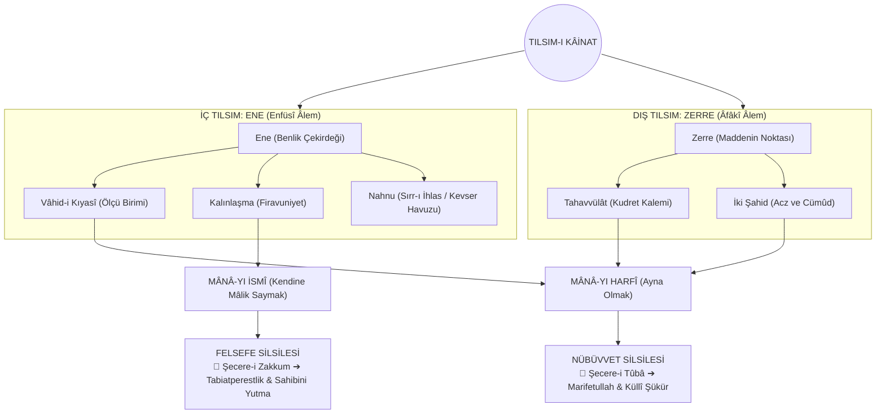

# 🌌 Tılsım-ı Kâinat: Ene, Zerre ve Varoluşun Şifreleri

> **بِسْمِ اللّٰهِ الرَّحْمٰنِ الرَّحٖيمِ**
> 
> *اِنَّا عَرَضْنَا الْاَمَانَةَ عَلَى السَّمٰوَاتِ وَالْاَرْضِ وَالْجِبَالِ فَاَبَيْنَ اَنْ يَحْمِلْنَهَا وَاَشْفَقْنَ مِنْهَا وَحَمَلَهَا الْاِنْسَانُ اِنَّهُ كَانَ ظَلُومًا جَهُولًا*
> 
> *"Ben göklere, yere ve dağlara emaneti arz ettim; onlar onu yüklenmekten çekindiler, ondan korktular. Onu insan yüklendi. Muhakkak ki o çok zâlim, çok câhildir."* (Ahzâb Sûresi, 72)

**Tılsım-ı Kâinat**, Risale-i Nur Külliyatı (bilhassa *30. Söz - Ene ve Zerre Risalesi*, *23. Söz*, *12. Söz*, *11. Söz*, *21. Lem'a - İhlas Risalesi*, *23. Lem'a - Tabiat Risalesi*, *26. Söz Zeyli* ve *Mesnevî-i Nuriye*) ekseninde; insanın varoluşsal çekirdeği olan **Ene (Benlik)** kavramını, kâinatın yapıtaşı olan **Zerre (Madde/Atom)** ile olan simetrik ilişkisini ve felsefe-vahiy çatışmasını inceleyen derinlikli bir ontoloji, tefekkür ve modelleme laboratuvarıdır.

Bu depo, kâinatın kilitli kapılarını açan o gizemli "Tılsım"ın şifrelerini, hem orijinal risale metinleri ve otantik lisanıyla şerh eder hem de analitik ve modern sistem teorisi yaklaşımıyla dökümante eder.

---

## 🧭 Tematik Okuma Haritası

| Sıra | Bölüm & Doküman | Eksen Risale | Temel Mesele ve Muhteva |
|:---:|:---|:---|:---|
| **01** | [**Vâhid-i Kıyasî ve Sırr-ı Hilkat**](docs/ene-ontolojisi/01-vahid-i-kiyasi.md) | *30. Söz, 1. Maksad* | Ene nedir? Mutlak sıfatlar farazî bir hat ile nasıl bilinir? Şemme Risalesi, ziya/zulmet misali. |
| **02** | [**Kalınlaşma, Firavuniyet ve Yutulma**](docs/ene-ontolojisi/02-kalinlasma-ve-firavuniyet.md) | *30. Söz & 12. Söz* | Hava gibi enenin 5 fazda buzlaşıp sahibini yutması, 12. Söz'den "firavun-u zelîl" tahlili. |
| **03** | [**Ene'den Nahnu'ya: İhlas ve Şahs-ı Manevî**](docs/ene-ontolojisi/03-eneden-nahnuya.md) | *21. Lem'a & 26. Söz Zeyli* | Buz parçasını kevser havuzunda eritmek, 1111/4444 sırrı, Sefine-i Rabbaniye hademeleri, Dört Hatve. |
| **04** | [**Tahavvülât-ı Zerrât ve Kudret Kalemi**](docs/zerre-dinamikleri/01-tahavvulat-i-zerrat.md) | *30. Söz, 2. Maksad* | Zerreler neden durmaksızın hareket eder? Mebdede Bismillah, hitâmda Elhamdülillah, Tevfik'in gözü. |
| **05** | [**Zerrenin İki Şahidi: Acz ve Cümûd**](docs/zerre-dinamikleri/02-zerrenin-iki-sahidi.md) | *30. Söz, 2. Nokta* | Zerre kimin ise, gezdiği bütün kâinat da Onundur! Vâcibü'l-Vücud'un vücud ve vahdetine şehadet. |
| **06** | [**Nübüvvet ve Felsefe: İki Silsile**](docs/nubuvvet-ve-felsefe.md) | *30. Söz & 12. Söz* | Şecere-i Tûbâ vs. Şecere-i Zakkum; Teşebbüh-ü bi'l-Vâcib eleştirisi; Gaye-i Hayal paradoksu. |
| **07** | [**Taallümle Tekâmül ve Dua Ubudiyeti**](docs/taallum-ve-tekamul.md) | *23. Söz & 11. Söz* | İnsan ile hayvanın farkı; Duygular terazileriyle küllî şükür; Kâinattan yükselen 4 nevi dua. |
| 📖 | [**Kavramlar Sözlüğü (Glossary)**](kavramlar-sozlugu/glossary.md) | *Tüm Külliyat* | 50'yi aşkın ıstılahın metin alıntıları ve etimolojisiyle şerhli lügati. |
| 🗺️ | [**Mermaid Diyagramları**](assets/diagrams/README.md) | *Kavramsal Şemalar* | Hâl değişimleri, geri besleme döngüleri ve Tılsım-ı Kâinat mimarisi. |

---

## 🏛️ Derinlemesine Kavramsal Şerhler ve Metin Alıntıları



---

### 🗝️ I. Ene'nin Mahiyeti: Âlemin Miftahı ve Vâhid-i Kıyasî

Bediüzzaman Said Nursî, 30. Söz'ün girişinde enenin kâinat sarayını açan muazzam anahtar olduğunu şöyle ilan eder:

> *"Ene, künûz-u mahfiye olan esmâ-i İlâhiyenin anahtarı olduğu gibi, kâinatın tılsım-ı muğlâkının dahi anahtarı olarak bir muammâ-yı müşkilküşâdır, bir tılsım-ı hayretfezâdır. O ene, mahiyetinin bilinmesiyle, o garip muammâ, o acip tılsım olan ene açılır ve kâinat tılsımını ve âlem-i vücubun künûzunu dahi açar.*
> 
> *Şu meseleye dair, **Şemme** isminde bir risale-i Arabiyemde şöyle bahsetmişiz ki: Âlemin miftahı insanın elindedir ve nefsine takılmıştır. Kâinat kapıları zâhiren açık görünürken, hakikaten kapalıdır. Cenâb-ı Hak, emanet cihetiyle, insana 'ene' namında öyle bir miftah vermiş ki, âlemin bütün kapılarını açar. Ve öyle tılsımlı bir enaniyet vermiş ki, Hallâk-ı Kâinatın künûz-u mahfiyesini onunla keşfeder."* (30. Söz, Mukaddime)

#### 1. Mutlak Sıfatların Bilinmesi İçin Vâhid-i Kıyasî İhtiyacı
Sonsuz ve hudutsuz olan bir hakikat, sınırlı bir şuur tarafından nasıl bilinebilir? Zıddı ve sınırı olmayan bir şey hissedilmez:

> *"Çünkü; mutlak ve muhît bir şeyin hududu ve nihâyeti olmadığı için, ona bir şekil verilmez ve üstüne bir suret ve bir taayyün vermek için hükmedilmez, mahiyeti ne olduğu anlaşılmaz. Meselâ: Zulmetsiz daimî bir ziya, bilinmez ve hissedilmez. Ne vakit hakikî veya vehmî bir karanlık ile bir hat çekilse, o vakit bilinir.*
> 
> *İşte, Cenâb-ı Hakkın, ilim ve kudret, Hakîm ve Rahîm gibi sıfât ve esmâsı muhit, hududsuz, şeriksiz olduğu için, onlara hükmedilmez ve ne oldukları bilinmez ve hissolunmaz. Öyle ise, hakikî nihayet ve hadleri olmadığından, **farazî ve vehmî bir haddi çizmek lâzım geliyor.** Onu da enaniyet yapar. Kendinde bir rububiyet-i mevhume, bir mâlikiyet, bir kudret, bir ilim tasavvur eder, bir had çizer, onunla muhit sıfatlara bir hadd-i mevhum vaz eder. 'Buraya kadar benim, ondan sonra Onundur' diye bir taksimat yapar..."* (30. Söz, Birinci Maksad)

#### 2. Hendesedeki Farazî Hatlar ve Kitaptan Bir Elif
Ene'nin hakiki, maddî ve müstakil bir vücudu yoktur; o yalnızca bir cetvel, bir kıyas aletidir:

> *"Sâni-i Hakîm, insanın eline, emanet olarak, rububiyetinin, sıfât ve şuûnâtının hakikatlerini gösterecek, tanıttıracak işârat ve nümuneleri câmi' bir ene vermiştir; tâ ki, o ene bir **vâhid-i kıyasî** olup, evsâf-ı Rububiyet ve şuûnât-ı Ulûhiyet bilinsin.*
> 
> *Fakat vâhid-i kıyasî, bir mevcud-u hakiki olmak lazım değil. Belki, **hendesedeki farazî hatlar gibi, farz ve tevehhümle bir vâhid-i kıyasî teşkil edilebilir.** İlim ve tahakkukla hakiki vücudu lazım değildir.*
> 
> *...Demek ene, âyine-misâl ve vâhid-i kıyasî ve âlet-i inkişaf ve mânâ-yı harfî gibi; mânâsı kendinde olmayan ve başkasının mânâsını gösteren, vücud-u insaniyetin kalın ipinden şuurlu bir tel ve mahiyet-i beşeriyenin hullesinden ince bir ip ve **şahsiyet-i âdemiyetin kitabından bir eliftir...**"* (30. Söz, Birinci Maksad)

---

### 🌪️ II. Ene'nin Beş Aşamalı Faz Değişimi ve Firavuniyet

Ene'nin fıtrî yapısı hava gibi hafif ve şeffaftır. Ancak felsefenin "mâna-yı ismî" (kendine mal etme) nazarıyla bakıldığında, adım adım katılaşır:

> *"Hem meslek-i felsefenin esasat-ı fâsidesindendir ki, **ene, kendi zâtında hava gibi zayıf bir mahiyeti olduğu halde,** felsefenin meş'um nazarı ile **mâna-yı ismî** cihetiyle baktığı için, güyâ buhar-misâl o ene **temeyyü'** edip, sonra ülfet cihetiyle ve maddiyata tevaggul sebebiyle güyâ **tasallûb** ediyor.*
> 
> *Sonra gaflet ve inkâr ile, o enâniyet **tecemmüd** eder. Sonra isyan ile **tekeddür** eder, şeffâfiyetini kaybeder. Sonra gittikçe kalınlaşıp **sahibini yutar.** Nev-i insanın efkârıyla şişer. Sonra sâir insanları, hattâ esbâbı kendine ve nefsine kıyas edip onlara –kabul etmedikleri ve teberrî ettikleri halde– birer firavunluk verir."* (30. Söz, Birinci Maksad)

```text
  [HAVA / BUHAR] ──(mâna-yı ismî)──> [TEMEYYÜ' / Sıvılaşma]
        │
        └──(ülfet & maddiyat)───────> [TASALLÜB / Katılaşma]
              │
              └──(gaflet & inkâr)───> [TECEMMÜD / Buzlaşma]
                    │
                    └──(isyan & günah)─> [TEKEDDÜR / Kararma] ──> [SAHİBİNİ YUTMA & FİRAVUNİYET]
```

#### Firavun-u Zelîl Portresi (12. Söz)
Kalınlaşan benlik dışarıdan heybetli görünse de, hakikatte sonsuz bir acizlik ve zillet içindedir:

> *"Felsefenin hâlis bir tilmizi, bir firavundur. Fakat, menfaati için en hasis şeye ibâdet eden **bir firavun-u zelîldir**; her menfaatli şeyi kendine rab tanır.*
> *Hem, o dinsiz şâkird, mütemerrid ve muanniddir. Fakat, bir lezzet için nihayet zilleti kabul eden miskin bir mütemerriddir...*
> *Hem, o dinsiz şâkird, cebbâr bir mağrurdur. Fakat, kalbinde nokta-i istinad bulmadığı için, zâtında gayet acz ile âciz **bir cebbâr-ı hodfüruştur**..."* (12. Söz, İkinci Esas)

---

### 🌊 III. Tedavi: Buz Parçasını Kevser Havuzunda Eritmek ve Şahs-ı Manevî

Katılaşan ve buz kesen benliğin çaresi, onu nefsin gurur güneşi altında çürütmek değil, cemaatin ihlas havuzuna atmaktır:

> *"Evet, bahtiyar odur ki, **kevser-i Kur’ânîden süzülen tatlı, büyük bir havuzu kazanmak için, bir buz parçası nev’indeki şahsiyetini ve enâniyetini o havuz içine atıp eritendir.** Yoksa o buz parçası erir, zayi olur; o havuzdan da istifade edilmez."* (21. Lem'a, İhlas Risalesi)

#### 1. İhlas Matematiği: Üç Eliften 111'e, Dört Eliften 4444'e
> *"Elbette dört ferdden bin yüz onbir kuvvet-i maneviyeyi temin eden sırr-ı ihlâsı kazanmak ile, tesanüd ve ittihad-ı hakikîye muhtacız ve mecburuz.*
> *Evet, üç elif ittihad etmezse, üç kıymeti var. Sırr-ı adediyet ile ittihad etse, **yüz on bir (111)** kıymet alır.*
> *Dört kere dört ayrı ayrı olsa, on altı kıymeti var. Eğer sırr-ı uhuvvet ve ittihad-ı maksat ve ittifak-ı vazife ile tevafuk edip bir çizgi üstünde omuz omuza verseler, o vakit **dört bin dört yüz kırk dört (4444)** kuvvetinde ve kıymetinde olduğu gibi, hakikî sırr-ı ihlâs ile, on altı fedakâr kardeşlerin kıymet ve kuvvet-i maneviyesi dört binden geçtiğine, pek çok vukuat-ı tarihiye şehadet ediyor."* (21. Lem'a)

#### 2. Sefine-i Rabbaniye Hademeleri
> *"İşte, ey Risale-i Nur şâkirtleri ve Kur’ân’ın hizmetkârları! Sizler ve bizler öyle bir **insân-ı kâmil ismine lâyık bir şahs-ı mânevînin âzâlarıyız**. Ve hayat-ı ebediye içindeki sâadet-i ebediyeyi netice veren **bir fabrikanın çarkları** hükmündeyiz. Ve **sâhil-i selâmet olan Dâr-üs Selâm’a Ümmet-i Muhammediyeyi (A.S.M.) çıkaran bir sefine-i Rabbaniyede çalışan hademeleriz.**"* (21. Lem'a)

#### 3. Dört Hatve (26. Söz Zeyli)
Kur'an'dan istihraç edilen en selametli ve kestirme tarîk:
1. **فَلاَ تُزَكُّوۤا اَنْفُسَكُمْ** *(Nefislerinizi temize çıkarmayın)* ➔ Aczini bilmek.
2. **وَلاَ تَكُونُوا كَالَّذِينَ نَسُوا اللّٰهَ فَاَنْسٰيهُمْ اَنْفُسَهُمْ** *(Allah'ı unutanlar gibi olmayın)* ➔ Menfaatte nefsini unutmak.
3. **مَاۤ اَصَابَكَ مِنْ حَسَنَةٍ فَمِنَ اللّٰهِ وَمَاۤ اَصَابَكَ مِنْ سَيِّئَةٍ فَمِنْ نَفْسِكَ** *(Güzellik Allah'tan, kusur nefsindendir)* ➔ Kemâli Hâlık'a vermek.
4. **كُلُّ شَىْءٍ هَاِلكٌ اِلاَّ وَجْهَهُ** *(O'nun veçhinden başka her şey helâk olucudur)* ➔ Mânâ-yı harfî ile bekāya ermek.

---

### ⚛️ IV. Zerre Dinamikleri: Kudret Kaleminin Tekvînî Âyetleri

Zerrelerin hareketi materyalistlerin sandığı gibi rastgele bir çalkantı değildir:

> *"Tahavvülât-ı zerrât; Nakkāş-ı Ezelî'nin **kalem-i kudreti**, kitâb-ı kâinâtta yazdığı **âyât-ı tekvîniyenin** hengâmındaki ihtizâzâtı ve cevelânıdır. Yoksa; maddiyûn ve tabîiyyûnların tevehhüm ettikleri gibi tesâdüf oyuncağı ve karışık, mânâsız bir hareket değildir.*
> 
> *Çünkü bütün mevcûdât gibi zerreler ve herbir zerre **mebde-i hareketinde 'Bismillâh' der**. Çünkü nihâyetsiz kuvvetinden fazla yükleri kaldırır ve buğday tanesi kadar bir çekirdeğin koca bir çam ağacı gibi bir yükü omzuna alması gibi…*
> 
> *Hem vazifesinin hitâmında **'Elhamdülillâh' der**. Çünkü bütün ukûlü hayrette bırakan hikmetli bir cemâl-i sanat, faydalı bir hüsn-ü nakş göstererek Sâni'-i Zülcelâl'in medâyihine bir kaside-i methiye gibi bir eser gösterir; meselâ: Nar ve mısıra dikkat et."* (30. Söz, İkinci Maksad)

#### 1. Zerrenin İki Şahid-i Sadıkı (İkinci Nokta)
> *"Herbir zerrede, Vâcibü’l-Vücudun vücuduna ve vahdetine iki şahid-i sadık vardır.*
> *Evet, zerre, **acz ve cümuduyla beraber**, şuurkârâne büyük vazifeleri yapmakla, büyük yükleri kaldırmakla **Vâcibü’l-Vücudun vücuduna kat’î şehadet ettiği gibi**;*
> *harekâtında nizamat-ı umumiyeye tevfik-i hareket edip, her girdiği yerde ona mahsus nizamatı müraat etmekle, her yerde kendi vatanı gibi yerleşmesiyle **Vâcibü’l-Vücudun vahdetine ve mülk ve melekûtun mâliki olan Zâtın ehadiyetine şehadet eder**.*
> ***Yani, zerre kimin ise, gezdiği bütün yerler de onundur.***"* (30. Söz, İkinci Maksad)

#### 2. Tevfik'in Gözbebeğindeki Zerre Misali (Üçüncü Nokta)
> *"Meselâ, Tevfik’in gözbebeğinde yerleşen zerre, gözün âsâb-ı muharrike ve hassâse ve şerâyin ve evride gibi damarlara karşı münasip vaziyet alması; ve yüzde ve sonra başta ve gövdede, daha sonra heyet-i mecmua-i insaniyede herbirisine karşı birer nisbeti, birer vazifesi, birer faydası kemâl-i hikmetle bulunması gösteriyor ki, **bütün o cismin bütün âzâsını icad eden bir Zât o zerreyi o yerde yerleştirebilir.**"* (30. Söz, Üçüncü Nokta)

---

### ⚔️ V. Nübüvvet vs. Felsefe: İki Medeniyet Muvazenesi

Düşünce tarihi iki zıt ağacın çatışmasıdır:

> *"İnsaniyetin gayetü’l-gayâtı teşebbüh-ü bi’l-Vâcibdir, yani Vâcibü’l-Vücuda benzemektir deyip firavunâne bir hüküm vermişler... Nübüvvet ise, gaye-i insaniyet ve vazife-i beşeriyet, **ahlâk-ı İlâhiye ile ve secâyâ-yı hasene ile tahallûk etmekle beraber, aczini bilip kudret-i İlâhiyeye iltica, zaafını görüp kuvvet-i İlâhiyeye istinad, fakrını görüp rahmet-i İlâhiyeye itimad, ihtiyacını görüp gınâ-yı İlâhiyeden istimdad, kusurunu görüp aff-ı İlâhîye istiğfar, naksını görüp kemâl-i İlâhîye tesbihhân olmaktır** diye, ubûdiyetkârâne hükmetmişler."* (30. Söz, Birinci Maksad)

| Mukayese Esası | Hikmet-i Felsefe (Maddeci Fikir) | Hikmet-i Kur’âniye (Vahiy Esasları) |
|:---|:---|:---|
| **Nokta-i İstinad** | **Kuvvet** *(Şe'ni tecavüzdür)* | **Hak** *(Şe'ni ittifak ve adalettir)* |
| **Hedef ve Gaye** | **Menfaat** *(Şe'ni boğuşmaktır)* | **Fazilet ve Rıza-i İlâhî** *(Şe'ni tesanüddür)* |
| **Düstur-u Hayat** | **Cidal** *(Şe'ni çarpışmaktır)* | **Teâvün** *(Şe'ni yardımlaşmaktır)* |
| **Cemaatlerin Bağı** | **Unsuriyet / Menfî Milliyet** *(Şe'ni başkasını yutmaktır)* | **Rabıta-i Diniye ve Vatanî** *(Şe'ni uhuvvettir)* |
| **Semeresi** | **Hevesatı Tatmin, İhtiyaçları Tezyid** | **Kemâlât-ı İnsaniye ve Saadet-i Dâreyn** |

#### Gaye-i Hayal Paradoksu (Hakikat Çekirdekleri, 41)
> **"Gaye-i hayâl olmazsa veyâhut nisyan veya tenâsî edilse; ezhân enelere dönüp, etrafında gezerler."**
> — **Mektubat & Lemeat**

---

### 🧬 VI. Taallümle Tekâmül ve Küllî Şükür

İnsan dünyaya bir hayvan gibi hazır gelmez; öğrenmek ve dua etmek için gönderilmiştir:

> *"Çünkü: Hayvan, dünyaya geldiği vakit, âdeta **başka bir âlemde tekemmül etmiş** gibi istîdâdına göre mükemmel olarak gelir; yani gönderilir... İnsanın yirmi senede kazandığı iktidâr-ı hayatiyeyi ve meleke-i ameliyeyi, **yirmi günde serçe ve arı gibi bir hayvan tahsil eder;** yani ona ilham olunur.*
> 
> *Demek ki, **insanın vazife-i fıtriyesi taallümle tekemmüldür, dua ile ubudiyettir.** Yani: 'Kimin merhametiyle böyle hakîmane idare olunuyorum? Kimin keremiyle böyle müşfikane terbiye olunuyorum?' deyip... **Kādıyü'l-Hâcât'a lisan-ı acz ve fakr ile yalvarmaktır ve istemektir ve dua etmektir; yani aczin ve fakrın cenahlarıyla makam-ı a'lâ-yı ubudiyete uçmaktır.**"* (23. Söz, Dördüncü Nokta)

#### Duygular Terazileriyle Küllî Şükür (11. Söz)
> *"Senin vücudunda konulan **duygular terazileriyle rahmet-i İlahiyenin hazinelerinde iddihar edilen nimetleri tartmaktır ve küllî şükretmektir.**"* (11. Söz)

#### Kâinattan Yükselen Dört Nevi Dua (23. Söz, Beşinci Nokta)
1. **Lisan-ı İstidad ile Dua:** Tohumların sümbüllenmek istemesi.
2. **İhtiyac-ı Fıtrî ile Dua:** Canlıların iktidarları dışındaki rızık ve hayat talebi.
3. **Lisan-ı Izdırar ile Dua:** Muztar kalan her çaresizin kat'î ilticası.
4. **Lisan-ı Kāl ile Dua:** İnsanın şuur ve söz ile aczini Kādıyü'l-Hâcât'a arz etmesi.

---

## 🧪 Simülasyon: Ene Kalınlaşma Dinamiği (Experimental Model)

Otuzuncu Söz'ün Birinci Maksadındaki dönüşüm, diferansiyel sistemle modellenmiştir:

$$\frac{dK}{dt} = a \cdot \text{tekâsüf} \cdot (1 - H + e)(K + e)(1 - K) - b \cdot \text{tasfiye} \cdot H \cdot K$$

$$\frac{dH}{dt} = c \cdot \text{tasfiye} \cdot (1 - H) - d \cdot \text{tekâsüf} \cdot K \cdot H$$

```bash
# Tüm hazır senaryoları karşılaştır:
python simulations/ene-thickening-model.py --karsilastir

# Tevbe senaryosunu incele:
python simulations/ene-thickening-model.py --senaryo tevbe

# Birim testlerini çalıştır:
python -m unittest discover -s simulations -p "test_*.py" -v
```

```text
Senaryo     Tekâsüf  Tasfiye  Nihai K  Yutulma t  Mertebe
------------------------------------------------------------------------
fitrat         0.38     0.37    0.000          —  Hava gibi şeffaf
firavun        0.91     0.01    1.000       5.10  Yutulma
gafil          0.54     0.16    0.925      20.60  Yutulma
tevbe          0.15     0.80    0.000          —  Hava gibi şeffaf
salik          0.06     0.90    0.000          —  Hava gibi şeffaf
filozof        0.59     0.11    0.970      11.85  Yutulma
```

> [!CAUTION]
> Simülasyon bir **tefekkür aracıdır**; manevî hakikatlerin sayılarla ölçülebileceği iddiasını taşımaz, kavramsal tesirleri modellemek için bir metafordur.

---

## 📂 Depo Mimarisi

```text
tilsim-i-kainat/
├── README.md                              # Ana manifesto, okuma haritası, alıntılar ve özet
├── CONTRIBUTING.md                        # Katkı ilkeleri ve rehber
├── docs/
│   ├── ene-ontolojisi/                    # 30. Söz – Birinci Maksad
│   │   ├── README.md                      #   Okuma haritası ve mukaddime
│   │   ├── 01-vahid-i-kiyasi.md           #   Vâhid-i kıyasî, farazî hat, iki vecih
│   │   ├── 02-kalinlasma-ve-firavuniyet.md#   Temeyyü', tasallüb, tecemmüd, tekeddür
│   │   └── 03-eneden-nahnuya.md           #   İhlas, buz parçası, 1111 sırrı, 4 hatve
│   ├── zerre-dinamikleri/                 # 30. Söz – İkinci Maksad
│   │   ├── README.md                      #   Ene ↔ Zerre simetrisi
│   │   ├── 01-tahavvulat-i-zerrat.md      #   Kudret kalemi, sühulet kanunu, Tevfik'in gözü
│   │   └── 02-zerrenin-iki-sahidi.md      #   Acz, cümûd ve umumî nizama tevfik
│   ├── nubuvvet-ve-felsefe.md             # İki silsile, Tûbâ vs. Zakkum (12. & 30. Söz)
│   └── taallum-ve-tekamul.md              # 23. & 11. Söz: Duygular mizanı, 4 nevi dua
├── kavramlar-sozlugu/
│   └── glossary.md                        # 50+ ıstılahın şerhli ve alıntılı lügati
├── assets/
│   └── diagrams/                          # Mermaid kaynak dosyaları ve rehber
├── simulations/                           # Dinamik sistem simülasyonu
│   ├── README.md                          # Matematiksel denklemler ve kullanım
│   ├── ene-thickening-model.py            # Çekirdek Python simülasyonu
│   └── test_ene_model.py                  # 9 adet birim testi (Unit Tests)
└── .github/workflows/tests.yml            # CI: Otomatik test koşumu
```

---

> *"İnsan bir yolcudur. Sabavetten gençliğe, gençlikten ihtiyarlığa, ihtiyarlıktan kabre, kabirden haşre, haşirden ebed memleketine giden bir yolcudur."* (Mesnevî-i Nuriye)
