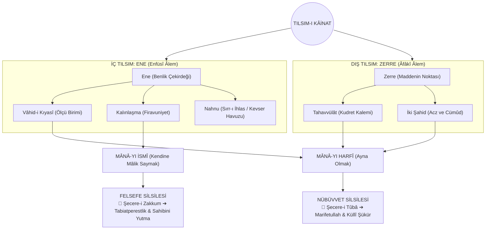

# 🌌 Tılsım-ı Kâinat: Ene, Zerre ve Varoluşun Şifreleri

> **بِسْمِ اللّٰهِ الرَّحْمٰنِ الرَّحٖيمِ**
> 
> *اِنَّا عَرَضْنَا الْاَمَانَةَ عَلَى السَّمٰوَاتِ وَالْاَرْضِ وَالْجِبَالِ فَاَبَيْنَ اَنْ يَحْمِلْنَهَا وَاَشْفَقْنَ مِنْهَا وَحَمَلَهَا الْاِنْسَانُ اِنَّهُ كَانَ ظَلُومًا جَهُولًا*
> 
> *"Ben göklere, yere ve dağlara emaneti arz ettim; onlar onu yüklenmekten çekindiler, ondan korktular. Onu insan yüklendi. Muhakkak ki o çok zâlim, çok câhildir."* (Ahzâb Sûresi, 72)

**Tılsım-ı Kâinat**, Risale-i Nur Külliyatı (bilhassa *30. Söz - Ene ve Zerre Risalesi*, *23. Söz*, *12. Söz*, *11. Söz*, *10. Söz - Haşir*, *21. Lem'a - İhlas Risalesi*, *23. Lem'a - Tabiat Risalesi*, *26. Söz - Kader* ve *Mesnevî-i Nuriye*) ekseninde; insanın varoluşsal çekirdeği olan **Ene (Benlik)** kavramını, kâinatın yapıtaşı olan **Zerre (Madde/Atom)** ile olan simetrik ilişkisini ve felsefe-vahiy çatışmasını inceleyen derinlikli bir ontoloji, tefekkür ve modelleme laboratuvarıdır.

Bu depo, kâinatın kilitli kapılarını açan o gizemli "Tılsım"ın şifrelerini, hem orijinal risale metinleri ve otantik lisanıyla şerh eder hem de analitik ve modern sistem teorisi yaklaşımıyla dökümante eder.

---

## 🧭 Tematik Okuma Haritası

| Sıra | Bölüm & Doküman | Eksen Risale | Temel Mesele ve Muhteva |
|:---:|:---|:---|:---|
| 🌟 | [**Tılsım-ı Kâinat'ın Büyük Çözümü**](docs/tilsim-i-kainat-kullî-cozum.md) | *9 Cephenin İcmali* | **Varoluş Muamması'nın Küllî Çözümü:** 9 Araştırma Cephesinden Ene, Zerre ve Kâinat formülü. |
| **01** | [**Vâhid-i Kıyasî ve Sırr-ı Hilkat**](docs/ene-ontolojisi/01-vahid-i-kiyasi.md) | *30. Söz, 1. Maksad* | Ene nedir? Mutlak sıfatlar farazî bir hat ile nasıl bilinir? Şemme Risalesi, ziya/zulmet misali. |
| **02** | [**Kalınlaşma, Firavuniyet ve Yutulma**](docs/ene-ontolojisi/02-kalinlasma-ve-firavuniyet.md) | *30. Söz & 12. Söz* | Hava gibi enenin 5 fazda buzlaşıp sahibini yutması, 12. Söz'den "firavun-u zelîl" tahlili. |
| **03** | [**Ene'den Nahnu'ya: İhlas ve Şahs-ı Manevî**](docs/ene-ontolojisi/03-eneden-nahnuya.md) | *21. Lem'a & 26. Söz Zeyli* | Buz parçasını kevser havuzunda eritmek, 1111/4444 sırrı, Sefine-i Rabbaniye hademeleri, Dört Hatve. |
| **04** | [**Tahavvülât-ı Zerrât ve Kudret Kalemi**](docs/zerre-dinamikleri/01-tahavvulat-i-zerrat.md) | *30. Söz, 2. Maksad* | Zerreler neden durmaksızın hareket eder? Mebdede Bismillah, hitâmda Elhamdülillah, Tevfik'in gözü. |
| **05** | [**Zerrenin İki Şahidi: Acz ve Cümûd**](docs/zerre-dinamikleri/02-zerrenin-iki-sahidi.md) | *30. Söz, 2. Nokta* | Zerre kimin ise, gezdiği bütün kâinat da Onundur! Vâcibü'l-Vücud'un vücud ve vahdetine şehadet. |
| **06** | [**Nübüvvet ve Felsefe: İki Silsile**](docs/nubuvvet-ve-felsefe.md) | *30. Söz & 12. Söz* | Şecere-i Tûbâ vs. Şecere-i Zakkum; Teşebbüh-ü bi'l-Vâcib eleştirisi; Gaye-i Hayal paradoksu. |
| **07** | [**Taallümle Tekâmül ve Dua Ubudiyeti**](docs/taallum-ve-tekamul.md) | *23. Söz & 11. Söz* | İnsan ile hayvanın farkı; Duygular terazileriyle küllî şükür; Kâinattan yükselen 4 nevi dua. |
| **08** | [**Kâinat Sarayı ve Üç Büyük Sual**](docs/kainat-sarayi-ve-uc-sual.md) | *11. Söz* | Necisin? Nereden geliyorsun? Nereye gidiyorsun? Sultan-ı Ezelî'nin sergisi, 9 küllî insanî vazife. |
| **09** | [**Tabiat ve Esbap Eleştirisi**](docs/tabiat-ve-esbab-elestirisi.md) | *23. Lem'a (Tabiat)* | Evcedethü'l-esbâb, Teşekkele binefsihî, İktezathü't-tabiat bâtıllarının 9 muhalle çürütülmesi. |
| **10** | [**Kader ve İrade Tılsımı**](docs/kader-ve-irade-tilsimi.md) | *26. Söz (Kader)* | Ene'nin gurur ve yeis dengesi: Hasenat Allah'tan Kadere şükürle, seyyiat nefisten istiğfarla. |
| **11** | [**Haşir ve Ebediyet Tılsımı**](docs/hasir-ve-ebediyet-tilsimi.md) | *10. Söz (Haşir)* | Kâinat tılsımının nihai mührü: Âhiret ve dâr-ı bekā olmadan kâinattaki hikmet ve adaletin izahı muhaldir. |
| 📖 | [**Kavramlar Sözlüğü (Glossary)**](kavramlar-sozlugu/glossary.md) | *Tüm Külliyat* | 100'e yakın ıstılahın metin alıntıları ve etimolojisiyle şerhli lügati. |
| 🗺️ | [**Mermaid Diyagramları**](assets/diagrams/README.md) | *Kavramsal Şemalar* | 7 adet mimari akış şeması (Hâl değişimleri, 3 Sual, Tabiat Muhalleri, Zerre Seyahati, İhlas). |

---

## 🏛️ Derinlemesine Kavramsal Şerhler ve Metin Alıntıları



---

### 🗝️ I. Ene'nin Mahiyeti: Âlemin Miftahı ve Vâhid-i Kıyasî

Bediüzzaman Said Nursî, 30. Söz'ün girişinde enenin kâinat sarayını açan muazzam anahtar olduğunu şöyle ilan eder:

> *"Ene, künûz-u mahfiye olan esmâ-i İlâhiyenin anahtarı olduğu gibi, kâinatın tılsım-ı muğlâkının dahi anahtarı olarak bir muammâ-yı müşkilküşâdır, bir tılsım-ı hayretfezâdır. O ene, mahiyetinin bilinmesiyle, o garip muammâ, o acip tılsım olan ene açılır ve kâinat tılsımını ve âlem-i vücubun künûzunu dahi açar.*
> 
> *Şu meseleye dair, **Şemme** isminde bir risale-i Arabiyemde şöyle bahsetmişiz ki: Âlemin miftahı insanın elindedir ve nefsine takılmıştır. Kâinat kapıları zâhiren açık görünürken, hakikaten kapalıdır. Cenâb-ı Hak, emanet cihetiyle, insana 'ene' namında öyle bir miftah vermiş ki, âlemin bütün kapılarını açar. Ve öyle tılsımlı bir enaniyet vermiş ki, Hallâk-ı Kâinatın künûz-u mahfiyesini onunla keşfeder."* (30. Söz, Mukaddime)

---

### 🌪️ II. Ene'nin Beş Aşamalı Faz Değişimi ve Firavuniyet

Ene'nin fıtrî yapısı hava gibi hafif ve şeffaftır. Ancak felsefenin "mâna-yı ismî" (kendine mal etme) nazarıyla bakıldığında, adım adım katılaşır:

```text
  [HAVA / BUHAR] ──(mâna-yı ismî)──> [TEMEYYÜ' / Sıvılaşma]
        │
        └──(ülfet & maddiyat)───────> [TASALLÜB / Katılaşma]
              │
              └──(gaflet & inkâr)───> [TECEMMÜD / Buzlaşma]
                    │
                    └──(isyan & günah)─> [TEKEDDÜR / Kararma] ──> [SAHİBİNİ YUTMA & FİRAVUNİYET]
```

---

### 🌊 III. İhlas Sinerjisi ve Şahs-ı Manevî: 111'den 4444'e

> *"Elbette dört ferdden bin yüz onbir kuvvet-i maneviyeyi temin eden sırr-ı ihlâsı kazanmak ile, tesanüd ve ittihad-ı hakikîye muhtacız ve mecburuz.*
> *Evet, üç elif ittihad etmezse, üç kıymeti var. Sırr-ı adediyet ile ittihad etse, **yüz on bir (111)** kıymet alır.*
> *Dört kere dört ayrı ayrı olsa, on altı kıymeti var. Eğer sırr-ı uhuvvet ve ittihad-ı maksat ve ittifak-ı vazife ile tevafuk edip bir çizgi üstünde omuz omuza verseler, o vakit **dört bin dört yüz kırk dört (4444)** kuvvetinde ve kıymetinde olduğu gibi..."* (21. Lem'a)

---

### ⚛️ IV. Zerre Dinamikleri: Kudret Kaleminin Tekvînî Âyetleri

> *"Tahavvülât-ı zerrât; Nakkāş-ı Ezelî'nin **kalem-i kudreti**, kitâb-ı kâinâtta yazdığı **âyât-ı tekvîniyenin** hengâmındaki ihtizâzâtı ve cevelânıdır... Çünkü bütün mevcûdât gibi zerreler ve herbir zerre **mebde-i hareketinde 'Bismillâh' der**... Vazifesinin hitâmında **'Elhamdülillâh' der**."* (30. Söz, İkinci Maksad)

* **Vücud Şehadeti:** Acz ve cümûdu ile (şuursuzken hadsiz yükleri omuzlayarak) Hâlık'ın vücudunu ispat eder.
* **Vahdet Şehadeti:** Umumî nizama intibakı ile (Tevfik'in gözbebeğinde damarlara, yüze, bedene tam uyum sağlayarak) Sâni'in vahdetini ve ehadiyetini ilan eder: *"Zerre kimin ise, gezdiği bütün kâinat da Onundur!"*

---

## 🧪 Simülasyon Laboratuvarı: Üç Matematiksel Model

Proje kapsamında Risale-i Nur'un ontolojik kavramlarını canlandıran **3 dinamik simülasyon motoru** ve **21 birim testi** yer alır.

```bash
# Tüm modelleri tek komutla çalıştır:
python simulations/run_all.py

# Birim testlerini çalıştır (21 test):
python -m unittest discover -s simulations -p "test_*.py" -v
```

### 1. Ene Kalınlaşma Modeli (`ene-thickening-model.py`)
```bash
python simulations/ene-thickening-model.py --karsilastir
```
$$\frac{dK}{dt} = a \cdot \text{tekâsüf} \cdot (1 - H + e)(K + e)(1 - K) - b \cdot \text{tasfiye} \cdot H \cdot K$$

### 2. Tahavvülât-ı Zerrât Simülasyonu (`zerre-simulation.py`)
```bash
python simulations/zerre-simulation.py --senaryo tevfikin_gozu
```
Zerratın mebdeden (Bismillah) hitâma (Elhamdülillah) seyahati, intizam oranı ve Vücud/Vahdet şehadet skorları.

### 3. İhlas ve Şahs-ı Manevî Sinerji Modeli (`ihlas-synergy-model.py`)
```bash
python simulations/ihlas-synergy-model.py --senaryo dort_elif
```
Enaniyet buzunun kevser havuzunda erimesi ve 4 ferdin 4444 manevî kuvvetine yükselişi.

---

## 📂 Depo Mimarisi

```text
tilsim-i-kainat/
├── README.md                              # Ana manifesto, okuma haritası ve külliyat şerhleri
├── CONTRIBUTING.md                        # Katkı ilkeleri ve rehber
├── docs/
│   ├── tilsim-i-kainat-kullî-cozum.md    # 9 Cepheden Varoluşun Büyük Çözüm Manifestosu
│   ├── ene-ontolojisi/                    # 30. Söz – Birinci Maksad
│   │   ├── README.md                      #   Okuma haritası ve mukaddime
│   │   ├── 01-vahid-i-kiyasi.md           #   Vâhid-i kıyasî, farazî hat, iki vecih
│   │   ├── 02-kalinlasma-ve-firavuniyet.md#   Temeyyü', tasallüb, tecemmüd, tekeddür
│   │   └── 03-eneden-nahnuya.md           #   İhlas, buz parçası, 1111 sırrı, 4 hatve
│   ├── zerre-dinamikleri/                 # 30. Söz – İkinci Maksad
│   │   ├── README.md                      #   Ene ↔ Zerre simetrisi
│   │   ├── 01-tahavvulat-i-zerrat.md      #   Kudret kalemi, sühulet kanunu, Tevfik'in gözü
│   │   └── 02-zerrenin-iki-sahidi.md      #   Acz, cümûd ve umumî nizama tevfik
│   ├── nubuvvet-ve-felsefe.md             # İki silsile, Tûbâ vs. Zakkum (12. & 30. Söz)
│   ├── taallum-ve-tekamul.md              # 23. & 11. Söz: Duygular mizanı, 4 nevi dua
│   ├── kainat-sarayi-ve-uc-sual.md        # 11. Söz: Necisin? Nereden? Nereye? (9 vazife)
│   ├── tabiat-ve-esbab-elestirisi.md      # 23. Lem'a: 4 ihtimal, 9 muhal ve Tevhid
│   ├── kader-ve-irade-tilsimi.md          # 26. Söz: Ene'nin gurur ve yeis muvazenesi
│   └── hasir-ve-ebediyet-tilsimi.md       # 10. Söz: Âhiret ve kâinat tılsımının son mührü
├── kavramlar-sozlugu/
│   └── glossary.md                        # 100'e yakın ıstılahın şerhli lügati
├── assets/
│   └── diagrams/                          # 7 adet Mermaid şeması ve kılavuz
├── simulations/                           # Dinamik sistem simülasyonları
│   ├── README.md                          # Matematiksel denklemler ve kullanım kılavuzu
│   ├── run_all.py                         # Üç modeli tek seferde icra eden çalıştırıcı
│   ├── ene-thickening-model.py            # Ene faz değişimi simülasyonu
│   ├── zerre-simulation.py                # Zerre tahavvülâtı ve kudret kalemi simülasyonu
│   ├── ihlas-synergy-model.py             # İhlas ve şahs-ı manevî sinerji modeli
│   ├── test_ene_model.py                  # 9 birim testi
│   ├── test_zerre_model.py                # 6 birim testi
│   └── test_ihlas_model.py                # 6 birim testi
└── .github/workflows/tests.yml            # CI: 4 farklı Python sürümünde 21 testin koşumu
```

---

> *"İnsan bir yolcudur. Sabavetten gençliğe, gençlikten ihtiyarlığa, ihtiyarlıktan kabre, kabirden haşre, haşirden ebed memleketine giden bir yolcudur."* (Mesnevî-i Nuriye)
