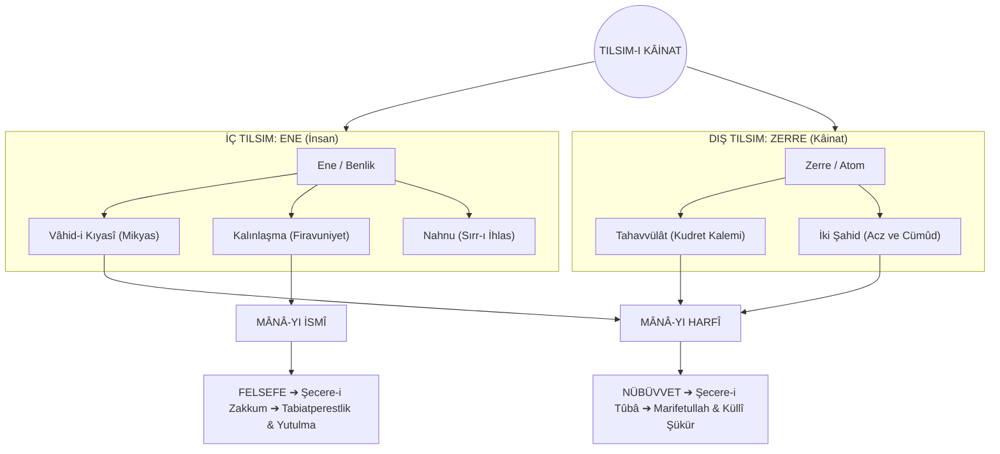

# 🌌 Tılsım-ı Kâinat: Ene, Zerre ve Varoluşun Şifreleri

> *"Ben göklere, yere ve dağlara emaneti arz ettim; onlar onu yüklenmekten çekindiler, ondan korktular. Onu insan yüklendi..."* (Ahzâb, 72)

**Tılsım-ı Kâinat**, Risale-i Nur Külliyatı (bilhassa *30. Söz - Ene ve Zerre Risalesi*, *23. Söz*, *12. Söz*, *11. Söz*, *21. Lem'a - İhlas Risalesi* ve *Mesnevî-i Nuriye*) ekseninde; insanın varoluşsal çekirdeği olan **Ene (Benlik)** kavramını, kâinatın yapıtaşı olan **Zerre (Madde/Atom)** ile olan simetrik ilişkisini ve felsefe-vahiy çatışmasını inceleyen derinlikli bir ontoloji, tefekkür ve modelleme laboratuvarıdır.

Bu depo, kâinatın kilitli kapılarını açan o gizemli "Tılsım"ın şifrelerini, hem orijinal risale metinleri ve otantik ıstılahlarla şerh eder hem de analitik ve modern sistem teorisi yaklaşımıyla dökümante eder.

---

## 🧭 Tematik Okuma Haritası

| Sıra | Bölüm & Doküman | Eksen Risale | Temel Mesele |
|:---:|:---|:---|:---|
| **01** | [**Vâhid-i Kıyasî ve Sırr-ı Hilkat**](docs/ene-ontolojisi/01-vahid-i-kiyasi.md) | *30. Söz, 1. Maksad* | Ene nedir? Mutlak sıfatlar farazî bir hat ile nasıl bilinir? |
| **02** | [**Kalınlaşma, Firavuniyet ve Yutulma**](docs/ene-ontolojisi/02-kalinlasma-ve-firavuniyet.md) | *30. Söz & 12. Söz* | Hava gibi enenin 5 fazda buzlaşıp sahibini yutması ve "firavun-u zelîl". |
| **03** | [**Ene'den Nahnu'ya: İhlas ve Şahs-ı Manevî**](docs/ene-ontolojisi/03-eneden-nahnuya.md) | *21. Lem'a & 26. Söz Zeyli* | Buz parçasını kevser havuzunda eritmek, 1111 sırrı, Acz ve Fakr tariki. |
| **04** | [**Tahavvülât-ı Zerrât ve Kudret Kalemi**](docs/zerre-dinamikleri/01-tahavvulat-i-zerrat.md) | *30. Söz, 2. Maksad* | Zerreler neden durmaksızın hareket eder? Tevfik'in gözbebeğindeki zerre. |
| **05** | [**Zerrenin İki Şahidi: Acz ve Cümûd**](docs/zerre-dinamikleri/02-zerrenin-iki-sahidi.md) | *30. Söz, 2. Nokta* | Zerre kimin ise, gezdiği bütün kâinat da Onundur! Vahdet şehadeti. |
| **06** | [**Nübüvvet ve Felsefe: İki Silsile**](docs/nubuvvet-ve-felsefe.md) | *30. Söz & 12. Söz* | Şecere-i Tûbâ vs. Şecere-i Zakkum; Gaye-i Hayal paradoksu; Medeniyet muvazenesi. |
| **07** | [**Taallümle Tekâmül ve Dua Ubudiyeti**](docs/taallum-ve-tekamul.md) | *23. Söz & 11. Söz* | İnsan ile hayvanın farkı; Duygular terazileriyle küllî şükür; 4 nevi dua. |
| 📖 | [**Kavramlar Sözlüğü (Glossary)**](kavramlar-sozlugu/glossary.md) | *Tüm Külliyat* | 50'yi aşkın ıstılahın metin alıntılarıyla şerhli lügati. |
| 🗺️ | [**Mermaid Diyagramları**](assets/diagrams/README.md) | *Kavramsal Şemalar* | Hâl değişimleri, geri besleme döngüleri ve kâinat haritası. |

---

## 🏛️ Ana Hakikatlerin Özeti



### 1. Ene: Âlemin Miftahı ve Vâhid-i Kıyasî
Mutlak ve muhît olan sıfatlar (İlahî ilim, kudret, mâlikiyet) sınırsız olduğu için doğrudan idrak edilemez. Zulmetsiz daimî bir ziya bilinmediği gibi, mutlak nur da bir hat çekilmeden anlaşılamaz. İnsana verilen "Ene", hendesedeki farazî hatlar gibi bir **vâhid-i kıyasî (ölçü birimi)**dir. İnsan kendi cüz'î hanesindeki tasarrufuyla Kâinat Sâni'inin mutlak tasarrufunu anlar.

### 2. Ene'nin Beş Fazda Kalınlaşması
Zâtında hava ve buhar gibi şeffaf olan ene; felsefenin mâna-yı ismî nazarıyla baktığında **temeyyü'** eder (sıvılaşır), ülfet ve maddeye dalmakla **tasallüb** eder (katılaşır), gaflet ve inkâr ile **tecemmüd** eder (donar, buzlaşır), isyan ile **tekeddür** eder (şeffafiyetini kaybeder) ve nihayetinde kalınlaşıp sahibini yutar!

### 3. Zerre: Kudret Kaleminin Tekvînî Âyetleri
Zerrelerin tahavvülâtı, kör tesadüf oyuncağı değildir; Nakkaş-ı Ezelî'nin kâinat kitabına yazdığı tekvînî âyetlerin yazılışındaki titreşim ve cevelandır. Her zerre işe başlarken aczinden fazla yükleri omuzlayarak **"Bismillah"**, işi tamamlayıp harika bir sanat neticesi verirken **"Elhamdülillah"** der.

### 4. Buz Parçasını Havuzda Eritmek
Kalınlaşan enenin yegâne kurtuluşu, benlik buzunu güneşte zayi etmeyip **Kevser-i Kur'ânî havuzunda** eritmektir. Dört ferdin ihlas ile bir araya gelmesi $1+1+1+1=4$ değil, yan yana gelip sırr-ı adediyet ile **1111 ve 4444** kuvvetini doğurur.

---

## 🧪 Simülasyon: Ene Kalınlaşma Dinamiği (Experimental Model)

Otuzuncu Söz'ün Birinci Maksadındaki dönüşüm, diferansiyel sistemle modellenmiştir:

$$\frac{dK}{dt} = a \cdot \text{tekâsüf} \cdot (1 - H + e)(K + e)(1 - K) - b \cdot \text{tasfiye} \cdot H \cdot K$$

$$\frac{dH}{dt} = c \cdot \text{tasfiye} \cdot (1 - H) - d \cdot \text{tekâsüf} \cdot K \cdot H$$

```bash
# Tüm hazır senaryoları karşılaştır:
python simulations/ene-thickening-model.py --karsilastir

# Tevbe senaryosunu incele:
python simulations/ene-thickening-model.py --senaryo tevbe

# Birim testlerini çalıştır:
python -m unittest discover -s simulations -p "test_*.py" -v
```

```text
Senaryo     Tekâsüf  Tasfiye  Nihai K  Yutulma t  Mertebe
------------------------------------------------------------------------
fitrat         0.38     0.37    0.000          —  Hava gibi şeffaf
firavun        0.91     0.01    1.000       5.10  Yutulma
gafil          0.54     0.16    0.925      20.60  Yutulma
tevbe          0.15     0.80    0.000          —  Hava gibi şeffaf
salik          0.06     0.90    0.000          —  Hava gibi şeffaf
filozof        0.59     0.11    0.970      11.85  Yutulma
```

> [!CAUTION]
> Simülasyon bir **tefekkür aracıdır**; manevî hakikatlerin sayılarla ölçülebileceği iddiasını taşımaz, kavramsal tesirleri modellemek için bir metafordur.

---

## 📂 Depo Mimarisi

```text
tilsim-i-kainat/
├── README.md                              # Ana manifesto, okuma haritası ve özet
├── CONTRIBUTING.md                        # Katkı ilkeleri ve rehber
├── docs/
│   ├── ene-ontolojisi/                    # 30. Söz – Birinci Maksad
│   │   ├── README.md                      #   Okuma haritası ve mukaddime
│   │   ├── 01-vahid-i-kiyasi.md           #   Vâhid-i kıyasî, farazî hat, iki vecih
│   │   ├── 02-kalinlasma-ve-firavuniyet.md#   Temeyyü', tasallüb, tecemmüd, tekeddür
│   │   └── 03-eneden-nahnuya.md           #   İhlas, buz parçası, 1111 sırrı, 4 hatve
│   ├── zerre-dinamikleri/                 # 30. Söz – İkinci Maksad
│   │   ├── README.md                      #   Ene ↔ Zerre simetrisi
│   │   ├── 01-tahavvulat-i-zerrat.md      #   Kudret kalemi, sühulet kanunu, Tevfik'in gözü
│   │   └── 02-zerrenin-iki-sahidi.md      #   Acz, cümûd ve umumî nizama tevfik
│   ├── nubuvvet-ve-felsefe.md             # İki silsile, Tûbâ vs. Zakkum (12. & 30. Söz)
│   └── taallum-ve-tekamul.md              # 23. & 11. Söz: Duygular mizanı, 4 nevi dua
├── kavramlar-sozlugu/
│   └── glossary.md                        # 50+ ıstılahın şerhli ve alıntılı lügati
├── assets/
│   └── diagrams/                          # Mermaid kaynak dosyaları ve rehber
├── simulations/                           # Dinamik sistem simülasyonu
│   ├── README.md                          # Matematiksel denklemler ve kullanım
│   ├── ene-thickening-model.py            # Çekirdek Python simülasyonu
│   └── test_ene_model.py                  # 9 adet birim testi (Unit Tests)
└── .github/workflows/tests.yml            # CI: Otomatik test koşumu
```

---

> *"İnsan bir yolcudur. Sabavetten gençliğe, gençlikten ihtiyarlığa, ihtiyarlıktan kabre, kabirden haşre, haşirden ebed memleketine giden bir yolcudur."*
