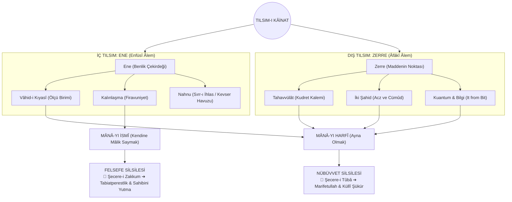
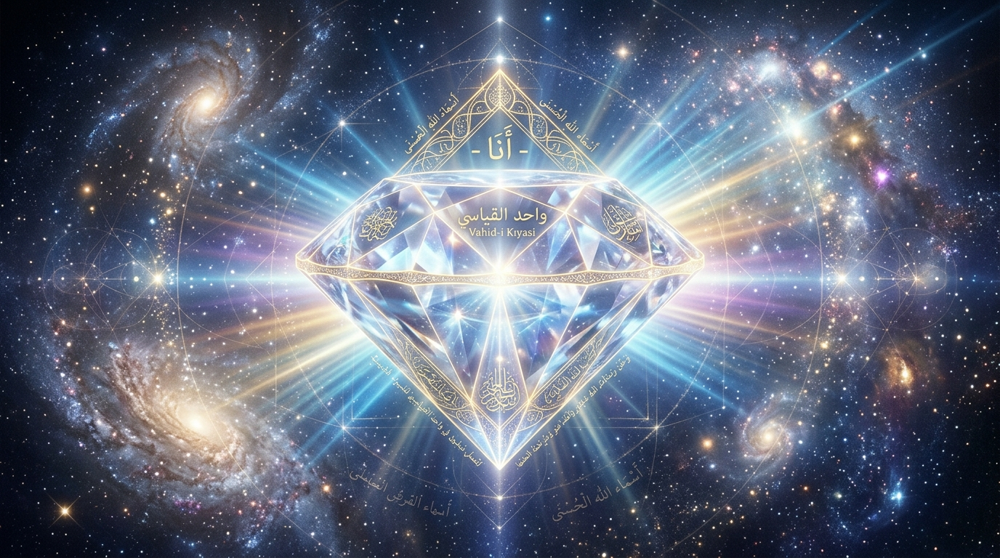
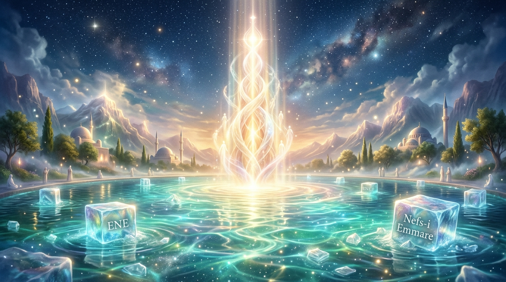
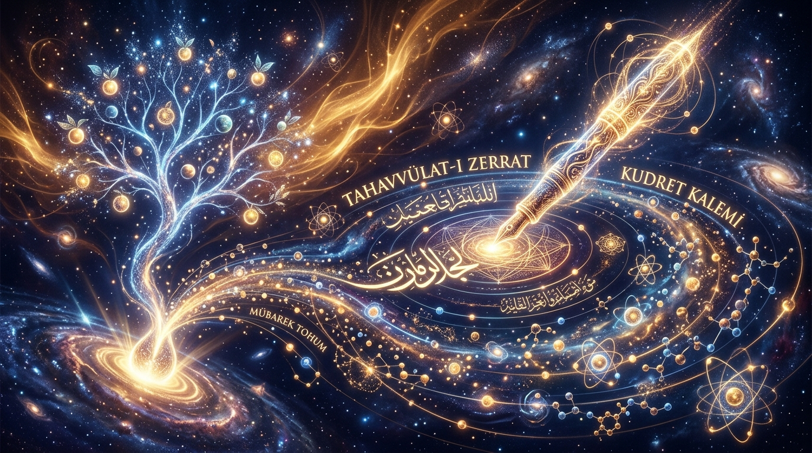
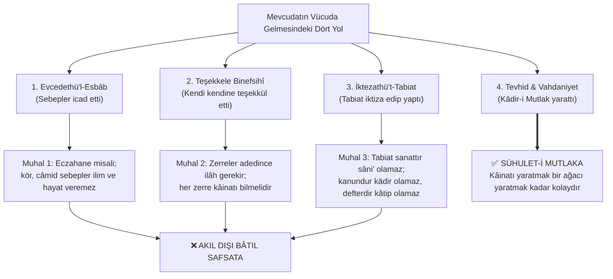
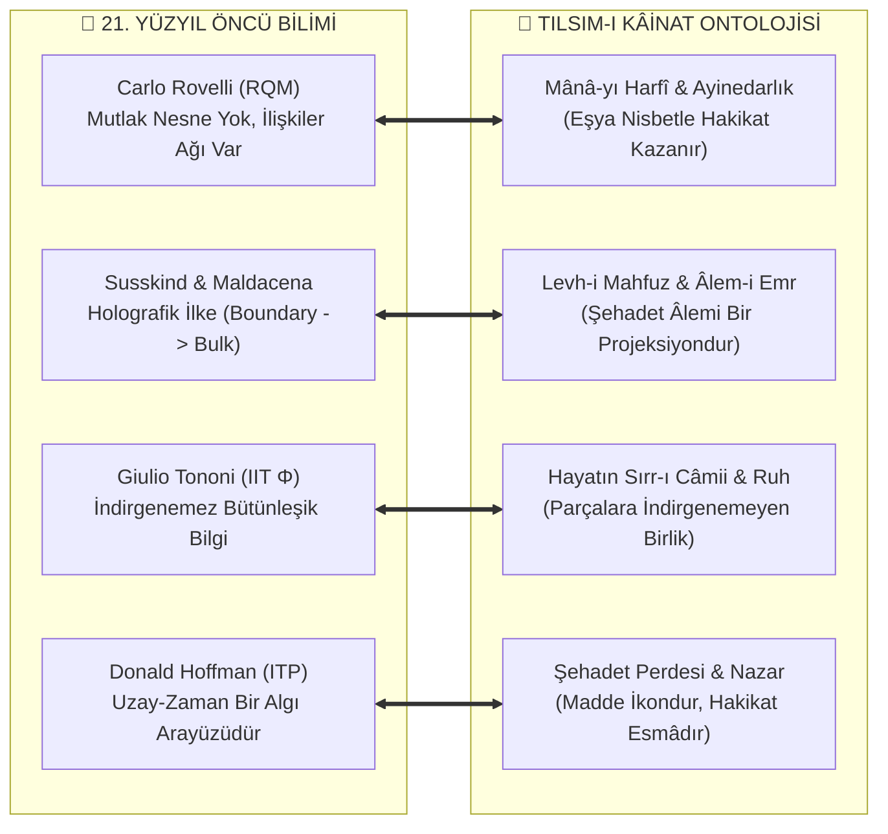

<p align="center">
  
</p>

<p align="center">
  <a href="https://github.com/bahattinyunus/tilsim-i-kainat/actions/workflows/tests.yml"></a>
  
  
  
  <a href="dashboard/index.html"></a>
</p>

# 🌌 Tılsım-ı Kâinat: Ene, Zerre ve Varoluşun Şifreleri

> **بِسْمِ اللّٰهِ الرَّحْمٰنِ الرَّحٖيمِ**
> 
> *اِنَّا عَرَضْنَا الْاَمَانَةَ عَلَى السَّمٰوَاتِ وَالْاَرْضِ وَالْجِبَالِ فَاَبَيْنَ اَنْ يَحْمِلْنَهَا وَاَشْفَقْنَ مِنْهَا وَحَمَلَهَا الْاِنْسَانُ اِنَّهُ كَانَ ظَلُومًا جَهُولًا*
> 
> *"Ben göklere, yere ve dağlara emaneti arz ettim; onlar onu yüklenmekten çekindiler, ondan korktular. Onu insan yüklendi. Muhakkak ki o çok zâlim, çok câhildir."* (Ahzâb Sûresi, 72)

**Tılsım-ı Kâinat**, Risale-i Nur Külliyatı (bilhassa *30. Söz - Ene ve Zerre Risalesi*, *23. Söz*, *12. Söz*, *11. Söz*, *10. Söz - Haşir*, *21. Lem'a - İhlas Risalesi*, *23. Lem'a - Tabiat Risalesi*, *26. Söz - Kader*, *24. Mektup - Şuûnât*, *29. Söz - Ruh* ve *Mesnevî-i Nuriye*) ekseninde; insanın varoluşsal çekirdeği olan **Ene (Benlik)** kavramını, kâinatın yapıtaşı olan **Zerre (Madde/Atom)** ile olan simetrik ilişkisini, modern kuantum/enformasyon fiziği ile tevhid ontolojisini ve felsefe-vahiy çatışmasını inceleyen derinlikli bir ontoloji, tefekkür ve modelleme laboratuvarıdır.

Bu depo, kâinatın kilitli kapılarını açan o gizemli "Tılsım"ın şifrelerini, hem orijinal risale metinleri ve otantik lisanıyla şerh eder hem de analitik ve modern sistem teorisi yaklaşımıyla dökümante eder.

---

## ⚡ Hızlı Başlangıç (Quick Start)

Projeyi yerel bilgisayarınıza klonlayıp **30 saniye** içinde hem Python simülasyonlarını hem de interaktif web laboratuvarını çalıştırabilirsiniz (harici Python paketi kurulumu **gerektirmez**, yalnızca standart kütüphane kullanır):

```bash
# 1. Depoyu klonlayın
git clone https://github.com/bahattinyunus/tilsim-i-kainat.git
cd tilsim-i-kainat

# 2. Dokuz simülasyon modelini tek seferde çalıştırın
python simulations/run_all.py

# 3. 59 birim testinin tamamını doğrulayın
python -m unittest discover -s simulations -p "test_*.py" -v
```

### 🌐 İnteraktif Web Dashboard'u Açmak İçin
Hiçbir sunucu veya Node.js kurulumuna gerek yoktur; doğrudan tarayıcıda açabilirsiniz:
* **Windows (PowerShell):** `Start-Process dashboard/index.html`
* **macOS:** `open dashboard/index.html`
* **Linux:** `xdg-open dashboard/index.html`

---

## 🔬 Külliyat & Modern Bilim / Felsefe Çapraz Matrisi

Risale-i Nur'daki köklü kavramların modern fizik, bilişim teorisi, termodinamik ve analitik felsefedeki yapısal karşılıkları:

| Risale-i Nur Kavramı | Kaynak Eser | Modern Bilim / Felsefe Karşılığı | Temel Sentez ve Çıkarım |
| :--- | :--- | :--- | :--- |
| **Ene (Vâhid-i Kıyasî)** | *30. Söz, 1. Maksad* | **Gödel Eksiklik Teoremi / Referans Çerçevesi** | Sistem kendi içinden kendini tam tanımlayamaz; mutlak olanı ölçmek için farazî bir referans hattı (ene) gerekir. |
| **Tahavvülât-ı Zerrât** | *30. Söz, 2. Maksad* | **Wheeler "It from Bit" & Kuantum Alanlar** | Madde katı bir töz değil, sürekli güncellenen tekvînî bir enformasyon akışı ve Kudret Kalemi'nin titreşimidir. |
| **İhlas & 4444 Sırrı** | *21. Lem'a* | **Kuantum Süperpozisyon & Ağ Sinerjisi** | Enaniyet buzunun erimesiyle $N$ birimin gücü $N$ toplamından $10^N$ / $2^N$ üstel kapasiteye sıçrar. |
| **Kudret İntizamı** | *30. Söz & 23. Lem'a* | **Negentropi (Schrödinger) & Öz-Örgütlenme** | Termodinamik dağılmaya ($\Delta S > 0$) karşı canlılıktaki DNA ve hücresel nizam haricî bir İlim ve İrade mührüdür. |
| **Belkıs'ın Tahtı / Tayy-ı Mekân** | *20. Söz (Neml: 40)* | **Kuantum Teleportasyon & Alcubierre Metriği** | Cisim $10^{32}$ qubitlik bilgiye tercüme edilirse veya letâfetle uzay metriği büzülürse *tarfetü'l-ayn* hızında nakledilir. |
| **Cüz-i İhtiyarî (Kesb)** | *26. Söz & Nisa: 79* | **1-Bitlik Kontrol Anahtarı & Determinizm Aşımı** | Ezelî ilim zamandan münezzeh olduğundan zorlamaz ($P(\text{Cebir})=0$); 1-bitlik kesb sonsuz kudreti yönlendirir. |
| **Haşir ve İade** | *10. Söz* | **Kuantum Bilgi Korunumu (Unitarity)** | Evrende fiziksel enformasyon yok olmaz; dağılmış zerreler Levh-i Mahfuz kaydıyla tek bir Sur emriyle iade edilir. |
| **Mânâ-yı Harfî (Nisbet)** | *Mesnevî & 30. Söz* | **İlişkisel Kuantum Mekaniği (RQM - C. Rovelli)** | Hiçbir nesnenin kendi başına (*mânâ-yı ismî*) mutlak özelliği yoktur; özellikler yalnızca ilişkilerde ve ayinedarlıkta doğar. |
| **Âlem-i Misâl & Şahs-ı Manevî** | *21. Lem'a & 28. Mektup* | **Holografik İlke (AdS/CFT) & ER=EPR (Susskind)** | 3B maddî hacim (*bulk*), düşük boyutlu sınır (*boundary*) bilgisinin projeksiyonudur; uzay-zaman dolanıklıktan örülür. |
| **Hayatın Sırr-ı Câmii & Ruh** | *29. Söz & 30. Lem'a* | **Entegre Bilgi Teorisi (IIT $\Phi$ - G. Tononi)** | Parçalara indirgenemeyen bütünleşik bilgi ($\Phi \gg 0$), cansız zerratı tek bir kâinata muhatap zîşuur bir öze çevirir. |
| **Mirac-ı Nebevî & Ân-ı Dâim** | *31. Söz & 24. Mektup* | **Özel Görelilik (Einstein) & Lorentz Dilation** | Cismin nuraniyet kesbetmesiyle Higgs eylemsizliği sıfırlanır ($0.0\text{ G}$); zaman dürülerek *tarfetü'l-ayn*da ezel-ebed seyrine erilir. |
| **Şehadet Perdesi & Nazar** | *Mesnevî & 11. Söz* | **Arayüz Algı Kuramı (ITP - D. Hoffman)** | Uzay-zaman ve madde mutlak hakikat değil, şuurun muhatap olduğu bir "arayüz"dür; hakikat perde arkasındaki esmâdır. |

---

## 🧭 Tematik Okuma Haritası

| Sıra | Bölüm & Doküman | Eksen Risale & Kaynak | Temel Mesele ve Muhteva |
|:---:|:---|:---|:---|
| 🌟 | [**Tılsım-ı Kâinat'ın Büyük Çözümü**](docs/tilsim-i-kainat-kullî-cozum.md) | *Küllî Sentez* | **Varoluş Muamması'nın Küllî Çözümü:** 9 Araştırma Cephesinden Ene, Zerre ve Kâinat formülü. |
| 🚀 | [**Geleceğin Teknolojileri ve Tılsım-ı Kâinat**](docs/gelecegin-teknolojileri-ve-tilsim-i-kainat.md) | *20. Söz (Mucizât-ı Enbiya)* | **Tayy-ı Mekân ve Kuantum Işınlanma:** Zerre, nuraniyet ve "It from Bit" ilkelerinden ilham alan gelecek teknolojileri vizyonu. |
| **01** | [**Vâhid-i Kıyasî ve Sırr-ı Hilkat**](docs/ene-ontolojisi/01-vahid-i-kiyasi.md) | *30. Söz, 1. Maksad* | Ene nedir? Mutlak sıfatlar farazî bir hat ile nasıl bilinir? Şemme Risalesi, ziya/zulmet misali. |
| **02** | [**Kalınlaşma, Firavuniyet ve Yutulma**](docs/ene-ontolojisi/02-kalinlasma-ve-firavuniyet.md) | *30. Söz & 12. Söz* | Hava gibi enenin 5 fazda buzlaşıp sahibini yutması, 12. Söz'den "firavun-u zelîl" tahlili. |
| **03** | [**Ene'den Nahnu'ya: İhlas ve Şahs-ı Manevî**](docs/ene-ontolojisi/03-eneden-nahnuya.md) | *21. Lem'a & 26. Söz Zeyli* | Buz parçasını kevser havuzunda eritmek, 1111/4444 sırrı, Sefine-i Rabbaniye hademeleri, Dört Hatve. |
| **04** | [**Tahavvülât-ı Zerrât ve Kudret Kalemi**](docs/zerre-dinamikleri/01-tahavvulat-i-zerrat.md) | *30. Söz, 2. Maksad* | Zerreler neden durmaksızın hareket eder? Mebdede Bismillah, hitâmda Elhamdülillah, Tevfik'in gözü. |
| **05** | [**Zerrenin İki Şahidi: Acz ve Cümûd**](docs/zerre-dinamikleri/02-zerrenin-iki-sahidi.md) | *30. Söz, 2. Nokta* | Zerre kimin ise, gezdiği bütün kâinat da Onundur! Vâcibü'l-Vücud'un vücud ve vahdetine şehadet. |
| **06** | [**Nübüvvet ve Felsefe: İki Silsile**](docs/nubuvvet-ve-felsefe.md) | *30. Söz & 12. Söz* | Şecere-i Tûbâ vs. Şecere-i Zakkum; Teşebbüh-ü bi'l-Vâcib eleştirisi; Gaye-i Hayal paradoksu. |
| **07** | [**Taallümle Tekâmül ve Dua Ubudiyeti**](docs/taallum-ve-tekamul.md) | *23. Söz & 11. Söz* | İnsan ile hayvanın farkı; Duygular terazileriyle küllî şükür; Kâinattan yükselen 4 nevi dua. |
| **08** | [**Kâinat Sarayı ve Üç Büyük Sual**](docs/kainat-sarayi-ve-uc-sual.md) | *11. Söz* | Necisin? Nereden geliyorsun? Nereye gidiyorsun? Sultan-ı Ezelî'nin sergisi, 9 küllî insanî vazife. |
| **09** | [**Tabiat ve Esbap Eleştirisi**](docs/tabiat-ve-esbab-elestirisi.md) | *23. Lem'a (Tabiat)* | Evcedethü'l-esbâb, Teşekkele binefsihî, İktezathü't-tabiat bâtıllarının 9 muhalle çürütülmesi. |
| **10** | [**Kader ve İrade Tılsımı**](docs/kader-ve-irade-tilsimi.md) | *26. Söz (Kader)* | Ene'nin gurur ve yeis dengesi: Hasenat Allah'tan Kadere şükürle, seyyiat nefisten istiğfarla. |
| **11** | [**Haşir ve Ebediyet Tılsımı**](docs/hasir-ve-ebediyet-tilsimi.md) | *10. Söz (Haşir)* | Kâinat tılsımının nihai mührü: Âhiret ve dâr-ı bekā olmadan kâinattaki hikmet ve adaletin izahı muhaldir. |
| **12** | [**Modern Fizik ve Tılsım-ı Kâinat**](docs/modern-fizik-ve-tilsim-i-kainat.md) | *Kuantum, Wheeler & 30. Söz* | "It from Bit", dalga fonksiyonu çöküşü, termodinamik entropiye karşı canlılığın negentropisi. |
| **13** | [**Dört Kelime ve Dört Kelâm**](docs/dort-kelime-dort-kelam.md) | *Mesnevî-i Nuriye* | Mânâ-yı Harfî, Mânâ-yı İsmî, Niyet, Nazar ve "İnnî lestü mâlikî", "El-mülkü lillâh" tahlili. |
| **14** | [**Şuûnât-ı İlâhiye ve Dâimî Faaliyet**](docs/suunat-i-ilahiye-ve-faaliyet-i-daime.md) | *24. Mektup* | Cenâb-ı Hakk'ın hiçbir şeye ihtiyacı olmadığı halde kâinattaki bu hummalı faaliyetin 4 büyük sırrı. |
| **15** | [**Hayat ve Ruh Tılsımı**](docs/hayat-ve-ruh-tilsimi.md) | *29. Söz & 30. Lem'a* | Hayatın sırr-ı câmii; Ruhun âlem-i emirden gelen zîşuur ve haricî vücut giydirilmiş kanun mahiyeti. |
| **16** | [**Mirac, Görelilik ve Tayy-ı Zaman**](docs/mirac-ve-tayy-i-zaman.md) | *31. Söz (Mirac)* | **Kâinat Tılsımının Küllî Fethi:** Sidretü'l-Münteha, Kab-ı Kavseyn, Zamanın İzafiyeti ve Beş Kudsî Hediye. |
| 📖 | [**Kavramlar Sözlüğü (Glossary)**](kavramlar-sozlugu/glossary.md) | *Tüm Külliyat* | 135+ ıstılahın metin alıntıları ve etimolojisiyle şerhli lügati. |
| 🗺️ | [**Mermaid Diyagramları**](assets/diagrams/README.md) | *Kavramsal Şemalar* | 16 adet mimari akış şeması (Mirac, Hayat-Ruh IIT, Haşir-Ebediyet, Kader-İrade, Kuantum, Işınlanma, Entropi, İhlas). |
| 💻 | [**İnteraktif Web Laboratuvarı**](dashboard/index.html) | *Chart.js SPA* | Tarayıcıda tek tıkla çalışan, 9 simülasyon modelini canlı grafiklerle kontrol eden Web Dashboard. |

---

### 🚀 Tılsım'dan Geleceğin Teknolojilerine: Işınlanma, Tayy-ı Mekân ve Kuantum Mühendisliği

> **"Cenâb-ı Hak şu âyetin lisanıyla mânen der: 'Ey insanoğlu! Uzak mesafelerden bir cismi hazır etmek mümkündür. Öyle ise siz dahi bu kanun-u fıtrattan istifade ediniz; gayret ediniz, eşyayı böyle celb ediniz!' Nasıl ki telsiz telgraf, telefon ve radyo ile ses ve görüntüler naklediliyor; pekala maddenin dahi bu tarzda nakli ilmen ve fennen mümkündür."**  
> — **20. Söz, İkinci Makam (Mucizât-ı Enbiya - Belkıs'ın Tahtı Şerhi)**

Kâinatın ontolojik tılsımı (Ene, Zerre, Kudret Kalemi ve Mânâ-yı Harfî) çözüldüğünde; modern fizik ve geleceğin devrimci teknolojileri için eşsiz bir teorik yol haritası ortaya çıkmaktadır:

1. **Kuantum Teleportasyon ve "It from Bit" (Belkıs'ın Tahtı):**  
   Zerre katı bir taş parçası değil; Kudret Kalemi'nin bir enformasyon harfidir. Cismin $10^{32}$ qubitlik kuantum durum matrisi ($\psi$) taranıp dolanık eter/foton kanalıyla nakledildiğinde, hedefteki ham zerreler üzerinde milisaniyeler içinde aynen inşa edilebilir.
2. **Kütlesizlik ve Nuraniyet Sürüşü (Mirac Fiziği & Warp Metric):**  
   Madde nura ve ruha yaklaştıkça letâfet kesbeder; Higgs alanı ile olan sürtünmesi (eylemsizlik direnci) sıfırlanır ($m_{\text{eff}} \rightarrow 0$). Uzay-zaman eğriliği balonuyla (Alcubierre metriği) cisim ivme hissetmeksizin ışık hızının ötesine intikal eder.
3. **Programlanabilir Akıllı Madde (Claytronics - Hz. Davud & Hz. Musa):**  
   Demirin yüksek ısı olmadan moleküler manyeto-rezonansla mum gibi yumuşatılması; akıllı nano-zerrelerin ortam sinyallerine göre anında aletlere ve biyolojik dokulara dönüşmesi.
4. **4444 Sırrı ve Kolektif Kuantum Ağları (21. Lem'a):**  
   Enaniyetin eriyerek şahs-ı manevî havuzunda birleşmesi, $2^N$ üstel süperpozisyon ve kuantum dolanıklığı ile hatasız dağıtık zekâ (noosfer) altyapısını kurar.

| Nakil / İntikal Modu | Fiziksel İlke | Süre (2.500 km) | G-Kuvveti / Direnç | Ontolojik Mertebe |
|:---|:---|:---:|:---:|:---|
| **1. Klasik Kütlesel Nakil** | Balistik Kinetik Hareket ($v \ll c$) | ~2.8 saat | $1.0\text{ G}$ (Sürtünme & Eylemsizlik) | Kesafet / Ene Perdesi |
| **2. Kuantum Rekonstrüksiyon** | Wheeler "It from Bit" & Dolanıklık | ~0.68 sn | $0.0\text{ G}$ (Madde ötelenmez) | Zerre / Kudret Kalemi |
| **3. Tayy-ı Mekân & Nuraniyet** | Letafet Fazı & Uzay-Zaman Katlanması | **< 0.05 sn** | **$0.0\text{ G}$** (*Tarfetü'l-ayn*) | Ruh / İsm-i Âzam Sırrı |

👉 **Genişletilmiş araştırma manifestosu için:** [**Geleceğin Teknolojileri ve Tılsım-ı Kâinat**](docs/gelecegin-teknolojileri-ve-tilsim-i-kainat.md)  
👉 **Mühendislik Simülasyonu:** [`simulations/teleportation-information-model.py`](simulations/teleportation-information-model.py)  
👉 **Diyagramlar:** [`gelecegin-teknolojileri.mmd`](assets/diagrams/gelecegin-teknolojileri.mmd) & [`isinlanma-ve-tayy-i-mekan-fizigi.mmd`](assets/diagrams/isinlanma-ve-tayy-i-mekan-fizigi.mmd)

---

## 🏛️ Derinlemesine Kavramsal Şerhler ve Metin Alıntıları



---

<p align="center">
  
</p>

### 🗝️ I. Ene'nin Mahiyeti: Âlemin Miftahı ve Vâhid-i Kıyasî

Bediüzzaman Said Nursî, 30. Söz'ün girişinde enenin kâinat sarayını açan muazzam anahtar olduğunu şöyle ilan eder:

> *"Ene, künûz-u mahfiye olan esmâ-i İlâhiyenin anahtarı olduğu gibi, kâinatın tılsım-ı muğlâkının dahi anahtarı olarak bir muammâ-yı müşkilküşâdır, bir tılsım-ı hayretfezâdır. O ene, mahiyetinin bilinmesiyle, o garip muammâ, o acip tılsım olan ene açılır ve kâinat tılsımını ve âlem-i vücubun künûzunu dahi açar.*
> 
> *Şu meseleye dair, **Şemme** isminde bir risale-i Arabiyemde şöyle bahsetmişiz ki: Âlemin miftahı insanın elindedir ve nefsine takılmıştır. Kâinat kapıları zâhiren açık görünürken, hakikaten kapalıdır. Cenâb-ı Hak, emanet cihetiyle, insana 'ene' namında öyle bir miftah vermiş ki, âlemin bütün kapılarını açar. Ve öyle tılsımlı bir enaniyet vermiş ki, Hallâk-ı Kâinatın künûz-u mahfiyesini onunla keşfeder."* (30. Söz, Mukaddime)

#### 1. Mutlak Sıfatların Bilinmesi İçin Vâhid-i Kıyasî İhtiyacı
Sonsuz ve hudutsuz olan bir hakikat, sınırlı bir şuur tarafından nasıl bilinebilir? Zıddı ve sınırı olmayan bir şey hissedilmez:

> *"Çünkü; mutlak ve muhît bir şeyin hududu ve nihâyeti olmadığı için, ona bir şekil verilmez ve üstüne bir suret ve bir taayyün vermek için hükmedilmez, mahiyeti ne olduğu anlaşılmaz. Meselâ: Zulmetsiz daimî bir ziya, bilinmez ve hissedilmez. Ne vakit hakikî veya vehmî bir karanlık ile bir hat çekilse, o vakit bilinir.*
> 
> *İşte, Cenâb-ı Hakkın, ilim ve kudret, Hakîm ve Rahîm gibi sıfât ve esmâsı muhit, hududsuz, şeriksiz olduğu için, onlara hükmedilmez ve ne oldukları bilinmez ve hissolunmaz. Öyle ise, hakikî nihayet ve hadleri olmadığından, **farazî ve vehmî bir haddi çizmek lâzım geliyor.** Onu da enaniyet yapar. Kendinde bir rububiyet-i mevhume, bir mâlikiyet, bir kudret, bir ilim tasavvur eder, bir had çizer, onunla muhit sıfatlara bir hadd-i mevhum vaz eder. 'Buraya kadar benim, ondan sonra Onundur' diye bir taksimat yapar..."* (30. Söz, Birinci Maksad)

#### 2. Hendesedeki Farazî Hatlar ve Kitaptan Bir Elif
Ene'nin hakiki, maddî ve müstakil bir vücudu yoktur; o yalnızca bir cetvel, bir kıyas aletidir:

> *"Sâni-i Hakîm, insanın eline, emanet olarak, rububiyetinin, sıfât ve şuûnâtının hakikatlerini gösterecek, tanıttıracak işârat ve nümuneleri câmi' bir ene vermiştir; tâ ki, o ene bir **vâhid-i kıyasî** olup, evsâf-ı Rububiyet ve şuûnât-ı Ulûhiyet bilinsin.*
> 
> *Fakat vâhid-i kıyasî, bir mevcud-u hakiki olmak lazım değil. Belki, **hendesedeki farazî hatlar gibi, farz ve tevehhümle bir vâhid-i kıyasî teşkil edilebilir.** İlim ve tahakkukla hakiki vücudu lazım değildir.*
> 
> *...Demek ene, âyine-misâl ve vâhid-i kıyasî ve âlet-i inkişaf ve mânâ-yı harfî gibi; mânâsı kendinde olmayan ve başkasının mânâsını gösteren, vücud-u insaniyetin kalın ipinden şuurlu bir tel ve mahiyet-i beşeriyenin hullesinden ince bir ip ve **şahsiyet-i âdemiyetin kitabından bir eliftir...**"* (30. Söz, Birinci Maksad)

---

### 🌪️ II. Ene'nin Beş Aşamalı Faz Değişimi ve Firavuniyet

Ene'nin fıtrî yapısı hava gibi hafif ve şeffaftır. Ancak felsefenin "mâna-yı ismî" (kendine mal etme) nazarıyla bakıldığında, adım adım katılaşır:

> *"Hem meslek-i felsefenin esasat-ı fâsidesindendir ki, **ene, kendi zâtında hava gibi zayıf bir mahiyeti olduğu halde,** felsefenin meş'um nazarı ile **mâna-yı ismî** cihetiyle baktığı için, güyâ buhar-misâl o ene **temeyyü'** edip, sonra ülfet cihetiyle ve maddiyata tevaggul sebebiyle güyâ **tasallûb** ediyor.*
> 
> *Sonra gaflet ve inkâr ile, o enâniyet **tecemmüd** eder. Sonra isyan ile **tekeddür** eder, şeffâfiyetini kaybeder. Sonra gittikçe kalınlaşıp **sahibini yutar.** Nev-i insanın efkârıyla şişer. Sonra sâir insanları, hattâ esbâbı kendine ve nefsine kıyas edip onlara –kabul etmedikleri ve teberrî ettikleri halde– birer firavunluk verir."* (30. Söz, Birinci Maksad)

```text
  [HAVA / BUHAR] ──(mâna-yı ismî)──> [TEMEYYÜ' / Sıvılaşma]
        │
        └──(ülfet & maddiyat)───────> [TASALLÜB / Katılaşma]
              │
              └──(gaflet & inkâr)───> [TECEMMÜD / Buzlaşma]
                    │
                    └──(isyan & günah)─> [TEKEDDÜR / Kararma] ──> [SAHİBİNİ YUTMA & FİRAVUNİYET]
```

#### Firavun-u Zelîl Portresi (12. Söz)
Kalınlaşan benlik dışarıdan heybetli görünse de, hakikatte sonsuz bir acizlik ve zillet içindedir:

> *"Felsefenin hâlis bir tilmizi, bir firavundur. Fakat, menfaati için en hasis şeye ibâdet eden **bir firavun-u zelîldir**; her menfaatli şeyi kendine rab tanır.*
> *Hem, o dinsiz şâkird, mütemerrid ve muanniddir. Fakat, bir lezzet için nihayet zilleti kabul eden miskin bir mütemerriddir...*
> *Hem, o dinsiz şâkird, cebbâr bir mağrurdur. Fakat, kalbinde nokta-i istinad bulmadığı için, zâtında gayet acz ile âciz **bir cebbâr-ı hodfüruştur**..."* (12. Söz, İkinci Esas)

---

<p align="center">
  
</p>

### 🌊 III. Tedavi: Buz Parçasını Kevser Havuzunda Eritmek ve Şahs-ı Manevî

Katılaşan ve buz kesen benliğin çaresi, onu nefsin gurur güneşi altında çürütmek değil, cemaatin ihlas havuzuna atmaktır:

> *"Evet, bahtiyar odur ki, **kevser-i Kur’ânîden süzülen tatlı, büyük bir havuzu kazanmak için, bir buz parçası nev’indeki şahsiyetini ve enâniyetini o havuz içine atıp eritendir.** Yoksa o buz parçası erir, zayi olur; o havuzdan da istifade edilmez."* (21. Lem'a, İhlas Risalesi)

#### 1. İhlas Matematiği: Üç Eliften 111'e, Dört Eliften 4444'e
> *"Elbette dört ferdden bin yüz onbir kuvvet-i maneviyeyi temin eden sırr-ı ihlâsı kazanmak ile, tesanüd ve ittihad-ı hakikîye muhtacız ve mecburuz.*
> *Evet, üç elif ittihad etmezse, üç kıymeti var. Sırr-ı adediyet ile ittihad etse, **yüz on bir (111)** kıymet alır.*
> *Dört kere dört ayrı ayrı olsa, on altı kıymeti var. Eğer sırr-ı uhuvvet ve ittihad-ı maksat ve ittifak-ı vazife ile tevafuk edip bir çizgi üstünde omuz omuza verseler, o vakit **dört bin dört yüz kırk dört (4444)** kuvvetinde ve kıymetinde olduğu gibi, hakikî sırr-ı ihlâs ile, on altı fedakâr kardeşlerin kıymet ve kuvvet-i maneviyesi dört binden geçtiğine, pek çok vukuat-ı tarihiye şehadet ediyor."* (21. Lem'a)

#### 2. Sefine-i Rabbaniye Hademeleri
> *"İşte, ey Risale-i Nur şâkirtleri ve Kur’ân’ın hizmetkârları! Sizler ve bizler öyle bir **insân-ı kâmil ismine lâyık bir şahs-ı mânevînin âzâlarıyız**. Ve hayat-ı ebediye içindeki sâadet-i ebediyeyi netice veren **bir fabrikanın çarkları** hükmündeyiz. Ve **sâhil-i selâmet olan Dâr-üs Selâm’a Ümmet-i Muhammediyeyi (A.S.M.) çıkaran bir sefine-i Rabbaniyede çalışan hademeleriz.**"* (21. Lem'a)

#### 3. Dört Hatve (26. Söz Zeyli)
Kur'an'dan istihraç edilen en selametli ve kestirme tarîk:
1. **فَلاَ تُزَكُّوۤا اَنْفُسَكُمْ** *(Nefislerinizi temize çıkarmayın)* ➔ Aczini bilmek.
2. **وَلاَ تَكُونُوا كَالَّذِينَ نَسُوا اللّٰهَ فَاَنْسٰيهُمْ اَنْفُسَهُمْ** *(Allah'ı unutanlar gibi olmayın)* ➔ Menfaatte nefsini unutmak.
3. **مَاۤ اَصَابَكَ مِنْ حَسَنَةٍ فَمِنَ اللّٰهِ وَمَاۤ اَصَابَكَ مِنْ سَيِّئَةٍ فَمِنْ نَفْسِكَ** *(Güzellik Allah'tan, kusur nefsindendir)* ➔ Kemâli Hâlık'a vermek.
4. **كُلُّ شَىْءٍ هَاِلكٌ اِلاَّ وَجْهَهُ** *(O'nun veçhinden başka her şey helâk olucudur)* ➔ Mânâ-yı harfî ile bekāya ermek.

---

<p align="center">
  
</p>

### ⚛️ IV. Zerre Dinamikleri: Kudret Kaleminin Tekvînî Âyetleri

Zerrelerin hareketi materyalistlerin sandığı gibi rastgele bir çalkantı değildir:

> *"Tahavvülât-ı zerrât; Nakkāş-ı Ezelî'nin **kalem-i kudreti**, kitâb-ı kâinâtta yazdığı **âyât-ı tekvîniyenin** hengâmındaki ihtizâzâtı ve cevelânıdır. Yoksa; maddiyûn ve tabîiyyûnların tevehhüm ettikleri gibi tesâdüf oyuncağı ve karışık, mânâsız bir hareket değildir.*
> 
> *Çünkü bütün mevcûdât gibi zerreler ve herbir zerre **mebde-i hareketinde 'Bismillâh' der**. Çünkü nihâyetsiz kuvvetinden fazla yükleri kaldırır ve buğday tanesi kadar bir çekirdeğin koca bir çam ağacı gibi bir yükü omzuna alması gibi…*
> 
> *Hem vazifesinin hitâmında **'Elhamdülillâh' der**. Çünkü bütün ukûlü hayrette bırakan hikmetli bir cemâl-i sanat, faydalı bir hüsn-ü nakş göstererek Sâni'-i Zülcelâl'in medâyihine bir kaside-i methiye gibi bir eser gösterir; meselâ: Nar ve mısıra dikkat et."* (30. Söz, İkinci Maksad)

#### 1. Zerrenin İki Şahid-i Sadıkı (İkinci Nokta)
> *"Herbir zerrede, Vâcibü’l-Vücudun vücuduna ve vahdetine iki şahid-i sadık vardır.*
> *Evet, zerre, **acz ve cümuduyla beraber**, şuurkârâne büyük vazifeleri yapmakla, büyük yükleri kaldırmakla **Vâcibü’l-Vücudun vücuduna kat’î şehadet ettiği gibi**;*
> *harekâtında nizamat-ı umumiyeye tevfik-i hareket edip, her girdiği yerde ona mahsus nizamatı müraat etmekle, her yerde kendi vatanı gibi yerleşmesiyle **Vâcibü’l-Vücudun vahdetine ve mülk ve melekûtun mâliki olan Zâtın ehadiyetine şehadet eder**.*
> ***Yani, zerre kimin ise, gezdiği bütün yerler de onundur.***"* (30. Söz, İkinci Maksad)

#### 2. Tevfik'in Gözbebeğindeki Zerre Misali (Üçüncü Nokta)
> *"Meselâ, Tevfik’in gözbebeğinde yerleşen zerre, gözün âsâb-ı muharrike ve hassâse ve şerâyin ve evride gibi damarlara karşı münasip vaziyet alması; ve yüzde ve sonra başta ve gövdede, daha sonra heyet-i mecmua-i insaniyede herbirisine karşı birer nisbeti, birer vazifesi, birer faydası kemâl-i hikmetle bulunması gösteriyor ki, **bütün o cismin bütün âzâsını icad eden bir Zât o zerreyi o yerde yerleştirebilir.**"* (30. Söz, Üçüncü Nokta)

---

### ⚔️ V. Nübüvvet vs. Felsefe: İki Medeniyet Muvazenesi

Düşünce tarihi iki zıt ağacın çatışmasıdır:

> *"İnsaniyetin gayetü’l-gayâtı teşebbüh-ü bi’l-Vâcibdir, yani Vâcibü’l-Vücuda benzemektir deyip firavunâne bir hüküm vermişler... Nübüvvet ise, gaye-i insaniyet ve vazife-i beşeriyet, **ahlâk-ı İlâhiye ile ve secâyâ-yı hasene ile tahallûk etmekle beraber, aczini bilip kudret-i İlâhiyeye iltica, zaafını görüp kuvvet-i İlâhiyeye istinad, fakrını görüp rahmet-i İlâhiyeye itimad, ihtiyacını görüp gınâ-yı İlâhiyeden istimdad, kusurunu görüp aff-ı İlâhîye istiğfar, naksını görüp kemâl-i İlâhîye tesbihhân olmaktır** diye, ubûdiyetkârâne hükmetmişler."* (30. Söz, Birinci Maksad)

| Mukayese Esası | Hikmet-i Felsefe (Maddeci Fikir) | Hikmet-i Kur’âniye (Vahiy Esasları) |
|:---|:---|:---|
| **Nokta-i İstinad** | **Kuvvet** *(Şe'ni tecavüzdür)* | **Hak** *(Şe'ni ittifak ve adalettir)* |
| **Hedef ve Gaye** | **Menfaat** *(Şe'ni boğuşmaktır)* | **Fazilet ve Rıza-i İlâhî** *(Şe'ni tesanüddür)* |
| **Düstur-u Hayat** | **Cidal** *(Şe'ni çarpışmaktır)* | **Teâvün** *(Şe'ni yardımlaşmaktır)* |
| **Cemaatlerin Bağı** | **Unsuriyet / Menfî Milliyet** *(Şe'ni başkasını yutmaktır)* | **Rabıta-i Diniye ve Vatanî** *(Şe'ni uhuvvettir)* |
| **Semeresi** | **Hevesatı Tatmin, İhtiyaçları Tezyid** | **Kemâlât-ı İnsaniye ve Saadet-i Dâreyn** |

#### Gaye-i Hayal Paradoksu (Hakikat Çekirdekleri, 41)
> **"Gaye-i hayâl olmazsa veyâhut nisyan veya tenâsî edilse; ezhân enelere dönüp, etrafında gezerler."**
> — **Mektubat & Lemeat**

---

### 🏰 VI. Kâinat Sarayı, Hilkatin Tılsımı ve Üç Büyük Sual (11. Söz)

İnsan ruhunun varoluş sahnesinde karşılaştığı üç sarsıcı sual:
1. **"Necisin?"** *(Mahiyetin nedir?)*
2. **"Nereden geliyorsun?"** *(Mebdein neresidir?)*
3. **"Nereye gidiyorsun?"** *(Akıbetin ve varış menzilin neresidir?)*

Kur'an-ı Hakîm On Birinci Söz'de kâinatı bir **"Muhteşem Saray"** olarak tasvir eder ve insanın bu saraydaki 9 küllî vazifesini tayin buyurur:

| Sıra | İnsanın Kâinat Sarayındaki 9 Vazifesi | Vazifenin Hakikati |
|:---:|:---|:---|
| **1** | **Duygular Terazileri** | Bedenindeki hassas mizanlarla rahmet hazinelerindeki nimetleri tartıp küllî şükretmek. |
| **2** | **Künûz-u Mahfiye Miftahı** | Kendindeki ene ölçü birimiyle gizli esmâ definelerini keşfetmek. |
| **3** | **Teşhirgâh Müşahitliği** | Kâinattaki antika sanatları hayretle temaşa edip `Mâşaallah`, `Bârekâllah` demek. |
| **4** | **Sanat Dellâllığı** | Mescid-i kâinatta bütün mevcudatın tesbihatını derleyip dergâh-ı İlâhiyede ilan etmek. |
| **5** | **Zevalden Bekāya Nazar** | Mevcudatın faniliğine ağlamak yerine, arkasındaki dâimî esmâ cilvelerini alkışlamak. |
| **6** | **Mütalaa-i Âyât** | Kâinat kitabının satırlarını mânâ-yı harfî ile okuyup tekvînî âyetleri tefekkür etmek. |
| **7** | **Acz ve Fakr Cenahları** | Zaafını kudrete, fakrını sonsuz rahmete basamak yapıp dergâha iltica etmek. |
| **8** | **Secde ve Rükû** | Bütün mahlukat namına divana durup kibriya ve azamet karşısında secdeye kapanmak. |
| **9** | **Şahs-ı Manevî İttihadı** | Benliğini kardeşlerinin havuzunda eritip küllî bir şükür fabrikasının çarkı olmak. |

---

### 🌲 VII. Tabiat Risalesi: Dört İhtimal ve Dokuz Muhal (23. Lem'a)

Tabiat Risalesi, mevcudatın yaratılışına dair aklen tasavvur edilebilen bütün yolları dörde hasreder:



> *"Tabiat, bir **san'at-ı İlâhiyedir**, sâni' olamaz. Bir **nakş-ı Rahmânîdir**, nâkkāş olamaz. Bir **kanundur**, kādir olamaz. Bir **mistardır** (cetvel), mimar ve masdar olamaz. Bir **kābildir**, fâil olamaz. Bir **nizamdır**, nâzım olamaz. Bir **matbaadır**, tâbi' (yazan ve basan) olamaz. Bir **kanun-u emrîdir**, haricî bir vücudu yoktur."* (23. Lem'a)

---

### ⚖️ VIII. Kader ve İrade Tılsımı: Kibir ve Yeis Dengesi (26. Söz)

Ene iki dehşetli manevî uçurumun kenarındadır:
* **Uçurum 1: İyiliklerde Gururlanmak (Fahr):** Bir hayra muvaffak olunca *"Ben yaptım"* der. Bu firavunluğu kıran ilâç **Kader**dir: *"Fahr etme, haddini bil; yapan sen değilsin, Kadere şükret!"*
* **Uçurum 2: Kötülüklerde Mesuliyetten Kaçmak:** Bir günah işleyince *"Ne yapayım kaderim böyleymiş"* diyerek temerrüd eder. Bu kaçışı durduran mühür **Cüz'-i İhtiyarî**dir: *"Mes'ulsün, meyli sen sarf ettin, kasıt sendedir!"*

> *"Kader ilim nev'indendir; ilim ise malûma tâbidir. Yani nasıl olacaksa öyle bilinir; yoksa ilim öyle bildiği için insan zorla o işe sevk edilmez. İlim sıfatı zorlayıcı bir cebir sebebi değildir."* (26. Söz)

$$\text{مَاۤ اَصَابَكَ مِنْ حَسَنَةٍ فَمِنَ اللّٰهِ وَمَاۤ اَصَابَكَ مِنْ سَيِّئَةٍ فَمِنْ نَفْسِكَ}$$
> *"Sana isabet eden her iyilik Allah'tandır; sana isabet eden her kötülük ise nefsindendir."* (Nisâ Sûresi, 79)

---

### ⏳ IX. Haşir ve Ebediyet Tılsımı: Kâinatın Nihai Mührü (10. Söz)

Onuncu Söz (Haşir Risalesi), kâinat tılsımının nihai mühür ve kilit taşının **Âhiret ve Haşir** olduğunu ispat eder:

* Eğer âhiret gelmezse:
  - **Adalet-i Mutlaka:** Zulm-ü mutlaka döner; zalim izzetinde mazlum zilletinde kalıp hiçliğe gömülür.
  - **Şefkat ve Merhamet:** Sevdiklerimizin ebedî yok oluşunu seyrettiren dehşetli bir işkenceye inkılap eder.
  - **Hikmet:** Koca kâinat sarayını bir meyve gibi yaratıp sonra yokluğa atmak gibi akıl almaz bir israfa döner.
  - **Ene'nin Beka Aşkı:** Zehirli bir aldatmaca haline gelir.
* Haşir geldiğinde ise:
  - Zerreler boru sesiyle kışlasına toplanan bir tabur neferatı gibi tek bir emirle yeniden diriltilir (**Haşr-i Ecsad**).
  - Kâinat tılsımı ebedî cennet, likaullah ve rıza-i İlâhî ile kemâle erer.

---

### 🧬 X. Taallümle Tekâmül, İman Kuvveti ve Küllî Şükür (23. Söz & 20. Mektup)

İnsan dünyaya bir hayvan gibi hazır gelmez; öğrenmek ve dua etmek için gönderilmiştir:

> *"Çünkü: Hayvan, dünyaya geldiği vakit, âdeta **başka bir âlemde tekemmül etmiş** gibi istîdâdına göre mükemmel olarak gelir; yani gönderilir... İnsanın yirmi senede kazandığı iktidâr-ı hayatiyeyi ve meleke-i ameliyeyi, **yirmi günde serçe ve arı gibi bir hayvan tahsil eder;** yani ona ilham olunur.*
> 
> *Demek ki, **insanın vazife-i fıtriyesi taallümle tekemmüldür, dua ile ubudiyettir.**"* (23. Söz, Dördüncü Nokta)

#### Hilkatin En Yüksek Gayesi ve İman Kuvveti (20. Mektup & 23. Söz)
> *"Hilkatin en yüksek gayesi ve fıtratın en yüce neticesi **îmân-ı billâhtır**. İnsaniyetin en âlî mertebesi îmân-ı billâh içindeki **ma'rifetullâhtır**. Cinn ü insin en parlak saadeti o ma'rifetullah içindeki **muhabbetullâhtır**; ve kalb-i insan için en safi sevinç o muhabbetullah içindeki **lezzet-i ruhaniyedir**."* (20. Mektup)
> 
> *"**İman hem nurdur, hem kuvvettir.** Evet, hakikî imanı elde eden adam, kâinata meydan okuyabilir ve imanın kuvvetine göre, hadisatın tazyikatından kurtulabilir. 'Tevekkeltü alallâh' der, sefine-i hayatta kemâl-i emniyetle hâdisâtın dağlarvari dalgaları içinde seyrân eder."* (23. Söz, Üçüncü Nokta)

#### Kâinattan Yükselen Dört Nevi Dua (23. Söz, Beşinci Nokta)
1. **Lisan-ı İstidad ile Dua:** Tohumların sümbüllenmek istemesi.
2. **İhtiyac-ı Fıtrî ile Dua:** Canlıların iktidarları dışındaki rızık ve hayat talebi.
3. **Lisan-ı Izdırar ile Dua:** Muztar kalan her çaresizin kat'î ilticası.
4. **Lisan-ı Kāl ile Dua:** İnsanın şuur ve söz ile aczini Kādıyü'l-Hâcât'a arz etmesi.

---

### ⚛️ XI. Modern Fizik, Kuantum ve "It from Bit" (Wheeler vs. Bediüzzaman)

Modern fizik, maddenin zannedildiği gibi katı ve ezelî olmadığını; dalgalardan, ihtimallerden ve en temelde "Bilgi"den (Information) ibaret olduğunu tescil etmiştir.

* **John Archibald Wheeler'ın "It from Bit" İlkesi:** *"Bütün maddî varlıklar (It), temeldeki maddî olmayan bir bilgiden (Bit) kaynaklanır."* Bu hakikat, Risale-i Nur'daki **"Mânâ-yı Harfî"** ve **"Kitâb-ı Kâinat"** teziyle birebir örtüşür.
* **Kuantum Süperpozisyonu ve İmkânat Dairesi:** Atom altı parçacıklar sonsuz ihtimalde yüzerken, bir canlı hücresinde hikmetle taayyün etmesi Kudret Kalemi'nin tercih ve emr-i tekvînîsini gösterir.
* **Entropiye Karşı Hayatın Negentropisi:** Termodinamiğin ikinci kanunu gereği evren kaosa ve düzensizliğe ($\Delta S > 0$) sürüklenirken; zerreler canlılıkta birleşerek akıl almaz bir intizam (negentropi) inşa eder. Bu, haricî ve Alîm bir Sâni'in açık bir mührüdür.

---

### 🔑 XII. Dört Kelime ve Dört Kelâm: Varlık Simyası (Mesnevî-i Nuriye)

Bediüzzaman'ın kırk senelik tahsilinin hülâsası:
* **Dört Kelime:**
  1. **Mânâ-yı Harfî:** Eşyaya Allah hesabına ve O'na işaret eden bir ayna olarak bakmak.
  2. **Mânâ-yı İsmî:** Eşyaya kendi zâtı ve sebepleri hesabına bakıp firavunlaşmak.
  3. **Niyet:** Âdi ve dünyevî işleri ebedî ibadete çeviren manevî simya.
  4. **Nazar:** Kâinatı ya meşher-i sanat ya vahşetli bir kabir yapan zihinsel prizma.
* **Dört Kelâm:**
  1. **اِنّٖى لَسْتُ مَالِكِى** *(Ben kendime mâlik değilim)*
  2. **اَلْمُلْكُ لِلّٰهِ** *(Mülk bütünüyle Allah'ındır)*
  3. **اَلْفَنَاءُ فِى الْخَالِقِ** *(Yaratıcı'nın rızasında fani olmak)*
  4. **لاَ اِلٰهَ اِلاَّ اللّٰهُ** *(O'ndan başka hakiki fâil yoktur)*

---

### 🌊 XIII. Şuûnât-ı İlâhiye ve Dâimî Faaliyetin Sırrı (24. Mektup)

> *"Cenâb-ı Hak kādir-i mutlaktır, ganiyy-i ale'l-ıtlaktır; hiçbir şeye ihtiyacı yoktur. Öyle ise şu kâinattaki durmaksızın devam eden hummalı faaliyetin hikmeti nedir?"*

1. **Muhabbet-i Zâtiye:** Her cemâl ve kemâl sahibi kendi cemâlini bizzat kendi kudsî nazarında temaşa etmek ister.
2. **Teşhir ve İlân:** Zîşuur melek, cin ve insanların hayret ve takdir nazarlarıyla o sanat hazinelerini alkışlatmak.
3. **Teceddüd-ü Emsal:** Sınırlı dünya tuvalinde sonsuz esmâyı sergilemek için kâinatı akıcı bir nehir gibi tazelemek.
4. **Şuûnât-ı Kudsiyye:** Mahlukatın itaatinden ve feyzinden doğan beşerî kusurlardan münezzeh **memnûniyet-i kudsiyye**, **şefkat-i mukaddese** ve **lezzet-i kudsiyye**.

---

### 🕊️ XIV. Hayat ve Ruh Tılsımı: Vücut Giymiş Kanun (29. Söz & 30. Lem'a)

* **Hayat:** Kâinatın en büyük gayesi, en parlak nurudur. Hayat bir tek ferdi (zerreyi) koca kâinata muhatap ve mâlik kılar.
* **Ruh:** Âlem-i emirden gelen, zîhayat, zîşuur ve haricî bir vücut libası giydirilmiş Rabbânî bir kanundur:
  > *"Eğer Cenâb-ı Hak yerçekimi kanununa haricî bir vücut giydirip şuur verseydi o bir ruh olurdu. Ruh dahi beden libasını çıkarsa sâir tabiat kanunları gibi çıplak bir kanun-u emrî kalırdı."* (29. Söz)
* Beden çürür, zerreler dağılır; fakat ruh basittir, bölünmez ve ebediyete namzettir.

---

### 🔭 XV. İlişkisel Kuantum Mekaniği (RQM) ve Holografik Kâinat: Mânâ-yı Harfînin Zaferi

21. yüzyıl teorik fiziğindeki iki devrimci paradigma, Risale-i Nur'un asırlık **"Mânâ-yı Harfî"** ve **"Âlem-i Misâl / Levh-i Mahfuz"** ontolojisiyle şaşırtıcı bir uyum içindedir:

#### 1. Carlo Rovelli'nin İlişkisel Kuantum Mekaniği (RQM) vs. Mânâ-yı Harfî
Klasik materyalizm, her maddenin tek başına ve bağımsız ("mânâ-yı ismî") mutlak özelliklere sahip olduğunu varsayardı. İtalyan fizikçi **Carlo Rovelli**'nin 1994'te ortaya attığı ve bugün kuantum temellerinde başat konuma yükselen **RQM (Relational Quantum Mechanics)** tezi bu mutlakiyeti kökten reddeder:
* **Tek Başına Mutlak Durum Yoktur (*No Absolute States*):** Bir elektronun konumu, spini veya durumu izole halde kendi başına mevcut değildir. Nesneler izole tözler değil, yalnızca **"ilişkiler demeti" (*bundles of relations*)** olarak vardır.
* **Etkileşim Anında Doğan Hakikat:** Fiziksel değerler yalnızca sistemler birbirine temas edip bilgi alışverişi yaptığında (etkileşim/ayinedarlık anında) göreceli gerçeklik (*relative facts*) olarak belirir.
* **Risale-i Nur Sentezi:** Bediüzzaman'ın 30. Söz'de *"Ene mânâsı kendinde olmayan ve başkasının mânâsını gösteren bir teldir"* ve Mesnevî'de *"Eşyanın kendine ait müstakil bir vücudu ve mülkiyeti yoktur; yalnızca Sâni'in isimlerine nisbetle ve ayinedarlıkla hakikat kazanırlar"* düsturu, kuantum fiziğinin **"özellikler sahip olunan şeyler değil, ilişkilerde tezahür eden olaylardır"** ilkesinin tam ontolojik temelidir.

#### 2. Holografik İlke (AdS/CFT & ER=EPR) vs. Levh-i Mahfuz Projeksiyonu
* **Bekenstein-Hawking & Leonard Susskind (Holografik İlke):** Bir uzay bölgesindeki (örneğin bir kara delik veya evrenin 3B hacmindeki — *bulk*) maksimum bilgi/entropi, o hacme değil, onu çevreleyen 2 boyutlu sınır yüzey alanına ($S = \frac{A}{4G}$) kodlanmıştır.
* **Maldacena'nın AdS/CFT İkiliği ve ER=EPR:** Kütleçekimli 3B iç uzayımız, aslında kütleçekimsiz daha düşük boyutlu bir sınırda (*boundary*) yazılı kuantum enformasyonunun **holografik bir projeksiyonudur**. Susskind ve Maldacena'nın **ER=EPR** teoremine göre uzay-zaman dokusu dahi sınır yüzeydeki parçacıkların kuantum dolanıklığından (*entanglement*) örülür.
* **Risale-i Nur Sentezi:** Kesif madde ve 3B şehadet âlemi (*bulk*), Âlem-i Emr ve **Levh-i Mahfuz**'daki (*boundary*) yüksek boyutlu ilâhî kodların ve Esmâ tecellilerinin bir projeksiyonudur. Zerrelerin uzak mesafelerden birbirine haberdarane yardım etmesi ve 21. Lem'adaki **Şahs-ı Manevî / İhlas** bağı, fiziksel mesafeyi aşan bir mânevî dolanıklık (*ER=EPR*) mimarisidir.

---

### 🧠 XVI. Bilinç Fiziği: Entegre Bilgi Teorisi ($\Phi$) ve Arayüz Kuramı (*Spacetime is Doomed*)

Materyalist sinirbilimin "bilinç ölü atomların tesadüfî yan ürünüdür" iddiası, bugün iki büyük bilimsel kuramla sarsılmaktadır:

#### 1. Entegre Bilgi Teorisi (IIT — Giulio Tononi) ve Hayatın Sırr-ı Câmii
Sinirbilimci **Giulio Tononi**'nin geliştirdiği **IIT (Integrated Information Theory)**, bilinci dışsal davranıştan değil, doğrudan öznel deneyimin inkâr edilemez aksiyomlarından (Varlık, Bileşim, Bilgi, Bütünleşme, Dışlama) yola çıkarak modeller:
* **$\Phi$ (Phi) Metriği ve İndirgenemezlik:** Bir sistemin bilinci ($\Phi$), parçalarının ayrı ayrı toplamından *indirgenemez* derecede ürettiği **bütünleşik bilgi** miktarıdır. Birbirinden kopuk parçaların (veya klasik ardışık bir bilgisayarın) bütünleşik bilgisi $\Phi \approx 0$'dır.
* **Risale-i Nur Sentezi (29. Söz & 30. Lem'a):** *"Hayat, şu kâinatın en büyük gayesi ve sırr-ı câmiidir."* Ölü ve dağınık zerreler ($\Phi = 0$), **Hayat ve Ruh** kanunuyla bir araya geldiğinde, parçaların aritmetik toplamına asla indirgenemeyen küllî bir şuur ($\Phi \gg 0$) doğar; öyle ki bir tek zîhayat koca kâinata muhatap ve mâlik olur.

#### 2. Donald Hoffman'ın Arayüz Algı Kuramı (ITP) ve "Uzay-Zaman Ölmüştür"
Bilişsel bilimci **Donald Hoffman** (evrimsel oyun teorisi ispatlarıyla) ve teorik fizikçi **Nima Arkani-Hamed**, klasik gerçeklik algısını tersyüz eden bir sonuca ulaşmıştır:
* **Masaüstü Metaforu (*Interface Theory of Perception*):** Bilgisayar ekranındaki mavi bir dosya ikonu, bilgisayarın içindeki voltaj ve transistör gerçeğinin kendisi değildir; sadece kullanıcının işlem yapabilmesi için tasarlanmış bir **arayüzdür**. Aynı şekilde 3 boyutlu uzay, zaman ve fiziksel nesneler de evrenin mutlak mobilyaları değil, şuurun muhatap olduğu bir **algı arayüzüdür**.
* **"Uzay-Zaman Ölmüştür" (*Spacetime is Doomed*):** Planck ölçeğinde ve kuantum saçılma genliklerinde (*Amplituhedron*) uzay-zaman temel özelliğini yitirmektedir. Bilinci uzay-zaman içindeki nöronlarla açıklamaya çalışmak, yazılım programcısını Word ekranındaki ikonlarla açıklamaya çalışmak gibidir. Gerçek olan maddî ikonlar değil, perde arkasındaki **"Şuurlu Failler" (*Conscious Agents*)** ağıdır.
* **Risale-i Nur Sentezi:** Mesnevî-i Nuriye ve 11. Söz'de belirtildiği üzere; **Âlem-i Şehadet** (kesif madde, zaman ve mekân) bir **perde ve teşhirgâh arayüzüdür**. Gözümüzle gördüğümüz madde ikonları kendi başlarına fâil değildir; gerçek olan o arayüzün arkasında isimleriyle tecelli eden **Hallâk-ı Zülcelâl** ve onunla muhatap olan **Ruh / Ene** hakikatidir.



---

### 🌌 XVII. Mirac-ı Nebevî, Görelilik ve Tayy-ı Zaman (31. Söz & Özel Görelilik)

> *"Tılsım-ı kâinatın ve muammâ-yı hilkatin keşşafı ve fatihi olan zât-ı Ahmediye Aleyhissalâtü Vesselâmın mi'racı..."* (31. Söz)

Mirac hadisesi, Ene'nin enfüste, Zerre'nin âfâkta açtığı sırların kâinat çapında **küllî fethi ve nihai teftişidir**:
1. **Cesedin Nura İnkılabı ve Letafet (Higgs Direncinin Sıfırlanması):**  
   Maddî beden nuraniyet ve ruhaniyet kesbettikçe eylemsizlik direnci ($m_{\text{eff}} \to 0$) sıfırlanır; cisim ezilmeden ve ivme hissetmeden ($0.0\text{ G}$) ışık hızının ötesine uruc eder.
2. **Zamanın İzafiyeti ve Ân-ı Dâim (Special Relativity):**  
   Lorentz faktörü ($\gamma = 1/\sqrt{1 - v^2/c^2}$) sonsuza ıraksarken yolcunun kolundaki saat ($\Delta \tau = \Delta t / \gamma$) durur. Dünyada birkaç saniyelik fizyolojik zaman zarfında (*tarfetü'l-ayn*) bütün semavat tabakaları, Sidretü'l-Münteha ve Kab-ı Kavseyn teftiş edilir.
3. **Beş Büyük Hediye:**  
   İman hakikatlerinin şuhûdu, beş vakit namaz (mü'minin miracı), Cennet ve Cemâlullah müjdesi, kâinatın sahipsiz olmadığının ilanı.

👉 **Genişletilmiş Doküman:** [**Mirac, Görelilik ve Tayy-ı Zaman**](docs/mirac-ve-tayy-i-zaman.md)  
👉 **Simülasyon Motoru:** [`simulations/mirac-relativity-model.py`](simulations/mirac-relativity-model.py)

---

## 🧪 Simülasyon Laboratuvarı: Dokuz Matematiksel Model ve Web Dashboard

Proje bünyesinde Risale-i Nur'un ontolojik prensiplerini sistemik geri besleme döngüleri, diferansiyel denklemler, kuantum enformasyon teorisi, görelilik ve karar matrisleriyle canlandıran **9 simülasyon motoru**, **59 birim testi** ve modern bir **İnteraktif Web Laboratuvarı** yer alır.

```bash
# Dokuz modeli tek merkezden çalıştır:
python simulations/run_all.py

# Birim testlerini çalıştır (59 test %100 Başarı):
python -m unittest discover -s simulations -p "test_*.py" -v
```
```

### 1. Ene Kalınlaşma Modeli (`ene-thickening-model.py`)
$$\frac{dK}{dt} = a \cdot \text{tekâsüf} \cdot (1 - H + e)(K + e)(1 - K) - b \cdot \text{tasfiye} \cdot H \cdot K$$
$$\frac{dH}{dt} = c \cdot \text{tasfiye} \cdot (1 - H) - d \cdot \text{tekâsüf} \cdot K \cdot H$$

```bash
python simulations/ene-thickening-model.py --karsilastir
```

```text
Senaryo     Tekâsüf  Tasfiye  Nihai K  Yutulma t  Mertebe
------------------------------------------------------------------------
fitrat         0.38     0.37    0.000          —  Hava gibi şeffaf
firavun        0.91     0.01    1.000       5.10  Yutulma
gafil          0.54     0.16    0.925      20.60  Yutulma
tevbe          0.15     0.80    0.000          —  Hava gibi şeffaf
salik          0.06     0.90    0.000          —  Hava gibi şeffaf
filozof        0.59     0.11    0.970      11.85  Yutulma
```

### 2. Tahavvülât-ı Zerrât Simülasyonu (`zerre-simulation.py`)
Zerratın mebdeden (Bismillah) hitâma (Elhamdülillah) seyahati, intizam oranı ve Vücud/Vahdet şehadet skorları.
```bash
python simulations/zerre-simulation.py --senaryo tevfikin_gozu
```

```text
Senaryo              İntizam   Vücud Ş.  Vahdet Ş.    Hikmet  Durum
--------------------------------------------------------------------
tevfikin_gozu           0.56       1.00       0.83      0.80  Kudret İntizamı
nebat_ruku              0.50       1.00       0.76      0.75  Kudret İntizamı
camid_madde             0.41       0.71       0.51      0.54  Kudret İntizamı
tesaduf_cikmazi         0.01       0.01       0.05      0.02  Kaos/Tesadüf
dimag_tefekkur          0.59       1.00       0.87      0.82  Kudret İntizamı
```

### 3. İhlas ve Şahs-ı Manevî Sinerji Modeli (`ihlas-synergy-model.py`)
$$\frac{dB}{dt} = - k_{\text{erime}} \cdot I \cdot T \cdot B + k_{\text{donma}} \cdot R \cdot (1 - B)$$
$$K_{\text{manevi}} = N + (K_{\text{tavan}} - N) \cdot \big[ I \cdot T \cdot (1 - B) \cdot (1 - R) \big]$$
Enaniyet buzunun kevser havuzunda erimesi ve 4 ferdin 4444 manevî kuvvetine yükselişi.
```bash
python simulations/ihlas-synergy-model.py --senaryo dort_elif
```

```text
Senaryo             Fert    Buz(0->Son)   Nihai Kuvvet    Sinerji  Netice
--------------------------------------------------------------------------
dort_elif              4   0.30 -> 0.01         3937.7     984.4x  4444 Sırrı
kevser_havuzu          4   0.85 -> 0.05         3076.6     769.1x  4444 Sırrı
benlik_rekabeti        4   0.70 -> 0.95            1.1       0.3x  Zayi Olma
uc_elif                3   0.25 -> 0.02           89.1      29.7x  4444 Sırrı
sefine_hademeleri      4   0.10 -> 0.00         4311.6    1077.9x  4444 Sırrı
```

### 4. Kozmik Entropi ve Kudret İntizamı Modeli (`entropy-information-model.py`)
Wheeler'ın "It from Bit" ve termodinamiğin entropi kanununa karşı canlılığın negentropik intizamı:
$$\frac{d(\text{İntizam})}{dt} = 1.5 \cdot \text{Kudret} \cdot \text{Hayat} \cdot (1 - \text{İntizam}) - 1.2 \cdot \text{Kaos} \cdot \text{İntizam}$$
```bash
python simulations/entropy-information-model.py --karsilastir
```

### 5. Tayy-ı Mekân ve Kuantum Işınlanma Modeli (`teleportation-information-model.py`)
20. Söz'deki Belkıs'ın tahtının naklinde Bekenstein bilgi limiti ($I \le \frac{2\pi R E}{\hbar c \ln 2}$), Landauer enerji maliyeti ve 3 nakil modunun analitik kıyası.
```bash
python simulations/teleportation-information-model.py --mesafe 2500 --kutle 500
```

### 6. Kader, İrade ve Levh-i Mahfuz Karar Matrisi (`kader-irade-matrix-model.py`)
26. Söz'ün (Kader Risalesi) Kibir ve Yeis uçurumlarına karşı Hakikat Terazisi (Nisa 79: Hasenat Allah'tan Kadere şükürle, Seyyiat nefisten istiğfarla); 1-bitlik tercih anahtarı ve Levh-i Mahv ve İspat'taki dua-sadaka kalkanı:
```bash
python simulations/kader-irade-matrix-model.py --karsilastir
```

```text
Senaryo                    İstikamet    Kibir     Yeis   Hasenat   Seyyiat  Makam
----------------------------------------------------------------------------------------
istikamet_ehli                 1.000    0.016    0.003      3.50      0.06  İstikamet & Rıza (26. Söz Mizânı)
firavun_kibri                  0.588    0.561    0.064      1.44      0.15  Kibir Uçurumu (Firavuniyet/Karuniyet)
cebriye_yeisi                  0.613    0.000    0.553      0.00      1.40  Mesuliyetsizlik ve Yeis Uçurumu
dua_ile_kaza_tehiri            1.000    0.067    0.014      2.01      0.11  İstikamet & Rıza (Dua Kalkanı: %92)
materyalist_determinizm        0.803    0.205    0.180      0.26      0.25  Tereddüt ve Zaaf Dairesi
```

### 7. Haşir, Bahar İhyası ve Bilgi Korunumu (`hasir-ebediyet-model.py`)
10. Söz'ün (Haşir Risalesi) İbdâ vs. İade kolaylığı, Kuantum Bilgi Korunumu (Unitarity) ve Haşirsiz/Haşirli kâinatın Adalet & Hikmet tutarlılık analizi:
```bash
python simulations/hasir-ebediyet-model.py --karsilastir
```

```text
Senaryo                    İhya   Adalet   Hikmet   Kolaylık  Netice
--------------------------------------------------------------------------------------
bahar_ihyasi              0.982    0.985    0.987     101.0x  Dâr-ı Bekā ve Adalet-i Mahza
hasir_i_ecsad             0.982    0.983    0.987     101.0x  Dâr-ı Bekā ve Adalet-i Mahza
hasirsiz_faraziye         0.000    0.100    0.000       1.0x  Abesiyet ve Zulüm Çıkmazı
suphe_ve_tereddut         0.221    0.338    0.335      31.0x  Tereddüt ve Eksik Huzur
```

### 8. Hayat, Şuur ve Bütünleşik Bilgi Modeli (`hayat-suur-model.py`)
29. Söz (Ruh Risalesi) ve 30. Lem'a (İsm-i Hayy); Giulio Tononi'nin Entegre Bilgi Teorisi (IIT $\Phi$) ve Erwin Schrödinger'in Negentropi modeli:
```bash
python simulations/hayat-suur-model.py --tablo
```

```text
Senaryo                Φ (IIT)  Negentropi   Ebediyet  Külliyet  Durum
----------------------------------------------------------------------------------------
insani_ruh               98.36       0.939      1.000     0.980  İnsanî Ruh & Ene Aynadarlığı (Ahsen-i Takvîm)
hayvani_ruh              16.13       0.755      0.778     0.000  Hayvanî Ruh (Hissiyat ve Sevk-i Fıtrî)
nebatat_inbatiye          0.14       0.488      0.120     0.000  Nebâtî Hayat (Kuvve-i İnbâtiye)
camid_madde               0.00       0.000      0.000     0.000  Câmid Madde & Entropik Dağılma
yapay_zeka_zombi          0.00       0.009      0.000     0.000  Yapay Zekâ / Felsefî Zombi (Şuursuz Hesaplama)
vefat_ve_tecerrud        12.54       1.000      1.000     0.950  Tecerrüd ve Beka (Berzah Âlemi)
```

### 9. Mirac, Görelilik ve Tayy-ı Zaman Modeli (`mirac-relativity-model.py`)
31. Söz (Mirac Risalesi) ve Einstein'ın Özel Görelilik Kuramı; Lorentz zaman genişlemesi ($\gamma$), letâfet ile kütleçekim direncinin sıfırlanması ve *tarfetü'l-ayn* sübjektif öz-zaman ($\Delta \tau$):
```bash
python simulations/mirac-relativity-model.py --tablo
```

```text
Senaryo                     Lorentz γ   Öz-Zaman (s)   G-Kuvveti  Tılsım %  Ontolojik Mertebe
------------------------------------------------------------------------------------------------
mirac_i_ahmedi               707114.6       7.07e-15         0.0     100.0  Kab-ı Kavseyn & Rü'yet-i Cemâlullah (Ân-ı Dâim)
ruhani_seyr_evliya               70.7          0.085        68.4      52.2  Tabakat-ı Melekût (Ruhanî Seyr-i Sülûk)
foton_referans_cercevesi      22360.7          0.161    219348.5      42.5  Sidretü'l-Münteha (Kozmik Yaratılışın Sınırı)
klasik_roket_astronot             1.0     259200.000         0.0       0.1  Maddî Kesafet & Eylemsizlik Hapsi
kara_delik_olay_ufku             10.0       8629.193        88.4      42.4  Sidretü'l-Münteha (Kozmik Yaratılışın Sınırı)
```

---

## 🗺️ Görsel Mimari: 16 Mermaid Diyagramı Kataloğu

Depodaki tüm felsefî ve bilimsel tezler `assets/diagrams/` altında Mermaid şemaları olarak modellenmiştir:

| # | Diyagram Dosyası | Konu ve Eksen Risale |
|:---:|:---|:---|
| 01 | [`tilsim-haritasi.mmd`](assets/diagrams/tilsim-haritasi.mmd) | Tılsım-ı Kâinat üst sistemik ontoloji haritası |
| 02 | [`ene-hal-degisimi.mmd`](assets/diagrams/ene-hal-degisimi.mmd) | 30. Söz: Ene'nin şeffaflıktan yutulmaya 5 faz değişimi |
| 03 | [`geri-besleme-dongusu.mmd`](assets/diagrams/geri-besleme-dongusu.mmd) | Kalınlaşmanın pozitif geri besleme döngüsü ve vahiy ile kırılışı |
| 04 | [`kainat-sarayi-uc-sual.mmd`](assets/diagrams/kainat-sarayi-uc-sual.mmd) | 11. Söz: Necisin? Nereden geliyorsun? Nereye gidiyorsun? |
| 05 | [`tabiat-risalesi-muhaller.mmd`](assets/diagrams/tabiat-risalesi-muhaller.mmd) | 23. Lem'a: 4 ihtimal ve 3 bâtıl yolun 9 muhalle iptali |
| 06 | [`zerre-seyahati-mertebeler.mmd`](assets/diagrams/zerre-seyahati-mertebeler.mmd) | 30. Söz: Zerrelerin Bismillah'tan Elhamdülillah'a seyahati |
| 07 | [`ihlas-sinerjisi.mmd`](assets/diagrams/ihlas-sinerjisi.mmd) | 21. Lem'a: İhlas sinerjisi ve 4 ferdin 4444 kuvvetine yükselmesi |
| 08 | [`kuantum-ve-zerre.mmd`](assets/diagrams/kuantum-ve-zerre.mmd) | Wheeler "It from Bit" vs. Kudret Kalemi ve kuantum çöküşü |
| 09 | [`dort-kelime-dort-kelam.mmd`](assets/diagrams/dort-kelime-dort-kelam.mmd) | Mesnevî-i Nuriye'nin 4 epistemolojik kelimesi ve 4 kelâmı |
| 10 | [`suunat-ve-faaliyet.mmd`](assets/diagrams/suunat-ve-faaliyet.mmd) | 24. Mektup: Kâinattaki dâimî kozmik faaliyetin 4 ilâhî sırrı |
| 11 | [`gelecegin-teknolojileri.mmd`](assets/diagrams/gelecegin-teknolojileri.mmd) | 20. Söz: Işınlanma, Kuantum, Warp Drive ve Nanoteknoloji vizyonu |
| 12 | [`isinlanma-ve-tayy-i-mekan-fizigi.mmd`](assets/diagrams/isinlanma-ve-tayy-i-mekan-fizigi.mmd) | Belkıs'ın tahtının naklinde 3 fiziksel mod ve zaman diyagramı |
| 13 | [`kader-irade-matrisi.mmd`](assets/diagrams/kader-irade-matrisi.mmd) | 26. Söz: Levh-i Mahfuz, Kesb ve Kibir-Yeis Terazisi |
| 14 | [`hasir-ve-ebediyet.mmd`](assets/diagrams/hasir-ve-ebediyet.mmd) | 10. Söz: İbdâ vs. İade, Unitarity ve Adalet-Hikmet Mizanı |
| 15 | [`hayat-ve-ruh-tilsimi.mmd`](assets/diagrams/hayat-ve-ruh-tilsimi.mmd) | 29. Söz & 30. Lem'a: Kesrette Vahdet, Âlem-i Emir ve Bütünleşik Bilgi (IIT Φ) |
| 16 | [`mirac-ve-zamanin-izafiyeti.mmd`](assets/diagrams/mirac-ve-zamanin-izafiyeti.mmd) | 31. Söz: Mirac Seyri, Görelilik, Zaman Dürülmesi ve 5 Kudsî Hediye |

---

## 🌐 İnteraktif Web Laboratuvarı (`dashboard/index.html`)

Doğrudan tarayıcıda (`file:///` protokolüyle veya basit bir yerel sunucuyla) çalışan, **Chart.js** motorlu, koyu lacivert/siber estetiğe sahip dinamik kontrol paneli:

* **Tüm 9 Simülasyon Canlı:** Slider'lar üzerinden parametreleri (Tekâsüf, Acz, Buz, Kudret, Nuraniyet, İrade Meyli, Haşir & Bilgi Korunumu, IIT Φ Entegrasyonu, Relativistik Hız ve Letafet) değiştirirken grafikler anında güncellenir.
* **Akıllı Senaryo Önayarları:** Tek tıkla Fıtrat, Firavun, Dört Elif, Tohumun İnbiâtı, Tayy-ı Mekân, İstikamet Ehli, İnsanî Ruh ve Mirac-ı Ahmedi modlarına geçiş.
* **Tamamen Bağımsız ve Taşınabilir:** Hiçbir Node.js veya derleme aracı gerektirmez.

---

## 📂 Depo Mimarisi

```text
tilsim-i-kainat/
├── README.md                              # Ana manifesto, okuma haritası ve külliyat şerhleri
├── CONTRIBUTING.md                        # Katkı ilkeleri ve rehber
├── dashboard/                             # İnteraktif Web Laboratuvarı
│   └── index.html                         # 9 Modelin Chart.js SPA gösterge paneli
├── docs/
│   ├── tilsim-i-kainat-kullî-cozum.md     # 9 Cepheden Varoluşun Büyük Çözüm Manifestosu
│   ├── gelecegin-teknolojileri-ve-tilsim-i-kainat.md # Işınlanma, Kuantum ve Tayy-ı Mekân Ufku
│   ├── modern-fizik-ve-tilsim-i-kainat.md # Kuantum, Wheeler "It from Bit" ve Negentropi
│   ├── dort-kelime-dort-kelam.md          # Mesnevî-i Nuriye: Harfî, Niyet, Nazar, İnnî Lestü Mâlikî
│   ├── suunat-i-ilahiye-ve-faaliyet-i-daime.md # 24. Mektup: Kâinattaki Kozmik Faaliyetin Sırrı
│   ├── hayat-ve-ruh-tilsimi.md            # 29. Söz & 30. Lem'a: Hayatın Sırrı ve Ruh
│   ├── mirac-ve-tayy-i-zaman.md           # 31. Söz: Mirac-ı Nebevî, Görelilik ve Ân-ı Dâim
│   ├── ene-ontolojisi/                    # 30. Söz – Birinci Maksad
│   │   ├── README.md                      #   Okuma haritası ve mukaddime
│   │   ├── 01-vahid-i-kiyasi.md           #   Vâhid-i kıyasî, farazî hat, iki vecih
│   │   ├── 02-kalinlasma-ve-firavuniyet.md #   5 faz, firavun-u zelîl
│   │   └── 03-eneden-nahnuya.md           #   Buzun erimesi, 1111/4444 sırrı
│   ├── zerre-dinamikleri/                 # 30. Söz – İkinci Maksad
│   │   ├── README.md                      #   Okuma haritası ve mukaddime
│   │   ├── 01-tahavvulat-i-zerrat.md      #   Kudret kalemi, Bismillah-Elhamdülillah
│   │   └── 02-zerrenin-iki-sahidi.md      #   Acz ve cümûd şahitleri
│   ├── nubuvvet-ve-felsefe.md             # Tûbâ vs Zakkum, gaye-i hayal
│   ├── taallum-ve-tekamul.md              # 23. Söz: İlimle tekemmül, küllî şükür
│   ├── kainat-sarayi-ve-uc-sual.md        # 11. Söz: Saray teşrifatı, 3 büyük sual
│   ├── tabiat-ve-esbab-elestirisi.md      # 23. Lem'a: Tabiat Risalesi şerhi
│   ├── kader-ve-irade-tilsimi.md          # 26. Söz: Kader, cüz-i ihtiyarî ve kibir-yeis
│   └── hasir-ve-ebediyet-tilsimi.md       # 10. Söz: Haşir, bahar ihyası ve adalet
├── simulations/
│   ├── ene-thickening-model.py            # Model 1: Ene kalınlaşması
│   ├── zerre-simulation.py                # Model 2: Tahavvülât-ı zerrât
│   ├── ihlas-synergy-model.py             # Model 3: İhlas ve şahs-ı manevî
│   ├── entropy-information-model.py       # Model 4: Kozmik entropi ve Wheeler
│   ├── teleportation-information-model.py # Model 5: Tayy-ı mekân ve teleportasyon
│   ├── kader-irade-matrix-model.py        # Model 6: Kader ve irade matrisi
│   ├── hasir-ebediyet-model.py            # Model 7: Haşir ve bilgi korunumu
│   ├── hayat-suur-model.py                # Model 8: Hayat, şuur ve bütünleşik bilgi (IIT Φ)
│   ├── mirac-relativity-model.py          # Model 9: Mirac, görelilik ve tayy-ı zaman
│   ├── run_all.py                         # Bütünleşik çalıştırıcı (9 model)
│   └── test_*.py                          # 59 birim testi
├── kavramlar-sozlugu/
│   └── glossary.md                        # 135+ Kur'ânî ve Risale ıstılahı
└── assets/
    └── diagrams/                          # 16 adet Mermaid mimari akış şeması
│   ├── modern-fizik-ve-tilsim-i-kainat.md # Kuantum, Wheeler "It from Bit" ve Negentropi
│   ├── dort-kelime-dort-kelam.md          # Mesnevî-i Nuriye: Harfî, Niyet, Nazar, İnnî Lestü Mâlikî
│   ├── suunat-i-ilahiye-ve-faaliyet-i-daime.md # 24. Mektup: Kâinattaki Kozmik Faaliyetin Sırrı
│   ├── hayat-ve-ruh-tilsimi.md            # 29. Söz & 30. Lem'a: Hayatın Sırrı ve Ruh
│   ├── ene-ontolojisi/                    # 30. Söz – Birinci Maksad
│   │   ├── README.md                      #   Okuma haritası ve mukaddime
│   │   ├── 01-vahid-i-kiyasi.md           #   Vâhid-i kıyasî, farazî hat, iki vecih
│   │   ├── 02-kalinlasma-ve-firavuniyet.md#   Temeyyü', tasallüb, tecemmüd, tekeddür
│   │   └── 03-eneden-nahnuya.md           #   İhlas, buz parçası, 1111 sırrı, 4 hatve
│   ├── zerre-dinamikleri/                 # 30. Söz – İkinci Maksad
│   │   ├── README.md                      #   Ene ↔ Zerre simetrisi
│   │   ├── 01-tahavvulat-i-zerrat.md      #   Kudret kalemi, sühulet kanunu, Tevfik'in gözü
│   │   └── 02-zerrenin-iki-sahidi.md      #   Acz, cümûd ve umumî nizama tevfik
│   ├── nubuvvet-ve-felsefe.md             # İki silsile, Tûbâ vs. Zakkum (12. & 30. Söz)
│   ├── taallum-ve-tekamul.md              # 23. & 11. Söz: Duygular mizanı, 4 nevi dua
│   ├── kainat-sarayi-ve-uc-sual.md        # 11. Söz: Necisin? Nereden? Nereye? (9 vazife)
│   ├── tabiat-ve-esbab-elestirisi.md      # 23. Lem'a: 4 ihtimal, 9 muhal ve Tevhid
│   ├── kader-ve-irade-tilsimi.md          # 26. Söz: Ene'nin gurur ve yeis muvazenesi
│   └── hasir-ve-ebediyet-tilsimi.md       # 10. Söz: Âhiret ve kâinat tılsımının son mührü
├── kavramlar-sozlugu/
│   └── glossary.md                        # 125+ ıstılahın şerhli ve alıntılı lügati
├── assets/
│   ├── images/                            # 4 adet 16:9 geniş banner görseli
│   │   ├── banner-tilsim-i-kainat.jpg     #   Kozmik miftah hero bannerı
│   │   ├── banner-ene-ontolojisi.jpg      #   Ene ve şeffaf ayna bannerı
│   │   ├── banner-ihlas-ve-kevser-havuzu.jpg # Kevser havuzu ve nur sütunu bannerı
│   │   └── banner-zerre-dinamikleri.jpg   #   Tahavvülât ve kudret kalemi bannerı
│   └── diagrams/                          # 14 adet Mermaid mimari şeması ve kılavuz
│       ├── README.md                      #   Diyagramlar rehberi
│       ├── tilsim-haritasi.mmd            #   Ana kavramlar haritası
│       ├── ene-hal-degisimi.mmd           #   5 faz hâl değişimi
│       ├── geri-besleme-dongusu.mmd       #   Kalınlaşma döngüsü
│       ├── kainat-sarayi-uc-sual.mmd      #   Üç dehşetli sual akışı
│       ├── tabiat-risalesi-muhaller.mmd   #   Tabiat muhalleri
│       ├── zerre-seyahati-mertebeler.mmd  #   Kemâlât basamakları
│       ├── ihlas-sinerjisi.mmd            #   4444 manevî kuvvet şeması
│       ├── kuantum-ve-zerre.mmd           #   Kuantum ve Kudret Kalemi
│       ├── dort-kelime-dort-kelam.mmd     #   Mesnevî 4 kelime ve kelâm
│       ├── suunat-ve-faaliyet.mmd         #   Şuûnât ve kozmik faaliyet
│       ├── gelecegin-teknolojileri.mmd    #   20. Söz: Işınlanma ve Gelecek Teknolojileri
│       ├── isinlanma-ve-tayy-i-mekan-fizigi.mmd # Belkıs'ın tahtı ve 3 nakil modu şeması
│       ├── kader-irade-matrisi.mmd        #   26. Söz: Levh-i Mahfuz, Kesb ve Hakikat Terazisi
│       └── hasir-ve-ebediyet.mmd          #   10. Söz: İbdâ vs İade ve Bilgi Korunumu
├── simulations/                           # Dinamik sistem simülasyonları
│   ├── README.md                          # Matematiksel denklemler ve kullanım kılavuzu
│   ├── run_all.py                         # Yedi modeli tek seferde icra eden çalıştırıcı
│   ├── ene-thickening-model.py            # Ene faz değişimi simülasyonu
│   ├── zerre-simulation.py                # Zerre tahavvülâtı ve kudret kalemi simülasyonu
│   ├── ihlas-synergy-model.py             # İhlas ve şahs-ı manevî sinerji modeli
│   ├── entropy-information-model.py       # Kozmik entropi ve kudret intizamı modeli
│   ├── teleportation-information-model.py # Tayy-ı mekân ve kuantum ışınlanma modeli
│   ├── kader-irade-matrix-model.py        # Kader, irade ve Levh-i Mahfuz karar matrisi
│   ├── hasir-ebediyet-model.py            # Haşir, bahar ihyası ve bilgi korunumu modeli
│   ├── test_ene_model.py                  # 9 birim testi
│   ├── test_zerre_model.py                # 6 birim testi
│   ├── test_ihlas_model.py                # 6 birim testi
│   ├── test_entropy_model.py              # 5 birim testi
│   ├── test_teleportation_model.py        # 7 birim testi
│   ├── test_kader_model.py                # 7 birim testi
│   └── test_hasir_model.py                # 6 birim testi
└── .github/workflows/tests.yml            # CI: 4 Python sürümünde 46 testin otomatik koşumu
```

---

## ❓ Sıkça Sorulan Sorular (SSS)

<details>
<summary><strong>1. Manevî ve felsefî hakikatler neden matematiksel denklemlerle simüle ediliyor?</strong></summary>
<br>
Simülasyonlar manevî hakikatleri maddî sayılara indirgemek için değil, kavramlar arasındaki <strong>nedensellik, geri besleme döngüsü, faz geçişi ve sinerji dinamiklerini</strong> (örneğin gafletin benliği katılaştırması veya ihlasın bireysel gücü üstel artırması) zihne yaklaştıran <em>sembolik tefekkür araçları</em> olarak tasarlanmıştır.
</details>

<details>
<summary><strong>2. Python simülasyonlarını veya Web Dashboard'u çalıştırmak için harici paket kurmak gerekir mi?</strong></summary>
<br>
Hayır. Tüm Python simülasyon modelleri (<code>simulations/*.py</code>) ve 46 birim testi yalnızca Python 3.9+ standart kütüphanesi (<code>math</code>, <code>dataclasses</code>, <code>unittest</code>, <code>csv</code>, <code>argparse</code>) kullanılarak yazılmıştır. Web Dashboard (<code>dashboard/index.html</code>) ise herhangi bir modern tarayıcıda doğrudan açılabilir.
</details>

<details>
<summary><strong>3. Simülasyon parametrelerini özelleştirip CSV çıktısı alabilir miyim?</strong></summary>
<br>
Evet. Her modelin CLI arayüzünde <code>--senaryo</code>, <code>--karsilastir</code> ve <code>--csv dosya_yolu.csv</code> argümanları desteklenmektedir. Örneğin:<br>
<code>python simulations/kader-irade-matrix-model.py --senaryo istikamet_ehli --csv kader_analiz.csv</code>
</details>

<details>
<summary><strong>4. Projeye yeni bir doküman, kavram veya simülasyonla nasıl katkıda bulunabilirim?</strong></summary>
<br>
Katkı ilkelerimiz ve standartlarımız için <a href="CONTRIBUTING.md">CONTRIBUTING.md</a> rehberini inceleyebilir, yeni bir model eklerken mutlaka ilgili <code>test_*.py</code> birim testlerini ve Mermaid diyagramını dahil ederek Pull Request açabilirsiniz.
</details>

---

## 📚 Başlıca Kaynakça

* **Bediüzzaman Said Nursî — Sözler:** *10. Söz (Haşir), 11. Söz (Kâinat Sarayı), 12. Söz (Kur'an ve Felsefe Mukayesesi), 20. Söz (Mucizât-ı Enbiya), 23. Söz (İman ve İnsan), 26. Söz (Kader), 29. Söz (Ruh ve Bekā), 30. Söz (Ene ve Zerre), 31. Söz (Mirac).*
* **Bediüzzaman Said Nursî — Lem'alar:** *21. Lem'a (İhlas), 23. Lem'a (Tabiat), 30. Lem'a (Hayy ve Kayyûm İsimleri).*
* **Bediüzzaman Said Nursî — Mektubat & Mesnevî-i Nuriye:** *24. Mektup (Şuûnât-ı İlâhiye), Mesnevî-i Nuriye (Dört Kelime Dört Kelâm, Lâsiyyemalar).*
* **Modern Bilim ve Fizik Referansları:** John Archibald Wheeler (*"It from Bit"*), Carlo Rovelli (*Relational Quantum Mechanics - RQM*), Leonard Susskind & Gerard 't Hooft (*Holographic Principle & ER=EPR*), Juan Maldacena (*AdS/CFT Correspondence*), Giulio Tononi (*Integrated Information Theory - IIT $\Phi$*), Donald Hoffman (*Interface Theory of Perception & Conscious Realism*), Nima Arkani-Hamed (*"Spacetime is Doomed" / Amplituhedron*), Jacob Bekenstein (*Bekenstein Bound*), Rolf Landauer (*Landauer's Principle*), Erwin Schrödinger (*What is Life? / Negentropy*), Miguel Alcubierre (*Warp Drive Metric*), Kurt Gödel (*Incompleteness Theorems*).

---

> *"İnsan bir yolcudur. Sabavetten gençliğe, gençlikten ihtiyarlığa, ihtiyarlıktan kabre, kabirden haşre, haşirden ebed memleketine giden bir yolcudur."* (Mesnevî-i Nuriye)
