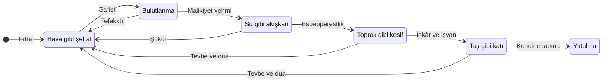
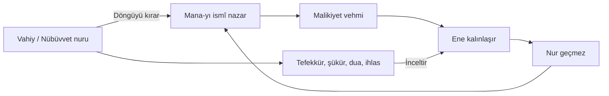
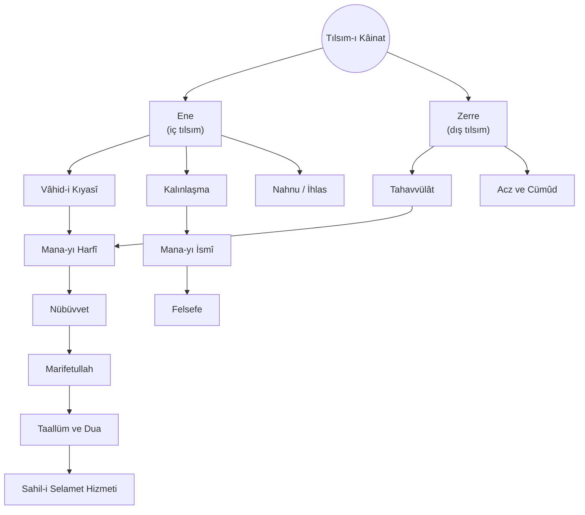

# 🗺️ Diyagramlar

Bu klasördeki şemalar [Mermaid](https://mermaid.js.org/) formatındadır; GitHub bunları doğrudan
görselleştirir. Ham `.mmd` dosyaları [Mermaid Live Editor](https://mermaid.live) ile düzenlenebilir
veya `mmdc` (mermaid-cli) ile SVG/PNG'ye dönüştürülebilir:

```bash
npx -p @mermaid-js/mermaid-cli mmdc -i ene-hal-degisimi.mmd -o ene-hal-degisimi.svg
```

| Dosya | İçerik |
|-------|--------|
| [`ene-hal-degisimi.mmd`](ene-hal-degisimi.mmd) | Ene'nin şeffaflıktan yutulmaya hâl değişimleri |
| [`geri-besleme-dongusu.mmd`](geri-besleme-dongusu.mmd) | Kalınlaşmanın kendini besleyen döngüsü ve kırılma noktası |
| [`tilsim-haritasi.mmd`](tilsim-haritasi.mmd) | Projenin tüm kavramlarını bağlayan üst harita |

---

## Ene'nin Hâl Değişimi



## Geri Besleme Döngüsü



## Tılsım Haritası


