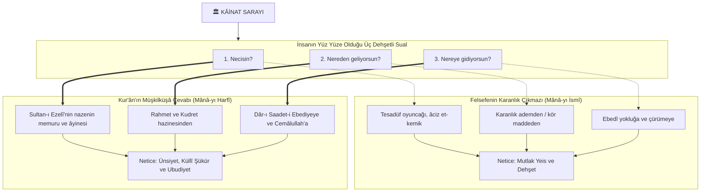
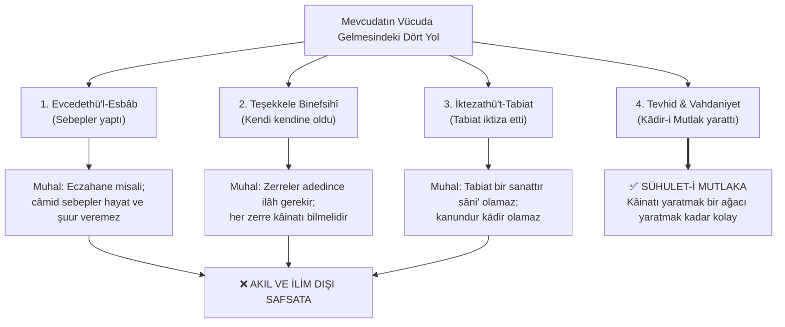
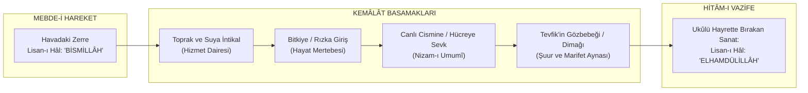
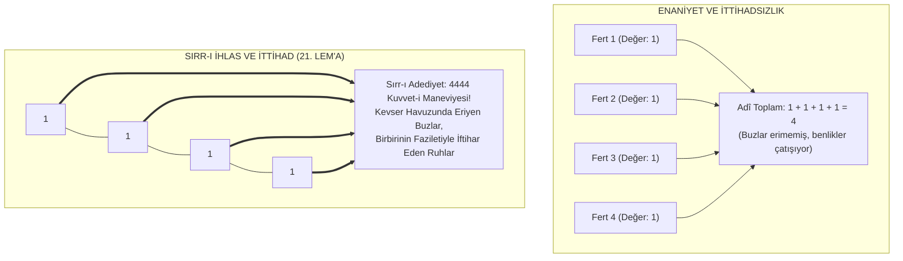

# 🗺️ Diyagramlar

Bu klasördeki şemalar [Mermaid](https://mermaid.js.org/) formatındadır; GitHub bunları doğrudan
görselleştirir. Ham `.mmd` dosyaları [Mermaid Live Editor](https://mermaid.live) ile düzenlenebilir
veya `mmdc` (mermaid-cli) ile SVG/PNG'ye dönüştürülebilir:

```bash
npx -p @mermaid-js/mermaid-cli mmdc -i ene-hal-degisimi.mmd -o ene-hal-degisimi.svg
```

| Dosya | Başlık | Eksen Risale & İçerik |
|-------|--------|-----------------------|
| [`tilsim-haritasi.mmd`](tilsim-haritasi.mmd) | Tılsım Haritası | Projenin tüm kavramlarını bağlayan üst sistem haritası |
| [`ene-hal-degisimi.mmd`](ene-hal-degisimi.mmd) | Ene Hâl Değişimi | 30. Söz: Ene'nin şeffaflıktan (hava) yutulmaya (taş) 5 fazı |
| [`geri-besleme-dongusu.mmd`](geri-besleme-dongusu.mmd) | Geri Besleme Döngüsü | Kalınlaşmanın pozitif döngüsü ve nübüvvetle kırılışı |
| [`kainat-sarayi-uc-sual.mmd`](kainat-sarayi-uc-sual.mmd) | Kâinat Sarayı ve 3 Sual | 11. Söz: Necisin? Nereden? Nereye? (Felsefe vs. Kur'an) |
| [`tabiat-risalesi-muhaller.mmd`](tabiat-risalesi-muhaller.mmd) | Tabiat Risalesi Muhalleri | 23. Lem'a: 4 ihtimal, 3 bâtıl yolun muhalleri ve tevhid |
| [`zerre-seyahati-mertebeler.mmd`](zerre-seyahati-mertebeler.mmd) | Zerre Seyahati ve Mertebeler | 30. Söz: Bismillah'tan Elhamdülillah'a kemâlât basamakları |
| [`ihlas-sinerjisi.mmd`](ihlas-sinerjisi.mmd) | İhlas Sinerjisi ve Şahs-ı Manevî | 21. Lem'a: 4 ferdin 4444 kuvvetine çıkması ve kevser havuzu |

---

## 1. Kâinat Sarayı ve Üç Büyük Sual



---

## 2. Tabiat Risalesi Muhalleri ve Tevhid Kolaylığı



---

## 3. Zerre Seyahati: Kemâlât Basamakları



---

## 4. İhlas Sinerjisi ve Şahs-ı Manevî


