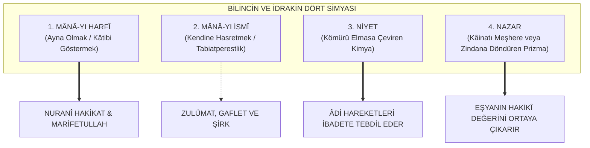

# 🔑 Dört Kelime ve Dört Kelâm: Ene Ontolojisinin Epistemolojik Temelleri

> **بِسْمِ اللّٰهِ الرَّحْمٰنِ الرَّحٖيمِ**
> 
> *"Kırk sene ömrümde, otuz sene tahsilimde yalnız **dört kelime** ile **dört kelâm** öğrendim; tafsilen beyan edilecektir. Burada yalnız icmalen işaret edilecektir:*
> * Kelimeler: **Mânâ-yı harfî**, **mânâ-yı ismî**, **niyet**, **nazar**dır.*
> * Kelâmlar ise:
>   1. **اِنّٖى لَسْتُ مَالِكِى** *(Ben kendime mâlik değilim)*
>   2. **اَلْمُلْكُ لِلّٰهِ** *(Mülk bütünüyle Allah'ındır)*
>   3. **اَلْفَنَاءُ فِى الْخَالِقِ** *(Yaratıcı'nın rızasında fani olmak)*
>   4. **لاَ اِلٰهَ اِلاَّ اللّٰهُ** *(O'ndan başka hiçbir hakiki mabud ve fail yoktur)*"*
> — **Mesnevî-i Nuriye, Mukaddime**

---

## 1. Dört Kelime: Bilincin ve İdrakin Dört Simyası

Bediüzzaman Said Nursî, insanın varlığı algılama ve yorumlama tarzını belirleyen dört anahtar kavramı şöyle şerh eder:

### 1.1 Mânâ-yı Harfî vs. Mânâ-yı İsmî
* **Harf:** Kendi başına bağımsız bir mânâsı olmayan, ancak bir kelimenin veya cümlenin içinde başka bir mânâyı gösteren işarettir. (Meselâ Türkçe'deki "-e", "-de" ekleri tek başına bir nesne değildir; bir nisbet bildirir). Ene ve kâinat **mânâ-yı harfî** ile okunmalıdır: *"Ben bir mektubum, kâtibim Allah'tır; ben bir aynayım, güneşim Rahman'dır."*
* **İsim:** Kendi başına müstakil bir varlığı gösteren kelimedir. Eşyaya veya ene'ye **mânâ-yı ismî** ile bakmak; onu kendi başına var olan, sebeplerin eseri olan ve kendine mâlik bir nesne saymaktır ki şirkin ve küfrün esası budur.

### 1.2 Niyet: Kömürü Elmasa Çeviren İksir
> *"Niyet bir ruhtur; o ruhun cesedi a'mâldir (amellerdir). Niyet bir iksirdir; ölü âdetleri canlı ibadetlere kalbeder. Günahkâr bir hareketi sevaba, fani bir lezzeti baki bir hazineye çevirir."* (Mesnevî-i Nuriye)
* İnsan bir lokma ekmeği yerken *"Lezzet alayım, karnım doysun"* niyetiyle yerse hayvanî bir fiildir; fakat *"Cenâb-ı Hakk'ın Rezzâk isminin ziyafetini tadayım, O'na şükredecek kuvvet bulayım"* niyetiyle yerse o yemek baştan başa bir tesbih ve ibadet olur.

### 1.3 Nazar: Kâinatın Rengini Belirleyen Gözlük
Nazar, insanın varlığa yönelttiği tefekkür dürbünüdür. 
* Gözünde sarı gözlük olan insan bütün kâinatı sarı görür; gözünde inkâr gözlüğü olan insan kâinatı sahipsiz bir leş zanneder.
* İman ve hikmet nazarıyla bakan insan için her zerre bir miftah, her çiçek bir tebessüm-ü rahmet, her gök gürültüsü bir tesbihat nidasıdır.

---

## 2. Dört Kelâm: Varlığın Hakikat Bildirgesi

### 2.1 Birinci Kelâm: "İnnî Lestü Mâlikî" (Ben Kendime Mâlik Değilim)
Ene'nin kibir ve firavuniyetini kökünden kesen ilk balta:
* İnsan kendi kalbinin atışına, kanının dolaşımına, hücrelerinin bölünmesine mâlik değildir.
* Kendini yoktan var edemeyen, gençliğini durduramayan, ihtiyarlığı engelleyemeyen ve ölümü savamayan bir varlık nasıl olur da *"Ben benimdir"* iddiasında bulunabilir?
* *"Ben kendime mâlik değilim; ancak mülkünde çalışan âciz bir misafirim."*

### 2.2 İkinci Kelâm: "El-Mülkü Lillâh" (Mülk Yalnızca Allah'ındır)
* Kâinattaki zerrelerden kürrelere kadar hiçbir şeyin hakiki sahibi sebepler, tabiat veya tesadüf değildir.
* Mülk bütünüyle O'nundur; emaneten insana verilen sıfatlar da O'nun künûz-u mahfiyesini tanımak için birer emanettir.

### 2.3 Üçüncü Kelâm: "El-Fenâü fi'l-Hâlık" (Hâlık'ın Rızasında Fani Olmak)
* Kendi cüz'î hevesatını, menfaatini ve egosunu Hâlık-ı Zülcelâl'in kudsî rızasında eritmek.
* *"Buz parçası hükmündeki enaniyetini kevser havuzuna atıp fani kılmak"* hakikati burada kemâle erer. Kendini unutan, ebediyeti bulur.

### 2.4 Dördüncü Kelâm: "Lâ İlâhe İllallâh" (Tevhidin Zirvesi)
* Bütün kâinatın tılsımını çözen nihai parola:
* Hâlık birdir, Mâlik birdir, Mün'im birdir, Rezzâk birdir. O'ndan başka sığınılacak, medet umulacak hiçbir merci yoktur.

---

## 3. Tılsım Açısından Sentez

Ene, **Dört Kelime** ile terbiyelenip **Dört Kelâm** ile donandığında; kâinatın muammâ-yı müşkilküşâsı çözülür, zulümat dağılır ve insan "Ahsen-i Takvîm" sırrına mazhar olur.
