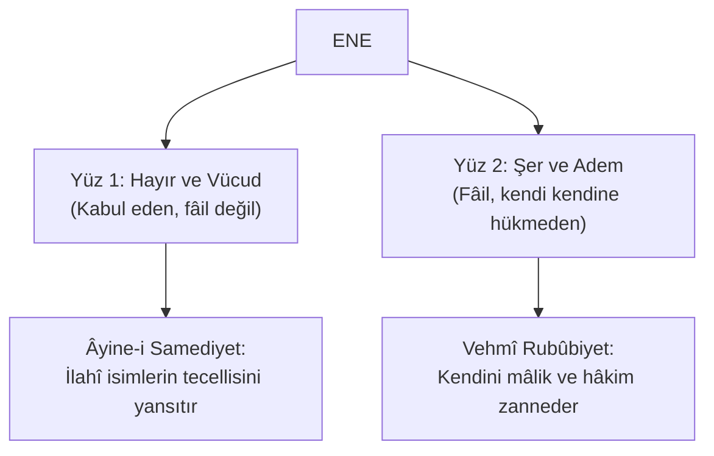

# 1. Vâhid-i Kıyasî: Ene'nin Fıtrî Vazifesi

> *"Ben göklere, yere ve dağlara emaneti arz ettim..."* (Ahzâb, 72)

30. Söz, bu âyetin işaret ettiği **emanet**in vecihlerinden birinin *ene* olduğunu söyler. Ene, insana
verilmiş öyle bir cihazdır ki hem kâinatın tılsımını hem de insanın kendi muammasını açar.

---

## 1.1 Problem: Mutlak Olan Nasıl Bilinir?

Bir şeyi bilmek, onu sınırlamakla mümkündür. Hududu olmayan bir ışık, bir karanlık çizgi çekilmeden
fark edilmez; her yeri dolduran bir şeyin *şekli* olmaz.

İlahî sıfatlar ise **muhit** ve **nihayetsizdir**: Ne başı vardır ne sonu. O hâlde sınırlı bir
akıl, sınırsız bir sıfatı nasıl idrak edecektir?

| Adım | Açıklama |
|------|----------|
| **Öncül 1** | Mutlak ve muhit olanın hududu yoktur. |
| **Öncül 2** | Hududu olmayan şey, kendi başına bir *şekil* ve *mahiyet* olarak idrak edilemez. |
| **Öncül 3** | İdrak için bir **ölçü birimi** (vâhid-i kıyasî) gerekir. |
| **Netice** | İnsana, *farazî bir hat* çeken, *vehmî bir rubûbiyet* taşıyan bir **ene** verilmiştir. |

## 1.2 Çözüm: Farazî Bir Hat

Ene, gerçek bir varlık değil, **farazî bir çizgidir**. Mühendisler bir hesabı kolaylaştırmak için nasıl
farazî bir hat çizerlerse, ene de mutlak sıfatları *ölçmek* için çizilmiş böyle bir hattır.

```text
   Sonsuz Nur (Mutlak Sıfat)
  ════════════════════════════════════════
              │  ← farazî hat (ENE)
   "Benim cüz'î ilmim var"   →  "O'nun küllî ilmi var"
   "Benim cüz'î kudretim var" →  "O'nun mutlak kudreti var"
   "Ben bu evin sahibiyim"    →  "O, kâinatın Mâlikidir"
```

### Ölçme Yöntemleri

Ene, İlahî sıfatları iki farklı yolla ölçer:

1. **Benzerlik (Teşbih değil, Temsil) Yoluyla:**
   Kendi cüz'î sıfatlarımızdan, O'nun küllî sıfatlarını *anlarız*. Küçük bir ev yapan insan, kâinat
   sarayının bir Ustası olduğunu fehmeder.

2. **Zıddiyet Yoluyla:**
   Kendi aczimizle O'nun kudretini, fakrımızla O'nun gınâsını, cehlimizle O'nun ilmini tanırız.
   *"Eşya zıtlarıyla bilinir."*

## 1.3 Hakikat-i Zılliyye ve Mana-yı Harfî

Ene'nin mahiyeti **harfîdir**: Kendine değil, başkasına delalet eder. Bir harf kendi başına manasızdır;
anlamını, ait olduğu kelimeden alır.

| | Mana-yı Harfî (Doğru Nazar) | Mana-yı İsmî (Bozuk Nazar) |
|---|---|---|
| **Kendini görme** | "Ben bir aynayım, bir gölgeyim." | "Ben kendi kendime varım." |
| **Sıfatlar** | Emanet; asıl Sahibine işaret eder. | Mülk; "benim" denir. |
| **Vücud** | Zıllî (gölge) bir vücud. | Müstakil bir vücud vehmi. |
| **Netice** | Tevhid, şükür, tevazu. | Şirk-i hafî, gurur, inkâr. |

> **Hakikat-i Zılliyye:** İnsandaki her sıfat, asıl ve mutlak bir sıfatın *gölgesidir*. Gölgenin varlığı,
> güneşin varlığına delildir; fakat gölge, güneşin yerine geçmeye kalkarsa kendini yok eder.

## 1.4 Ene'nin Çift Yönlü Yapısı



Ene'nin *kabul ve infial* (alma, edilgenlik) yönü hayırdır; *fiil ve icad* iddiası ise şerdir.
Çünkü insan hayırda **fâil değil, kâbildir**; şerde ise **fâildir**.

## 1.5 Tefekkür Soruları

- Bir aynanın değeri camında mıdır, yoksa yansıttığı güneşte mi?
- "Ben"i kaldırınca geriye ne kalır? "Ben"i asıl yerine koyunca neler görünür hâle gelir?
- Ölçü birimi (metre, kilogram) kendini ölçülen şeyle karıştırırsa ne olur?

---

⬅️ [Ene Ontolojisi](README.md) · ➡️ [2. Kalınlaşma, Firavuniyet ve Yutulma](02-kalinlasma-ve-firavuniyet.md)
