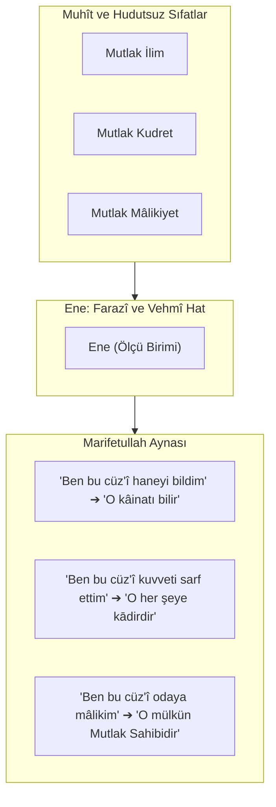

# 🗝️ 1. Vâhid-i Kıyasî: Ene'nin Fıtrî Vazifesi ve Sırr-ı Hilkati

> **بِسْمِ اللّٰهِ الرَّحْمٰنِ الرَّحٖيمِ**
> 
> *اِنَّا عَرَضْنَا الْاَمَانَةَ عَلَى السَّمٰوَاتِ وَالْاَرْضِ وَالْجِبَالِ فَاَبَيْنَ اَنْ يَحْمِلْنَهَا وَاَشْفَقْنَ مِنْهَا وَحَمَلَهَا الْاِنْسَانُ اِنَّهُ كَانَ ظَلُومًا جَهُولًا*
> 
> *"Şu âyetin büyük hazinesinden tek bir cevherine işaret edeceğiz. Şöyle ki: Gök, zemin, dağ tahammülünden çekindiği ve korktuğu emânetin müteaddid vücûhundan bir ferdi, bir vechi, 'ene'dir."*
> — **30. Söz, Birinci Maksad (Mukaddime)**

---

## 1.1 Kâinatın Tılsım-ı Muğlâkı ve Müşkilküşâ Miftah

Otuzuncu Söz'ün başında Bediüzzaman Said Nursî, kâinat ile insan arasındaki esrarlı bağı şöyle ilân eder:

> *"Ene, künûz-u mahfiye olan esmâ-i İlâhiyenin anahtarı olduğu gibi, kâinatın tılsım-ı muğlâkının dahi anahtarı olarak bir muammâ-yı müşkilküşâdır, bir tılsım-ı hayretfezâdır. O ene, mahiyetinin bilinmesiyle, o garip muammâ, o acip tılsım olan ene açılır ve kâinat tılsımını ve âlem-i vücubun künûzunu dahi açar.*
> 
> *Şu meseleye dair, Şemme isminde bir risale-i Arabiyemde şöyle bahsetmişiz ki: Âlemin miftahı insanın elindedir ve nefsine takılmıştır. Kâinat kapıları zâhiren açık görünürken, hakikaten kapalıdır. Cenâb-ı Hak, emanet cihetiyle, insana 'ene' namında öyle bir miftah vermiş ki, âlemin bütün kapılarını açar. Ve öyle tılsımlı bir enaniyet vermiş ki, Hallâk-ı Kâinatın künûz-u mahfiyesini onunla keşfeder."*

Kâinat sarayının kapıları zâhiren ardına kadar açıktır; yıldızlar parlar, rüzgârlar eser, zerreler raks eder. Fakat bir şuur sahibi insan gelip de o sahifelerdeki İlâhî manaları okumadıkça, bu kapılar hakikatte kilitlidir. İşte o kilitleri açacak yegâne anahtar insanın benliğine takılmış olan **"Ene"**dir.

---

## 1.2 Problem: Mutlak ve Muhît Olan Nasıl İdrak Edilir?

Neden insana böyle tehlikeli ve iki yüzlü bir cihaz verilmiştir? Cevap, varlık felsefesinin en çetin meselesinde yatar: **Mutlak ve sınırsız olan bir hakikat, sınırlı bir şuur tarafından nasıl ihata edilecek ve bilinecektir?**

> *"Elcevap: Çünkü; mutlak ve muhît bir şeyin hududu ve nihâyeti olmadığı için, ona bir şekil verilmez ve üstüne bir suret ve bir taayyün vermek için hükmedilmez, mahiyeti ne olduğu anlaşılmaz.*
> 
> *Meselâ: Zulmetsiz daimî bir ziya, bilinmez ve hissedilmez. Ne vakit hakikî veya vehmî bir karanlık ile bir hat çekilse, o vakit bilinir.*
> 
> *İşte, Cenâb-ı Hakkın, ilim ve kudret, Hakîm ve Rahîm gibi sıfât ve esmâsı muhit, hududsuz, şeriksiz olduğu için, onlara hükmedilmez ve ne oldukları bilinmez ve hissolunmaz. Öyle ise, hakikî nihayet ve hadleri olmadığından, farazî ve vehmî bir haddi çizmek lâzım geliyor. Onu da enaniyet yapar. Kendinde bir rububiyet-i mevhume, bir mâlikiyet, bir kudret, bir ilim tasavvur eder, bir had çizer, onunla muhit sıfatlara bir hadd-i mevhum vaz eder. 'Buraya kadar benim, ondan sonra Onundur' diye bir taksimat yapar..."*
> — **30. Söz, Birinci Maksad**

---

## 1.3 Hendesedeki Farazî Hatlar Misali: Vâhid-i Kıyasî

Bediüzzaman, enenin hakiki bir varlığı olmadığını geometri ilminden enfes bir analojiyle delillendirir:

> *"Sâni-i Hakîm, insanın eline, emanet olarak, rububiyetinin, sıfât ve şuûnâtının hakikatlerini gösterecek, tanıttıracak işârat ve nümuneleri câmi' bir ene vermiştir; tâ ki, o ene bir **vâhid-i kıyasî** olup, evsâf-ı Rububiyet ve şuûnât-ı Ulûhiyet bilinsin.*
> 
> *Fakat vâhid-i kıyasî, bir mevcud-u hakiki olmak lazım değil. Belki, **hendesedeki farazî hatlar gibi, farz ve tevehhümle bir vâhid-i kıyasî teşkil edilebilir.** İlim ve tahakkukla hakiki vücudu lazım değildir.*
> 
> *...Demek ene, âyine-misâl ve vâhid-i kıyasî ve âlet-i inkişaf ve mânâ-yı harfî gibi; mânâsı kendinde olmayan ve başkasının mânâsını gösteren, vücud-u insaniyetin kalın ipinden şuurlu bir tel ve mahiyet-i beşeriyenin hullesinden ince bir ip ve şahsiyet-i âdemiyetin kitabından bir eliftir..."*

### Üç Temsilî Tasvir:
1. **Şuurlu bir tel:** İnsanın kesif ve kalın cismâniyet ipinden süzülmüş, hassas ve nâzenin bir teldir.
2. **İnce bir ip:** Mahiyet elbisesinin dikişindeki en nâzik ilmek gibidir.
3. **Kitaptan bir elif:** Âdemiyet kitabının başında duran incecik **elif (ا)** harfidir. Elifin kendi başına zâtî bir manası yoktur; fakat bütün kelimelerin ve harflerin tertibine menşe olur, Kâtib'ine işaret eder.

---

## 1.4 Ene'nin İki Vechi: Nübüvvet ve Felsefe Silsileleri

30. Söz'de insanlık tarihi, enenin iki vechinin açılmasıyla iki ana gövdeye ayrılır:

> *"Evet, ene, zaman-ı Âdem’den şimdiye kadar âlem-i insaniyetin etrafına dal budak salan nurânî bir şecere-i Tûbâ ile, müthiş bir şecere-i zakkumun çekirdeğidir.*
> 
> *O iki şecereye menşe ve medâr, esaslı bir çekirdek olarak enenin iki vechini beyân edeceğiz. Şöyle ki: **Enenin bir vechini nübüvvet tutmuş gidiyor, diğer vechini felsefe tutmuş geliyor.**"*

### Birinci Vecih: Nübüvvet Yolu ve Hakiki Ubudiyet
> *"Nübüvvetin vechi olan birinci vecih: Ubûdiyet-i mahzânın menşeidir. Yani, ene, kendini abd bilir; başkasına hizmet eder, anlar.*
> * *Mahiyeti harfiyedir; yani başkasının mânâsını taşıyor, fehmeder.*
> * *Vücudu tebeîdir; yani başka birisinin vücuduyla kâim ve icadıyla sabittir, itikad eder.*
> * *Mâlikiyeti vehmiyedir; yani kendi mâlikinin izniyle sürî, muvakkat bir mâlikiyeti vardır, bilir.*
> * *Hakikati zılliyedir; yani hak ve vâcip bir hakikatin cilvesini taşıyan mümkin ve miskin bir zılldir.*
> * *Vazifesi ise, kendi Hâlıkının sıfât ve şuûnâtına mikyas ve mizan olarak, şuurkârâne bir hizmettir."*

Bu vecih ile ene; *"Ben kimim ki kendime mâlik olayım? Ben ancak Sâni-i Zülcelâl'in antika bir san'atıyım, O'nun isimlerinin cilvelerine mazhar bir aynayım"* der. Emaneti hıyanet etmeksizin sahibine teslim eder.

### İkinci Vecih: Felsefe Yolu ve Firavunane Dalâlet
> *"İkinci vecih ise, felsefe tutmuştur. Felsefe ise, eneye mânâ-yı ismiyle bakmış. Yani; kendi kendine delâlet eder, der. Mânâsı kendindedir, kendi hesabına çalışır, hükmeder.*
> * *Vücûdu; aslî, zâtî olduğunu telâkki eder. Yani, zâtında bizzât bir vücûdu vardır, der.*
> * *Bir hakk-ı hayatı var, daire-i tasarrufunda hakiki mâliktir, zu‘meder. Onu, bir hakikat-i sâbite zanneder.*
> * *Vazifesini, hubb-u zâtından neş’et eden bir tekemmül-ü zâtî olduğunu bilir ve hâkeza çok esâsât-ı fâsideye mesleklerini binerler."*

---

## 1.5 Karşılaştırma Matrisi: Ene'nin İki Tablosu

| Boyut | Nübüvvet Nazarı (Hidayet) | Felsefe Nazarı (Dalâlet) |
|:---|:---|:---|
| **Nazar Türü** | Mânâ-yı Harfî (Kâtib'i gösterir) | Mânâ-yı İsmî (Kendine işaret eder) |
| **Vücud Telakkisi** | Vücud-u Tebeî (O'nunla kâimdir) | Vücud-u Aslî ve Zâtî (Kendi başına vardır) |
| **Mâlikiyet Anlayışı**| Mâlikiyet-i Vehmiye (Emanettir, muvakkat) | Mâlikiyet-i Hakikiye (Ben kazandım, benimdir) |
| **Varlık Derecesi** | Hakikat-i Zılliye (Gölge, ayna) | Hakikat-i Sâbite (Müstakil varlık) |
| **Vazifesi** | Sıfât-ı İlâhiyeye mikyas ve mizan olmak | Hubb-u zâttan neş'et eden tekemmül-ü zâtî |
| **Meyvesi** | Şecere-i Tûbâ-yı Ubudiyet | Şecere-i Zakkum-u Enaniyet |

---

## 1.6 Derin Tefekkür Soruları

1. Metre veya terazi, tarttığı kumaşın veya altının mülkiyetini iddia etse ne kadar gülünç olursa; ene'nin de elindeki ilim ve kudreti sahiplenmesi o derece muhal değil midir?
2. Zâtında hava ve buhar gibi olan bir şey, nasıl olur da dağları ve gökleri titreten bir enaniyete dönüşebilir? (Cevap 2. Bölümde...)

---

⬅️ [Ene Ontolojisi Giriş](README.md) · ➡️ [2. Kalınlaşma, Firavuniyet ve Yutulma](02-kalinlasma-ve-firavuniyet.md)
