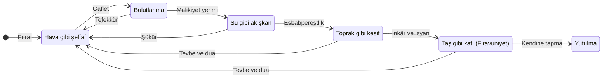
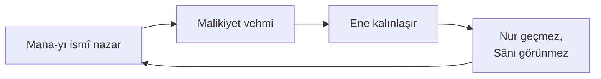

# 2. Kalınlaşma, Firavuniyet ve Yutulma

> *"Ene, zâtında hava gibi şeffaftır; fakat gaflet, inkâr ve isyanla kalınlaşır; büyür, sahibini yutar."*
> — 30. Söz'ün ana fikrinin özeti

---

## 2.1 Hâl Değişimi (Faz Diyagramı)

Ene'nin bozuluşu, fizikteki hâl değişimlerine benzetilebilir. Şeffaf bir gaz önce buğulanır, sonra
yoğunlaşır, en sonunda katılaşır ve ışık geçirmez olur.

| Mertebe | Hâl | Belirti |
|---------|-----|---------|
| 0 | **Hava gibi şeffaf** | Ene, ayna vazifesini görüyor; her nimet Sahibini hatırlatıyor. |
| 1 | **Bulutlanma** | Gaflet perdeleri. Nimet görülüyor, Mün'im unutuluyor. |
| 2 | **Su gibi akışkan** | "Bu benim" vehmi yerleşiyor (temellük). |
| 3 | **Toprak gibi kesif** | Sebepler müessir zannediliyor (esbabperestlik). Nur geçmiyor. |
| 4 | **Taş gibi katı** | Firavuniyet: Ene kendini rab, sebepleri tanrı yerine koyuyor. |
| 5 | **Yutulma** | Ene sahibini yutmuş; insanın fıtratı ve hakiki mahiyeti örtülmüş. |

> [!TIP]
> Bu geçişler [`simulations/ene-thickening-model.py`](../../simulations/ene-thickening-model.py)
> içinde sembolik olarak modellenmiştir. `python simulations/ene-thickening-model.py --karsilastir`

## 2.2 Kalınlaştırıcı Mekanizmalar

### a) Gaflet
Nimetin içinde Mün'im'i görmemek. Gaflet, bir **unutma** değil, bir **bakmama** hâlidir. Göz açıktır
fakat nazar ismîdir.

### b) Malikiyet-i Vehmiye (Temellük)
Emanet olarak verilen sıfatları mülk zannetmek: *"Bu ilim benimdir, bu kudret benimdir."*
Bu vehim, enenin **ilk katılaşma çekirdeğidir**: Bir defa "benim" denilen şey, ene'ye ağırlık katar.

### c) Esbabperestlik
Sebeplere *tesir-i hakikî* vermek. Tabiatı, tesadüfü veya kendi gücünü fâil yerine koymak.
Ene kendini mâlik zannettiği gibi, diğer sebepleri de mâlik zanneder ve *"şirkin envâı taifeleri"*
böylece doğar.

### d) İnkâr ve İsyan
Bilinçli olarak İlahî emir ve hakikatlere karşı durmak. Bu safhada ene artık yalnız şeffaflığını
kaybetmemiş, **kendini bir duvar olarak savunan** bir hâle gelmiştir.

## 2.3 Pozitif Geri Besleme Döngüsü

Ene'nin "sahibini yutması" doğrusal değil, **kendini besleyen** bir süreçtir:

Kalınlaşan ene Sâni'i daha az gösterir; Sâni daha az görüldükçe eşyaya ismî bakış artar; ismî bakış
arttıkça ene daha çok kalınlaşır. Bu döngüyü ancak **dışarıdan gelen bir nur** (vahiy, nübüvvet) kırabilir.

## 2.4 Firavuniyet: Bir Arketip

Firavun tarihî bir şahıs olmakla beraber, aynı zamanda **bir enenin son mertebesinin** sembolüdür:

- *"Ben sizin en yüce rabbinizim"* (Nâziât, 24) iddiası, kalınlaşmış enenin dile gelmiş hâlidir.
- Firavuniyet; yalnız siyasî bir tiranlık değil, **ferdî bir hâl** olarak her insanda potansiyel olarak mevcuttur.
- Felsefenin *teşebbüh-ü bi'l-Vâcib* (Vâcib'e benzemeye çalışma) ideali, bu arketipin entelektüel versiyonudur.
  Bkz. [Nübüvvet ve Felsefe](../nubuvvet-ve-felsefe.md).

## 2.5 Modern Yansımalar

| Klasik Kavram | Modern Karşılık (Yaklaşık) |
|---------------|----------------------------|
| Malikiyet-i vehmiye | Mülkiyetçi benlik, "self-made man" mitosu |
| Esbabperestlik | Natüralizm, mekanistik dünya görüşü |
| Firavuniyet | Narsisizm, güç kültü |
| Ene'nin sahibini yutması | Yabancılaşma, anlam krizi |
| *Ezhan*ın enelere dönmesi | Bireyci izolasyon, "kendine dönük dünya" |

> [!WARNING]
> Bu eşleştirmeler birer **köprü** denemesidir, birebir tercüme değildir. Klasik ıstılahların kendi
> bağlamı ve derinliği korunmalıdır.

---

⬅️ [1. Vâhid-i Kıyasî](01-vahid-i-kiyasi.md) · ➡️ [3. Ene'den Nahnu'ya](03-eneden-nahnuya.md)
