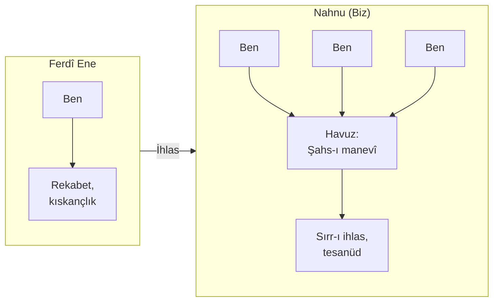

# 3. Ene'den Nahnu'ya: İhlas ve Şahs-ı Manevî

> Kalınlaşmanın tedavisi, eneyi **yok etmek** değil, onu **asıl vazifesine iade etmektir**.

---

## 3.1 Tedavinin İlkesi

Ene bir organ gibidir: Kesilip atılamaz, fakat **fıtrî vazifesine** döndürülebilir. Hava gibi
şeffaflaştırmanın yolları, kalınlaştırıcı kuvvetlerin tam zıddıdır:

| Hastalık | İlaç | Mekanizma |
|----------|------|-----------|
| Gaflet | **Tefekkür** | Nazarı mana-yı harfîye çevirir; her şeyde Sâni'i okur. |
| Malikiyet vehmi | **Şükür** | Nimeti Sahibine iade eder; "benim" yerine "O'nun" der. |
| Acizlik karşısında isyan | **Dua** | Aczi, Kudret-i Mutlaka'ya bağlanma vesilesine çevirir. |
| Riya ve şöhret | **İhlas** | Ameli yalnızca rıza-yı İlahî için yapar. |
| İnkâr | **Tahkikî iman** | Bürhan ile tasdik; taklidi yakîne çevirir. |

## 3.2 Acz, Fakr, Şefkat, Tefekkür

Risale-i Nur'da (*Sözler*, 26. Söz Zeyli) "*acz, fakr, şefkat, tefekkür*" dört esaslı yol olarak
zikredilir. Ene açısından okunduğunda:

1. **Acz:** Kendi aczini görmek → Ene'nin "kudret" iddiası düşer.
2. **Fakr:** Kendi fakrını görmek → Ene'nin "gınâ" (müstağnilik) iddiası düşer.
3. **Şefkat:** Rahmet-i İlahiyenin yansımasını taşımak → Ene merkezden çıkar, başkalarına yönelir.
4. **Tefekkür:** Eşyayı mana-yı harfî ile okumak → Ene şeffaflaşır, ayna olur.

## 3.3 Nahnu Havuzu: Kolektif Bir Ruh

*Lem'alar*'daki **İhlas Risaleleri**, ferdî eneyi "biz" (nahnu) havuzunda eritmeyi tavsiye eder.
Benzetme şudur: Bir buz parçası (ene) kendini koruyup tek başına kalırsa güneşte eriyip zayi olur;
bir havuza atılırsa havuzla beraber bâki kalır.

### Şahs-ı Manevî

Bir cemaatin ihlas ile birleşmesinden doğan kolektif kişiliktir. Matematik benzetmesiyle:
> Dört tane "bir" ayrı ayrı yazılırsa dört eder; birleşip yan yana yazılırsa **1111** eder.

Bu, *sinerji*nin manevî bir ifadesidir: Ene'lerin toplamı değil, **ihlas ile çarpımı**.

## 3.4 Pratik Kontrol Listesi

- [ ] Bir başarıdan sonra ilk düşüncem "ben yaptım" mı, yoksa "bana yaptırıldı" mı?
- [ ] Bir nimeti görünce, Sahibini de hatırlıyor muyum?
- [ ] Bir hizmet arkadaşımın başarısı beni sevindiriyor mu, kıskandırıyor mu?
- [ ] Aczimi hissettiğim anlarda isyana mı, duaya mı yöneliyorum?
- [ ] Bir sebebe güvendiğimde, onun bir *perde* olduğunu hatırlıyor muyum?

---

⬅️ [2. Kalınlaşma ve Firavuniyet](02-kalinlasma-ve-firavuniyet.md) · 🏠 [Ana Sayfa](../../README.md)
