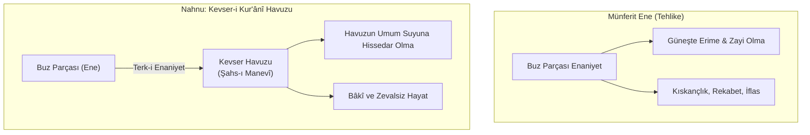
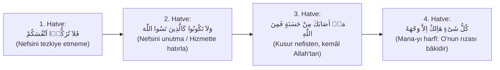

# 🌊 3. Ene'den Nahnu'ya: İhlas, Buz Parçası ve Şahs-ı Manevî

> *"Evet, bahtiyar odur ki, kevser-i Kur’ânîden süzülen tatlı, büyük bir havuzu kazanmak için, bir buz parçası nev’indeki şahsiyetini ve enâniyetini o havuz içine atıp eritendir. Yoksa o buz parçası erir, zayi olur; o havuzdan da istifade edilmez."*
> — **21. Lem'a (İhlas Risalesi)**

---

## 3.1 Bireysel Buz Parçasından Kevser Havuzuna

Kalınlaşan, donan ve tecemmüd eden ene'nin nihai ilacı onu zorla yok etmek (intihar-ı mânevî) değil; **Kur'ânî havuzun içinde eritip bâkileştirmektir.**

Bir buz parçasını sıcak bir günde avucunuzda tutsanız, erir, parmaklarınızın arasından akar ve toprağa karışıp zayi olur. Ne size bir faydası kalır, ne bir başkasına. Fakat o buzu alıp binlerce metreküplük tatlı ve berrak bir su havuzunun içine atarsanız:
1. Buz erir, donuk ve kesif şahsiyetini terk eder.
2. Havuzun bir damlası değil, **havuzun tamamının ortağı ve mâliki** hükmüne geçer.
3. Kendi sınırlı kuvveti yerine, havuzun küllî kuvvetini arkasına alır.

---

## 3.2 İhlas Matematiği: Üç Eliften 111'e, Dört Eliften 4444'e

İhlas Risalesi'nin 3. Düsturunda Bediüzzaman, modern sistem teorisindeki **sinerji (emergence)** kanununu harika bir ebced ve hat temsiliyle açıklar:

> *"Elbette dört ferdden bin yüz onbir kuvvet-i maneviyeyi temin eden sırr-ı ihlâsı kazanmak ile, tesanüd ve ittihad-ı hakikîye muhtacız ve mecburuz.*
> 
> *Evet, üç elif ittihad etmezse, üç kıymeti var. Sırr-ı adediyet ile ittihad etse, **yüz on bir (111)** kıymet alır.*
> *Dört kere dört ayrı ayrı olsa, on altı kıymeti var. Eğer sırr-ı uhuvvet ve ittihad-ı maksat ve ittifak-ı vazife ile tevafuk edip bir çizgi üstünde omuz omuza verseler, o vakit **dört bin dört yüz kırk dört (4444)** kuvvetinde ve kıymetinde olduğu gibi, hakikî sırr-ı ihlâs ile, on altı fedakâr kardeşlerin kıymet ve kuvvet-i maneviyesi dört binden geçtiğine, pek çok vukuat-ı tarihiye şehadet ediyor."*

$$1 + 1 + 1 = 3 \quad \text{(Benliklerin mekanik toplamı)}$$
$$1 \text{ omuz omuza } 1 \text{ omuz omuza } 1 = 111 \quad \text{(Sırr-ı İhlas ile şahs-ı manevî)}$$

Eğer insanlar "ben" davası güderlerse, en fazla kendi cüz'î ağırlıkları kadar iş yaparlar ve sürtünmeden dolayı birbirlerinin kuvvetini kırarlar. Fakat "biz" (nahnu) şuuruna erip tek bir hizada birleşirlerse, kuvvetleri toplamla değil basamak değeriyle çarpan etkisi kazanır.

---

## 3.3 İnsan-ı Kâmil Suretinde Bir Şahs-ı Manevî

Yirmi Birinci Lem'a'da, Kur'an hizmetkârlarının ve hakikat yolcularının bu dehşetli asırdaki konumu üç büyük metaforla tasvir edilir:

> *"İşte, ey Risale-i Nur şâkirtleri ve Kur’ân’ın hizmetkârları!*
> 1. *Sizler ve bizler öyle bir **insân-ı kâmil ismine lâyık bir şahs-ı mânevînin âzâlarıyız**.*
> 2. *Ve hayat-ı ebediye içindeki sâadet-i ebediyeyi netice veren bir **fabrikanın çarkları** hükmündeyiz.*
> 3. *Ve **sâhil-i selâmet olan Dâr-üs Selâm’a Ümmet-i Muhammediyeyi (A.S.M.) çıkaran bir sefine-i Rabbaniyede çalışan hademeleriz**."*

### Üç Metaforun Derinliği:
* **İnsan-ı Kâmil'in Âzâları:** Göz kulağa rekabet etmez; el ayağa gıpta etmez; kalp akılla yarışmaz. Her biri diğerinin eksiğini tamamlar, birbirinin faziletiyle iftihar eder.
* **Fabrikanın Çarkları:** Çarklardan biri ters dönse veya "ben diğerinden büyüğüm" deyip yerini terk etse bütün fabrikanın üretimi durur. Hadiselerin kıymeti çarkın büyüklüğünde değil, intizamdaki sadakatindedir.
* **Sefine-i Rabbaniye Hademeleri:** Fırtınalı bir denizde batmak üzere olan insanları kurtaran dev bir geminin hademeleri, kendi aralarında rütbe kavgası yapamazlar. Yegâne gaye, Ümmet-i Muhammed'i (a.s.m.) sahil-i selamete sağ salim ulaştırmaktır.

---

## 3.4 Acz, Fakr, Şefkat ve Tefekkür: Dört Hatve

Yirmi Altıncı Söz'ün Zeyli'nde, tarik-i Nakşî'nin on letaifi ve tarik-i Kadirî'nin yedi nefis mertebesine mukabil, Kur'an'dan istihraç edilen ve eneyi en kestirme yoldan eriten **"Dört Hatve"** tariki beyan edilir:

> *"Cenâb-ı Hakk’a vâsıl olacak tarîkler pek çoktur... O tarîkler içinde, kāsır fehmimle Kur’ân’dan istifade ettiğim **'acz ve fakr ve şefkat ve tefekkür'** tarîkıdır.*
> *Evet, acz dahi aşk gibi, belki daha eslem bir tarîktir ki, ubûdiyet tarîkıyla mahbûbiyete kadar gider.*
> *Fakr dahi Rahmân ismine îsal eder.*
> *Hem şefkat dahi aşk gibi, belki daha keskin ve daha geniş bir tarîktir ki, Rahîm ismine îsal eder.*
> *Hem tefekkür dahi aşk gibi, belki daha zengin, daha parlak, daha geniş bir tarîktir ki, Hakîm ismine îsal eder."*

### Dört Hatvenin Pratik İzahı:
1. **فَلاَ تُزَكُّوۤا اَنْفُسَكُمْ (Necm, 32):** Kendini temize çıkarma, kusursuz görme. Daima nefsini itham et.
2. **وَلاَ تَكُونُوا كَالَّذِينَ نَسُوا اللّٰهَ فَاَنْسٰيهُمْ اَنْفُسَهُمْ (Haşr, 19):** Nefsini hazlarda, menfaatlerde unut; ancak vazifede, acz ve fakrda hatırla.
3. **مَاۤ اَصَابَكَ مِنْ حَسَنَةٍ فَمِنَ اللّٰهِ وَمَاۤ اَصَابَكَ مِنْ سَيِّئَةٍ فَمِنْ نَفْسِكَ (Nisâ, 79):** Hayır ve muvaffakiyet gördüğünde "Allah'ın lütfudur" de, gururlanma; şer ve hata gördüğünde "kendi kusurumdur" de, kadere taş atma.
4. **كُلُّ شَىْءٍ هَاِلكٌ اِلاَّ وَجْهَهُ (Kasas, 88):** Eşyaya mana-yı ismiyle bakarsan her şey fanidir, helaktedir. Mana-yı harfiyle bakarsan, O'na ayna olan her şey bekā bulur.

---

## 3.5 Nahnu Şuurunun Günlük Hayattaki Ölçüleri

- [ ] Bir iş başarıldığında tebriki şahsına değil, şahs-ı manevîye havale etmek.
- [ ] Kardeşinin meziyetiyle kendi meziyeti gibi iftihar edebilmek (fena fi'l-ihvan).
- [ ] Tenkidi önce nefsine, hürmeti önce dava arkadaşına yöneltmek.
- [ ] Kendi cüz'î fikrinde inat etmek yerine, meşveretin ve ortak aklın kararına teslim olmak.

---

⬅️ [2. Kalınlaşma ve Firavuniyet](02-kalinlasma-ve-firavuniyet.md) · 🏠 [Ana Sayfa](../../README.md)
