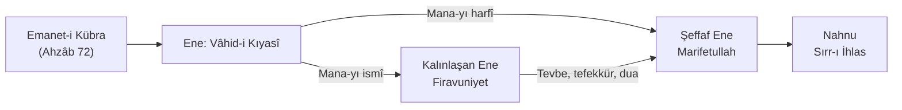

# 🗝️ Ene Ontolojisi

> *30. Söz – Ene ve Zerre Risalesi, Birinci Maksad* ekseninde hazırlanmış analizler.

Bu klasör, insanın varoluşsal çekirdeği olan **Ene**'yi (benlik) üç aşamada inceler:

| # | Doküman | Soru |
|---|---------|------|
| 1 | [Vâhid-i Kıyasî: Ene'nin Fıtrî Vazifesi](01-vahid-i-kiyasi.md) | Ene *ne için* verilmiştir? |
| 2 | [Kalınlaşma, Firavuniyet ve Yutulma](02-kalinlasma-ve-firavuniyet.md) | Ene *nasıl* bozulur? |
| 3 | [Ene'den Nahnu'ya: İhlas ve Şahs-ı Manevî](03-eneden-nahnuya.md) | Ene *nasıl* tedavi edilir? |

## Okuma Haritası

## Temel Tez

Ene, kâinat hazinesinin **anahtarıdır**; fakat aynı zamanda **tılsımlı bir kilittir**. Doğru kullanıldığında
İlahî isimlerin gizli hazinelerini açar; yanlış kullanıldığında kendisi bir kilit hâline gelir ve
sahibinin önünde marifet kapılarını kapatır.

> [!NOTE]
> Bu dokümanlar, Risale-i Nur metinlerinin **yerine geçmez**; bir okuma rehberi ve kavramsal şerh
> denemesidir. Asıl metin için ilgili risalelerin kendisine başvurulmalıdır.
