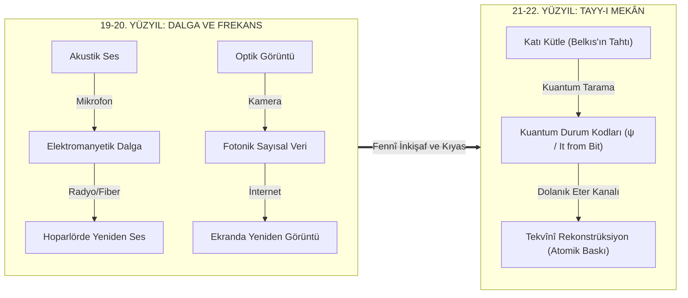
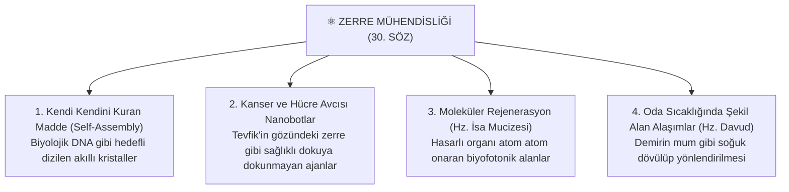

# 🚀 Geleceğin Teknolojileri ve Tılsım-ı Kâinat: Tayy-ı Mekân, Kuantum Işınlanma ve Madde-Enformasyon Mühendisliği

> **بِسْمِ اللّٰهِ الرَّحْمٰنِ الرَّحٖيمِ**
> 
> *قَالَ الَّذٖى عِنْدَهُ عِلْمٌ مِنَ الْكِتَابِ اَنَا اٰتٖيكَ بِهٖ قَبْلَ اَنْ يَرْتَدَّ اِلَيْكَ طَرْفُكَ فَلَمَّا رَاٰهُ مُسْتَقِرًّا عِنْدَهُ قَالَ هٰذَا مِنْ فَضْلِ رَبّٖى*
> 
> *"Kitaptan bir ilme sahip olan zat ise: 'Gözünü açıp kapamadan ben onu sana getiririm' dedi. Süleyman, tahtı yanı başında durur görünce: 'Bu Rabbimin bir lütfudur' dedi."* (Neml Sûresi, 40)
> 
> *"Kur'ân-ı Hakîm, enbiyaları beşere din ve ahlâk cihetinde birer imam ve rehber tayin ettiği gibi; onların mucizeleriyle dahi beşerin terakkiyat-ı feylesofiyane ve fenniyesine birer nihayet, birer gaye-i kemâl çiziyor ve parmağıyla basıp 'Haydi, bunlara yetişiniz!' diye teşvik ediyor."*  
> — **Bediüzzaman Said Nursî, 20. Söz, İkinci Makam (Mucizât-ı Enbiya)**

---

## 1. Giriş: Mucizât-ı Enbiya — Fennin Gayetü'l-Gāyâtı ve Nihai Ufukları

Yirminci Söz'ün ortaya koyduğu bilim felsefesi epistemolojik bir inkılâptır:  
Peygamberlerin mucizeleri salt geçmişte cereyan etmiş ve kapanmış harikalar değildir. Bilakis her bir mucize, Cenâb-ı Hakk'ın kâinata vaz' ettiği kanun-u fıtratın en uç noktasını (asymptote), beşer fenninin istikbalde ulaşabileceği **nihai teknolojik tavanı (fennî gayetü'l-gāyât)** gösteren birer meş'ale ve ilham kaynağıdır.

Kur'ân, peygamber mucizelerini anlatırken beşere şu nidayı yapar:  
*"Şu mucize bir ferdin elinde bir anda vücuda geldi. Ey insanoğlu! Madem bu hadise kâinat kanunlarının hilafına değil, o kanunların en yüksek tecellisidir; çalışınız, fen ve ilim vasıtasıyla o mertebenin benzerlerine yetişiniz!"*

### 🌌 10 Temel Peygamber Mucizesi ve Karşılık Gelen Gelecek Teknolojileri Matrisi

| # | Peygamber / Hadise | Kur'ânî / Risale Dayanağı | Tarihî / Mânevî Tezahür | Karşılık Gelen Nihai Gelecek Teknolojisi |
|:---:|:---|:---|:---|:---|
| **1** | **Âsaf b. Berhiyâ / Hz. Süleyman** | Neml: 40 / 20. Söz | Belkıs'ın tahtının 2500 km'den göz açıp kapamadan nakli | **Kuantum Teleportasyon & Tayy-ı Mekân (Madde-Enformasyon Rekonstrüksiyonu)** |
| **2** | **Hz. Süleyman (A.S.)** | Sebe: 12 / 20. Söz | Bir aylık mesafeyi havada bir günde kat etmesi | **Anti-Gravite, İyonik/Metrik İtki ve Atmosfersiz Hipersonik Uçuş** |
| **3** | **Hz. İsa (A.S.)** | Mâide: 110 / 20. Söz | Anadan doğma körleri, alacalıları ve ölüleri diriltmesi | **Biyogenetik Rejenerasyon, Kök Hücre Nanorobotiği ve Biyolojik Ömür Uzatma** |
| **4** | **Hz. Davud (A.S.)** | Sebe: 10 / 20. Söz | Demirin ateşe sokulmadan mum gibi yumuşatılıp şekil alması | **Oda Sıcaklığında Programlanabilir Madde (Claytronics) & Moleküler Metalürji** |
| **5** | **Hz. Musa (A.S.)** | Bakara: 60 / 20. Söz | Asâ ile taşa vurup on iki gür pınar fışkırtması | **Sismik-Akustik Yeraltı Sondajı, Su Akiferleri ve Jeotermal Enerji Hasadı** |
| **6** | **Hz. Musa (A.S.)** | Tâhâ: 20 / 20. Söz | Câmid ağaç asânın ejderhaya dönüşüp sihirleri yutması | **Biyomimetik Kendini Kopyalayan Akıllı Madde ve Nanomakineler** |
| **7** | **Hz. İbrahim (A.S.)** | Enbiyâ: 69 / 20. Söz | Nemrud'un yaktığı dev ateşin serin ve selametli kılınması | **Termal Metamalzemeler, Plazma Manyetik Kalkanları ve Füzyon Muhafazası** |
| **8** | **Hz. Süleyman (A.S.)** | Sebe: 12 / 20. Söz | "Kıtt-ı Munsab" (Erimiş bakır/maden pınarının akıtılması) | **Oda Sıcaklığında Süperiletkenler (LK-99 Tipi) ve Sıvı Metal Devreleri** |
| **9** | **Hz. Yusuf (A.S.)** | Yûsuf: 93 / 20. Söz | Gömleğinin kokusuyla Yakub'un (A.S.) âmâ gözlerinin açılması | **Biyofotonik Optogenetik, Kuantum Koku Analizi ve Nöral Görme Protezleri** |
| **10** | **Hz. Muhammed (A.S.M.)** | Kamer: 1 / 31. Söz | Şakk-ı Kamer (Ay'ın yarılması) ve Mi'rac (Kâinatın ötesine urûc) | **Astro-Mühendislik, Uzay-Zaman Metrik Bükülmesi (Warp) & Bast-ı Zaman (Zaman Dilation)** |

---

## 2. Belkıs'ın Tahtı ve Işınlanma Mühendisliği (Tayy-ı Mekân Fiziği)

### 2.1 Tarihî ve Metinsel Analiz: Yemen'den Kudüs'e 2.500 Kilometre

Neml Sûresi 38-40. âyetlerinde cereyan eden hadisede iki teklif sunulur:
1. Bir ifrit (cin): *"Sen makamından kalkmadan ben onu sana getiririm"* der (yaklaşık 1-2 saatlik süre).
2. Yanında *"Kitaptan bir ilim bulunan zat"* (Âsaf bin Berhiyâ veya Hz. Süleyman'ın kendisi): *"Gözünü açıp kapamadan ben onu sana getiririm"* der.

Bediüzzaman 20. Söz'de bu âyeti modern fenne şöyle teşmil eder:

> *"Cenâb-ı Hak şu âyetin lisanıyla mânen der: 'Ey insanoğlu! Uzak mesafelerden bir cismi hazır etmek mümkündür. Öyle ise siz dahi bu kanun-u fıtrattan istifade ediniz; gayret ediniz, eşyayı böyle celb ediniz!'*  
> *Nasıl ki telsiz telgraf, telefon ve radyo ile ses ve görüntüler naklediliyor; pekala maddenin dahi bu tarzda nakli ilmen ve fennen mümkündür."*



### 2.2 Teleportasyonun Üç Fiziksel Modeli

Modern teorik fizik ve Risale-i Nur ontolojisi ışığında makro cisimlerin ışınlanması 3 temel mekanizma ile mümkündür:

```
[MODEL A: KUANTUM ENFORMASYONEL REKONSTRÜKSİYON]
  Madde = Bilgi (It from Bit) ➔ Kuantum Durum Kopyalama ➔ Hedefte Sıfırdan İnşa

[MODEL B: MADDE-ENERJİ FAZ DEĞİŞİMİ (LETAFETE İNKILÂB)]
  Katı Kütle ➔ Plazma/Foton Koheransı (E = mc²) ➔ Işık Hızında İletim ➔ Tekâsüf

[MODEL C: UZAY-ZAMAN METRİK BÜKÜLMESİ (TAYY-I MEKÂN)]
  A Noktası ile B Noktasının Katlanması (ER=EPR / Solucandeliği) ➔ Mesafe = 0
```

#### Model A: Kuantum Dolanıklığı ve Wheeler'ın "It from Bit" İlkesi
John Archibald Wheeler'ın formüle ettiği *"It from Bit"* (Her madde bir enformasyon paketidir) ilkesi, 30. Söz'deki *"Zerre Kudret Kalemi'nin bir harfidir"* tespitiyle birebir örtüşür.  
- 500 kg ağırlığındaki taht yaklaşık $3 \times 10^{29}$ nükleondan oluşur.
- Her parçacığın kuantum durumunu ($\text{spin}, \text{momentum}, \text{pozisyon}, \text{bağ enerjisi}$) temsil etmek için gereken bilgi miktarı Bekenstein sınırı uyarınca:

$$I_{\text{Bekenstein}} \le \frac{2\pi R E}{\hbar c \ln 2} \approx 1.933 \times 10^{46} \text{ bit}$$

Taht Yemen'de fiziksel olarak taşınmaz; tahtı oluşturan kuantum enformasyon dalgası Kudüs'teki dolanık foton/eter alanına aktarılır. Kudüs'te hazır bekleyen ham karbon, hidrojen ve metal atomları (Zerreler), Bismillah emrine imtisal ederek saniyenin binde birinde Belkıs'ın tahtı sûretinde kristalleşir!

#### Model B: Kesafetin Letâfete İnkılâbı (Kütle-Enerji Faz Değişimi)
31. Söz Mirac Risalesi'nde beyan edildiği üzere:
> *"Demir gibi kesif maddeler ateşe atıldıkça incelir, erir, buharlaşır; nura ve ruha yaklaştıkça letâfet kesbeder."*

Katı madde, atomik bağları çözülerek koherent bir fotonik plazma dalgasına dönüştürülür ($m \rightarrow E/c^2$). Işık hızında ($c$) seyahat eden bu saf enformasyonel dalga, hedef koordinatta tekrar yoğunlaştırılarak (tekâsüf) dondurulur.

#### Model C: Uzay-Zaman Katlanması (Solucandeliği ve ER=EPR)
Einstein-Rosen Köprüleri (Wormhole) ile kuantum dolanıklığı ($ER = EPR$) arasındaki özdeşlik:
- Taht hiçbir yere gitmez; Yemen ile Kudüs arasındaki uzay-zaman geometrisi, Âsaf bin Berhiyâ'nın mazhar olduğu İsm-i Âzam sırrıyla katlanır.
- İki nokta üst üste getirildiğinde, taht sadece bir adım öteye konulmuş olur. *"Göz açıp kapamadan"* tabiri, Plank zamanı ($t_P \sim 10^{-44} \text{ s}$) ile lokal zamanın sıfırlandığı bu metrik büzülmeyi tasvir eder.

---

## 3. Kesafetten Nuraniyete: Kütlesizlik, Eylemsizlik İptali ve Işık Hızının Aşılması

### 3.1 31. Söz (Mirac Fiziği) ve Eylemsizlik İlkesi

Özel Görelilik teorisinde hiçbir kütleli cisim ışık hızını ($c$) aşamaz; zira hızı arttıkça rölativistik kütlesi ($m = \gamma m_0$) ve kinetik enerjisi sonsuza ıraksar.  
Oysa Bediüzzaman 31. Söz'de Mirac-ı Nebevî'nin dakikalar içinde bütün semavatı kat etmesini şu fizik-ötesi kanunla açıklar:

> *"Kesif maddelerin hareketi ağırdır; çünkü yerçekimi ve eylemsizlik direnci vardır. Lâkin cisim letâfet kesbettikçe sür'ati tezâyüd eder.  
> Meselâ: Taşın hareketi ağırdır; su daha hızlı akar; hava daha sür'atlidir; ziya (ışık) saniyede üç yüz bin kilometre gider; hayal ve fikir ise zaman ve mekân kaydını parçalar, bir anda kâinatın öbür ucuna varır.  
> Cism-i Muhammedî (A.S.M.) dahi Mirac gecesinde o derece letâfet ve nuraniyet kesbetmiştir ki, ruhun sür'atine tâbi olmuş; şimşek gibi semavatı aşmıştır."* (31. Söz)

### 3.2 Higgs Alanı Modülasyonu ve "Nuraniyet Sürüşü" (Warp Metric)

Modern fizikte kütle, temel parçacıkların **Higgs Alanı (Higgs Field)** ile sürtünmesinden kaynaklanır.

```text
[KESİF MADDE]     ────────>  Higgs Alanı ile Şiddetli Etkileşim  ────────>  Ağır Kütle, Düşük Hız (v << c)
[NURANÎ MADDE]    ────────>  Higgs Etkileşimi Sıfırlanır (λ ➔ 0)   ────────>  Sıfır Eylemsizlik, Işık Hızı (v = c)
[RUH VE BİLİNÇ]   ────────>  Zaman-Mekân Kayıtlarından Tecerrüd    ────────>  Sonsuz Sür'at / Anî Vusul
```

$$\mathcal{L}_{\text{etkin}} = \mathcal{L}_{\text{Dirac}} - g_{\phi} (1 - \Lambda_{\text{nur}}) \bar{\psi} \phi \psi$$

Burada $\Lambda_{\text{nur}} \in [0, 1]$ nuraniyet parametresidir:
* $\Lambda_{\text{nur}} = 0$ iken cisim bütünüyle kesiftir; eylemsizlik direnci ve yerçekimi tam tesir eder.
* $\Lambda_{\text{nur}} \rightarrow 1$ olduğunda Higgs bozonu etkileşimi perdelenir; cismin etkin kütlesi sıfıra yaklaşır ($m_{\text{eff}} \rightarrow 0$).
* Kütlesi sıfırlanan cisim fotonlaşır; ivmelenme süresine ihtiyaç duymaksızın anında ışık hızına fırlar.
* Cisim etrafında oluşturulacak uzay-zaman eğriliği balonu (Alcubierre metriği) ile kütlenin kendisi hareket etmez; uzay arkadan genişletilip önden büzülerek **ışıktan kat be kat hızlı (Tachyonic/Superluminal)** menzillere intikal edilir!

---

## 4. Zerre Dinamiklerinden Programlanabilir Maddeye (Claytronics ve Nanoteknoloji)

### 4.1 30. Söz'ün İkinci Maksadı: Akıllı Zerreler Doktrini

Bediüzzaman zerrelerin cansız ve şuursuz taş parçacıkları olmadığını; her bir zerrenin adeta sonsuz bir ilim ve iradenin emriyle sevk olunduğunu ispat eder:
> *"Her bir zerre mebde-i hareketinde 'Bismillâh' der; hadsiz kuvvetinden fazla işleri görür... Bir zerre kan hücresine girer, oranın nizamını bilir gibi hareket eder; oradan dimağa çıkar, hafıza ve tefekkür aynası olur; oradan Tevfik'in gözbebeğine yerleşir, basar nuruyla dünyayı temaşa eder."*

### 4.2 Geleceğin Biyomühendislik Uygulamaları



1. **Claytronics (Programlanabilir Katı Madde):**  
   Milyarlarca mikroskobik robotik zerrenin (catom) yazılımsal sinyallerle anında bir masa, bir bina, bir otomobil veya bir alete dönüşebilmesi. Tıpkı topraktaki tek tip elementlerin emirle elmaya, nara veya güle dönüşmesi gibi.
2. **Hz. Davud'un Demiri Yumuşatması (Moleküler Kafes Esnekliği):**  
   Demirin yüksek ısıya (1538 °C) gerek kalmadan, sadece düşük frekanslı manyeto-rezonans titreşimleriyle kristal örgüsünün gevşetilerek mum gibi bükülebilmesi. Bu teknoloji, sıfır karbon emisyonlu nano-metalurjinin temeli olacaktır.
3. **Hz. Musa'nın Asâsı ve Biyomimetik Akıllı Polimerler:**  
   Câmid bir maddenin ortamdaki kimyasal ve biyolojik sinyallere göre şekil ve fonksiyon değiştirip biyolojik bir canlı gibi hareket edebilmesi.

---

## 5. İhlas Sinerjisi ve Şahs-ı Manevî Kuantum Mimarisi (4444 Sırrı)

### 5.1 Klasik Toplama Karşı Kuantum Dolanıklık

21. Lem'a'da Bediüzzaman fertlerin enaniyetlerini bırakıp müşterek bir dava etrafında kenetlenmelerini matematiksel bir üstel fonksiyonla tarif eder:

> *"Hakiki ve halis bir uhuvvet ile, dört fert omuz omuza verip bir çizgi üstünde bulunsa; adedî kıymetleri dört iken, sırr-ı ittihad ile dört bin dört yüz kırk dört (4444) kıymetini alır... İhlas ile üç elif birleşse yüz on bir (111) kıymetini aldığı gibi."*

```text
Klasik Sistemler (Ayrı Ayrılık ve Benlik):
  [1] + [1] + [1] + [1] = 4 (Lineer İşlem Kapasitesi)

Kuantum Dolanıklık & İhlas (Şahs-ı Manevî):
  |ψ⟩ = (|0000⟩ + |1111⟩) / √2 ➔ 4.444 Üstel Eşzamanlı Faz İnterferansı!
```

### 5.2 Geleceğin Kuantum Ağları ve Dağıtık Zekâ (Noosfer)

* **Qubit Sinerjisi:** Klasik süper-bilgisayarlar lineer artış gösterirken, dolanık kuantum işlemciler her eklenen kubitle paralel uzayı $2^N$ kat genişletir.
* **Kolektif Bilinç Ağı (Şahs-ı Manevî):** Bireysel egoların (ene) birbiriyle rekabet etmek yerine "Kevser Havuzu"nda erimesi; kuantum internetinde hata toleransını (fault-tolerance) sıfıra indirir. 
* Bu sinerji, ışınlanma sırasında ihtiyaç duyulan $10^{32}$ qubitlik kuantum durum bilgisini saniyeler içinde işleyecek **Kolektif Kuantum İşlemci Mimarisinin** teorik omurgasını oluşturur.

---

## 6. Bast-ı Zaman (Zaman Bükülmesi) ve Âlem-i Misal Mühendisliği

### 6.1 Zamanın İzafiyeti: Mirac ve Rüya Örnekleri

Bediüzzaman Mektubat ve Lem'alar'da zamanın sabit bir nehir olmadığını, şuurun ve cismin mertebelerine göre genişleyip daralabileceğini (**Bast-ı Zaman ve Tayy-ı Zaman**) anlatır:
* Bir insan rüyada birkaç saniyelik fizyolojik sürede senelerce süren bir ömür yaşayabilir.
* Peygamberimiz (A.S.M.) Mirac'ta birkaç dakikalık dünya süresinde Cennet, Cehennem, geçmiş ve geleceğin milyonlarca senelik menzillerini temaşa etmiştir.

$$\Delta t' = \frac{\Delta t}{\sqrt{1 - \frac{v^2}{c^2}}} \quad \xrightarrow{\text{Bilinç Frekansı Modülasyonu}} \quad \Delta \tau_{\text{öznel}} = \int \Omega_{\text{şuur}}(t) \, dt$$

### 6.2 Nöro-Zihinsel Frekans Hızlandırıcılar ve Sanal Boyutlar

* **Sübjektif Zaman Genişletme:** İnsan beyninin nöral ateşleme frekansı fotonik ve kuantum sinaps arayüzleriyle (BCI) hızlandırıldığında; 1 saatlik fiziksel sürede 10 yıllık ilmî araştırma, tefekkür ve kodlama tamamlanabilir.
* **Âlem-i Misal Arayüzleri:** Maddî cisimlerin misalî sûretleriyle irtibat kurularak, fiziken laboratuvara girmeden maddelerin kuantum davranışları zihinsel boyutlarda simüle edilebilir.

---

## 7. Esir Maddesi, Kuantum Vakumu ve Sıfır Noktası Enerjisi (ZPE)

İşârâtü'l-İ'câz tefsirinde Bediüzzaman esir (aether) maddesini şöyle tarif eder:
> *"Cenâb-ı Hak esir maddesini yaratmıştır; o madde kâinatın hammaddesidir. Bütün ecram-ı semaviye onda yüzer. Maddenin en ince, en lâtif, en seyyal bir mertebesidir ki, Cenâb-ı Hakk'ın arş-ı emri ve nurunun nâkili olmuştur."*

Modern kuantum alan teorisinde (QFT) boşluk (vakum) asla boş değildir; sürekli doğup batan sanal parçacıklarla kaynayan **Kuantum Vakum Çalkantısı (Quantum Vacuum Fluctuations)** ve **Sıfır Noktası Enerjisi (Zero-Point Energy - Casimir Etkisi)** ile doludur.
* Esir maddesinin dalgalanmaları kontrol edilebildiğinde; sonsuz ve temiz bir enerji kaynağı doğrudan uzayın boşluğundan hasat edilebilir.
* Işınlanma ve uzay bükülmesi için gereken devasa enerji, dev yakıt tanklarıyla değil; uzayın kendi esirî dokusundan (ZPE) çekilecektir.

---

## 8. Felsefî ve Mânevî Sonuç: Firavunluk Değil, Ubûdiyet Zirvesi

Modern felsefe ve seküler transhümanizm, teknolojiyi insanı tanrılaştırmak, ölümü alt edip kâinata hükmetmek için bir kibir vasıtası görür. Bu sapkın anlayış Nemrudların ve Karunların helâkine yol açmıştır.

Tılsım-ı Kâinat'ın ve 20. Söz'ün insanlığa vasiyeti ise tam zıddıdır:

> *"Fenlerin nihayet gayeleri esmâ-i İlâhiyenin nakışlarına dayanmaktır. Tıp feni Şâfî ismine; hendese ve mimarlık Adl ve Mukaddir isimlerine; kimya ve biyoloji Hayy ve Kayyûm isimlerine dayanır...  
> Madem her bir fen nihayetinde bir İlâhî isme çıkar; öyle ise ilim ve teknikte ilerleyen beşer gurura kapılmamalı, bilakis aczini ve fakrını anlayıp sonsuz Kudret sahibine secde etmelidir!"*

* Işınlanmayı icad eden insan; *"Ben mekânı fethettim"* demeyecek; *"Bütün kâinatı kudretinin bir kabzasında tutan ve her zerreye sözü geçen Zât-ı Zülcelâl ne yücedir"* diyerek hayret secdesine kapanacaktır.
* Maddeyi enformasyona çeviren mühendis; Wheeler'ın *"It from Bit"* hakikatinde Kur'ân'ın *"Kün fe-yekûn"* (Ol der, oluverir) fermanını okuyacak; ilmin zirvesinde kâmil bir mü'min olacaktır.

---

### 📚 İlgili Dokümanlar ve Laboratuvar Modelleri
- [Tılsım-ı Kâinat Küllî Çözüm Raporu](file:///g:/Di%C4%9Fer%20bilgisayarlar/Diz%C3%BCst%C3%BC%20Bilgisayar%C4%B1m/github%20repolar%C4%B1m/tilsim-i-kainat/docs/tilsim-i-kainat-kullî-cozum.md)
- [Modern Fizik ve Tılsım-ı Kâinat](file:///g:/Di%C4%9Fer%20bilgisayarlar/Diz%C3%BCst%C3%BC%20Bilgisayar%C4%B1m/github%20repolar%C4%B1m/tilsim-i-kainat/docs/modern-fizik-ve-tilsim-i-kainat.md)
- [Tayy-ı Mekân & Kuantum Işınlanma Simülasyonu](file:///g:/Di%C4%9Fer%20bilgisayarlar/Diz%C3%BCst%C3%BC%20Bilgisayar%C4%B1m/github%20repolar%C4%B1m/tilsim-i-kainat/simulations/teleportation-information-model.py)
- [Geleceğin Teknolojileri Mimarisi Diyagramı](file:///g:/Di%C4%9Fer%20bilgisayarlar/Diz%C3%BCst%C3%BC%20Bilgisayar%C4%B1m/github%20repolar%C4%B1m/tilsim-i-kainat/assets/diagrams/gelecegin-teknolojileri.mmd)
