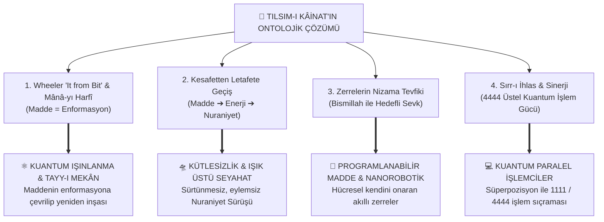

# 🚀 Geleceğin Teknolojileri ve Tılsım-ı Kâinat: Tayy-ı Mekân, Kuantum Işınlanma ve Madde-Enformasyon Mühendisliği

> **بِسْمِ اللّٰهِ الرَّحْمٰنِ الرَّحٖيمِ**
> 
> *قَالَ الَّذٖى عِنْدَهُ عِلْمٌ مِنَ الْكِتَابِ اَنَا اٰتٖيكَ بِهٖ قَبْلَ اَنْ يَرْتَدَّ اِلَيْكَ طَرْفُكَ*
> 
> *"Kitaptan bir ilme sahip olan zat ise: 'Gözünü açıp kapamadan ben onu sana getiririm' dedi."* (Neml Sûresi, 40)
> 
> *"Kur'ân-ı Hakîm, enbiyaları beşere din ve ahlâk cihetinde birer imam ve rehber tayin ettiği gibi; onların mucizeleriyle dahi beşerin terakkiyat-ı feylesofiyane ve fenniyesine birer nihayet, birer gaye-i kemâl çiziyor ve parmağıyla basıp 'Haydi, bunlara yetişiniz!' diye teşvik ediyor."*
> — **20. Söz, İkinci Makam (Mucizât-ı Enbiya)**

---

## 1. Giriş: Mucizeler Gelecek Teknolojilerinin Nihai Sınırlarıdır

Yirminci Söz'ün ortaya koyduğu muazzam bilim felsefesine göre peygamber mucizeleri, yalnızca geçmişte yaşanmış tarihî vakalar değildir. Onlar, insan aklının ve fennin gelecekte ulaşabileceği **nihai teknolojik sınırların (fennî gayetü'l-gāyât)** birer numunesi ve müjdesidir:

* **Hz. İsa'nın (A.S.)** en amansız hastalıkları iyileştirmesi ve ölüleri diriltmesi $\rightarrow$ *Tıbbın ve biyoteknolojinin genetik kopyalama, hücresel yenilenme ve ölümcül hastalıkları tedavi etme ufkunu gösterir.*
* **Hz. Musa'nın (A.S.)** asasıyla taştan on iki çeşme akıtması $\rightarrow$ *Jeoloji, hidroloji ve yer altı kaynaklarını ses dalgalarıyla tespit etme fennine işaret eder.*
* **Hz. Süleyman'ın (A.S.)** bir günde iki aylık mesafeyi havada kat etmesi $\rightarrow$ *Havacılık, ses hızını aşan jetler ve uzay mekiklerinin hedefini çizer.*
* **Hz. Süleyman'ın (A.S.) veziri Âsaf bin Berhiyâ'nın Belkıs'ın tahtını göz açıp kapayıncaya kadar Yemen'den Kudüs'e getirmesi** $\rightarrow$ **Maddenin, sûretlerin ve cisimlerin uzak mesafelerden anında ışınlanması ve nakli fennine en kat'î işarettir!**

Aşağıda, Tılsım-ı Kâinat'ın çözülen ontolojik sırlarından (Ene, Zerre, It from Bit, Nuraniyet, Sinerji) ilham alarak geleceğin devrimci teknolojileri tahlil edilmektedir.



---

## 2. Belkıs'ın Tahtı ve Işınlanma (Tayy-ı Mekân Teknolojisi)

### 2.1 Âyetin İşareti ve Bediüzzaman'ın Tahlili
Neml Sûresi 40. âyetinde geçen hadise, yaklaşık 2.500 kilometrelik bir mesafeden (Yemen-Sebe'den Kudüs'e) tonlarca ağırlıktaki bir tahtın saliseler içinde getirilmesidir. Bediüzzaman 20. Söz'de der ki:

> *"Cenâb-ı Hak şu âyetin lisanıyla mânen der: 'Ey insanoğlu! Uzak mesafelerden bir cismi hazır etmek mümkündür. Öyle ise siz dahi bu kanun-u fıtrattan istifade ediniz; gayret ediniz, eşyayı böyle celb ediniz!'*
> *Nasıl ki telsiz telgraf, telefon ve radyo ile ses ve görüntüler naklediliyor; pekala maddenin dahi bu tarzda nakli ilmen ve fennen mümkündür."* (20. Söz)

### 2.2 Modern Fizik Açısından Işınlanma Mekanizması
Modern fizikte kuantum ışınlanması (Quantum Teleportation), fotonlar ve küçük atomlar üzerinde laboratuvar ortamında başarılmıştır. Ancak makro cisimlerin ışınlanması için Tılsım-ı Kâinat şu üç adımı fısıldar:

```text
  [1. Kuantum Tarama]          [2. Enformasyon İletimi]         [3. Tekvînî İnşa]
  Cismin trilyonlarca          Trilyonlarca Gigabaytlık         Hedefteki ham zerreler
  zerresindeki kuantum  ────>  enformasyonun (Bit/Harf) ────>  kütlesine o enformasyon
  durumu (ψ) taranır.          ışık/eter kanalıyla nakli.       giydirilir (It from Bit).
```

1. **Maddenin Özü Bilgidir ("It from Bit"):** Zerre katı ve bölünmez bir taş değildir; Kudret Kalemi'nin bir harfidir. Harf bir yerde silinip diğer tarafta aynı anda yazılabilir.
2. **Kuantum Dolanıklığı (Entanglement):** İki dolanık parçacık aralarındaki mesafe ne olursa olsun anında birbirini etkiler (Einstein'ın *"spooky action at a distance"* dediği sır). Başlangıç ve hedef noktalarında kurulacak bir dolanık kuantum alanı, cismin enformasyonunu sıfır zamanda nakledebilir.
3. **Maddenin Sureten ve Aynen İntikali:** Belkıs'ın tahtı ya atomlarına ayrılarak bir enerji/dalga formunda nakledilip Kudüs'te milisaniyede yeniden birleştirildi; ya da uzay-zaman bükülerek (Wormhole / Tayy-ı Mekân) mesafe sıfırlandı!

---

## 3. Kesafetten Letafete Geçiş: Nuraniyet ve Işık Hızının Aşılması

31. Söz (Mirac Risalesi) ve 29. Söz (Ruh Risalesi), kütleli maddelerin fiziksel sınırları ile nuranî varlıkların sınırsızlığını mukayese eder:

> *"Kesif bir cisim, maddiyatın ağırlığıyla yerçekimine ve zamana mahkûmdur. Fakat cisim nuraniyet kesbettikçe; katıdan sıvıya, sıvıdan gaza, gazdan nura ve ruha yaklaştıkça letâfet kazanır. Cisim ruha tâbi olur; demir mıknatısın peşinden koştuğu gibi, cisim dahi ruhun sür'atiyle fezada seyahat eder."* (31. Söz, Mirac)

### Teknolojik Çıkarım: "Nuraniyet Sürüşü" (Photonic/Tachyonic Propulsion)
Mevcut roket teknolojileri kütle atımıyla (etki-tepki) hareket eder ve Einstein'ın özel görelilik sınırına ($v < c$) takılır; çünkü kütle hızlandıkça enerjisi ve eylemsizliği sonsuza yaklaşır.

Ancak Tılsım-ı Kâinat'ın gösterdiği prensip:
* Maddenin durumunu **plazma ve koherent fotonik / nuranî faza** dönüştürmek,
* Cisim etrafında yapay bir yerçekimsel kalkan (kütleçekimsel nötrleme / Alcubierre Warp Drive) oluşturarak uzay-zaman dokusunu arkadan genişletip önden daraltmak,
* Böylece cisim hareket etmeden uzay-zamanın kendisi kaydırılarak ışıktan hızlı mesafeler katedilebilir (**Bast-ı Zaman ve Tayy-ı Mekân**).

---

## 4. Zerre Dinamiklerinden Programlanabilir Maddeye (Nanoteknoloji)

30. Söz'ün İkinci Maksadında zerrenin Tevfik'in gözbebeğine kadar her organa tam intibak ettiği anlatılır. Zerre kör ve câmid olduğu halde, adeta bütün bedenin mavi kopyasını (blueprint) cebinde taşıyor gibi hareket eder.

### Geleceğin Biyomühendisliği: "Akıllı ve İntibak Eden Zerreler" (Claytronics)
1. **Moleküler Montajcılar (Molecular Assemblers):** Topraktaki elementleri saniyeler içinde proteine, meyveye veya ilaca dönüştüren nano-fabrikalar. 
   - *Risale-i Nur İlhamı:* Buğday tanesi kadar çekirdeğin koca çam ağacının trilyonlarca zerresini muntazaman dizmesi sırrı, nano-3D yazıcıların anahtarıdır.
2. **Kendi Kendini Tamir Eden Biyomateryaller:** Zerrelerin kanda pıhtılaşması veya dokuyu onarması prensibinden hareketle; çizildiğinde veya kırıldığında hücresel seviyede kendi kendine kaynayan akıllı zırhlar ve köprüler.
3. **Hedefli Nano-Tıbbî Ajanlar:** Kanserli hücreyi milyonlarca sağlıklı hücre arasından teşhis edip imha eden, Tevfik'in gözündeki zerre gibi bedenin nizamına zarar vermeden vazife gören moleküler robotlar.

---

## 5. İhlas Sinerjisinden Kuantum Paralel Hesaplamaya (4444 Sırrı)

21. Lem'a'daki *"Dört ferd omuz omuza verip bir çizgi üstünde olsa 4444 kuvvetinde olur"* hakikati, klasik mantığın lineer ($1+1+1+1=4$) cebirini yerle bir eder.

### Kuantum Bilişimde Qubit Sinerjisi
* Klasik bilgisayarda 4 bit yalnızca 4 durumdan birini saklar.
* Kuantum bilgisayarında süperpozisyon ve dolanıklık halindeki 4 Qubit ise aynı anda $2^4 = 16$ durumu paralel olarak işler; 64 Qubit ise kâinattaki bütün atomların sayısından daha fazla ihtimali tek bir nanosaniyede simüle eder!

```text
  KLASİK MANTIK (Benlik ve Ayrı Fertler):
    1 + 1 + 1 + 1 = 4 işlemci gücü

  KUANTUM VE İHLAS MANTIĞI (Dolanıklık ve Şahs-ı Manevî):
    1 ── 1 ── 1 ── 1 = 4.444 üstel paralel hesaplama gücü!
```

Geleceğin kuantum interneti ve kuantum yapay zekâ ağları; fertlerin birbirini ezdiği değil, düğümlerin (nodes) tam bir ahenkle birleştiği **Şahs-ı Manevî mimarisiyle** çalışacaktır.

---

## 6. Bast-ı Zaman (Zaman Bükülmesi) ve Zihinsel Arayüzler

Bediüzzaman Lem'alar'da ve Mektubat'ta **Bast-ı Zaman** (Zamanın genişlemesi) hakikatini anlatır:
* Bir insan rüyada birkaç saniyelik bir sürede saatler süren maceralar yaşayabilir.
* Peygamber Efendimiz (A.S.M.) Mirac'ta birkaç dakikalık dünya vaktinde Cennet, Cehennem ve binler senelik menzilleri temaşa etmiştir.

### Teknolojik İzdüşüm: "Nöro-Zihinsel Hızlandırıcılar ve Sanal Gerçeklik"
* İnsan bilincinin zaman algısı biyolojik frekansa bağlıdır. 
* Doğrudan nöronal ve ruhî arayüzlerle (Direct Neural Interfaces / Brain-Computer Interface) zihnin frekansı artırıldığında; 1 saniyelik fiziksel sürede 100 saatlik bir kütüphane okunup sindirilebilir, asırlar sürecek ilmî keşifler birkaç günde tamamlanabilir.

---

## 7. Felsefî ve Ahlakî Sonuç: Teknoloji İlahlaşma Değil, Ubudiyet Vesilesidir

Felsefe, bu teknolojileri (ışınlanma, yapay zekâ, genetik mühendisliği) insanı ilâhlaştırmak, tabiatı sömürmek ve kibre kapılmak için bir vesile sayar (transhümanizm).

Oysa Tılsım-ı Kâinat'ın verdiği ders şudur:
* Işınlanmayı bulan insan firavunlaşmamalı; *"Cenâb-ı Hakk'ın koca fezayı benim emrime böyle müsahhar kılan sonsuz kudretine şükürler olsun"* demelidir.
* Maddeyi enformasyona çeviren dimağ, her zerrenin zaten ezelden beri Kudret Kalemi'nin bir kelimesi olduğunu idrak edip hayretle secdeye varmalıdır.

> *"Fenlerin nihayet gayeleri esmâ-i İlâhiyenin nakışlarına dayanmaktır. Her bir fen bir isme dayanır; o isimde nihayet bulur, kemâlini onda gösterir."* (20. Söz)
