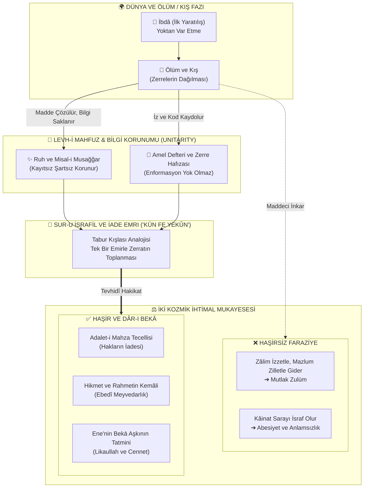

# ⏳ Haşir ve Ebediyet Tılsımı: Kâinatın Nihai Mührü

> **بِسْمِ اللّٰهِ الرَّحْمٰنِ الرَّحٖيمِ**
> 
> *فَانْظُرْ اِلٰى اٰثَارِ رَحْمَتِ اللّٰهِ كَيْفَ يُحْيِى الْاَرْضَ بَعْدَ مَوْتِهَا اِنَّ ذٰلِكَ لَمُحْيِى الْمَوْتٰى وَهُوَ عَلٰى كُلِّ شَىْءٍ قَدٖيرٌ*
> 
> *"Şimdi bak Allah'ın rahmet eserlerine: Ölümünün ardından yeryüzünü nasıl diriltiyor! Şüphe yok ki, ölüleri diriltecek olan da O'dur ve O her şeye hakkıyla kādirdir."* (Rûm Sûresi, 50)
> 
> *"Eğer haşrin gelmesi, kaza ve kader-i İlâhî gibi muhakkak olmazsa; kâinatın bütün hakaiki, zîneti, intizamı, adaleti, merhameti zîr ü zeber olur. Ve kâinatın tılsım-ı muğlâkı bir muammâ-yı lâyünhall (çözülmez düğüm) olarak kalır."*
> — **10. Söz (Haşir Risalesi, On İkinci Hakikat)**

---

## 1. Kâinat Tılsımının Kilit Taşı: Âhiret ve Haşir

Onuncu Söz (Haşir Risalesi), kâinat nizamının mantıksal, ahlakî ve fiziksel tutarlılığının ancak **Âhiret ve Haşir** hakikatiyle kaim olduğunu 12 sarsıcı hakikatle ispat eder.



---

## 2. İbdâ vs. İade ve Kuantum Bilgi Korunumu (Unitarity)

Modern teorik fizikte (Kuantum Mekaniği ve Kara Delik Bilgi Paradoksu) en temel yasalardan biri **Bilginin Korunumu (Unitarity)** ilkesidir: Evrendeki fiziksel durumların kuantum enformasyonu asla mutlak olarak yok edilemez.

Risale-i Nur bu hakikati 10. Söz'de iki ana eksende şerh eder:

1. **İbdâ (İlk Yaratılış) ve İade (Yeniden Diriltme) Kolaylığı:**
   * Bir taburu sıfırdan kurmak, askerleri eğitmek ve techizatlandırmak (**İbdâ**) zahmetlidir.
   * Dağılmış bir taburu tek bir boru sesiyle kışlasına toplamak (**İade / Haşir**) ise birincisinden yüzlerce kat daha kolaydır.
   * Cenâb-ı Hak zerratı ilk kez yoktan yaratıp terbiye ettikten sonra, onların arasındaki ünsiyet ve hafızayı korumaktadır; Sur üfürüldüğünde *"Kün fe yekûn"* emriyle zerreler anında eski vazifelerine koşacaktır.
2. **Bahar İhyası (300.000 Türün Yıllık Haşri):**
   * Her kış yeryüzü ölür, bitkiler ve böcekler dağılır; ancak çekirdeklerindeki genetik program (*misal-i musağğar*) korunur.
   * Bahar geldiğinde tek bir Rahmet emriyle yüz binlerce tür birkaç hafta içinde yeniden ihya edilir.

---

## 3. Zerre ve Ene'nin Haşirle Münasebeti

* **Zerrelerin Haşri:** Otuzuncu Söz'ün İkinci Maksadında anlatılan zerreler, kâinatta boşuna dolaşmamaktadır. Her zerre birer amel defteri gibi canlıların hücresinde vazife görür ve kıyametten sonra zerratın yeniden bir araya getirilmesi (Haşr-i Ecsad), ilk yaratılıştan fersah fersah daha kolaydır.
* **Ene'nin Bekā Aşkı:** İnsanın kalbine konulan bekā arzusu, o bekāyı verecek bir Vâcibü'l-Vücud'un varlığının en latif ve sarsılmaz bir vicdanî delilidir:
  > *"Fıtrat yalan söylemez. Bir tohumdaki sümbüllenme meyli toprağı ve suyu haber verdiği gibi, insan fıtratındaki ebediyet aşkı dahi ebedî bir dârı haber verir."*

---

## 4. Matematiksel Simülasyon: `hasir-ebediyet-model.py`

Projemizin 7. simülasyon modeli; Haşir ve Bilgi Korunumu ilkelerini dinamik olarak modeller:

```bash
# Tüm senaryoları karşılaştırmalı tablo olarak basmak için:
python simulations/hasir-ebediyet-model.py --karsilastir
```

### Simülasyon Çıktısı (Özet Tablo)

| Senaryo | İhya Oranı | Adalet İndisi | Hikmet İndisi | İade Kolaylık | Netice Hükmü |
|---|:---:|:---:|:---:|:---:|---|
| **`bahar_ihyasi`** | **0.982** | **0.985** | **0.987** | 101.0x | **Dâr-ı Bekā ve Adalet-i Mahza** |
| **`hasir_i_ecsad`** | **0.982** | **0.983** | **0.987** | 101.0x | **Dâr-ı Bekā ve Adalet-i Mahza** |
| **`hasirsiz_faraziye`** | 0.000 | **0.100** | **0.000** | 1.0x | **Abesiyet ve Zulüm Çıkmazı** |
| **`suphe_ve_tereddut`** | 0.211 | 0.329 | 0.328 | 16.0x | Tereddüt ve Eksik Huzur |

---

## 5. İlgili Dosyalar ve Tılsım'ın Son Sözü

Ene ve zerre ile başlayan, tabiat ve esbabın tenkidiyle saflaşan, kader ve irade dengesiyle kemâle eren tefekkür yolculuğu; ancak Haşir hakikatiyle nihai huzura ve mutlak saadete kavuşur. Kâinat tılsımının son anahtarı: **"Lâ ilâhe illallâh ve inne’l-âhirete hakkun"** mührüdür.

* 📊 **Python Modeli:** [`simulations/hasir-ebediyet-model.py`](../simulations/hasir-ebediyet-model.py)
* 🧪 **Birim Testleri:** [`simulations/test_hasir_model.py`](../simulations/test_hasir_model.py)
* 🗺️ **Mermaid Diyagramı:** [`assets/diagrams/hasir-ve-ebediyet.mmd`](../assets/diagrams/hasir-ve-ebediyet.mmd)
