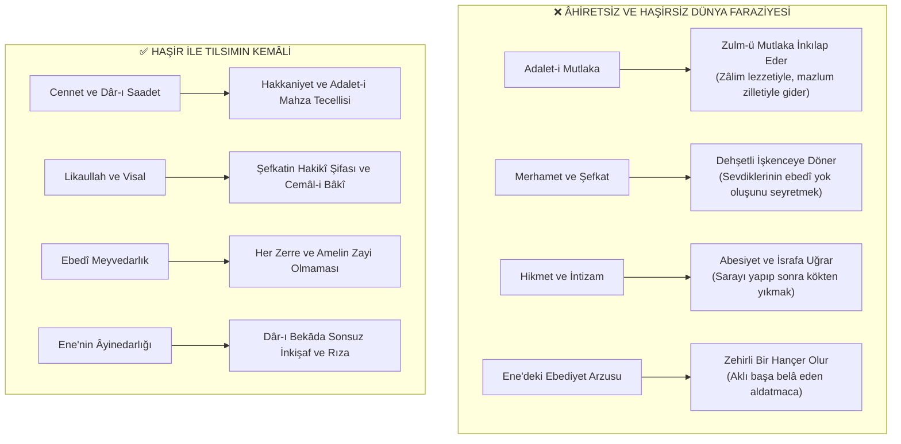

# ⏳ Haşir ve Ebediyet Tılsımı: Kâinatın Nihai Mührü

> **بِسْمِ اللّٰهِ الرَّحْمٰنِ الرَّحٖيمِ**
> 
> *فَانْظُرْ اِلٰى اٰثَارِ رَحْمَتِ اللّٰهِ كَيْفَ يُحْيِى الْاَرْضَ بَعْدَ مَوْتِهَا اِنَّ ذٰلِكَ لَمُحْيِى الْمَوْتٰى وَهُوَ عَلٰى كُلِّ شَىْءٍ قَدٖيرٌ*
> 
> *"Şimdi bak Allah'ın rahmet eserlerine: Ölümünün ardından yeryüzünü nasıl diriltiyor! Şüphe yok ki, ölüleri diriltecek olan da O'dur ve O her şeye hakkıyla kādirdir."* (Rûm Sûresi, 50)
> 
> *"Eğer haşrin gelmesi, kaza ve kader-i İlâhî gibi muhakkak olmazsa; kâinatın bütün hakaiki, zîneti, intizamı, adaleti, merhameti zîr ü zeber olur. Ve kâinatın tılsım-ı muğlâkı bir muammâ-yı lâyünhall (çözülmez düğüm) olarak kalır."*
> — **10. Söz (Haşir Risalesi, On İkinci Hakikat)**

---

## 1. Kâinat Tılsımının Kilit Taşı: Âhiret ve Haşir

Onuncu Söz (Haşir Risalesi), kâinat nizamının mantıksal ve ahlakî tutarlılığının ancak **Âhiret ve Haşir** inancıyla kaim olduğunu 12 sarsıcı hakikatle ispat eder.

Eğer âhiret ve dâr-ı bekā olmasaydı:

---

## 2. Zerre ve Ene'nin Haşirle Münasebeti

* **Zerrelerin Haşri:** Otuzuncu Söz'ün İkinci Maksadında anlatılan zerreler, kâinatta boşuna dolaşmamaktadır. Her zerre birer amel defteri gibi canlıların hücresinde vazife görür ve kıyametten sonra zerratın yeniden bir araya getirilmesi (Haşr-i Ecsad), ilk yaratılıştan fersah fersah daha kolaydır:
  > *"Bir taburu teşkil eden neferat bir boru sesiyle nasıl kışlaya toplanırsa; kudret-i mutlaka dahi tek bir emirle dağılmış zerratı yeniden bir araya getirip cesetleri iade edecektir."* (10. Söz)
* **Ene'nin Bekā Aşkı:** İnsanın kalbine konulan bekā arzusu, o bekāyı verecek bir Vâcibü'l-Vücud'un varlığının en latif ve sarsılmaz bir vicdanî delilidir:
  > *"Fıtrat yalan söylemez. Bir tohumdaki sümbüllenme meyli toprağı ve suyu haber verdiği gibi, insan fıtratındaki ebediyet aşkı dahi ebedî bir dârı haber verir."*

---

## 3. Tılsım-ı Kâinat'ın Son Sözü

Ene ve zerre ile başlayan, tabiat ve esbabın tenkidiyle saflaşan, kader ve irade dengesiyle kemâle eren tefekkür yolculuğu; ancak Haşir hakikatiyle nihai huzura ve mutlak saadete kavuşur. Kâinat tılsımının son anahtarı: **"Lâ ilâhe illallâh ve inne’l-âhirete hakkun"** mührüdür.
