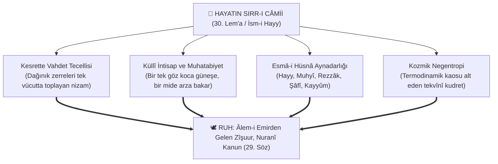

# 🕊️ Hayat ve Ruh Tılsımı: Kâinatın Kalbi ve Âlem-i Emir

> **بِسْمِ اللّٰهِ الرَّحْمٰنِ الرَّحٖيمِ**
> 
> *وَيَسْئَلُونَكَ عَنِ الرُّوحِ قُلِ الرُّوحُ مِنْ اَمْرِ رَبّٖى وَمَاۤ اُوتٖيتُمْ مِنَ الْعِلْمِ اِلاَّ قَلٖيلًا*
> 
> *"Sana ruhtan sorarlar; de ki: Ruh Rabbimin emrindendir. Ve size ilimden ancak az bir şey verilmiştir."* (İsrâ Sûresi, 85)
> 
> *"Hayat, şu kâinatın en ehemmiyetli gayesi, hem en büyük neticesi, hem en parlak nuru, hem en lâtif mayası, hem gayet süzülmüş bir hülâsası, hem en mükemmel meyvesi, hem en yüksek kemâli, hem en güzel cemâlidir...*
> *Hayat, kesrette bir vahdet rabıtasıdır; koca kâinatı bir ferdin hanesi hükmüne getirir."*
> — **30. Lem'a (Beşinci Nükte - İsm-i Hayy)**

---

## 1. Hayat Nedir? Kâinatı Bir Ferde Hizmetkâr Kılan İksir

Risale-i Nur metafiziğinde **"Hayat"**, mevcudat ağacının en parlak meyvesi ve kâinat sarayının merkezî direğidir. Eğer kâinattan hayat çekilip alınsaydı:
* Trilyonlarca galaksi ve yıldız fırıl fırıl dönseydi dahi, onları temaşa eden ve takdirle alkışlayan bir göz bulunmayacak; bütün nurlar ve ziyanın varlığı karanlık bir yokluğa gömülecekti.
* Yeryüzünde hadsiz nimetler, zinetler ve sanatlar fışkırsaydı bile; onları tadacak, hissedecek, şükürle Mukaddes Yaratıcısına arz edecek bir zîşuur kalmayacak; hikmet-i hilkat kökünden yıkılacaktı.
* Kâinat kaskatı, kör, sağır, şuursuz ve vahşetli bir taş yığınına dönüşecekti.

Bediüzzaman Said Nursî Hazretleri, Otuzuncu Lem'a'da Hayatın bu sırr-ı câmiini şöyle tasvir buyurur:

> *"Hayat, kâinatın zerrâtını dağılmaktan kurtaran, onları bir merkez etrafında toplayıp muntazam bir cisim yapan bir cazibe-i İlâhiyedir.*
> *Hem hayat, bir zîhayatı bütün kâinatla münasebettar eder; bir gözüyle güneşi görür, bir midesiyle yeryüzü sofrasından istifade eder.*
> *Evet, hayat öyle bir iksirdir ki; bir cüz'ü (parçayı) külle (bütüne) mâlik eder; bir ferdi koca kâinata muhatap ve sultan eyler."* (30. Lem'a)

---

## 2. Ruhun Mahiyeti: Vücud-u Haricî Giymiş Bir Kanun-u Emrî (29. Söz)

Yirmi Dokuzuncu Söz'ün İkinci Esasında Bediüzzaman Hazretleri, felsefenin asırlardır içinden çıkamadığı "Zihin-Beden (Mind-Body) ve Ruh Problemi"ni kelâmî ve ontolojik bir şaheserle çözer:

> *"Ruh; zîhayat, zîşuur, nûrânî, vücud-u haricî giydirilmiş, câmi', hakikatdar, külliyet kesb etmeye müstaid bir **kanun-u emrîdir**.*
> 
> *Eğer Cenâb-ı Hak, kâinattaki **câzibe-i umumiye (kütleçekim) kanununa** ve nebatattaki **kuvve-i inbâtiye (büyüme/filizlenme) kanununa** haricî bir vücud giydirse ve başına şuur koysa; onlar birer ruh olurdu.*
> *Ruh dahi, eğer beden libasını çıkarsa ve başından şuuru sıyırsa, sâir tabiat kanunları gibi çıplak bir kanun-u emrî olarak kalırdı."* (29. Söz, İkinci Esas)

### Kanun-u Emrî ile Ruh Arasındaki İnce Sınır

| Varlık Kategorisi | Ontolojik Mahiyeti | Şuur & İdrak | Maddî Haricî Vücut | Ebediyet Kabiliyeti |
|---|---|:---:|:---:|:---:|
| **Tabiat Kanunları** *(Kütleçekim, Elektromanyetizma)* | Âlem-i emirden gelen mücerred emirler | ❌ Şuursuz | ❌ Sadece maddede tecelli eder, haricî gövdesi yoktur | Kâinatın bozulmasıyla hükümsüz kalır |
| **Kuvve-i İnbâtiye** *(Bitkisel Canlılık)* | Teşekkül ve büyüme emri | ❌ Şuur yok, sadece sevk-i İlâhî | ❌ Çekirdeğin dağılmasıyla misalî kod kalır | Nev'i devam eder, fert baki kalmaz |
| **Hayvanî Ruh** | Hissiyat ve sevk-i fıtrî sahibi cevher | ⚠️ Cüz'î his | ✅ Haricî latif vücut libası giymiştir | Ceset ölse de ruhun aslı bakidir |
| **İnsanî Ruh** | Ene miftahını taşıyan câmi' kanun-u emrî | ✅ Küllî akıl, vicdan, ene ve şuur | ✅ Vücud-u haricî giymiş, nuranî basit cevher | **Mutlak ebedîdir; zeval ve fenâ bulmaz** |

---

## 3. Ruh Neden Ölmez ve Bölünmez? Ruhun Basitliği ve Tecerrüdü

Materyalist felsefe, ruhu bedenin biyokimyasal reaksiyonlarının geçici bir buharı (epifenomen) zanneder. 29. Söz bu safsatayı şu burhanla yıkar:

1. **Ruh Mürekkep Değildir, Basittir:**
   * Maddî beden; elementlerden, moleküllerden ve hücrelerden terekküp etmiştir (bileşiktir). Bileşik olan her şey, zamanla parçalanmaya, ayrışmaya ve çürümeye mahkûmdur ($Entropy \rightarrow \text{Max}$).
   * Fakat insan ruhu **basittir** (terkipsizdir, atomlardan oluşmaz). Parçası olmayan bir şeyin parçalanması, bölünmesi veya çürümesi aklen muhaldir.
2. **Tahrip Yalnızca Libastadır (Beden Elbisesindedir):**
   * Beden, ruhun bu dünyada iş görebilmesi için giydiği kesif bir hırkadır. İnsan elbisesini yırtsa veya çıkarsa zatına bir zeval gelmediği gibi; ecel hançeriyle beden libası parçalanan ruh, zindandan saraya fırlar, haps-i cesetten tecerrüd eder.
3. **Misafirhane Yıkılsa da Misafir Bakidir:**
   * > *"Ruhun bekāına en büyük delil, fıtratındaki ebediyet aşkıdır. Fıtratta yalan ve abes yoktur. Bir tohumun toprağı delme meyli baharı ve güneşi haber verdiği gibi; insanın kalbindeki bekā arzusu dahi ebedî bir hayatı ve ruhun bekāını kat'î ilan eder."* (29. Söz)

---

## 4. 21. Yüzyıl Nörolojisi ve Fiziği: Entegre Bilgi ($\Phi$) ve Kuantum Bilinç (Orch-OR)

Modern bilim, beynin yüz milyarlarca nöronunun nasıl olup da tek ve bölünmez bir "Ben" (Ene / Ruh) şuuru ürettiğini (David Chalmers'ın **"Hard Problem of Consciousness"** dediği bilincin zor problemini) klasik mekanikle izah edememektedir:

### 1. Giulio Tononi'nin Entegre Bilgi Teorisi (IIT)
* Tononi'ye göre bilinç, bağımsız parçaların toplamına indirgenemez. Bir sistemin bilinci, sistem bölündüğünde kaybolan bilgi miktarıyla ($\Phi$) ölçülür.
* Eğer bir beyin veya sistem sadece ardışık mantık kapılarından ibaretse $\Phi = 0$'dır (zombidir, şuursuzdur). Ancak zîhayat bir ruhta $\Phi \gg 0$'dır; yani tek bir anlık idrak bütün kâinatı kucaklar. Bu, Risale-i Nur'un **"Hayat vahdet rabıtasıdır; kesreti vahdete çevirir"** sırrının tam matematiksel ifadesidir.

### 2. Roger Penrose & Stuart Hameroff: Orch-OR (Kuantum Mikrotübüller)
* Nobel ödüllü fizikçi Roger Penrose ve Stuart Hameroff; bilincin nöronlar arası klasik elektrik sinyallerinden değil, hücre iskeletindeki **mikrotübüller** içerisinde cereyan eden kuantum yerçekimi çöküşlerinden (Orchestrated Objective Reduction) doğduğunu ispatlamıştır.
* Kuantum seviyesindeki bu tecelli, maddenin ötesindeki **Âlem-i Emir** emirlerinin zerreler dünyasına nasıl nüfuz ettiğinin fiziksel bir temas noktasıdır.

---

## 5. Tılsım-ı Kâinat'ın Zirvesi: Zerre, Hayat, Ruh ve Ene Dörtgeni

Bu dört kavram, kâinat muammasını çözen altın anahtarlardır:

* **Zerre:** Maddenin alfabesidir; Kudret Kalemi'nin mürekkebidir.
* **Hayat:** O mürekkeple yazılan kâinat kasidesidir; mevcudatı birbiriyle kardeş kılan iksirdir.
* **Ruh:** O kasideyi okuyan, hisseden ve kâinat sarayının emanetini sırtlanan nurlu sultandır.
* **Ene:** O sultanın elindeki ölçü aletidir (vâhid-i kıyasî); onunla Zât-ı Zülcelâl'in gizli hazinelerini ve kudsî sıfatlarını keşfeder.

> *"Ey insan! Bil ki; senin vücudunun mülkü senin değildir. Sen o sarayda bir emanetçisin. Ruhun Rabbânî bir kanun, hayatın ilâhî bir tecelli, enen ise Rabbini tanımak için verilmiş bir mir'attır (aynadır). Mir'atı kırma; şeffaf tut ki esmâ nurları parıldasın!"*
