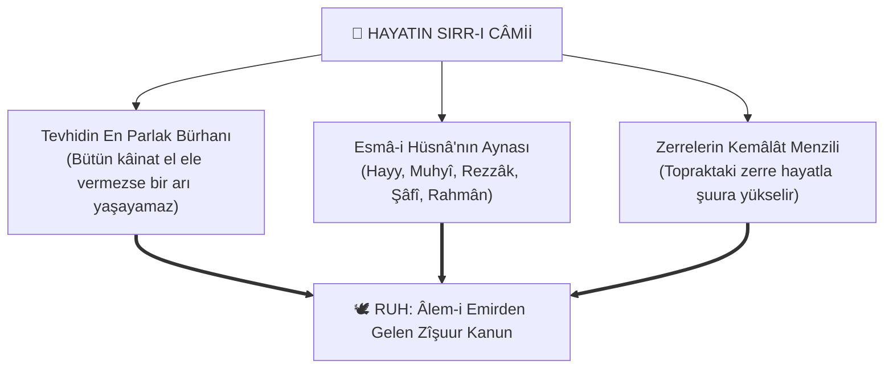

# 🕊️ Hayat ve Ruh Tılsımı: Kâinatın Kalbi ve Âlem-i Emir

> **بِسْمِ اللّٰهِ الرَّحْمٰنِ الرَّحٖيمِ**
> 
> *وَيَسْئَلُونَكَ عَنِ الرُّوحِ قُلِ الرُّوحُ مِنْ اَمْرِ رَبّٖى وَمَاۤ اُوتٖيتُمْ مِنَ الْعِلْمِ اِلاَّ قَلٖيلًا*
> 
> *"Sana ruhtan sorarlar; de ki: Ruh Rabbimin emrindendir. Ve size ilimden ancak az bir şey verilmiştir."* (İsrâ Sûresi, 85)
> 
> *"Hayat, şu kâinatın en ehemmiyetli gayesi, hem en büyük neticesi, hem en parlak nuru, hem en lâtif mayası, hem gayet süzülmüş bir hülâsası, hem en mükemmel meyvesi, hem en yüksek kemâli, hem en güzel cemâlidir."*
> — **30. Lem'a (Beşinci Nükte - İsm-i Hayy)**

---

## 1. Hayat Nedir? Kâinatı İnsana Veren İksir

Risale-i Nur ontolojisinde **"Hayat"**, kâinatın bütün çarklarının etrafında döndüğü odak noktasıdır. Eğer hayat olmasaydı:
* Yıldızlar parlasa bile onları gören bir göz olmazdı; ziya abes kalırdı.
* Rızıklar fışkırsa bile onları tadacak bir ağız olmazdı; nimet zayi olurdu.
* Kâinat kaskatı, kör, sağır ve karanlık bir taş yığınına dönerdi.

Hayat öyle muazzam bir tılsımdır ki:
* Bir karıncaya göz takarak koca güneşi ona hizmetkâr eder.
* İnsana akıl ve şuur vererek maziyi, müstakbeli ve Cennet'i onun hayaline dahil eder.
* **Hayat bir tek cüz'ü (parçayı) küll (bütün) hükmüne getirir.**

---

## 2. Ruhun Mahiyeti: Vücud Giymiş Bir Kanun-u Emrî (29. Söz)

Yirmi Dokuzuncu Söz'de Bediüzzaman Said Nursî, ruhun felsefî ve kelâmî tahlilini sarsıcı bir netlikle yapar:

> *"Ruh, zîhayat, zîşuur, nûrânî, vücud-u haricî giydirilmiş, câmi', hakikatdar, külliyet kesb etmeye müstaid bir kanun-u emrîdir.*
> 
> *Eğer Cenâb-ı Hak, kâinattaki **câzibe-i umumiye (yerçekimi) kanununa** ve nebatattaki **kuvve-i inbâtiye (büyüme) kanununa** haricî bir vücud giydirse ve başına şuur koysa; onlar birer ruh olurdu. Ruh dahi, eğer beden libasını çıkarsa ve başından şuuru sıyırsa, sâir tabiat kanunları gibi çıplak bir kanun-u emrî olarak kalırdı."* (29. Söz, İkinci Esas)

### Kanun ile Ruh Arasındaki Fark:
* **Fizik Kanunları (Yerçekimi, Manyetizma):** Haricî maddî bir vücudu yoktur; zihinlerde bir kavramdır ve maddede tecelli eder.
* **Ruh:** Cenâb-ı Hakk'ın bizzat haricî ve kalıcı bir vücut elbisesi giydirdiği, şuur ve hayat bahşettiği kudsî bir kanundur. Beden yıkılsa bile ruh baki kalır; çünkü o parçalanmaz, bölünmez, basittir (terkipsizdir).

---

## 3. Tılsım-ı Kâinat'ın Zirvesi: Hayat, Ene ve Zerre

* **Zerre:** Hayatın tuğlasıdır; Kudret Kalemi'nin mürekkebidir.
* **Hayat:** O tuğlalarla örülen saraydır.
* **Ruh:** O sarayın padişahıdır.
* **Ene:** O padişahın elindeki anahtardır; onunla Hâlık'ının gizli hazinelerini keşfeder.
