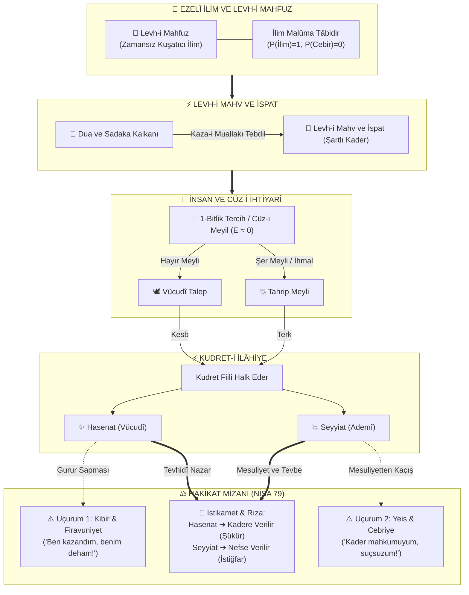

# ⚖️ Kader ve İrade Tılsımı: Ene'nin Gurur ve Yeis Dengesi

> **بِسْمِ اللّٰهِ الرَّحْمٰنِ الرَّحٖيمِ**
> 
> *وَاِنْ مِنْ شَىْءٍ اِلاَّ عِنْدَنَا خَزَاۤئِنُهُ وَمَا نُنَزِّلُهُ اِلاَّ بِقَدَرٍ مَعْلُومٍ*
> 
> *"Kader ve cüz'-i ihtiyarî, İslâmiyetin ve imanın nihayet hududunu gösteren, hâlî ve vicdanî bir imanın mütemmimâtındandır; yoksa ilmî ve nazarî değillerdir.*
> *Yani, mü'min her şeyi, hattâ fiilini Cenâb-ı Hakka vere vere, tâ nihayette teklif ve mes'uliyetten kurtulmamak için, önüne **cüz'-i ihtiyarî** çıkıyor; ona 'Mes'ulsün ve mükellefsin' der.*
> *Sonra, ondan sudûr eden kemâlât ve hasenat ile fahreylememek ve gurura düşmemek için, **kader** karşısına çıkıyor; der: 'Fahr etme, haddini bil; yapan sen değilsin.'"*
> — **26. Söz (Kader Risalesi)**

---

## 1. Ene'nin İki Tehlikeli Uçurumu: Kibir ve Yeis

Benlik (Ene), varlık sahnesinde sürekli iki büyük vartanın ve sapkınlığın tehdidi altındadır. Bediüzzaman Hazretleri 26. Söz'de bu iki vartayı teşhis ederek kâinatın en ince felsefî problemini (Determinizm vs. Özgür İrade) vicdanî ve ontolojik bir netliğe kavuşturur:



1. **Hasenat ve Başarılarda Gururlanmak (Kibir Uçurumu):** Ene bir hayra vesile olduğunda, bir muvaffakiyet kazandığında gurura kapılıp firavunâne "Benim deham, benim iktidarım" der. İşte bu gurur hastalığını tedavi eden ilâç **Kader**dir: *"Fahr etme, haddini bil; o nimeti yaratan ve tevfik veren Allah'tır."*
2. **Seyyiat ve Hatalarda Mesuliyeti Kadere Atmak (Yeis Uçurumu):** Ene bir günah işlediğinde veya tembellik edip bir kusur işlediğinde, vicdan azabından kaçmak için Kadere bühtan eder: *"Ne yapayım, kaderim böyle yazılmış!"* İşte bu kaçışı durduran kalkan ise **Cüz'-i İhtiyarî**dir: *"Mes'ulsün, meyli sen sarf ettin, kasıt sendedir!"*

---

## 2. Nuranî Düstur: Hasenat Allah'tan, Seyyiat Nefisten

Kur'ân-ı Hakîm'in Nisa Sûresi 79. âyeti bu sırrı matematiksel ve ontolojik bir kesinlikle ilân eder:

$$\text{مَاۤ اَصَابَكَ مِنْ حَسَنَةٍ فَمِنَ اللّٰهِ وَمَاۤ اَصَابَكَ مِنْ سَيِّئَةٍ فَمِنْ نَفْسِكَ}$$

> *"Sana isabet eden her iyilik Allah'tandır; sana isabet eden her kötülük ise nefsindendir."*

### Vücudî ve Ademî Fiiller Arasındaki Asimetri

Bediüzzaman bu âyetin sırrını şu iki temel aksiyomla delillendirir:

| Boyut | Hasenat (İyilik) | Seyyiat (Kötülük / Tahrip) |
|---|---|---|
| **Ontolojik Mahiyeti** | **Vücudîdir:** Varlık, hayat, nizam, trilyonlarca şart ve sonsuz bir kudret gerektirir. | **Ademîdir:** Yokluk, bozma, terk ve tahriptir. Var olan nizamın şartlarından birini bozmaktır. |
| **İnsanın Hissesi** | Yalnızca cüz-i bir meyil, dua, talep ve kesbdir. Yaratıcı kudret insanda yoktur. | Şerri tercih etmek, vazifeyi terk etmek veya tek bir dengeyi bozmaktır. |
| **Sebep-Netice Oranı** | Sonsuz sebep $\rightarrow$ 1 Hayır neticesi | 1 Küçük ihmal $\rightarrow$ Devasa tahribat |
| **Misâl** | Bir sarayın inşası binlerce ustanın, mimarın, malzemenin ve ayların cehdine bağlıdır. | O koca sarayı yakmak için tek bir kibrit ve bir saniyelik gaflet kâfidir. |
| **Hüküm ve Nisbet** | Fail-i Hakiki Allah'tır; fahr edilmez, **şükredilir**. | Fail-i Tahribi nefs-i emmaredir; kadere atılmaz, **istiğfar edilir**. |

---

## 3. Ezelî İlim ve Determinizm Paradoksunun Çözümü

Modern felsefe ve fizikte iki asırdır süren büyük çıkmaz:
1. **Laplasyen Katı Determinizm:** Geçmiş durum geleceği zorunlu kılar; irade bir yanılsamadır (İnsanı saat çarkına indirger).
2. **Kuantum Belirsizliği ve İndeterminizm:** Atom altı parçacıklar rastgele davranır; özgür irade rastlantısallıkla karıştırılır (İnsanı tesadüf oyuncağı yapar).

Risale-i Nur, 26. Söz'de ezeliyet kavramını zamansal bir çizginin başı değil, **zamanı bütünüyle kuşatan bir muhit daire** olarak tarif ederek bu paradoksu kökünden çözer:

### "İlim Malûma Tâbidir" Prensibi

* **Ezel Geçmiş Zaman Değildir:** Ezel, geçmişin nihayetsizliği değil; geçmiş, hâl ve geleceği aynı anda gören bir fevkattabiî ve zamandan münezzeh tecelli makamıdır. Bir aynanın yüksekten bir nehrin hem menbaını hem mecrasını hem mansabını aynı anda ihata etmesi gibidir.
* **Bilmek Zorlamak Değildir:** Allah bir insanın yarın ne yapacağını ezelî ilmiyle bilir. Fakat **Allah bildiği için insan o fiili yapmaz; insan kendi cüz-i iradesiyle o tercihi yapacağı için Allah ezelî ilmiyle bilmiştir.**
  $$P(\text{İlâhî Bilgi} \mid \text{İnsanî Tercih}) = 1.0 \quad \text{ancak} \quad P(\text{Cebir ve Zorlama}) = 0.0$$
* Demek ki Levh-i Mahfuz, iradeyi felç eden bir zorlama kütüğü değil; bütün zaman ve mekânların tercih ve neticelerini ihata eden sonsuz bir ezelî enformasyon matrisidir.

---

## 4. Levh-i Mahv ve İspat: Şartlı Kader ve Dua-Sadaka Etkileşimi

Kader tekdüze ve kaskatı bir levha değildir. Bediüzzaman'ın izahıyla kaderin iki veçhesi vardır:

1. **Levh-i Mahfuz (Kaza-i Mübrem):** Ezelî ilmin değişmez ana kütüğüdür. Kanun-u küllîler buradadır.
2. **Levh-i Mahv ve İspat (Kaza-i Muallak):** Zamanın seylânında, kaderin yaz-boz tahtası hükmündeki dinamik sahifesidir. Burada hükümler şartlara bağlanmıştır:
   $$\text{Kaza}_{\text{fiilî}} = \text{Kaza}_0 - f(\text{Dua}) - g(\text{Sadaka}) + h(\text{Günah})$$

> **"Kaza-i muallakı yalnız dua tebdil eder; sadaka belayı def eder ve ömrü tezyid eder."** (Hadis-i Şerif Şerhi, 26. Söz)

Kul samimiyetle dua ettiğinde, istiğfar eylediğinde veya sadaka verdiğinde; Allah Levh-i Mahv ve İspat'taki o muallak belayı lütfuyla ref' eder ve hayra tebdil eyler.

---

## 5. Cüz-i İhtiyarînin Enformasyonel Modeli: 1-Bitlik Tercih Anahtarı

İnsanın iradesi maddi bir cisim veya devasa bir kuvvet kaynağı değildir. Bediüzzaman cüz-i iradeyi bir **"emir-i itibarî"** (ilişkisel durum) ve **"kesb"** olarak tanımlar:

* **Enerji Miktarı:** İradenin fiziki iş yapma enerjisi sıfıra yakındır ($E_{\text{irade}} \approx 0$).
* **Enformasyonel Fonksiyonu:** İrade bir anahtardır (1-bit toggle: $0 \rightarrow 1$ veya $\theta \in [-\pi/2, +\pi/2]$).
* **Kudret Akışı:** O 1-bitlik anahtar çevrildiğinde, arkasındaki kâinat santralinin sonsuz Kudret motoru faaliyete geçer ve fiili yaratır.
* **Mesuliyet:** Işığı yakan veya fabrikayı patlatan, anahtarı çeviren parmaktır; santraldeki megavatlarca elektrik değil. Dolayısıyla mesuliyet bütünüyle tercihi yapan insana aittir.

---

## 6. Matematiksel Simülasyon: `kader-irade-matrix-model.py`

Projemizin 6. simülasyon modeli olan Kader-İrade Karar Matrisi; bu hakikatleri bilgisayar ortamında parametrik olarak modeller:

```bash
# İstikamet ehli dengesini simüle etmek için:
python simulations/kader-irade-matrix-model.py --senaryo istikamet_ehli

# Tüm senaryoları karşılaştırmalı tablo olarak basmak için:
python simulations/kader-irade-matrix-model.py --karsilastir
```

### Simülasyon Çıktısı (Özet Tablo)

| Senaryo | İstikamet İndisi | Kibir Potansiyeli | Yeis Potansiyeli | Hasenat | Seyyiat | Ruhi ve Felsefî Makam |
|---|:---:|:---:|:---:|:---:|:---:|---|
| **`istikamet_ehli`** | **1.000** | 0.016 | 0.003 | 3.50 | 0.06 | **İstikamet & Rıza (26. Söz Mizânı)** |
| **`firavun_kibri`** | 0.588 | **0.561** | 0.064 | 1.44 | 0.15 | Kibir Uçurumu (Firavuniyet/Karuniyet) |
| **`cebriye_yeisi`** | 0.613 | 0.000 | **0.553** | 0.00 | 1.40 | Yeis Uçurumu (Cebriyecilik/Mesuliyetsizlik) |
| **`dua_ile_kaza_tehiri`** | **1.000** | 0.067 | 0.014 | 2.01 | 0.11 | İstikamet & Rıza (Şartlı Kaza Kalkanı: %92) |
| **`materyalist_determinizm`**| 0.803 | 0.205 | 0.180 | 0.26 | 0.25 | Tereddüt ve Zaaf Dairesi |

---

## 7. İlgili Dosyalar ve İleri Okuma

* 📊 **Python Modeli:** [`simulations/kader-irade-matrix-model.py`](../simulations/kader-irade-matrix-model.py)
* 🧪 **Birim Testleri:** [`simulations/test_kader_model.py`](../simulations/test_kader_model.py)
* 🗺️ **Mermaid Diyagramı:** [`assets/diagrams/kader-irade-matrisi.mmd`](../assets/diagrams/kader-irade-matrisi.mmd)
* 📖 **Sözlük Maddeleri:** [Cüz-i İhtiyarî](../kavramlar-sozlugu/glossary.md#cç), [Kader](../kavramlar-sozlugu/glossary.md#k), [Levh-i Mahfuz](../kavramlar-sozlugu/glossary.md#l)
