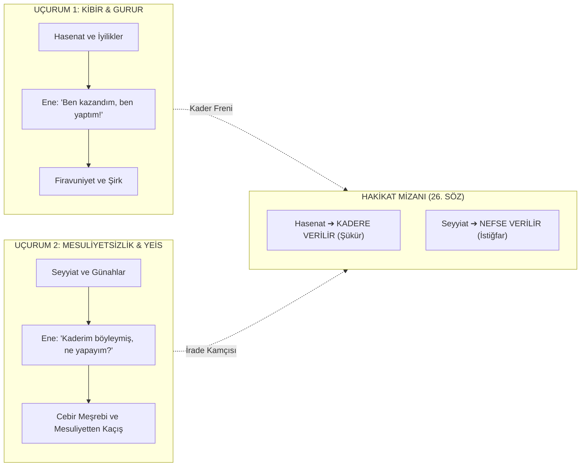

# ⚖️ Kader ve İrade Tılsımı: Ene'nin Gurur ve Yeis Dengesi

> **بِسْمِ اللّٰهِ الرَّحْمٰنِ الرَّحٖيمِ**
> 
> *وَاِنْ مِنْ شَىْءٍ اِلاَّ عِنْدَنَا خَزَاۤئِنُهُ وَمَا نُنَزِّلُهُ اِلاَّ بِقَدَرٍ مَعْلُومٍ*
> 
> *"Kader ve cüz'-i ihtiyarî, İslâmiyetin ve imanın nihayet hududunu gösteren, hâlî ve vicdanî bir imanın mütemmimâtındandır; yoksa ilmî ve nazarî değillerdir.*
> *Yani, mü'min her şeyi, hattâ fiilini Cenâb-ı Hakka vere vere, tâ nihayette teklif ve mes'uliyetten kurtulmamak için, önüne **cüz'-i ihtiyarî** çıkıyor; ona 'Mes'ulsün ve mükellefsin' der.*
> *Sonra, ondan sudûr eden kemâlât ve hasenat ile fahreylememek ve gurura düşmemek için, **kader** karşısına çıkıyor; der: 'Fahr etme, haddini bil; yapan sen değilsin.'"*
> — **26. Söz (Kader Risalesi)**

---

## 1. Ene'nin İki Tehlikeli Uçurumu: Kibir ve Yeis

Benlik (Ene), varlık sahnesinde sürekli iki büyük tehlike ile karşı karşıyadır:

1. **Hasenat ve Başarılarda Gururlanmak:** Ene bir hayra vesile olduğunda, bir muvaffakiyet kazandığında gurura kapılıp firavunâne "Benim deham, benim iktidarım" der. İşte bu gurur hastalığını tedavi eden ilâç **Kader**dir: *"Fahr etme, haddini bil; o nimeti yaratan ve tevfik veren Allah'tır."*
2. **Seyyiat ve Hatalarda Mesuliyeti Kadere Atmak:** Ene bir günah işlediğinde veya tembellik edip bir kusur işlediğinde, vicdan azabından kaçmak için Kadere bühtan eder: *"Ne yapayım, kaderim böyle yazılmış!"* İşte bu kaçışı durduran kalkan ise **Cüz'-i İhtiyarî**dir: *"Mes'ulsün, meyli sen sarf ettin, kasıt sendedir!"*

---

## 2. Nuranî Düstur: Hasenat Allah'tan, Seyyiat Nefisten

Kur'ân-ı Hakîm'in Nisa Sûresi 79. âyeti bu tılsımı nihai bir mühürle bağlar:

$$\text{مَاۤ اَصَابَكَ مِنْ حَسَنَةٍ فَمِنَ اللّٰهِ وَمَاۤ اَصَابَكَ مِنْ سَيِّئَةٍ فَمِنْ نَفْسِكَ}$$
> *"Sana isabet eden her iyilik Allah'tandır; sana isabet eden her kötülük ise nefsindendir."*

Bediüzzaman bu âyetin sırrını şöyle izah eder:
* **İyilik ve Hasenat Vücudîdir:** İyilik vücut, hayat, nizam, kudret ve imkân ister. İnsanın zâtında mutlak bir vücut ve kudret yoktur; dolayısıyla hayrın yaratıcısı ancak Hallâk-ı Zülcelâl'dir. İnsanın hissesi sadece dua, talep ve kesbdir.
* **Kötülük ve Seyyiat Ademedir (Tahriptir):** Tahrip için kuvvet gerekmez; küçük bir ihmal veya terk koca bir sarayı yakmaya yeter. Meselâ bir kibritle koca bir ormanı yakan insan, "Ormanın kül olmasında benim sadece küçük bir hareketim vardı" diyerek mesuliyetten kurtulamaz. Çünkü tahripte fâil tamamen o şerri işleyendir.

---

## 3. Kader ve İradenin Ene Simülasyonundaki Rolü

Ene modelimiz açısından Kader ve İrade dengesi şu kurallarla sistemik bir dengeye oturur:

* **Tevhidî Muvazene:**
  $$\text{Nefsin Şe'ni} = \text{Acz} + \text{Fakr} + \text{Kusurunu İtiraf}$$
  $$\text{Rabb'in Şe'ni} = \text{Kudret} + \text{Gınâ} + \text{Kemâl-i Mutlak}$$
* Ene bu muvazeneyi koruduğu müddetçe ne yeise düşüp ümitsiz olur ne de kibre sapıp firavunlaşır. İbadetinde huzu', hizmetinde ise gayret ve şevk içinde kalır.
