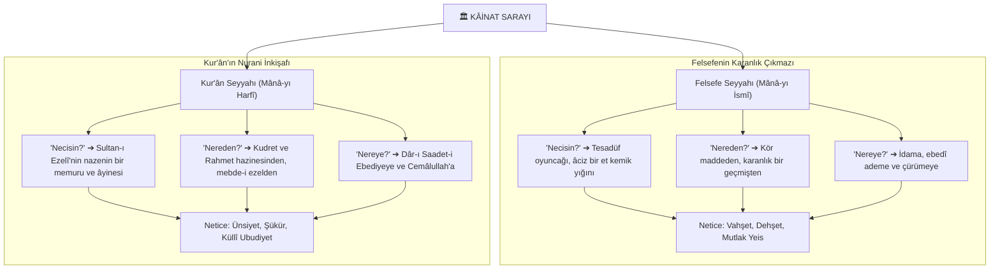

# 🏰 Kâinat Sarayı, Hilkatin Tılsımı ve Üç Büyük Sual

> **بِسْمِ اللّٰهِ الرَّحْمٰنِ الرَّحٖيمِ**
> 
> *وَالشَّمْسِ وَضُحٰيهَا ۞ وَالْقَمَرِ اِذَا تَلٰيهَا ۞ وَالنَّهَارِ اِذَا جَلّٰيهَا ۞ وَالَّيْلِ اِذَا يَغْشٰيهَا*
> 
> *"Ey birader! Eğer birinci seyahat-i hayaliyede o zâlim nefsin zakkum-misâl ahlâkından bir derece teberrî edip, Kur’ân-ı Hakîm’in tiryak-misâl ahlâk-ı âliyesini rehber ittihaz edersen; bak, kâinat sarayı nasıl bir tarzda görünür ve o sarayın Sâni’-i Zülcelâl’i o sarayı ne için yapmış ve içine insanı ne vazife ile koymuş, gör."*
> — **11. Söz**

---

## 1. Tılsım-ı Kâinat'ın Üç Muammâsı: Necisin? Nereden? Nereye?

Bediüzzaman Said Nursî, eserlerinin pek çok yerinde insan aklını ve ruhunu ezelden ebede meşgul eden, cevabı bulunmadığında bütün varlığı anlamsız bir karanlığa ve yeise gömen üç müthiş suale dikkat çeker:

1. **"Necisin?"** *(Mahiyetin, hakikatin ve vazifen nedir?)*
2. **"Nereden geliyorsun?"** *(Mebdein nedir; seni bu âleme sevk eden kimdir?)*
3. **"Nereye gidiyorsun?"** *(Akıbetin, müntehan ve varış noktan neresidir?)*

> *"Bütün mevcudat-ı âleme karşı alâkadar ve her bir şeyin saadet ve şekavetiyle bir derece müteellim ve mütelezziz olan insan, şu mevcudat-ı seyyale ve mahlukat-ı zâile içinde kendini pek garib, pek bîçare, pek zaîf ve kimsesiz gördüğü vakitte, birden Kur'ân-ı Mu'cizü'l-Beyan'ın lisanından şu üç sualin cevabını işitir: **'Ey insan! Sen hiçlikten gelmedin; Hâlık-ı Hakîm'in memurusun. Vazifen ise O'nun esmâsına âyinedarlık etmektir. Ve ebedî bir saadete, dâr-ı bekāya gidiyorsun.'**"* (11. Söz & 24. Mektup)

---

## 2. İki Bakış Açısının Kâinatı Tasviri

On Birinci Söz'de kâinat, muhteşem bir **"Saray"** ve bir **"Sergi"** olarak tasvir edilir. Bu saraya giren iki seyyahın müşahedesi, felsefe (mânâ-yı ismî) ile nübüvvetin (mânâ-yı harfî) kâinat tılsımını nasıl çözdüğünü veya kördüğüm yaptığını ortaya koyar.

---

## 3. Sultan-ı Ezelî'nin Kâinat Sarayını İnşa Gayeleri

On Birinci Söz'e göre, bir Padişah-ı Zîşân öyle bir saray yaptırmıştır ki:
* Her bir odasında hadsiz antika sanatlar teşhir edilmiş,
* Her sofrasında tükenmez leziz taamlar serpilmiş,
* Ve o Padişah iki gaye ile bu sarayı tanzim etmiştir:
  1. **Bizzat Kendi Cemâl ve Kemâlini Müşahede Etmek:** Kendi esmâ ve sıfâtının tecellilerini kudsî bir muhabbetle bizzat nazar-ı şuhudunda görmek.
  2. **Zîşuur Seyircilerin Nazarıyla Teşhir Etmek:** İnsanın ve melaikenin takdir, hayret, tahsin ve ubudiyet dolu nazarlarıyla o sanat hazinelerini alkışlatmak.

> *"İşte, öyle bir Sâni-i Hakîm, bir Kadîr-i Alîm, şu kâinat sarayını hadsiz acaib ve garaible donatmış ve o sarayın seyrine ve temaşasına melekleri, cinleri ve insanları davet etmiş... Ve o sarayda insanı en câmi' bir muhatap ve en zengin bir muarrif kılmıştır."* (11. Söz)

---

## 4. İnsanın Kâinat Sarayındaki Dokuz Küllî Vazifesi

On Birinci Söz'ün hitâmında insanın dergâh-ı İlâhiyede ifa etmekle mükellef olduğu **9 büyük vazife** şöyle sıralanır:

| No | Vazife Nevi | Hakikati ve Ameli |
|:---:|:---|:---|
| **1** | **Mizan ve Tartı Vazifesi** | Vücuduna takılan duygular terazileriyle rahmet hazinelerindeki nimetleri tartmak ve küllî şükretmek. |
| **2** | **Künûz-u Esmâ Miftahlığı** | Fıtratına dercedilen ene ve istidad anahtarlarıyla esmâ-i İlâhiyenin gizli hazinelerini keşfetmek. |
| **3** | **Teşhirgâh Müşahitliği** | Bu sergideki nakışları kemâl-i hayretle temaşa edip Sâni'ine karşı `Mâşaallah`, `Bârekâllah` demek. |
| **4** | **Dellâllık ve İlânat** | Mescid-i kâinatta bütün mevcudatın tesbihatını şuurla derleyip dellâllığını yapmak. |
| **5** | **Ziynet ve Sanat Perestişkârlığı** | Kâinattaki nakışların zevaline ağlamak yerine, onların dâimî tecelligâh olan Esmâ-i Hüsnâ'ya şehadetini alkışlamak. |
| **6** | **Tefekkür ve Mütalaa** | Kâinat kitabının sahifelerini mânâ-yı harfî ile okuyup tekvînî âyetleri derûnuna sindirmek. |
| **7** | **Acz ve Fakr Cenahlarıyla Uçmak** | Nihayetsiz fakrını Cenâb-ı Hakk'ın gınâsına, aczini O'nun mutlak kudretine iltica vesilesi yapmak. |
| **8** | **Secde-i Ubudiyet** | Bütün mevcudat namına rükû ve secdeye kapanarak Halik-ı Kâinat'ın azamet ve kibriyasına boyun eğmek. |
| **9** | **Şahs-ı Manevîde Eriş** | Enaniyetini şahs-ı manevî havuzunda eritip kâinatın zerreleri adedince hamd ve tesbihte bulunmak. |

---

## 5. Tılsım-ı Kâinat'ın Çözülüşü

İnsan bu dokuz vazifeyi deruhte ettiğinde:
* Kâinat, düşman ve yabancı bir gurbetgah olmaktan çıkar, bir **meşher-i sanat-ı İlâhiye** ve **ziyâfetgâh-ı Rahmâniye**ye inkılap eder.
* Zerreler birer kudret kelimesi, küreler birer nizam burhanı olur.
* Ene, firavuniyet iddia eden bir canavar değil; Vâhid-i Kıyasî ile mutlak kemâlâtı tanıttıran şeffaf bir elmas âyineye dönüşür.

> *"İşte kâinatın tılsım-ı muğlâkı böylece açılır. Zât-ı Zülcelâl'in künûz-u mahfiyesi böylece keşfolunur."* (11. Söz)
