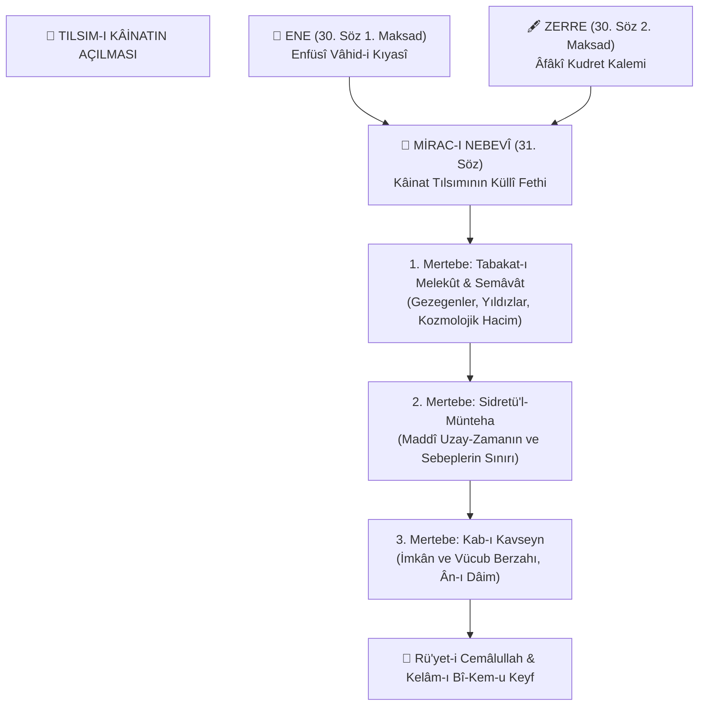

# 🌌 Mirac-ı Nebevî, Görelilik ve Tayy-ı Zaman: Kâinat Tılsımının Fethi (31. Söz)

> **بِسْمِ اللّٰهِ الرَّحْمٰnِ الرَّحٖيمِ**
> 
> *سُبْحَانَ الَّذٖى اَسْرٰى بِعَبْدِهٖ لَيْلًا مِنَ الْمَسْجِدِ الْحَرَامِ اِلَى الْمَسْجِدِ الْاَقْصَى الَّذٖى بَارَكْنَا حَوْلَهُ لِنُرِيَهُ مِنْ اٰيَاتِنَا اِنَّهُ هُوَ السَّمٖيعُ الْبَصٖيرُ*
> 
> *"Kendisine âyetlerimizden bir kısmını gösterelim diye kulunu bir gece Mescid-i Haram'dan, çevresini bereketlendirdiğimiz Mescid-i Aksa'ya götüren Allah noksan sıfatlardan münezzehtir. O, her şeyi hakkıyla işitendir, hakkıyla görendir."* (İsrâ Sûresi, 1)
> 
> *ثُمَّ دَنَا فَتَدَلّٰى ۝ فَكَانَ قَابَ قَوْسَيْنِ اَوْ اَدْنٰى ۝ فَاَوْحٰى اِلٰى عَبْدِهٖ مَاۤ اَوْحٰى*
> 
> *"Sonra yaklaştı ve sarktı. İki yay aralığı kadar yahut daha da yakın oldu. Böylece kuluna vahyettiğini vahyetti."* (Necm Sûresi, 8-10)
> 
> *"Tılsım-ı kâinatın ve muammâ-yı hilkatin keşşafı ve fatihi olan zât-ı Ahmediye Aleyhissalâtü Vesselâmın mi'racı; mevcudatın intizamından, hilkatin gayelerinden ve esmâ-i İlâhiyenin cemâlinden bahseden en kudsî, en câmi' bir seyahat-i rububiyettir."*
> — **31. Söz (Mirac Risalesi)**

---

## 1. Mirac Nedir ve Kâinat Tılsımıyla Doğrudan Bağı

Risale-i Nur Külliyatı'nda **Tılsım-ı Kâinat**, mevcudatın yaratılış sırrını, nereden gelip nereye gittiğini ve mahiyetinin ne olduğunu izah eden varoluşsal düğümdür.
* **30. Söz'ün Birinci Maksadı (Ene):** Bu tılsımın **enfüsî (iç) anahtarıdır**; insan nefsi, vâhid-i kıyasî ile esmâyı keşfeder.
* **30. Söz'ün İkinci Maksadı (Zerre):** Bu tılsımın **âfâkî (dış) mikroskobik alfabesidir**; zerreler Kudret Kalemi'nin mürekkebidir.
* **31. Söz (Mirac):** Bu iki anahtarın açtığı kâinat sarayının **küllî fethi, teftişi ve nihai zirvesidir**.

Bediüzzaman Hazretleri, Mirac'ı sadece şahsî bir keramet veya harikulade bir seyahat olarak değil; **kâinat ağacının en mükemmel meyvesinin (Zât-ı Ahmediye Aleyhissalâtü Vesselâm), ağacın bütün dal, yaprak, kök ve semavat tabakalarını temaşa ederek Kökü ve Sahibi olan Sultan-ı Ezelî'nin huzuruna çıkması** olarak tarif eder.

---

## 2. Mirac Neden Cisimle Vuku Buldu? Kesafetten Letâfete İnkılap

Mirac bahsinde felsefecilerin ve dar akılların en çok takıldığı mesele şudur: *"Ruh manevîdir, mekânsızdır, bir anda her yere gidebilir. Neden bu seyahat sadece ruhla değil de maddî beden ve ceset ile vuku bulmuştur?"*

31. Söz'ün Birinci Esası bu suale sarsılmaz burhanlarla cevap verir:

### A. Ceset Kâinatın Bütün Cihazatını Taşır
Eğer Mirac sadece ruh ile olsaydı; göz, kulak, kalp, sinir sistemi gibi maddî zerrat ve hücrelerin ibadetleri bu küllî bayrama iştirak edemezdi. İnsan cesedi, kâinat elementlerinin ve tabiatının en hassas fihristesidir. Göz güneşi tartar, kulak ses dalgalarını ölçer, dil tatları süzer. Dolayısıyla kâinat sarayının teftişinde bu fihristenin de seyahate dahil olması hikmetin tam gereğidir.

### B. Madde Nura ve Ruha Tâbidir (Letafet Prensibi)
Maddî cisimler kendi başlarına kaldıklarında kesiftir, ağırdır ve eylemsizdir (Higgs alanı direnci). Fakat bir cisim ruhun ve nurun emrine girdiğinde, ruhun sür'at ve letafetini kesbeder:
* Demir bir parçayı ateşe atarsanız; demir sertliğini ve karanlığını koruyamaz, ateşin rengini, hararetini ve akıcılığını alır; demir gibi değil, ateş gibi davranır.
* Aynen öyle de; Peygamber Efendimiz'in (A.S.M.) mübarek cesedi, ruhunun nuraniyetiyle öyle bir imtizac etmiştir ki; **ceset ruhaniyet kazanmış, hafiflemiş ve nur sür'atine yükselmiştir**.

---

## 3. Zamanın İzafiyeti ve Görelilik Fiziği (Special Relativity & Ân-ı Dâim)

Mirac hadisesinde en hayret verici noktalardan biri; Peygamberimiz'in (A.S.M.) yetmiş bin melekût perdesini, yedi kat semavatı, cennet ve cehennemi gezip Cenâb-ı Hak ile mükâleme ettikten sonra geri döndüğünde, **yatağının henüz soğumamış ve abdest suyunun henüz akmakta olmasıdır** (*Tarfetü'l-ayn*).

Modern fizik bu hakikati Albert Einstein'ın 1905 Özel Görelilik Kuramı ile teyit etmiştir:

$$\gamma = \frac{1}{\sqrt{1 - \frac{v^2}{c^2}}}$$

$$\Delta \tau = \frac{\Delta t}{\gamma}$$

1. **Zamanın Göreceliği (Time Dilation):**
   * Durağan bir gözlemciye (Dünya) göre geçen zaman $\Delta t$ iken; ışık hızına ($v \to c$) yaklaşan bir seyyahın kolundaki saatin gösterdiği öz-zaman ($\Delta \tau$) sıfıra yaklaşır.
2. **Foton Referans Çerçevesi:**
   * Evrende ışık hızında hareket eden bir foton için **zaman tamamen durmuştur**. Foton yaratıldığı andan evrenin sonuna kadar geçen milyarlarca yılı tek bir anda yaşar.
3. **Mirac'ta Ân-ı Dâim (Genişletilmiş Şerit):**
   * Bediüzzaman Hazretleri bu fiziksel kanunu 24. Mektup ve 31. Söz'de muazzam bir zaman felsefesiyle şerh eder:
   > *"Zaman, kâinattaki seyelân-ı mevcudatın bir şerididir. O şeridin sür'ati muhtelif mahlukata göre değişir. Cismin sür'ati arttıkça ve ruhaniyete yaklaştıkça, zaman şeridi büzülür; bir dakikada bin senelik iş görülür."*

---

## 4. Sidretü'l-Münteha ve Kab-ı Kavseyn: Nedenselliğin Bittiği Yer

| Menzil / Makam | Kozmolojik ve Ontolojik Anlamı | Fiziksel Sınır |
| :--- | :--- | :--- |
| **Arz ve Tabakat-ı Semâvât** | Maddî kâinat, galaksiler, atomlar ve esbap dairesi. | $v < c$, 4-Boyutlu Uzay-Zaman |
| **Sidretü'l-Münteha** | Yaratılmış mevcudatın ve melekût ilminin son hududu. Hz. Cebrail'in (A.S.) dahi *"Bir adım daha atarsam yanarım"* dediği sınır. | Kozmik Olay Ufku, Nedensellik Sınırı |
| **Kab-ı Kavseyn** | İmkân (mahlukiyet) dairesi ile Vücub (Yaratıcı) dairesinin buluşma berzahı; mekândan ve zamandan münezzehiyet. | Tekillik Ötesi, Ezeliyet & Ebediyet Dairesi |
| **Rü'yet-i Cemâlullah** | Keyfiyetsiz, misilsiz, zamansız ve mekânsız olarak Allah'ın cemâlini bizzat temaşa etmek. | Mutlak Hakikat (Hakkalyakîn) |

---

## 5. Mirac'ın Kâinata Getirdiği Beş Kudsî Hediye (31. Söz, 4. Esas)

Mirac seyahati yalnızca Peygamberimiz'e (A.S.M.) mahsus bir ikram değil; bütün insanlığa ve kâinata getirilmiş kudsî bir hazinedir:

1. **Erkân-ı İmaniyenin Gözle Görülmesi:** İmanın altı esası (Allah, melekler, âhiret, kader vb.) gayb olmaktan çıkmış, bizzat görülerek kâinata şeksiz bürhan olarak ilan edilmiştir.
2. **Beş Vakit Namaz (Mü'minin Miracı):** Her bir mü'minin günde beş defa Mirac sırrına erip kâinatın ve nefsin dağdağasından sıyrılarak Rabb-i Rahîm'inin huzuruna çıkabilme hediyesi.
3. **Dâr-ı Saadet ve Ebediyet Müjdesi:** İnsanı yokluk, ölüm ve zeval karanlığından kurtaran, cennetin ve ebedî hayatın varlığının şahitlikle müjdelenmesi.
4. **Rü'yet-i Cemâlullah Vaadi:** Cennette Cenâb-ı Hakk'ın rü'yetine mazhar olunacağının kat'î müjdesi.
5. **Kâinatın Sultanının Tanıtılması:** İnsanın bu kâinatta başıboş ve sahipsiz olmadığını; kâinat sarayının nâzenin bir misafiri ve muhatabı olduğunu bütün mevcudata ilan etmesi.

---

## 6. Matematiksel Simülasyon ve Web Modeli

Mirac fiziği, depomuzda yer alan 9. simülasyon modelinde matematiksel olarak kodlanmıştır:
* **Python Simülatörü:** [`simulations/mirac-relativity-model.py`](../simulations/mirac-relativity-model.py)
* **Birim Testleri:** [`simulations/test_mirac_model.py`](../simulations/test_mirac_model.py) (Lorentz daralması, kütlesizlik, tarfetü'l-ayn zamanı)
* **Mermaid Şeması:** [`assets/diagrams/mirac-ve-zamanin-izafiyeti.mmd`](../assets/diagrams/mirac-ve-zamanin-izafiyeti.mmd)
* **İnteraktif Web Sekmesi:** [Web Dashboard - 9. Sekme](../dashboard/index.html)
