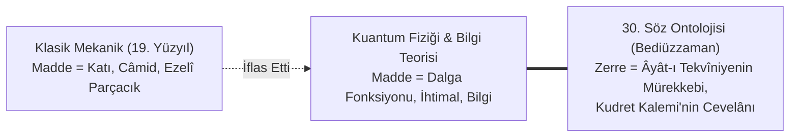

# ⚛️ Modern Fizik ve Tılsım-ı Kâinat: Kuantum, Entropi ve Kudret Kalemi

> *"Tahavvülât-ı zerrât; Nakkāş-ı Ezelî'nin **kalem-i kudreti**, kitâb-ı kâinâtta yazdığı **âyât-ı tekvîniyenin** hengâmındaki ihtizâzâtı ve cevelânıdır. Yoksa; maddiyûn ve tabîiyyûnların tevehhüm ettikleri gibi tesâdüf oyuncağı ve karışık, mânâsız bir hareket değildir."*
> — **30. Söz, İkinci Maksad**

---

## 1. Giriş: 20. Yüzyıl Fiziğinin Maddeden Bilgiye Evrimi

19. yüzyılın kaba materyalizmi maddeyi katı, ezelî, bölünmez ve kendi kendine kaim bir "bilardo topu" zannediyordu. Oysa 20. ve 21. yüzyıl modern fiziği (Kuantum Mekaniği, Genel Görelilik ve Bilgi Teorisi), maddenin zannedildiği gibi katı ve müstakil bir cevher olmadığını; dalga boylarından, enerji titreşimlerinden, ihtimallerden ve en temelde **"Bilgi"den (Information)** ibaret olduğunu ortaya koydu.

Bediüzzaman Said Nursî'nin 1920'lerde kaleme aldığı **Otuzuncu Söz (Ene ve Zerre Risalesi)**, modern fiziğin ancak bugün ulaştığı bu hakikati bir asır öncesinden ontolojik olarak şöyle formüle etmiştir:
* Madde kaim-i bizzat (kendi kendine var olan) bir kütle değildir; bir **yazıdır**, bir **mektuptur**, tekvînî bir kelimedir.
* Zerrelerin titreşimi (ihtizazat), Kudret Kalemi'nin kâinat sahifesine koyduğu noktalardır.



---

## 2. Kuantum Belirsizliği ve İmkân Dairesi vs. Kudret Kalemi

Kuantum mekaniğinin kurucularından Werner Heisenberg'in ortaya koyduğu **Belirsizlik İlkesi (Uncertainty Principle)** ve Erwin Schrödinger'in **Dalga Fonksiyonu ($\psi$)**, atom altı parçacıkların deterministik bir zorunlulukla değil, sonsuz ihtimaller denizinde (süperpozisyon) yüzdüğünü gösterir.

### Kuantumun Tıkanıklığı: "Ölçüm Problemi" (Measurement Problem)
Bir elektron gözlemlenene kadar dalga olarak sonsuz ihtimalde dalgalanırken, gözlem anında neden belirli tek bir noktaya çöker (Wave function collapse)? Materyalist fizik bu soruya metafizik olmadan tutarlı bir cevap veremez.

### Risale-i Nur'un Müşkilküşâ İzahı: İmkân ve Vücub Dengesi
Kelâm felsefesinde her mevcud mümkinü'l-vücuddur (olması da olmaması da, şurada veya burada bulunması da müsavidir). 

> *"Kâinatta her bir zerre, hadsiz imkânat yolları içinde mütereddid iken; birden gayet muntazam, hikmetli tek bir yolu ihtiyar etmesi gösteriyor ki, o zerre kendi başına değil; her şeyi muhît bir İlim ve her şeye hükmeden bir İrade ve Kudret'in sevkiyle hareket ediyor."* (30. Söz)

Kuantum fiziğindeki "ihtimaller dalgası", Risale-i Nur'un bahsettiği **"Vâsi İmkânat Dairesi"**dir. Dalga fonksiyonunun bir canlı hücresinde intizamla çökmesi ve vazife alması ise **"Kudret Kalemi'nin Taayyünü ve Emr-i Kûn fe-yekûn"** cilvesidir.

---

## 3. John Archibald Wheeler: "It from Bit" ve Mânâ-yı Harfî

20. yüzyılın en büyük teorik fizikçilerinden John Archibald Wheeler (karadelik kavramının isim babası), ömrünün sonlarında modern fiziğin vardığı nihai hakikati şu formülle özetlemiştir:

$$\Large \text{"It from Bit"}$$

* **It (Madde/Varlık):** Gördüğümüz parçacıklar, yıldızlar, bedenler.
* **Bit (Bilgi/Mânâ):** Evet/Hayır ikilikleri, kodlar, şuur ve bilgi.

Wheeler der ki: *"Bütün maddî varlıklar (It), temeldeki maddî olmayan bir bilgiden (Bit) kaynaklanır. Evren bir makine değil, devasa bir bilgi işleme sistemi ve bir metindir."*

### Risale-i Nur Mukayesesi:
Wheeler'ın 1990'larda vardığı "It from Bit", Bediüzzaman'ın **"Mânâ-yı Harfî"** ve **"Kitâb-ı Kebîr-i Kâinat"** doktrininin fizik lisanıyla yankılanmasından ibarettir:

| Boyut | Wheeler / Modern Bilgi Fiziği | Risale-i Nur Ontolojisi (30. Söz) |
|:---|:---|:---|
| **Varlığın Özü** | Bilgi (Information / Bit) | Mânâ-yı Harfî (Kâtibini gösteren yazı) |
| **Parçacıkların Hareketi** | Kodların dinamik işlenişi | Âyât-ı tekvîniyenin yazılış hengâmındaki cevelân |
| **Kâinatın Yapısı** | Kozmik bir metin / simülasyon | Kitâb-ı Mübîn ve İmam-ı Mübîn sahifeleri |
| **Gözlemcinin Rolü** | Katılımcı evren (Participatory Universe) | Zîşuurun temaşası, şükrü ve dellâllığı (11. Söz) |

---

## 4. Termodinamiğin İkinci Kanunu (Entropi) vs. Hayatın Negentropisi

Termodinamiğin ikinci kanunu (Entropi İlkesi), kapalı bir fiziksel sistemdeki düzensizliğin ve rastgeleliğin zamanla daima artacağını ($\Delta S > 0$) ve nihayetinde evrenin "Isı Ölümü"ne (Heat Death) sürükleneceğini söyler.

### Çarpıcı Kozmik Paradoks:
Eğer her şey kör fizik kanunlarıyla ve tesadüfle işliyorsa; nasıl oluyor da 13.8 milyar yıldır kâinatta entropi artarken, **canlılık, DNA, hücreler, beyin ve şuur gibi akıl almaz derecede negatif entropik (yani düzeni artıran, kaosu intizama çeviren)** harikalar inşa edilmektedir?

```text
  ┌─────────────────────────────────────────────────────────────┐
  │ KÖR MADDENİN MEYLİ (ENTROPİ):                               │
  │   Düzensizlik, çürüme, dağılma, kaos (ΔS > 0)               │
  ├─────────────────────────────────────────────────────────────┤
  │ KUDRET KALEMİ VE HAYATIN MUCİZESİ (NEGENTROPİ):             │
  │   Zerreler mebdede "Bismillah" der; trilyonlarca atom bir   │
  │   araya gelip Tevfik'in gözbebeğinde basar nuru olur!       │
  │   (Kādir-i Alîm'in emir ve terbiyesi olmadan imkânsızdır)   │
  └─────────────────────────────────────────────────────────────┘
```

> *"Çünkü bütün mevcudat gibi zerreler ve herbir zerre mebde-i hareketinde 'Bismillâh' der. Çünkü nihayetsiz kuvvetinden fazla yükleri kaldırır... Topraktan, sudan, havadan gelen câmid zerreler, canlı cismine girdiklerinde öyle bir intizama girerler ki, her bir zerre bir ordu neferi gibi umumî nizama baş eğer."* (30. Söz)

Zerrelerin entropiye meydan okuyarak kusursuz bir intizam inşa etmesi, ancak haricî, Muhît ve Alîm bir **Müdebbir-i Hakîm**'in tekvînî emriyle mümkündür.

---

## 5. Netice: Zerre Bir İlah Değil, Bir Kelimedir

Modern fiziğin ulaştığı kuantum alan teorisi, sicim teorisi ve enformasyon fiziği; maddenin kendi kendine var olmadığını, her an arkasındaki gizli bir kudret ve ilim tarafından beslendiğini haykırmaktadır. 

Risale-i Nur, modern bilimin henüz sorularla kıvrandığı bu noktada nihai hükmü ilan eder:
**"Zerre kimin ise, gezdiği bütün kâinat da Onundur!"**
