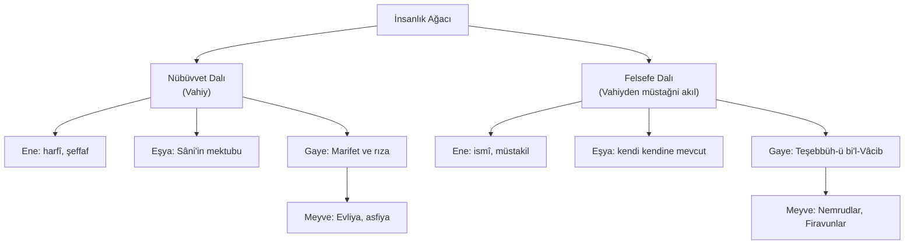
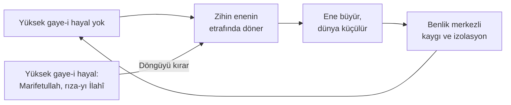

# ⚔️ Nübüvvet ve Felsefe: İki Nazar, İki Medeniyet

> *12. Söz* ve *30. Söz* ekseninde: İnsanlık ağacının iki dalı arasındaki ebedî mücadele.

---

## 1. İki Dal

İnsanlık tarihinde düşünce iki ana kola ayrılmıştır:



> [!NOTE]
> Burada eleştirilen "felsefe", aklın ve hikmetin kendisi değil; **vahiyden müstağni olduğunu iddia
> eden ve ene'yi müstakil kabul eden** felsefî nazardır. Risale-i Nur, hizmetkâr ve faydalı
> felsefeyi (hikmet) bu eleştiriden ayrı tutar.

## 2. Dört Mukayese Ekseni

### 2.1 Şahsî Hayat

| Felsefe | Nübüvvet |
|---------|----------|
| Kuvvet, menfaat, cidal (mücadele), unsuriyet. | Hak, fazilet, rıza, muavenet (yardımlaşma), din kardeşliği. |
| *"Hayat bir mücadeledir."* | *"Hayat bir yardımlaşmadır."* |

### 2.2 İçtimaî Hayat

| Felsefe | Nübüvvet |
|---------|----------|
| Nokta-i istinadı **kuvvet** → tecavüz doğurur. | Nokta-i istinadı **hak** → ittifak doğurur. |
| Hedefi **menfaat** → boğuşma doğurur. | Hedefi **fazilet ve rıza** → tesanüd doğurur. |
| Düsturu **cidal** → çatışma doğurur. | Düsturu **teavün** → yardımlaşma doğurur. |
| Rabıtası **unsuriyet** → başkalarını yutarak beslenir. | Rabıtası **din, vatan, sınıf kardeşliği** → samimi uhuvvet. |

### 2.3 Eşyaya Bakış

| Felsefe | Nübüvvet |
|---------|----------|
| Eşyaya **mana-yı ismî** ile bakar: "Ne kadar güzel bir çiçek!" | Eşyaya **mana-yı harfî** ile bakar: "Ne güzel yapılmış bir çiçek!" |
| Sebepleri fâil zanneder. | Sebepleri perde bilir. |

### 2.4 Gaye-i Hayal

| Felsefe | Nübüvvet |
|---------|----------|
| *Teşebbüh-ü bi'l-Vâcib*: Tanrıya benzemek, müstağni olmak. | *Tahalluk bi-ahlâkillah* + *acz ve fakr*: Aczini bilip Kudret'e dayanmak. |
| İnsanı firavunlaştırır. | İnsanı abd (kul) yapar; kulluk ise en yüksek makamdır. |

## 3. Gaye-i Hayal Paradoksu

İnsan fıtratında yüksek bir gaye-i hayal yoksa, zihinler (*ezhan*) dışarıya değil, kendi enelerine döner:



Bu, modern insanın "anlam krizi"nin klasik bir teşhisidir: Gaye ne kadar küçülürse, ene o kadar büyür.

## 4. Simülasyondaki Karşılığı

`filozof` senaryosu, tam olarak bu ayrımı gösterir: **Yüksek tefekkür**, fakat **esbabperest nazar**.
Modelde esbabperest tefekkürün tasfiye gücü `tefekkur × (1 − inkar)` olarak hesaplanır; bu yüzden
akıl ne kadar keskin olursa olsun, harfî nazar olmadan ene şeffaflaşmaz.

```bash
python simulations/ene-thickening-model.py --senaryo filozof
python simulations/ene-thickening-model.py --senaryo filozof --inkar 0.0   # aynı akıl, harfî nazarla
```

---

🏠 [Ana Sayfa](../README.md) · 📖 [Kavramlar Sözlüğü](../kavramlar-sozlugu/glossary.md)
