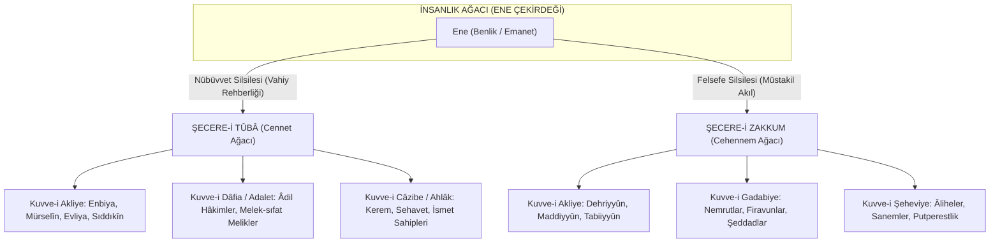
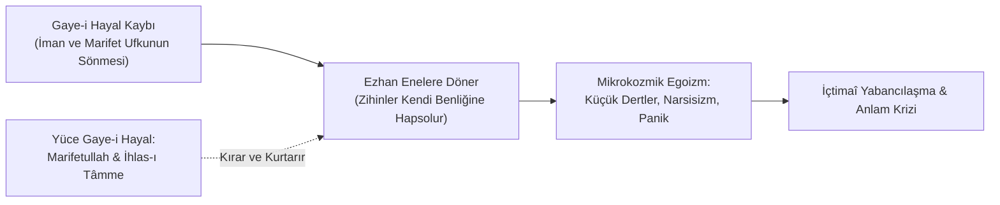

# ⚔️ Nübüvvet ve Felsefe: İki Silsile, İki Ağaç, İki Medeniyet

> *"İnsaniyetin gayetü’l-gayâtı teşebbüh-ü bi’l-Vâcibdir, yani Vâcibü’l-Vücuda benzemektir deyip firavunâne bir hüküm vermişler. Ve enaniyeti kamçılayıp şirk derelerinde serbest koşturarak, esbabperest, sanemperest, tabiatperest, nücumperest gibi çok envâ-ı şirk taifelerine meydan açmışlar...*
> 
> *Nübüvvet ise, gaye-i insaniyet ve vazife-i beşeriyet, **ahlâk-ı İlâhiye ile ve secâyâ-yı hasene ile tahallûk etmekle beraber, aczini bilip kudret-i İlâhiyeye iltica, zaafını görüp kuvvet-i İlâhiyeye istinad, fakrını görüp rahmet-i İlâhiyeye itimad, ihtiyacını görüp gınâ-yı İlâhiyeden istimdad, kusurunu görüp aff-ı İlâhîye istiğfar, naksını görüp kemâl-i İlâhîye tesbihhân olmaktır** diye, ubûdiyetkârâne hükmetmişler."*
> — **30. Söz, Birinci Maksad**

---

## 1. Düşünce Tarihinin İki Büyük Ağacı

Otuzuncu Söz'ün kalbinde yer alan mukayeseye göre, Hz. Âdem'den (a.s.) kıyamete kadar insanlık düşüncesi ve medeniyet tarihi iki zıt silsile halinde cereyan eder:

---

## 2. On İkinci Söz'ün Muazzam Medeniyet Muvazenesi

On İkinci Söz'ün Üçüncü Esasında, materyalist felsefenin içtimaî hayata kazandırdığı prensipler ile Kur'an-ı Hakîm'in cemiyete verdiği esaslar 5 temel eksende karşılaştırılır:

| Mukayese Ekseni | Hikmet-i Felsefe (Maddeci Felsefe) | Hikmet-i Kur’âniye (Vahiy Medeniyeti) |
|:---|:---|:---|
| **1. Nokta-i İstinad (Dayanak)** | **Kuvvet**   *(Şe'ni: Tecavüz ve zulümdür)* | **Hak**   *(Şe'ni: İttifak ve adalettir)* |
| **2. Hedef ve Gaye** | **Menfaat**   *(Şe'ni: Üstünde boğuşmak ve hırstır)* | **Fazilet ve Rıza-i İlâhî**   *(Şe'ni: Tesanüd ve dayanışmadır)* |
| **3. Düstur-u Hayat** | **Cidal (Çatışma / Mücadele)**   *(Şe'ni: Çarpışmak ve ezmektir)* | **Teâvün (Yardımlaşma)**   *(Şe'ni: Birbirinin imdadına koşmaktır)* |
| **4. Cemaatlerin Rabıtası** | **Unsuriyet ve Menfî Milliyet**   *(Şe'ni: Başkasını yutmakla beslenmektir)* | **Rabıta-i Dinî, Sınıfî ve Vatanî**   *(Şe'ni: Uhuvvet, samimiyet ve sulhtur)* |
| **5. Netice ve Semerat** | **Hevesat-ı Nefsaniyeyi Tatmin**   *(İhtiyaçları tezyid, insanı canavarlaştırma)* | **Kemâlât-ı İnsaniyeye Sevk**   *(Ruhu maâliyata teşvik, saadet-i dâreyn)* |

> *"İşte bu hikmettendir ki, beşerin saadeti selb olmuştur (kaçıp gitmiştir)."* (12. Söz)
> 
> Darwinist ve materyalist felsefenin *"hayat bir mücadeledir"* dogmasına mukabil, Kur'an hikmeti kâinatın fıtrat kanununun **"teâvün (yardımlaşma)"** olduğunu ispat eder. Güneş bulutların, bulutlar toprağın, toprak bitkilerin, bitkiler hayvanların, hayvanlar insanın imdadına koşmaktadır; cidal değil teavün esastır!

---

## 3. Teşebbüh-ü bi'l-Vâcib Yanılgısı vs. Tahalluk bi-ahlâkillah

İslam felsefecileri (İbn-i Sina, Fârâbî vb.) ve Antik Yunan dâhileri (Eflâtun, Aristo), insanın en yüksek kemâlât hedefini tarif ederken felsefî bir hata yapmışlardır:
* **Felsefenin İddiası:** *"Teşebbüh-ü bi'l-Vâcib"* (Yaratıcı'ya benzemek, O'nun gibi müstağni ve kudretli olmaya çalışmak).
* **Bu İddianın Neticesi:** İnsanın fıtratında saklı olan acizlik ve fakirlik kapılarını kapatır; gururu ve enaniyeti kamçılar; insanı sahte bir tanrılık davasına iter (Firavunlaşma).

* **Nübüvvetin Hükmü:** *"Tahalluk bi-ahlâkillah"* (Allah'ın güzel ahlakıyla ahlaklanmak). 
* **Fakat Nasıl?** Asla haddini aşıp ulûhiyet taslamadan! Kendi **hadsiz aczini** bilip O'nun kudretine sığınarak; **hadsiz fakrını** görüp O'nun rahmetine iltica ederek. İnsan aczini anladığı nispette Yaratıcısına yakınlaşır.

---

## 4. Gaye-i Hayal Paradoksu (Hakikat Çekirdekleri, 41)

Bediüzzaman'ın veciz sosyo-psikolojik tespiti:

> **"Gaye-i hayâl olmazsa veyâhut nisyan veya tenâsî edilse; ezhân enelere dönüp, etrafında gezerler."**
> — **Mektubat (Hakikat Çekirdekleri, 41) & Lemeat**

İnsanın zihninde kainatı ve ebediyeti kucaklayan bir **gaye-i hayal** (Allah'ı bilmek, rızasını kazanmak, insanlığa iman hizmeti sunmak) kalmadığında; o zihin boşlukta kalamaz. Kendi küçük cüzi benliğinin etrafında pervane gibi dönmeye başlar. Günümüz insanının içine düştüğü kronik anksiyete, depresyon ve narsisizm salgınının en isabetli teşhisi işte bu tek cümledir!

---

## 5. İki Talebenin Portresi (12. Söz, İkinci Esas)

* **Felsefenin Talebesi:** Bir firavun-u zelîldir. Kibirli görünür fakat bir menfaati için en sefil şahsın ayağını öper. Kalbinde istinad noktası olmadığı için korkak bir zâlimdir.
* **Kur'an'ın Talebesi:** Bir abd-i azîzdir. Zayıftır, fakirdir fakat Kâinat Sahibine dayandığı için hiçbir zorbaya boyun eğmez. Cennet gibi muazzam bir mükâfatı dahi ibadetinin yegâne gayesi yapmaz; yalnız ve yalnız **Rıza-yı İlâhî** için yaşar.

---

🏠 [Ana Sayfa](../README.md) · 📖 [Kavramlar Sözlüğü](../kavramlar-sozlugu/glossary.md)
