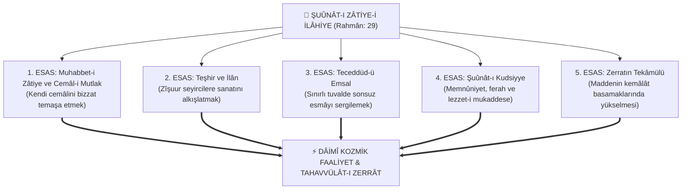

# 🌊 Şuûnât-ı İlâhiye ve Dâimî Faaliyetin Sırrı

> **بِسْمِ اللّٰهِ الرَّحْمٰنِ الرَّحٖيمِ**
> 
> *كُلَّ يَوْمٍ هُوَ فٖى شَاْنٍ*
> 
> *"O, her an muazzam bir yaratma, tasarruf ve tecelli (şe'n) içindedir."* (Rahmân Sûresi, 29)
> 
> *"Sual: Cenâb-ı Hak kādir-i mutlaktır, ganiyy-i ale'l-ıtlaktır; hiçbir şeye hiçbir cihette ihtiyacı yoktur. Öyle ise, şu kâinatta bu dâimî ve hummalı faaliyetin, mevcudatın durmaksızın kafile kafile gelip kabre dökülmesinin, zerratın durmaksızın cevelân edip dönmesinin hikmet ve sırrı nedir? Zîhayatların bu kadar sür'atle gelip gitmeleri nedendir?"*
> — **24. Mektup, Birinci Kısım**

---

## 1. Varlık Felsefesinin ve İlahiyatın En Yüksek Muamması

Tılsım-ı Kâinat'ın metafizik zirvesi şu dehşetli sualin cevabında yatar:
Cenâb-ı Hak noksanlıktan münezzehtir; hiçbir kula, hiçbir ibadete, hiçbir kâinata ve galaksiye zerre kadar ihtiyacı yoktur. O halde kâinattaki bu baş döndürücü hız, atomların çekirdek etrafındaki ışık hızındaki dönüşü, hücrelerin saniyede milyonlarca bölünmesi, baharların gelip kışlara yer açması ve varlıkların bir sel gibi yaratılıp sonra berzah perdesinin arkasına akıp gitmesindeki hikmet-i ezelîye nedir?

Bediüzzaman Said Nursî Hazretleri, Yirmi Dördüncü Mektup'ta bu en muazzam ve ince meseleyi Kur'ân-ı Hakîm'in feyziyle **Beş Nurlu Esas** dairesinde şerh ederek akılları hayrette bırakan bir vuzuh kazandırır:

---

## 2. Beş Nurlu Esasın Derinlemesine Tahlili

### 2.1 Birinci Esas: Her Cemâl ve Kemâl Sahibi Kendi Cemâlini Müşahede Etmek İster

Bediüzzaman Hazretleri varlığın yaratılış mayasındaki ezelî aşk ve muhabbeti şu fıtrî kaide ile izah eder:

> *"Her cemâl ve kemâl sahibi, kendi cemâl ve kemâlini görmek ve göstermek istemesi bir kaide-i külliyedir. Hattâ vehmî bir cemâl veya kemâl dahi olsa, sahibini teşhire sevk eder.*
> 
> *Meselâ: Hârika bir hüsn-ü hat (güzel yazı) yazan veya emsalsiz bir elmas işleyen sanatkâr; elbette onu iki cihetle temaşa etmek ister:*
> *1. **Birinci veche:** Bizzat kendi müdakkik gözüyle sanatındaki incelikleri, gizli meziyetleri görüp lezzet almak.*
> *2. **İkinci veche:** O antika eseri başkalarının takdir ve tahsin edici gözleriyle temaşa edip, onların 'Mâşaallah, Bârekâllah' nidalarıyla alkışlatmak.*
> 
> *İşte, Sâni'-i Zülcelâl dahi, nihayetsiz Esmâ-i Hüsnâsının hüsün ve cemâlini ve kemâl-i kudsiyesini hem bizzat Kendi kudsî nazar-ı şuhudunda müşahede eyler; hem de melek, cin ve insanların nazarlarıyla o kudsî güzellikleri meşher-i kâinatta sergileyip alkışlatır."* (24. Mektup)

### 2.2 İkinci Esas: Sınırlı Levhada Sonsuz Manzara — "Teceddüd-ü Emsal"

* Kâinat ve yeryüzü sonludur; madde mahduttur. Fakat Zât-ı Zülcelâl'in isimleri, sıfatları ve cilveleri sonsuzdur.
* Eğer mevcudat sabit kalsaydı, bir ağaç meyvelerini dökmeseydi, bir bahar yerini yaza ve güze bırakmasaydı; esmânın yalnızca daracık bir cüz'ü tecelli edebilirdi.
* **Akıcı Film ve Sinema Levhası Analojisi:**
  > *"Sonsuz cilveleri sınırlı bir zeminde göstermenin yegâne hikmeti; o zemin üzerindeki tabloları akıcı bir nehir gibi durmaksızın tazelemektir. Her an gelen kafile lisan-ı hal ile 'Bismillah' deyip esmâ cilvesini gösterir; sonra arkadan gelen kardeşlerine yer açmak için 'Elhamdülillah' diyerek terhis olur, gayb âlemine geçer."*

### 2.3 Üçüncü Esas: Şuûnât-ı Kudsiyye ve Kusursuz Halleri

Kelâm ve ilahiyatın en nazik ve derin noktası burasıdır: Cenâb-ı Hakk'a beşerî duygular (üzüntü, elem, ihtiyaç, acı) isnad edilemez. Fakat Kur'ân'ın ifadesiyle O'nun Zât-ı Akdes'ine layık **Şuûnâtı** vardır:

* **Şefkat-i Mukaddese:** Bütün annelerin kalbindeki şefkatin menbaı olan ilâhî merhamet.
* **Memnûniyet-i Kudsiyye:** Mahlukatın ibadetinden, nizamından ve vazifesini kemâl-i itaatle yapmasından hasıl olan kudsî rıza.
* **Ferah-ı Mukaddes ve Lezzet-i Kudsiyye:** Yarattığı zîhayatların nimetlerden lezzet almasını, doymasını, şifa bulmasını görmekten doğan, noksanlıktan münezzeh kudsî sevinç ve in'am lezzeti.
* Bu kudsî şuûnât; kâinattaki o dur durak bilmeyen yaratma, rızıklandırma ve hayat verme faaliyetinin tükenmez pınarıdır.

### 2.4 Dördüncü Esas: İstidatların İnkişafı ve Manevî Ticaret

Kâinattaki faaliyet bir gayesizlik değil; varlıkların çekirdek halindeki istidatlarını sümbül vermeye sevk eden manevî bir inkişaf fabrikasıdır:
* Bir elma çekirdeği toprakta çürümezse ağaç olamaz.
* Zerre bedende deveran etmezse şuur ve tefekküre eremez.
* İnsan bu imtihan dünyasında meşakkatlerle çalkalanmazsa ruhundaki elmas istidatlar kömür seviyesinde kalır.

### 2.5 Beşinci Esas: Zerrelerin Kemâlât Basamaklarındaki Seyahati

Otuzuncu Söz'ün İkinci Maksadı ile Yirmi Dördüncü Mektup bu noktada tam birleşir:
Zerreler câmid bir taş gibi tek bir yerde çakılı kalsalardı, nurlanamazlardı. Cenâb-ı Hak zerreleri havadan suya, sudan toprağa, topraktan bitkiye, bitkiden canlı hücreye, oradan da insan beynine ve gözbebeğine kadar sevk ederek onlara adeta kâinatı tavaf ettirir. Zerre her durakta ayrı bir ismin cilvesine ayna olarak manen terakki eder.

---

## 3. Modern Termodinamik ve Kozmoloji ile Mukayese

1. **Dissipative Structures (Ilya Prigogine):**
   * Nobel ödüllü fizikçi Ilya Prigogine, açık sistemlerde dengeden uzak termodinamik akışların (enerji ve madde akışı) yüksek dereceli intizam ve yapılar ürettiğini göstermiştir.
   * Kâinattaki bu faaliyet durursa donar ve ölür (ısı ölümü). 24. Mektup'un sırrı; akışın bizâtihi intizamı ve hayatı doğuran rahmet motoru olduğunu ilan eder.
2. **Kuantum Vakumu ve Sıfır Noktası Enerjisi:**
   * Modern kuantum elektrodinamiğinde "boşluk" (vakum) asla durağan ve ölü değildir; her an sanal parçacık çiftlerinin doğup battığı hummalı bir kuantum çalkantısıdır (*Quantum Fluctuation*).
   * Varlık bir an bile faaliyetten duramaz; zira durduğu an varlık dairesinden ademe (yokluğa) düşer. *"Külle yevmin hüve fî şe'n"* âyeti, atom altı titreşimlerden galaksilerin kaçışına kadar her an süren bu ilâhî tasarrufun ezelî mührüdür.

---

## 4. Tılsım-ı Kâinat İntibakı: Ene Bu Faaliyetin Neresindedir?

Kâinat bu kadar azametli bir nehir gibi akarken; insanın enaniyeti (Ene) ne yapmalıdır?
* Eğer ene **mânâ-yı ismî** ile bakarsa; *"Ben bu selin içinde boğuluyorum, sevdiklerim ölüp gidiyor"* diyerek feryat ve yeis içinde çırpınır.
* Eğer ene **mânâ-yı harfî** ile bakarsa; o akıcı kâinat nehrini Sultan-ı Ezelî'nin canlı bir sinema perdesi, taptaze bir meşher-i sanatı olarak görür. Gidenlere ağlamaz; arkalarında tecelli eden dâimî ve bâkî Esmâ-i İlâhiyeyi alkışlar ve lisan-ı hal ile der:
  $$\text{اَلْبَاقٖى هُوَ الْبَاقٖى — Bâkî olan ancak O'dur!}$$
