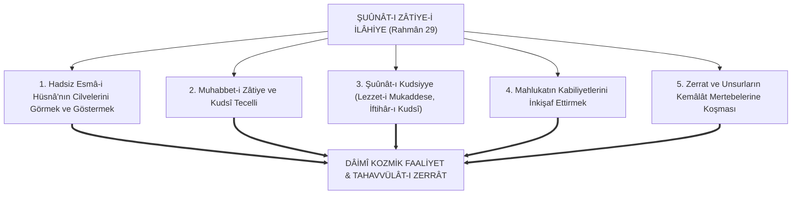

# 🌊 Şuûnât-ı İlâhiye ve Dâimî Faaliyetin Sırrı

> **بِسْمِ اللّٰهِ الرَّحْمٰنِ الرَّحٖيمِ**
> 
> *كُلَّ يَوْمٍ هُوَ فٖى شَاْنٍ*
> 
> *"O, her an muazzam bir yaratma ve tasarruf (şe'n) içindedir."* (Rahmân Sûresi, 29)
> 
> *"Sual: Cenâb-ı Hak kādir-i mutlaktır, ganiyy-i ale'l-ıtlaktır; hiçbir şeye hiçbir cihette ihtiyacı yoktur. Öyle ise, şu kâinatta bu dâimî ve hummalı faaliyetin, mevcudatın durmaksızın kafile kafile gelip kabre dökülmesinin, zerratın durmaksızın dönmesinin hikmet ve sırrı nedir?"*
> — **24. Mektup, Birinci Kısım**

---

## 1. Varlık Felsefesinin En Yüksek Muamması

Tılsım-ı Kâinat'ın en derin ve metafizik boyutlarından biri şudur:
Allah mutlak zengindir, noksanlıktan münezzehtir; hiçbir mahluka, hiçbir ibadete muhtaç değildir. Peki öyleyse kâinattaki bu baş döndürücü hız, yıldızların durmaksızın dönmesi, zerrelerin raksı, mevsimlerin tazelenmesi ve canlıların akıcı bir nehir gibi yaratılıp terhis edilmesindeki ilâhî hikmet nedir?

Bediüzzaman Said Nursî, Yirmi Dördüncü Mektup'ta bu en çetin soruya Kur'ân-ı Hakîm'in feyziyle beş nurlu esasta cevap verir:

---

## 2. Beş Nurlu Esas

### 2.1 Her Cemâl ve Kemâl Sahibi Kendi Cemâlini Müşahede Etmek İster
* Dünyada hünerli bir sanatkâr, harika bir tablo yapsa; iki şey ister:
  1. Bizzat kendi gözüyle sanatındaki incelikleri temaşa etmek.
  2. Takdir edici diğer gözlerle o güzelliği alkışlatmak.
* Cenâb-ı Zülcemâl dahi nihayetsiz cemâl ve kemâlini bizzat kendi kudsî nazar-ı şuhudunda müşahede etmek ve melek, cin ve insan gibi zîşuur seyircilerin nazarlarıyla tecelli ettirmek için bu kâinat sergisini her an tazelemektedir.

### 2.2 Sınırlı Zeminde Sonsuz Manzara: "Teceddüd-ü Emsal"
* Yeryüzü sınırlıdır, madde mahduttur; fakat Esmâ-i İlâhiye sonsuzdur.
* Sonsuz resimleri sınırlı bir tuvalde sergileyebilmenin yegâne yolu, levhayı akıcı kılmaktır: Bir kafile gelir, vazifesini yapar, esmâ nakışlarını gösterir; sonra arkadan gelen diğer kafileye yer açmak için terhis edilir.

### 2.3 Şuûnât-ı Kudsiyye: Beşerî Kusurlardan Münezzeh Kudsî Hâller
İlahiyatın en hassas meselesi: Allah'ta üzüntü, eksiklik, ihtiyaç olamaz. Fakat Cenâb-ı Hakk'ın kudsî zâtına lâyık:
* Hadsiz bir **Şefkat-i Mukaddese**,
* Mahlukatının itaatinden duyulan bir **Memnûniyet-i Kudsiyye**,
* İhsan etmekten ve yaratmaktan gelen bir **Ferah-ı Mukaddes** ve **Lezzet-i Kudsiyye** vardır ki; bu şuûnât, kâinattaki faaliyet-i daimenin ezelî membaıdır.

---

## 3. Zerre ve Ene ile Bağlantısı

* **Zerre:** Bu kudsî faaliyet nehrinin bir damlasıdır; durursa donar, akarsa nakış olur.
* **Ene:** Bu kudsî şuûnâtı ve esmâyı tartıp anlayabilecek kâinattaki yegâne câmi' aynadır.
