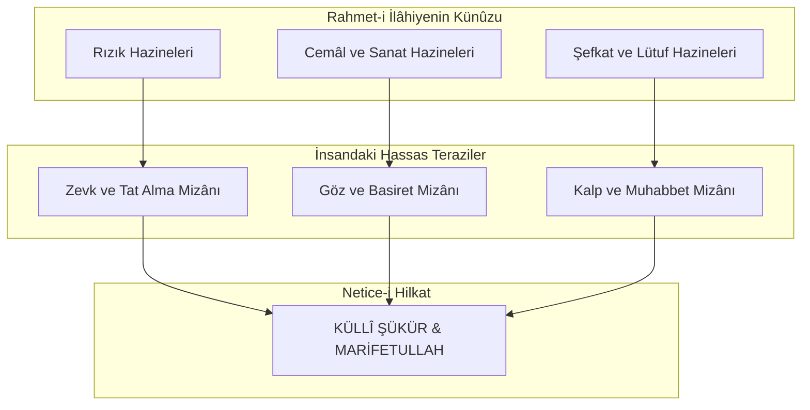
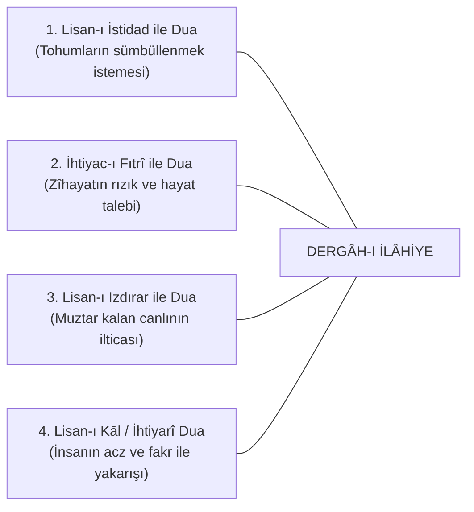

# 🧬 Taallüm ve Tekâmül: İnsanın Fıtrî Vazifesi ve Dua Mekanizması

> *"Evet, insaniyet îmân ile insaniyet olduğunu; insan ile hayvanın dünyaya gelişindeki farkları gösterir.*
> 
> *Çünkü: Hayvan, dünyaya geldiği vakit, âdeta **başka bir âlemde tekemmül etmiş** gibi istîdâdına göre mükemmel olarak gelir; yani gönderilir. Ya iki saatte, ya iki günde veya iki ayda bütün şerâit-i hayatiyesini ve kâinâtla olan münasebetini ve kavânîn-i hayatiyesini öğrenir, meleke sahibi olur. **İnsanın yirmi senede kazandığı iktidâr-ı hayatiyeyi ve meleke-i ameliyeyi, yirmi günde serçe ve arı gibi bir hayvan tahsil eder; yani ona ilham olunur.**
> 
> *Demek, hayvanın vazife-i asliyesi, taallümle tekemmül etmek değildir; ve marifet kesbetmekle terakki etmek değildir; ve aczini göstermekle medet istemek, dua etmek değildir. Belki vazifesi, istidadına göre taammüldür, amel etmektir, ubûdiyet-i fiiliyedir.*
> 
> *İnsan ise, dünyaya gelişinde, herşeyi öğrenmeye muhtaç ve hayat kanunlarına cahil; hattâ yirmi senede tamamen şerâit-i hayatı öğrenemiyor...*
> 
> *Demek ki, **insanın vazife-i fıtriyesi taallümle tekemmüldür, dua ile ubudiyettir.** Yani: 'Kimin merhametiyle böyle hakîmane idare olunuyorum? Kimin keremiyle böyle müşfikane terbiye olunuyorum? Nasıl birisinin lütuflarıyla böyle nâzeninane besleniyorum?' deyip binden birisine eli yetişemediği hacatına dair **Kādıyü'l-Hâcât'a lisan-ı acz ve fakr ile yalvarmaktır ve istemektir ve dua etmektir; yani aczin ve fakrın cenahlarıyla makam-ı a'lâ-yı ubudiyete uçmaktır.**"*
> — **23. Söz, Birinci Mebhas (Dördüncü Nokta)**

---

## 1. Hayvan ile İnsanın Ontolojik Mukayesesi

| Mukayese Kriteri | Hayvan Fıtratı | İnsan Fıtratı |
|:---|:---|:---|
| **Dünyaya Geliş Hali** | Başka bir âlemde tekemmül etmiş gibi hazır ve mükemmel | Hadsiz âciz, cahil, her şeye muhtaç, çıplak |
| **Öğrenme Süresi** | 2 saat ile 20 gün arası (arı, serçe melekesi) | 20 yıl, hatta ömrün sonuna kadar öğrenmeye muhtaç |
| **Öğrenme Yolu** | İlham-ı fıtrî (doğuştan gelen sevk-i İlâhî) | Kesb, talim, tefekkür, tecrübe |
| **Aslî Vazife** | Taammül, amel, ubudiyet-i fiiliye | **Taallümle tekemmül, dua ile ubudiyet** |
| **İstidad Ufku** | Mahdut, sabit bir makam | Hadsiz: Esfel-i sâfilînden A'lâ-yı illiyyîne kadar açık |

İnsanın dünyaya bu kadar aciz, zayıf ve muhtaç gönderilmesi bir kusur veya noksanlık değildir; aksine insanı **bütün kâinatın halifesi ve muhatab-ı İlâhîsi** yapacak olan ilahî bir projedir!

---

## 2. On Birinci Söz: Duygular Terazileri ve Küllî Şükür

On Birinci Söz'ün başında insanın mahiyetindeki cihazatın hikmeti şöyle izah edilir:

> *"Ey kardeş! Eğer hikmet-i âlemin tılsımını ve hilkat-i insanın muammasını ve hakikat-i salâtın rümuzunu bir parça fehmetmek istersen, nefsimle beraber şu temsîlî hikâyeciğe bak:*
> 
> *...Birincisi şudur ki: **Senin vücudunda konulan duygular terazileriyle rahmet-i İlahiyenin hazinelerinde iddihar edilen nimetleri tartmaktır ve küllî şükretmektir.**"*
> — **11. Söz**

İnsana takılan göz, kulak, dil, kalp, hayal, hafıza gibi binlerce his ve duygu; sadece fani dünyanın geçici lezzetlerini tatmak için verilmemiştir. Her bir duygu, Cenâb-ı Hakk'ın sonsuz rahmet hazinelerini tartan **gayet hassas bir mizan (terazi)**dir:
* Dilin tat alma mizânı ile hadsiz rızıklar tartılır ➔ *Rezzâk* ismine şükredilir.
* Gözün estetik terazisi ile renkler ve güzellikler tartılır ➔ *Musavvir* ve *Cemîl* isimleri tefekkür edilir.
* Kalbin muhabbet terazisi ile sonsuz şefkat tartılır ➔ *Rahmân* ve *Vedûd* isimlerine küllî bir secde ile mukabele edilir.

---

## 3. Kâinattan Dergâh-ı İlâhiyeye Yükselen Dört Nevi Dua

Yirmi Üçüncü Söz'ün Beşinci Noktası'nda duanın sadece insanın sözlü dileklerinden ibaret olmadığı, kâinat çapında bir kanun olduğu beyan edilir:

> *"Bütün mevcudat, herbirisi birer mahsus tesbih ve birer hususî ibadet, birer has secde ettikleri gibi; **bütün kâinattan dergâh-ı İlahiyeye giden, bir duadır.**"*

### Dört Dua Sınıfı:
1. **Lisan-ı İstidad ile Dua:** Bütün çekirdeklerin, tohumların ve istidatların duasıdır. Bir incir çekirdeği lisan-ı istidadıyla der ki: *"Yâ Hâlık! Bana münasip bir suret giydir ve beni koca bir incir ağacı yap."* Feyyaz-ı Mutlak bu duayı daima kabul eder.
2. **İhtiyac-ı Fıtrî ile Dua:** Canlıların ellerinin yetişmediği zaruri ihtiyaçları için yaptıkları fıtrî duadır. Aç kalan bir yavrunun imdadına sütün gönderilmesi bu duanın fiilî kabulüdür.
3. **Lisan-ı Izdırar ile Dua:** Çaresiz ve muztar kalan her canlının kat'î bir iltica ile yaptığı duadır. Deniz ortasında boğulmak üzere olan bir insanın veya kuraklıktan kavrulan mahlûkatın yakarışı gibi.
4. **Lisan-ı Kāl (Sözlü Dua):** İnsanın şuurla, acz ve fakr lisanıyla Kādıyü'l-Hâcât'a arz ettiği dualardır. Bu dua ubudiyetin sırrıdır; neticesi ahirete bakar.

---

## 4. Dua İle Ubudiyet: Aczin ve Fakrın Cenahları

İnsanın gücü bir adım ötesine zor yeterken; istekleri ve emelleri ebede kadar uzanır. 
Bu derin uçurum ancak **Dua** ile aşılır. İnsan kendi aczini bir kanat, fakirliğini diğer bir kanat yaparak Kādıyü'l-Hâcât olan Rabbine sığınır; böylece mahlûkatın en zayıfı iken, kâinatın en aziz ve nazenin misafiri rütbesine yükselir.

---

🏠 [Ana Sayfa](../README.md) · 📖 [Kavramlar Sözlüğü](../kavramlar-sozlugu/glossary.md)
