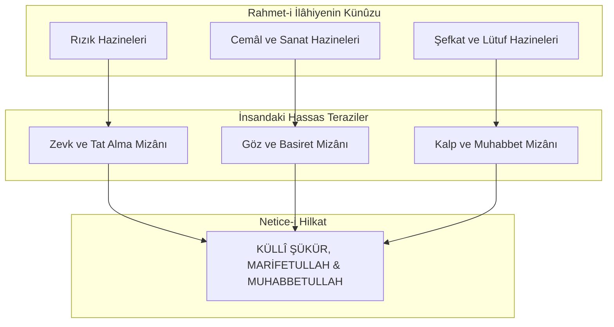
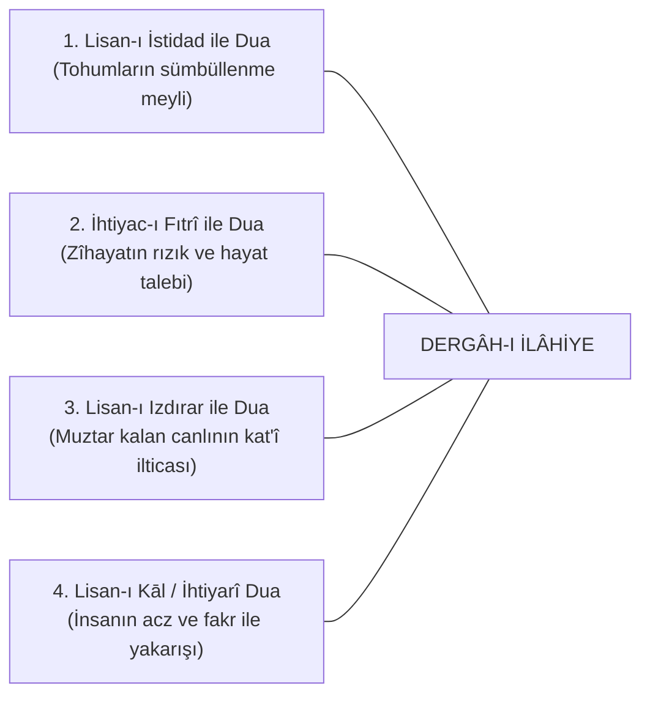

# 🧬 Taallüm ve Tekâmül: İnsanın Fıtrî Vazifesi ve Dua Mekanizması

> *"Evet, insaniyet îmân ile insaniyet olduğunu; insan ile hayvanın dünyaya gelişindeki farkları gösterir.*
> 
> *Çünkü: Hayvan, dünyaya geldiği vakit, âdeta **başka bir âlemde tekemmül etmiş** gibi istîdâdına göre mükemmel olarak gelir; yani gönderilir. Ya iki saatte, ya iki günde veya iki ayda bütün şerâit-i hayatiyesini ve kâinâtla olan münasebetini ve kavânîn-i hayatiyesini öğrenir, meleke sahibi olur. **İnsanın yirmi senede kazandığı iktidâr-ı hayatiyeyi ve meleke-i ameliyeyi, yirmi günde serçe ve arı gibi bir hayvan tahsil eder; yani ona ilham olunur.**
> 
> *Demek, hayvanın vazife-i asliyesi, taallümle tekemmül etmek değildir; ve marifet kesbetmekle terakki etmek değildir; ve aczini göstermekle medet istemek, dua etmek değildir. Belki vazifesi, istidadına göre taammüldür, amel etmektir, ubûdiyet-i fiiliyedir.*
> 
> *İnsan ise, dünyaya gelişinde, herşeyi öğrenmeye muhtaç ve hayat kanunlarına cahil; hattâ yirmi senede tamamen şerâit-i hayatı öğrenemiyor...*
> 
> *Demek ki, **insanın vazife-i fıtriyesi taallümle tekemmüldür, dua ile ubudiyettir.** Yani: 'Kimin merhametiyle böyle hakîmane idare olunuyorum? Kimin keremiyle böyle müşfikane terbiye olunuyorum? Nasıl birisinin lütuflarıyla böyle nâzeninane besleniyorum?' deyip binden birisine eli yetişemediği hacatına dair **Kādıyü'l-Hâcât'a lisan-ı acz ve fakr ile yalvarmaktır ve istemektir ve dua etmektir; yani aczin ve fakrın cenahlarıyla makam-ı a'lâ-yı ubudiyete uçmaktır.**"*
> — **23. Söz, Birinci Mebhas (Dördüncü Nokta)**

---

## 1. Hayvan ile İnsanın Ontolojik Mukayesesi

| Mukayese Kriteri | Hayvan Fıtratı | İnsan Fıtratı |
|:---|:---|:---|
| **Dünyaya Geliş Hali** | Başka bir âlemde tekemmül etmiş gibi hazır ve mükemmel | Hadsiz âciz, cahil, her şeye muhtaç, çıplak |
| **Öğrenme Süresi** | 2 saat ile 20 gün arası (arı, serçe melekesi) | 20 yıl, hatta ömrün sonuna kadar öğrenmeye muhtaç |
| **Öğrenme Yolu** | İlham-ı fıtrî (doğuştan gelen sevk-i İlâhî) | Kesb, talim, tefekkür, tecrübe |
| **Aslî Vazife** | Taammül, amel, ubudiyet-i fiiliye | **Taallümle tekemmül, dua ile ubudiyet** |
| **İstidad Ufku** | Mahdut, sabit bir makam | Hadsiz: Esfel-i sâfilînden A'lâ-yı illiyyîne kadar açık |

İnsanın dünyaya bu kadar aciz, zayıf ve muhtaç gönderilmesi bir kusur veya noksanlık değildir; aksine insanı **bütün kâinatın halifesi ve muhatab-ı İlâhîsi** yapacak olan ilahî bir projedir!

---

## 2. Hilkatin En Yüksek Gayesi: İman, Marifet ve Muhabbetullah (20. Mektup)

İnsanın taallümle (öğrenerek) ulaşacağı nihai zirve nedir? Bediüzzaman Hazretleri Yirminci Mektup'un başında varoluşun mertebelerini şöyle ilan eder:

> *"Kat'iyen bil ki: **Hilkatin en yüksek gayesi ve fıtratın en yüce neticesi, îmân-ı billâhtır.**  
> Ve insaniyetin en âlî mertebesi ve beşeriyetin en büyük makamı, **îmân-ı billâh içindeki ma'rifetullâhtır.**  
> Cinn ü insin en parlak saadeti ve en tatlı ni'meti, **o ma'rifetullah içindeki muhabbetullâhtır.**  
> Ve ruh-u beşer için en hâlis sürur ve kalb-i insan için en safi sevinç, **o muhabbetullah içindeki lezzet-i ruhaniyedir.**"* (20. Mektup, Mukaddime)

```text
  ┌───────────────────────────────────────────────────────────┐
  │ 4. ZİRVE: Lezzet-i Ruhaniye (En safi kalp sevinci)        │
  │    ▲                                                      │
  │ 3. MERTEBE: Muhabbetullah (Allah aşkı ve sevgisi)         │
  │    ▲                                                      │
  │ 2. MERTEBE: Marifetullah (Esmâ ve sıfatları tanımak)      │
  │    ▲                                                      │
  │ 1. TEMEL: İman-ı Billâh (Yaratıcı'yı tasdik ve intisap)  │
  └───────────────────────────────────────────────────────────┘
```

---

## 3. "İman Hem Nurdur, Hem Kuvvettir" (23. Söz, Üçüncü Nokta)

İman sadece teorik bir kabul değil; insan ruhuna kâinata meydan okuyacak bir kudret ve emniyet kazandıran kozmik bir zırhtır:

> *"İman hem nurdur, hem kuvvettir. Evet, **hakikî imanı elde eden adam, kâinata meydan okuyabilir** ve imanın kuvvetine göre, hadisatın tazyikatından kurtulabilir.*  
> *'Tevekkeltü alallâh' der, sefine-i hayatta kemâl-i emniyetle hâdisâtın dağlarvari dalgaları içinde seyrân eder. Bütün ağırlıklarını Kadîr-i Mutlak'ın eline emanet eder, rahatla dünyadan geçer, berzahta istirahat eder, sonra saadet-i ebediyeye girmek için Cennet'e uçabilir."* (23. Söz, Üçüncü Nokta)

### Vapur Yolcusu Misali (Tevekkülün Rahatlığı)
* Büyük bir deniz gemisine binen iki yolcudan biri, ahmaklığı sebebiyle sırtındaki ağır yükü yere bırakmaz: *"Ya çalınırsa, ben güçlüyüm sırtımda taşırım"* der. Koca gemi tonlarca yükü taşırken o zavallı bükülmüş beliyle ezilir ve maskara olur.
* Akıllı yolcu ise yükünü geminin ambarına bırakır, geminin üzerinde rahatça kahvesini yudumlar.
* **Tefekkür Dersi:** Kâinat koca bir sefine-i Rabbaniyedir. İnsan dünyevî kederleri, ölüm korkusunu, rızık endişesini kendi zayıf omuzlarına yüklerse firavunâne ezilir. Tevekkül ile Kadîr-i Hakîm'e teslim eden ise dünya musibetlerinin tazyikatından kurtulur.

---

## 4. On Birinci Söz: Duygular Terazileri ve Küllî Şükür

> *"Ey kardeş! Eğer hikmet-i âlemin tılsımını ve hilkat-i insanın muammasını fehmetmek istersen şu hakikate bak:*  
> *...Senin vücudunda konulan **duygular terazileriyle** rahmet-i İlâhiyenin hazinelerinde iddihar edilen nimetleri tartmaktır ve **küllî şükretmektir**."* (11. Söz)



---

## 5. Kâinattan Dergâh-ı İlâhiyeye Yükselen Dört Nevi Dua

Yirmi Üçüncü Söz'ün Beşinci Noktası'nda duanın mevcudatın evrensel ibadet kanunu olduğu bildirilir:



1. **Lisan-ı İstidad ile Dua:** Bir buğday tanesi veya incir çekirdeği kabiliyet diliyle der ki: *"Yâ Hâlık! Bana münasip bir beden libası giydir ve beni koca bir ağaç yap."* Bu fıtrî dua asla reddedilmez.
2. **İhtiyac-ı Fıtrî ile Dua:** Yeni doğmuş bir bebeğin ağzına annesinin memesinden süzülen sıcacık sütün akması, bu fıtrî ihtiyacın anında karşılanmasıdır.
3. **Lisan-ı Izdırar ile Dua:** Çaresiz ve muztar kalan bir kulun ihlaslı feryadı (Denizde boğulan Hz. Yûnus A.S. gibi).
4. **Lisan-ı Kāl (Sözlü İbadet):** İnsanın aczini kanat, fakrını basamak yaparak Kādıyü'l-Hâcât'a el açmasıdır. Bu dua neticesi itibariyle doğrudan ebedî cennete ve rıza-yı İlâhîye bakar.
