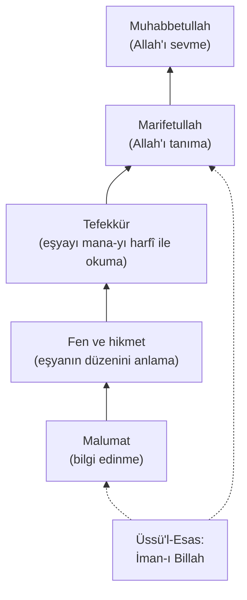

# 🧬 Taallüm ve Tekâmül: İnsanın Fıtrî Vazifesi

> *23. Söz – İkinci Mebhas* ekseninde: İnsan dünyaya **öğrenmek** ve **dua etmek** için gönderilmiştir.

---

## 1. Hayvan ile İnsan Arasındaki Temel Fark

| | Hayvan | İnsan |
|---|---|---|
| **Dünyaya geliş** | Âdeta başka bir âlemde tekemmül etmiş gibi, yetenekleri hazır gelir. | Her şeye muhtaç, âciz ve cahil doğar. |
| **Öğrenme süresi** | Saatler, günler (bir serçe birkaç haftada uçar). | Yıllar; hayatı boyunca öğrenmeye muhtaç. |
| **Vazife** | Fıtrî ibadet; kendi kabiliyetiyle amel. | **Taallüm** ile tekâmül, **dua** ile ubudiyet. |
| **Tekâmül sınırı** | Sınırlı ve sabit. | Sınırsız: en yüksek mertebelere de, en aşağıya da açık. |

Bu acizlik bir eksiklik değil, **bir proje tasarımıdır**: İnsan öğrenerek olgunlaşsın ve acziyle
Kudret-i Mutlaka'ya yönelsin diye böyle yaratılmıştır.

## 2. Öğrenmenin Hiyerarşisi



Her ilmin nihai noktası, Marifetullah'a açılan bir kapıdır. Tıp *Şâfî* ismine, mimarlık *Musavvir*
ismine, astronomi *Rabbü's-semâvât* unvanına bakar. İlim, bu kapıdan geçtiği ölçüde **hakikî ilim** olur.

## 3. İman-ı Billah: Tahkikî İman

Marifet binasının temeli imandır; fakat burada kastedilen **taklidî** değil, **tahkikî** imandır:

| Taklidî İman | Tahkikî İman |
|--------------|--------------|
| Duyduğu için inanmak. | Bürhan ile tasdik etmek. |
| Şüphe rüzgârlarına karşı kırılgan. | Delillerle köklenmiş, sarsılmaz. |
| Kalıtsal veya kültürel. | Akıl, kalp ve vicdanın ortak tasdiki. |

> **Bürhan → Tasdik → Yakîn:** Kesin delil, zihnin kabulünü doğurur; kabul tekrarlanıp derinleştikçe
> yakîne (kesin bilgiye) dönüşür.

## 4. Duygular Terazisi

İnsana verilen binlerce his ve duygu, birer **hassas terazi** ve **ölçü cihazıdır**:

| Cihaz | Tarttığı Hazine | Şükür Şekli |
|-------|-----------------|-------------|
| Göz | Renkler ve şekiller (*Musavvir*, *Cemîl*) | Hayranlıkla bakış |
| Kulak | Sesler ve nağmeler | Dinleyerek tesbih |
| Dil (zevk) | Tatlar ve rızıklar (*Rezzâk*) | Lezzette Mün'im'i anma |
| Akıl | Hikmet ve nizam (*Hakîm*) | Tefekkür |
| Kalp | Muhabbet ve şefkat (*Vedûd*, *Rahîm*) | Sevgi ve ubudiyet |

Bu cihazlarla nimetler tartılır, Sahibi tanınır ve **küllî bir şükür** sunulur.

## 5. Dua ile Ubudiyet

İnsanın arzuları **nihayetsiz**, gücü ise **son derece sınırlıdır**:

```text
  Arzular  ████████████████████████████████████████  → ∞
  Güç      ██                                         → çok sınırlı
           └─────────── Bu açık nasıl kapanır? ─────────┘
                           ⬇
                   DUA: Aczin Kudret'e bağlanması
```

Dua, bu varoluşsal açığın tek köprüsüdür. Risale-i Nur dua'yı üç kısımda ele alır:

1. **İstidat lisanıyla dua:** Tohumun ağaç olmak için "istemesi".
2. **İhtiyac-ı fıtrî lisanıyla dua:** Canlının hayatî ihtiyaçlarının karşılanması.
3. **Kāl (söz) lisanıyla dua:** İnsanın şuurlu, sözlü niyazı.

> Dua, *ubudiyetin özüdür*. İnsan aczini bilir, Kudret'i tanır ve ona yönelir: İşte kulluk budur.

## 6. Ene Modeli ile Bağlantı

Taallüm ve dua, [ene kalınlaşma simülasyonundaki](../simulations/ene-thickening-model.py) **tasfiye**
(inceltici) kuvvetlerdir. `tefekkur`, `sukur` ve `dua` parametreleri yükseldikçe ene şeffaflaşır:

```bash
python simulations/ene-thickening-model.py --senaryo salik
python simulations/ene-thickening-model.py --senaryo gafil --dua 0.9 --sukur 0.9
```

---

🏠 [Ana Sayfa](../README.md) · 📖 [Kavramlar Sözlüğü](../kavramlar-sozlugu/glossary.md)
