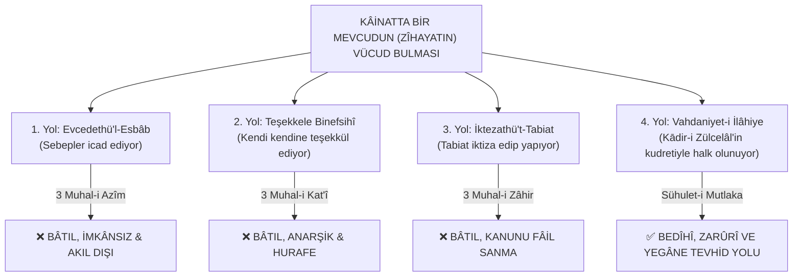

# 🌲 Tabiat ve Esbap Eleştirisi: Tılsımın Küfürle Kırılışı

> **بِسْمِ اللّٰهِ الرَّحْمٰنِ الرَّحٖيمِ**
> 
> *قَالَتْ رُسُلُهُمْ اَفِى اللّٰهِ شَكٌّ فَاطِرِ السَّمٰوَاتِ وَالْاَرْضِ*
> 
> *"Peygamberleri onlara dedi ki: Gökleri ve yeri yoktan var eden Allah hakkında şüphe mi olur?"* (İbrâhîm Sûresi, 10)
> 
> *"Ey insan! Bil ki, insanların ağzından çıkan ve dinsizliği işmam eden dehşetli kelimeler var; ehl-i iman bilmeyerek istimal ediyorlar. Mühimlerinden üç tanesini beyan edeceğiz:*
> * Birincisi: **'Evcedethü'l-esbâb'** yani 'Esbab bu şeyi yapıyor.'
> * İkincisi: **'Teşekkele binefsihî'** yani 'Kendi kendine teşekkül ediyor.'
> * Üçüncüsü: **'İktezathü't-tabiat'** yani 'Tabiat iktiza edip yapıyor.'"*
> — **23. Lem'a (Tabiat Risalesi)**

---

## 1. Varlık Mertebelerinde Dört Mantıksal İhtimal

Risale-i Nur'un en sarsıcı epistemolojik, felsefî ve mantıkî metinlerinden biri olan **Tabiat Risalesi (23. Lem'a)**; mevcudatın (ve bilhassa bir zîhayatın) vücuda gelişine dair aklen tasavvur edilebilen bütün yolları mutlak bir mantıkî hasr ile dörde ayırır:

Matematiksel ve mantıksal bir ispat metodu olan **"Sebir ve Taksim" (Disjunctive Syllogism)** kaidesince:
Eğer ilk üç bâtıl yolun her birinin içinde akla ziyan üçer muhal (toplamda **Dokuz Muhal-i Kat'î**) bulunduğu bürhanlarla ispat edilirse; geriye kalan dördüncü yol olan **Vahdaniyet ve Tevhid Yolu** zarurî, bedîhî ve şüphesiz bir hakikat olarak parıldar.

---

## 2. Üç Bâtıl Yolun Derinlemesine Tahlili ve Muhalleri

### 2.1 Birinci Yol: "Evcedethü'l-Esbâb" (Sebeplerin İcad Ettiği Vehmi)

Bu materyalist sapkınlık; canlılardaki muazzam tasarımı, hassas ölçüleri ve hayatı kör, câmid, şuursuz tabiat unsurlarına (su, toprak, rüzgar, ısı, kimyasal reaksiyonlar) isnat eder.

#### Eczahâne Misali ve Hayat Tiryakı (Birinci Muhal)
> *"Nasıl ki nihayet derecede hârika, bin bir maddeden terkip edilmiş şifalı bir tiryak (hayat şurubu) bulunan bir eczahânede; yüzlerce kavanozda zehirli, hassas ve tesirli ecza bulunsa...*
> *Bir fırtına kopsa, kavanozlar devrilse ve dökülen maddeler tesadüfen o harika şurubun tam gramajlarına denk gelip birleşse; akıl sahibi hiçbir insan bunu rüzgârın kör tesadüfüne ve dökülen şuursuz şişelerin ittifakına veremez.*
> *Aynen öyle de: Canlı bir sineğin veya bir insanın vücudu, kâinat eczahanesinden hassas mizanlarla süzülmüş yüz binlerce element ve molekülün milimetrik terkibidir. Kör sebeplerin tesadüfen birleşip bu hayat tiryakını vücuda getirmesi, eczanedeki şişelerin kendi kendine ilaç yapmasından trilyonlarca kat daha muhaldir!"* (23. Lem'a)

---

### 2.2 İkinci Yol: "Teşekkele Binefsihî" (Kendi Kendine Teşekkül Etme İddiası)

Modern natüralizmin ve tesadüfçü biyolojinin (Jacques Monod, Richard Dawkins vb.) sığındığı "maddenin kendi kendine organize olması" efsanesidir.

#### Zerreler Adedince İlâh İddiası (İkinci Muhal)
İnsan bedeninde yaklaşık 37 trilyon hücre ve her hücrede milyarlarca atom vardır:
* Eğer o zerreler Alîm ve Hakîm bir Zât'ın memuru ve kalemi olmazlarsa; bedendeki **tek bir zerre**, bütün damarları, sinirleri, gözü, kulağı ve beyni bilecek derecede mutlak bir ilme; ve onlarla ahenk kurup yerleşecek mutlak bir kudrete sahip olmalıdır.
* Bediüzzaman bu akıl dışı mantığı şöyle teşhir eder:
  > *"Bir tek Vâhid-i Ehad'i kabul etmeyen inkârcı; bedendeki zerreler adedince ilâhları ve hâkimleri kabul etmek gibi akıl almaz bir cehalete ve hezeyana düşer!"*

---

### 2.3 Üçüncü Yol: "İktezathü't-Tabiat" (Tabiatın Yaptığı İddiası)

Felsefenin en yaldızlı tuzağı: Tabiata bilinç, irade, tasarım ve yaratıcılık atfetmek. Bediüzzaman Hazretleri bu noktada dünya felsefe tarihine geçecek ontolojik ayrımı yapar:

#### Tabiatın Gerçek Mahiyeti: "Matbaa Olabilir, Tâbi' Olamaz!"
Bediüzzaman Hazretleri 23. Lem'a'da tabiatın ne olup ne olamayacağını 7 parlak hakikatle mühürler:

> *"Tabiat, bir **san'at-ı İlâhiyedir**, sâni' (sanatkâr) olamaz.*  
> *Bir **nakş-ı Rahmânîdir**, nâkkāş (nakış işleyen) olamaz.*  
> *Bir **kanundur**, kādir (kudret sahibi) olamaz.*  
> *Bir **mistardır** (çizgi çizen cetvel), masdar (kaynak) ve mimar olamaz.*  
> *Bir **kābildir** (etkiyi kabul eden zemin), fâil (işi yapan) olamaz.*  
> *Bir **nizamdır**, nâzım (düzen koyucu) olamaz.*  
> *Bir **fıtrattır**, fâtır (yaratan) olamaz.*  
> *Bir **matbaadır**, tâbi' (kitabı basan usta) olamaz.*  
> *Bir **kanun-u emrîdir**, haricî bir vücudu ve zâtî kudreti yoktur."* (23. Lem'a)

#### Matbaa ve Kitap Analojisi
* Matbaa ne kadar harika makinelerden, dişlilerden ve mürekkeplerden oluşursa oluşsun; demir ve çelikten ibaret şuursuz bir mekanizmadır. Matbaa kendi kendine bir roman yazamaz, harfleri dizip sayfaları ciltleyemez.
* Kitabı yazan ve basan (**Tâbi'**); matbaanın dışındaki, ilim, irade ve şuur sahibi bir müelliftir.
* Kâinat da ilâhî kudretin bir matbaası hükmündedir; yeryüzüne neşredilen yüz binlerce canlı nev'i ise o matbaada basılan tekvînî kitaplardır. Matbaayı müellif sanmak ne kadar ahmaklıksa; tabiatı yaratıcı sanmak da o derece gülünç bir cehalettir.

---

## 3. Tevhid Yolu: Sühulet-i Mutlaka (Mutlak Kolaylık)

Neden Tevhid yolu sonsuz derece kolay; Şirk ve Tabiatperestlik yolu sonsuz derece imkânsızdır?

| Kriter | Şirk ve Tabiatperestlik Yolu | Tevhid ve Vahdaniyet Yolu |
|---|---|---|
| **Yönetim Modeli** | Çok başlılık, hadsiz sebeplerin ittifakı | Tek bir Padişah-ı Ezelî'nin mutlak emri |
| **İşin Müşkilâtı** | Bir tek meyve için koca kâinatın ittifakı şarttır (İmkânsız) | Bir ağacı yaratmak bir meyve kadar, kâinatı yaratmak bir çiçek kadar kolaydır |
| **Kudret Nisbeti** | Her zerreye sonsuz ilim ve kudret vermek gerekir | Zerreler tek bir Kudret Kalemi'nin itaatkâr neferidir |
| **Askerî Temsil** | Ordudaki her askerin bütün levazımatı kendisinin yapması (Kaos) | Tek bir kumandanın *"Arş!"* emriyle koca ordunun tek vücut olması |

> *"Eğer her şey bir tek Zât'a verilse; bir ağaç bir meyve gibi, koca kâinat bir ağaç gibi suhuletle vücut bulur. Eğer sebepler ve tabiata havale edilse; bir tek meyvenin icadı koca kâinatın icadı kadar müşkil ve muhal olur."* (23. Lem'a)

---

## 4. 21. Yüzyıl İndirgemeciliği ve Enformasyon Fiziği Karşısında Tabiat Risalesi

Modern moleküler biyolojide (DNA ve epigenetik kodlar) bilinen en açık gerçek:
* DNA bir **yazılımdır (enformasyondur)**.
* Kimya ve fizik kanunları ise sadece harflerin yazıldığı **kağıt ve mürekkeptir**.
* Hiçbir mürekkep kendi kendine Shakespeare'in Hamlet piyesini yazamaz.
* Tabiat Risalesi'nin 1930'larda ilan ettiği *"Tabiat kanundur, kudret değil; nakıştır, nakkaş değil"* hakikati; bugün bilişim teorisinin ve genetiğin ulaştığı **"Enformasyon maddeden öncedir"** ilkesinin sarsılmaz felsefî omurgasıdır.
