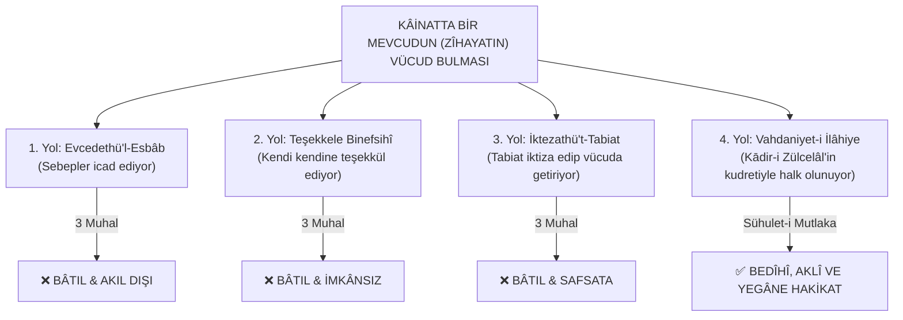

# 🌲 Tabiat ve Esbap Eleştirisi: Tılsımın Küfürle Kırılışı

> **بِسْمِ اللّٰهِ الرَّحْمٰنِ الرَّحٖيمِ**
> 
> *قَالَتْ رُسُلُهُمْ اَفِى اللّٰهِ شَكٌّ فَاطِرِ السَّمٰوَاتِ وَالْاَرْضِ*
> 
> *"Peygamberleri onlara dedi ki: Gökleri ve yeri yoktan var eden Allah hakkında şüphe mi olur?"* (İbrâhîm Sûresi, 10)
> 
> *"Ey insan! Bil ki, insanların ağzından çıkan ve dinsizliği işmam eden dehşetli kelimeler var; ehl-i iman bilmeyerek istimal ediyorlar. Mühimlerinden üç tanesini beyan edeceğiz:*
> * Birincisi: **'Evcedethü'l-esbâb'** yani 'Esbab bu şeyi yapıyor.'
> * İkincisi: **'Teşekkele binefsihî'** yani 'Kendi kendine teşekkül ediyor.'
> * Üçüncüsü: **'İktezathü't-tabiat'** yani 'Tabiat iktiza edip yapıyor.'"*
> — **23. Lem'a (Tabiat Risalesi)**

---

## 1. Varlık Mertebelerinde Dört Mantıksal İhtimal

Risale-i Nur'un en sarsıcı felsefî ve kelâmî metinlerinden biri olan **Tabiat Risalesi (23. Lem'a)**, varlıkların vücuda gelişine dair aklen mümkün olan bütün yolları dörde hasreder:



Eğer ilk üç yolun kat'î burhanlarla akıl dışı ve muhal olduğu ispat edilirse; dördüncü yol olan **Vahdaniyet ve Tevhid Yolu** bizzat ve zaruretle sabit olur.

---

## 2. Üç Çıkmaz Yolun Tahlili ve Muhalleri

### 2.1 Birinci Yol: "Evcedethü'l-Esbâb" (Sebeplerin İcadı)
Bu anlayış, hayatı ve sanatı şuursuz unsurlara (su, toprak, hava, hararet, kimyasal reaksiyonlar) isnat eder.

* **Eczahâne Misali:** Muazzam bir eczahânede binlerce kavanozda zehirli, tesirli, hassas maddeler vardır. Bir fırtına kopsa, kavanozlar devrilse ve dökülen maddeler tesadüfen harika bir hayat şurubu veya tiryak oluştursa; akıl sahibi hiçbir insan bunu rüzgâra veya kavanozlara veremez.
* **Muhal:** Şuursuz, câmid, âciz, kör sebepler bir araya gelerek sonsuz bir ilim, hikmet, şuur ve hayat gerektiren bir sineğin gözünü veya bir insanın hafızasını icad edemez.

### 2.2 İkinci Yol: "Teşekkele Binefsihî" (Kendi Kendine Olma)
Materyalist biyoloji ve tesadüf teorilerinin sığındığı "kendi kendine teşekkül etme" vehmidir.

* **Zerreler Adedince İlâh İddiası:** Bir insanın vücudu yüz trilyon hücreden ve kat be kat zerrelerden teşekkül eder. Eğer bu nizam tek bir Müdebbir'e verilmezse; bedendeki her bir zerreye diğer bütün zerreleri bilecek, görecek, onlarla münasebet kuracak mutlak bir ilim ve her şeye hükmedecek mutlak bir kudret vermek gerekir.
* **Muhal:** Bir tek İlâhı inkâr eden ahmak, zerreler adedince bâtıl ilâhları kabul etmek mecburiyetinde kalır!

### 2.3 Üçüncü Yol: "İktezathü't-Tabiat" (Tabiatın İktizası)
Felsefenin en sofistike aldatmacası: Tabiata yaratıcılık ve fâiliyet vasfı yüklemek.

Bediüzzaman bu noktada ontolojik bir sınır çizer:
> *"Tabiat, bir **san'at-ı İlâhiyedir**, sâni' olamaz.*  
> *Bir **nakş-ı Rahmânîdir**, nâkkāş olamaz.*  
> *Bir **kanundur**, kādir olamaz.*  
> *Bir **mistardır** (cetvel), mimar olamaz.*  
> *Bir **kābildir** (kabul edici), fâil olamaz.*  
> *Bir **nizamdır**, nâzım olamaz.*  
> *Bir **fıtrattır**, fâtır olamaz.*  
> *Bir **kanun-u emrîdir**, haricî bir vücudu ve zâtî kudreti yoktur."* (23. Lem'a)

---

## 3. Sühulet ve Vahdet: Tevhid Yolunun Akılcılığı

Tevhid yolu neden aklen en kolay ve bedihî yoldur?

```text
  ┌───────────────────────────────────────────────────────────┐
  │ EHL-İ KÜFÜR VE TABİATPERESTİN KABUL ETTİĞİ ZORLUK:        │
  │   Her bir zerreye sonsuz ilim, şuur ve kudret vermek.     │
  │   (Milyarlarca muhal ve sonsuz müşkilat)                  │
  ├───────────────────────────────────────────────────────────┤
  │ EHL-İ TEVHİD VE İMANIN KABUL ETTİĞİ HAKİKAT:              │
  │   Bütün zerreleri ve kâinatı tek bir Kadîr-i Zülcelâl'in  │
  │   emir ve iradesine isnat etmek.                          │
  │   (Mutlak suhulet, sonsuz kolaylık: "Kün fe-yekûn")       │
  └───────────────────────────────────────────────────────────┘
```

* Nasıl ki bir kumandanın tek bir emriyle bütün ordu bir nefer gibi kolayca harekete geçer; eğer o kumandan inkâr edilirse ordunun her neferine yüz binlerce vazifeyi kendi başına tanzim etme kudreti verilmelidir.
* Tevhid yolunda bir tek ağacı meyveleriyle halk etmek, bir tek baharı halk etmek kadar kolaydır.
* Küfür yolunda ise bir tek meyvenin icadı, bütün kâinatın icadından daha müşkil ve muhaldir.

---

## 4. Tılsım Açısından Netice

* Ene, kâinata tabiat ve tesadüf nazarıyla baktığında (mânâ-yı ismî), her şeyi zehirli bir karmaşaya çevirir ve kâinat tılsımını karanlık bir zindana dönüştürür.
* Ene, kâinata mânâ-yı harfî ile baktığında, tabiatın yalnızca bir kanun-u İlâhî ve kudretin bir tecelligâhı olduğunu idrak eder; böylece kâinatın tılsımı çözülür ve mevcudat bir bayram coşkusuyla tesbihe başlar.
