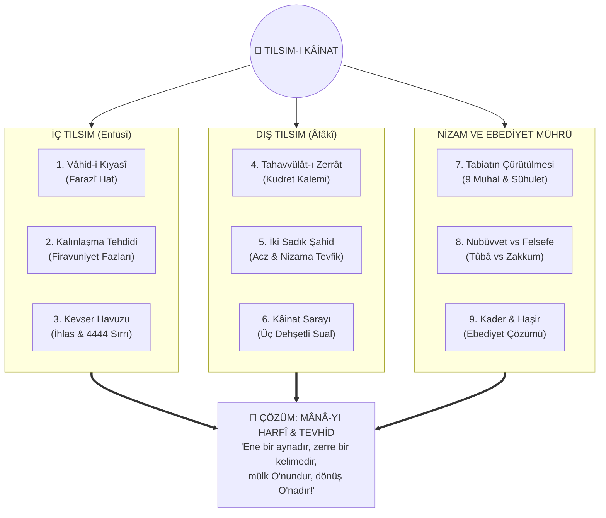

# 🌌 Tılsım-ı Kâinat'ın Büyük Çözümü: Dokuz Cepheden Varoluşun Şifreleri

> **بِسْمِ اللّٰهِ الرَّحْمٰنِ الرَّحٖيمِ**
> 
> *اِنَّا عَرَضْنَا الْاَمَانَةَ عَلَى السَّمٰوَاتِ وَالْاَرْضِ وَالْجِبَالِ فَاَبَيْنَ اَنْ يَحْمِلْنَهَا وَاَشْفَقْنَ مِنْهَا وَحَمَلَهَا الْاِنْسَانُ اِنَّهُ كَانَ ظَلُومًا جَهُولًا*
> 
> *"Ene, künûz-u mahfiye olan esmâ-i İlâhiyenin anahtarı olduğu gibi, kâinatın tılsım-ı muğlâkının dahi anahtarı olarak bir muammâ-yı müşkilküşâdır, bir tılsım-ı hayretfezâdır. O ene, mahiyetinin bilinmesiyle, o garip muammâ, o acip tılsım olan ene açılır ve kâinat tılsımını ve âlem-i vücubun künûzunu dahi açar."*
> — **30. Söz, Mukaddime**

---

## 1. Giriş: Kâinat Neden Bir Tılsımdır?

Kâinata çıplak gözle ve sathi bir akılla bakan insan, akıl almaz bir tezadın ortasında kalır:
* Bir yanda **muazzam bir sanat, baş döndürücü bir intizam, sınırsız bir merhamet ve kusursuz bir güzellik** parıldar;
* Diğer yanda ise **durmaksızın çürüyen cesetler, ölen sevdiklerimiz, zevale yuvarlanan mevcudat, sönen yıldızlar ve kabre doğru akan bir insanlık seli** vardır.

Eğer bu varoluşun gizli sırrı (tılsımı) çözülemezse;
* İlim bir cehalete,
* Merhamet sevdiklerimizin yok oluşunu seyrettiren dehşetli bir işkenceye,
* Akıl insanın başına bela edilmiş zehirli bir hançere,
* Koca kâinat ise dehşetli bir mâtemhâneye inkılap eder.

İşte Bediüzzaman Said Nursî, Risale-i Nur Külliyatı boyunca bu muazzam düğümü **"Tılsım-ı Kâinat"** ve **"Muammâ-yı Hilkat"** olarak adlandırır. Ve bu tılsımın açılması için iki anahtar vaz edilmiştir:
1. **İç Tılsım (Enfüsî Âlem):** İnsanın derûnuna yerleştirilen **"ENE" (Benlik)**.
2. **Dış Tılsım (Âfâkî Âlem):** Maddenin ve evrenin en küçük yapıtaşı olan **"ZERRE" (Atom/Madde)**.

Aşağıda, 9 farklı araştırma cephesinden (9 Ajan Zaviyesi) bu tılsımın adım adım nasıl çözüldüğü bizzat Risale-i Nur'un orijinal metinleri, felsefî tahlilleri ve ontolojik keşifleriyle ortaya konulmaktadır.

---

## 2. Dokuz Cepheden Küllî Tahlil ve Çözüm

---

### 🗝️ Cephe 1: Ene'nin Mahiyeti ve Vâhid-i Kıyasî Sırrı
> *"Fakat vâhid-i kıyasî, bir mevcud-u hakiki olmak lazım değil. Belki, hendesedeki farazî hatlar gibi, farz ve tevehhümle bir vâhid-i kıyasî teşkil edilebilir. İlim ve tahakkukla hakiki vücudu lazım değildir."* (30. Söz, Birinci Maksad)

* **Muamma:** Sonsuz, hudutsuz, zıddı olmayan bir mutlak nur (Allah'ın mutlak ilmi, mutlak kudreti, mutlak rububiyeti) sınırlı bir insan aklı tarafından nasıl idrak edilecektir? Zira zulmetsiz daimî bir ziya hissedilmez ve anlaşılmaz!
* **Çözüm:** Allah insanın eline "farazî ve vehmî bir hat" olan ene'yi vermiştir. İnsan der: *"Ben şu cüz'î haneme mâlik olduğum gibi, Hâlık da koca kâinatın mâlikidir. Ben şu küçük ilmimle şu yazıyı yazdığım gibi, Hâlık da nihayetsiz ilmiyle bu kâinat kitabını yazmıştır."*
* **Büyük Sır:** Ene hakiki bir varlık değildir; geometrideki ekvator çizgisi gibi varsayımsal bir cetveldir. Cetvelin kendisi kumaş değildir; kumaşı ölçtükten sonra cetvel aradan çekilmelidir!

---

### 🌪️ Cephe 2: Ene'nin 5 Fazı ve Sahibini Yutan Firavuniyet
> *"Ene, kendi zâtında hava gibi zayıf bir mahiyeti olduğu halde... mâna-yı ismî cihetiyle baktığı için, güyâ buhar-misâl o ene temeyyü' edip, sonra ülfet cihetiyle tasallûb ediyor. Sonra gaflet ve inkâr ile tecemmüd eder. Sonra isyan ile tekeddür eder, şeffâfiyetini kaybeder. Sonra gittikçe kalınlaşıp sahibini yutar."* (30. Söz)

* **Muamma:** İnsandaki benlik neden firavunlaşır ve nasıl olur da insan kendi nefsine tapar hâle gelir?
* **Çözüm:** Ene'nin fıtratı hava gibi şeffaftır. Fakat kendine malikiyet vehmettiğinde (mânâ-yı ismî nazarı):
  1. **Temeyyü' (Sıvılaşma):** Buhar yoğunlaşır, heva ve hevese meyleder.
  2. **Tasallüb (Katılaşma):** Dünyaya alışkanlık ve maddiyata dalışla sertleşir.
  3. **Tecemmüd (Buzlaşma):** Gaflet ve inkâr ile kaskatı bir buza dönüşür.
  4. **Tekeddür (Bulanma/Kararma):** İsyan ve günahlarla şeffaflığını tamamen yitirir, nur geçirmez bir duvara döner.
  5. **Sahibini Yutma:** Ene o kadar şişer ki, kalbi, aklı ve vicdanı yutar; insan kendi nefsine tapan "bir firavun-u zelîl" olur.

---

### 🌊 Cephe 3: Nahnu, İhlas Matematiği ve Kevser Havuzu
> *"Evet, bahtiyar odur ki, kevser-i Kur’ânîden süzülen tatlı, büyük bir havuzu kazanmak için, bir buz parçası nev’indeki şahsiyetini ve enâniyetini o havuz içine atıp eritendir. Yoksa o buz parçası erir, zayi olur; o havuzdan da istifade edilmez."* (21. Lem'a)

* **Muamma:** Katılaşmış, buz kesmiş benlikten nasıl kurtulunur?
* **Çözüm:** Enaniyet buzunu nefsin gurur güneşi altında çürütmek değil; mü'minlerin ve Kur'an hademelerinin ihlas havuzuna atıp eritmektir.
* **111 ve 4444 Sırrı:** 
  - Üç tane '1' ayrı dursa toplamı 3'tür; omuz omuza gelse **111** kıymeti alır.
  - Dört tane '4' ayrı dursa 16 eder; sırr-ı ihlas ve ittihad ile bir çizgi üstünde omuz omuza verseler **4444** manevî kuvveti kazanırlar.
  - Sırr-ı İhlas ile fert kendini aradan çıkarır; *"Ben değil, biz"* der ve koca cemaatin kuvvetine mazhar olur.

---

### ⚛️ Cephe 4: Tahavvülât-ı Zerrât ve Kudret Kalemi
> *"Tahavvülât-ı zerrât; Nakkāş-ı Ezelî'nin kalem-i kudreti, kitâb-ı kâinâtta yazdığı âyât-ı tekvîniyenin hengâmındaki ihtizâzâtı ve cevelânıdır. Yoksa; maddiyûn ve tabîiyyûnların tevehhüm ettikleri gibi tesâdüf oyuncağı ve karışık, mânâsız bir hareket değildir."* (30. Söz, İkinci Maksad)

* **Muamma:** Maddenin atomları ve zerreleri neden bir an bile durmaksızın döner, çalkalanır ve vazifeden vazifeye koşar?
* **Çözüm:** Kâinat donuk bir heykel değil, her an tazelenen canlı bir kitaptır. 
  - Zerre mebde-i hareketinde **'Bismillâh'** der; çünkü boyundan milyonlarca kat büyük yükleri kaldırır (buğday tanesi kadar çekirdeğin koca çamı sırtlaması gibi).
  - Vazifesinin hitâmında **'Elhamdülillâh'** der; çünkü nar, mısır veya göz gibi ukûlü hayrette bırakan hikmetli bir sanat meyvesi verir.

---

### 👁️ Cephe 5: Zerrenin İki Sadık Şahidi ve Tevfik'in Gözü
> *"Meselâ, Tevfik’in gözbebeğinde yerleşen zerre, gözün âsâb-ı muharrike ve hassâse ve şerâyin ve evride gibi damarlara karşı münasip vaziyet alması... gösteriyor ki, bütün o cismin bütün âzâsını icad eden bir Zât o zerreyi o yerde yerleştirebilir. Yani, zerre kimin ise, gezdiği bütün yerler de onundur."* (30. Söz, İkinci Maksad)

* **Muamma:** Şuursuz bir zerre nasıl olur da insan vücudunun en hassas merkezine kusursuzca yerleşir?
* **Çözüm (İki Sadık Şahit):**
  1. **Vücud Şehadeti (Acz ve Cümûd):** Zerre câmid ve âciz olduğu halde şuurlu işler görerek, kendisini sevk eden Kādir-i Mutlak'ın vücudunu ispat eder.
  2. **Vahdet Şehadeti (Nizam-ı Umumiye Tevfik):** Zerre girdiği her yerde (hava, toprak, kan, dimağ, gözbebeği) yabancılık çekmez; oranın nizamına tam uyar. Demek ki o zerreyi sevk eden Zât, bütün kâinatın ve bedenin tek Mâlikidir.

---

### 🏰 Cephe 6: Kâinat Sarayı ve Üç Dehşetli Sual
> *"Ey insan! Sen hiçlikten gelmedin; Hâlık-ı Hakîm'in memurusun. Vazifen ise O'nun esmâsına âyinedarlık etmektir. Ve ebedî bir saadete, dâr-ı bekāya gidiyorsun."* (11. Söz & 24. Mektup)

* **Muamma:** Aklı başındaki her insanın kalbini kanatan 3 dehşetli sual: **"Necisin? Nereden geliyorsun? Nereye gidiyorsun?"**
* **Çözüm:**
  - Felsefe der ki: *"Tesadüfün oyuncağısın, karanlık maddeden geldin, ebedî yokluğa ve çürümeye gidiyorsun."* Netice: Mutlak cinnet ve dehşet!
  - Kur'an der ki: *"Sultan-ı Ezelî'nin nazenin bir memurusun, O'nun rahmet hazinesinden geldin, kâinat sarayında duygular terazileriyle nimetleri tartıp şükredeceksin ve O'nun ebedî cemâlini müşahedeye gidiyorsun!"*

---

### 🌲 Cephe 7: Tabiat Risalesi ve Dört Bâtıl Yolun 9 Muhalle İptali
> *"Tabiat, bir san'at-ı İlâhiyedir, sâni' olamaz. Bir nakş-ı Rahmânîdir, nâkkāş olamaz. Bir kanundur, kādir olamaz. Bir mistardır, mimar olamaz."* (23. Lem'a)

* **Muamma:** Tabiat kendi kendine yaratabilir mi? Sebepler icad edebilir mi?
* **Çözüm:** Varlıkların ortaya çıkışında aklen 4 ihtimal vardır:
  1. *Evcedethü'l-esbâb (Sebepler yaptı):* Eczahanedeki kavanozların devrilip tesadüfen hayat şurubu yapması kadar muhaldir.
  2. *Teşekkele binefsihî (Kendi kendine oldu):* Bedendeki her bir zerreye sonsuz ilim ve kudret vermek gerekir; bir İlâhı inkâr eden zerreler adedince ilâh kabul etmek zorunda kalır.
  3. *İktezathü't-tabiat (Tabiat iktiza etti):* Kanunu kādir, cetveli mimar, kitabı yazar zannetmektir.
  4. *Tevhid Yolu:* Koca kâinatı yaratmak tek bir Kadîr-i Ezelî için bir tek meyveyi yaratmak kadar kolaydır (**Sühulet-i Mutlaka**).

---

### ⚔️ Cephe 8: Nübüvvet vs. Felsefe ve Medeniyet Çatışması
> *"İnsaniyetin gayetü’l-gayâtı teşebbüh-ü bi’l-Vâcibdir, yani Vâcibü’l-Vücuda benzemektir deyip firavunâne bir hüküm vermişler... Nübüvvet ise, gaye-i insaniyet ve vazife-i beşeriyet... aczini bilip kudret-i İlâhiyeye iltica, zaafını görüp kuvvet-i İlâhiyeye istinad... ubûdiyetkârâne hükmetmişler."* (30. Söz & 12. Söz)

* **Muamma:** Neden felsefe insanı mutsuz ve canavar ederken vahiy saadete ulaştırır?
* **Çözüm:** Felsefe insanı zorla ilâhlaştırmaya (teşebbüh-ü bi'l-Vâcib) çalışır; fakat insan aciz olduğu için menfaatine tapan zelil bir firavun olur. Nübüvvet ise insana sonsuz aczini ve fakrını hissettirir; insan acziyle Kudret-i İlâhiyeye dayanır, fakrıyla Rahmet-i İlâhiyeden medet umar ve kâinatın en aziz sultanı olur.

---

### ⏳ Cephe 9: Kader, İrade ve Haşir: Tılsımın Ebediyet Mütemmimi
> *"Eğer haşrin gelmesi, kaza ve kader-i İlâhî gibi muhakkak olmazsa; kâinatın bütün hakaiki, zîneti, intizamı, adaleti, merhameti zîr ü zeber olur. Ve kâinatın tılsım-ı muğlâkı bir muammâ-yı lâyünhall olarak kalır."* (10. Söz, Haşir Risalesi)

* **Muamma:** Bütün bu intizam, iyilik ve adalet sonunda kabir çukurunda bitecekse kâinat tılsımı neye yarar?
* **Çözüm:** 
  - **Kader:** İnsanın iyiliklerle gururlanmasını önler (*"Fahr etme, yapan sen değilsin, Kadere şükret"*).
  - **İrade:** İnsanın kötülüklerde mesuliyetten kaçmasını önler (*"Mes'ulsün, meyli sen sarf ettin"*).
  - **Haşir ve Ebediyet:** Kâinat tılsımının son kilit taşıdır. Eğer âhiret olmazsa, zalim izzetinde mazlum zilletinde kalır, adalet zulme, merhamet işkenceye döner. Haşir geldiğinde ise her zerre ebedî meyvesini verir ve tılsım sonsuz saadetle çözülür.

---

## 3. Tılsım-ı Kâinat'ın Büyük Formülü

Bütün bu 9 cephenin vardığı tek ve mutlak hakikat şudur:

$$\boxed{\text{Tılsım-ı Kâinat} = \text{Mânâ-yı Harfî} \times (\text{Ene'nin Acz Aynadarlığı}) \times (\text{Zerrenin Kudret Yazısı Oluşu}) \times \text{Haşr-i Ebedî}}$$

1. **Ene:** Kendine mâlik olmadığını, Cenâb-ı Hakk'ın kemâlâtını tanımak için bir cetvel (vâhid-i kıyasî) olduğunu bilirse kurtulur.
2. **Zerre:** Kör tesadüfün oyuncağı değil, Ezelî Kalem'in tekvînî harfi olduğunu bilirse nurlanır.
3. **İnsan:** "Ben" buzunu "Biz" havuzunda eritirse 4444 kuvvetini bulur.
4. **Varlık:** Tabiat ve sebeplerin sahte rablığını kırıp Vâhid-i Ehad'e teslim olursa kâinat baştan başa bir cennet bahçesine döner.
