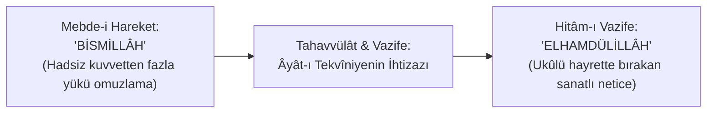
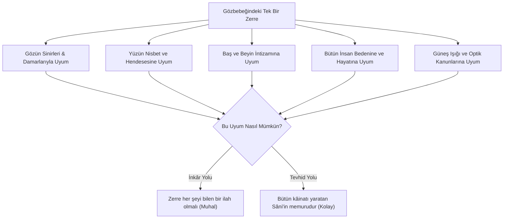

# ⚛️ 1. Tahavvülât-ı Zerrât: Hareketin Hikmetleri ve Kudret Kalemi

> *"Tahavvülât-ı zerrât; Nakkāş-ı Ezelî'nin **kalem-i kudreti**, kitâb-ı kâinâtta yazdığı **âyât-ı tekvîniyenin** hengâmındaki ihtizâzâtı ve cevelânıdır. Yoksa; maddiyûn ve tabîiyyûnların tevehhüm ettikleri gibi tesâdüf oyuncağı ve karışık, mânâsız bir hareket değildir.*
> 
> *Çünkü bütün mevcûdât gibi zerreler ve herbir zerre **mebde-i hareketinde 'Bismillâh' der**. Çünkü nihâyetsiz kuvvetinden fazla yükleri kaldırır ve buğday tanesi kadar bir çekirdeğin koca bir çam ağacı gibi bir yükü omzuna alması gibi…*
> 
> *Hem vazifesinin hitâmında **'Elhamdülillâh' der**. Çünkü bütün ukûlü hayrette bırakan hikmetli bir cemâl-i sanat, faydalı bir hüsn-ü nakş göstererek Sâni'-i Zülcelâl'in medâyihine bir kaside-i methiye gibi bir eser gösterir; meselâ: Nar ve mısıra dikkat et."*
> — **30. Söz, İkinci Maksad (Mukaddime)**

---

## 1.1 Dış Tılsım: Zerre Neden Durmaksızın Döner?

Eğer insanın ruh dünyasındaki muamma ve iç tılsım **"Ene"** ise; afaktaki, yani maddi kâinattaki kilitli sandık ve dış tılsım **"Zerre (Madde/Atom)"** dir.

Materyalist felsefe (maddiyun ve tabiiyyun), zerrelerin bu hummalı hareketini kör bir tesadüf, şuursuz bir termodinamik çalkantı zanneder. Oysa Risale-i Nur nazarıyla bakıldığında kâinat bir kitaptır; zerreler ise o kitabın mürekkep damlaları ve harfleridir. Kudret kalemi her an yeni âyetler yazdığı için, zerreler de bu yazılışın vecdiyle titremekte ve dönmektedir.

---

## 1.2 Hikmet-i Kur'âniye Nazarında Zerrelerin Tahavvül Gayeleri

Otuzuncu Söz'ün İkinci Maksadı'nın Birinci Noktası'nın İkinci Mebhasında, Kur'an hikmetine göre zerrelerin hareketindeki üç küllî hikmet şöyle beyan edilir:

### 1. Tecelliyât-ı İcâdiyeyi Tecdid ve Tazelendirmek
Cenâb-ı Vâcibü'l-Vücud'un yaratmadaki tecellileri donuk ve durağan değildir; dâimî bir feyiz ve tazelenme içindedir. 
* Her bir ruhu model ittihaz ederek her sene taze bir ceset giydirmek,
* Bir tek kitaptan hikmetle binler muhtelif kitap istinsah etmek (çoğaltmak),
* Bir tek hakikati başka başka suretlerde göstermek için zerreler durmaksızın vazifeden vazifeye koşturulur.

### 2. Sınırlı Zeminde Hadsiz Esmâ Nakışlarını Göstermek
Yeryüzü ve madde sınırlıdır; fakat Cenâb-ı Hakk'ın isimleri ve cemâlî nakışları nihayetsizdir. 
Küçük ve mahdut bir tuval üzerinde sonsuz resimleri sergileyebilmenin yegâne hikmetli yolu, zerreleri akıcı bir nehir gibi hareket ettirmektir. Böylece her an bir resim silinir, yerine daha harika bir nakış yazılır.

### 3. Zerreleri ve Unsurları Kemâlât Mertebelerine Koşturmak
Toprakta veya havada âdi, câmid ve şuursuz bir halde bulunan bir zerre; bitkiye girer, oradan hayvana, oradan insana geçer. İnsanın dimağında veya gözbebeğinde vazife alarak hayat, şuur ve tesbih mertebelerine mazhar olur. 
Böylece zerre kendi kabiliyetine göre bir kemâl mertebesi kazanır; Allah'ın *Hâkim, Âlim, Rezzâk, Şâfî* gibi bin bir isminin nakışlarını üzerinde teşhir eder.

---

## 1.3 Tevfik'in Gözbebeğindeki Zerre Misali (Üçüncü Nokta)

Otuzuncu Söz'ün en meşhur delillerinden biri, bir zerrenin insan gözbebeğindeki konumlanışıdır:

> *"Meselâ, Tevfik’in gözbebeğinde yerleşen zerre, gözün âsâb-ı muharrike ve hassâse ve şerâyin ve evride gibi damarlara karşı münasip vaziyet alması; ve yüzde ve sonra başta ve gövdede, daha sonra heyet-i mecmua-i insaniyede herbirisine karşı birer nisbeti, birer vazifesi, birer faydası kemâl-i hikmetle bulunması gösteriyor ki, **bütün o cismin bütün âzâsını icad eden bir Zât o zerreyi o yerde yerleştirebilir**.*
> 
> *Her bir zerre, eğer memur-u İlâhî olmazsa ve Onun izni ve tasarrufuyla hareket etmezse ve ilim ve kudretiyle tahavvül etmezse, o vakit **herbir zerrenin nihayetsiz bir ilmi, hadsiz bir kudreti, herşeyi görür bir gözü, herşeye bakar bir yüzü, herşeye geçer bir sözü bulunmak lâzım gelir**."*

---

## 1.4 Tabiat Risalesi'ndeki Sühulet ve Suubet Kanunu (23. Lem'a)

Bediüzzaman'ın sisteminde zerrelerin hareketi konusunda iki yol vardır:

> *“Eşyanın icadı bir tek zâta verilse, bütün eşya bir tek şey gibi kolay olur ve sühulet peyda eder. Eğer müteaddid esbaba verilse ve kesrete isnad edilse, bir tek şeyin icadı; bütün eşyanın icadı kadar müşkilâtlı olur ve imtina‘ derecesinde suubet peyda eder.”*
> — **23. Lem'a (Tabiat Risalesi)**

* **Tevhid Yolu:** Nasıl ki bir kumandan, bir tek neferi bir emirle sevk ettiği gibi, koca bir orduyu da aynı tek kelimeyle harekete geçirir. Tek bir Sâni'e isnad edildiğinde, hadsiz zerreler aynı ilahî kanunun tecellisiyle suhûletle iş görür.
* **Şirk Yolu:** Eğer zerrelerin hareketi sebeplere ve zerrelere verilse; gözbebeğindeki zerrenin vazife görebilmesi için beyinle, kalp ile, kan dolaşımıyla ve hatta güneş ışığıyla oturup anlaşması, protokol imzalaması gerekir! Cansız ve kör zerrenin bunu yapabilmesi için her zerrenin bir ilah olması lazımdır.

---

## 1.5 Madde Hareketinin Modern İzdüşümü

Bugün kuantum fiziğinin gösterdiği dalga-parçacık ikiliği, sıfır noktası enerjisi ve atom altı parçacıkların sürekli varoluşsal titreşimi; Risale-i Nur'un *“Kudret kaleminin tekvînî âyetleri yazarkenki ihtizazatı”* tasviriyle muazzam bir tefekkür köprüsü kurar. Parçacıklar durağan "katı misketler" değil; ilahî iradenin tecellilerine ayna olan dinamik süreçlerdir.

---

⬅️ [Zerre Dinamikleri Giriş](README.md) · ➡️ [2. Zerrenin İki Şahidi: Acz ve Cümûd](02-zerrenin-iki-sahidi.md)
