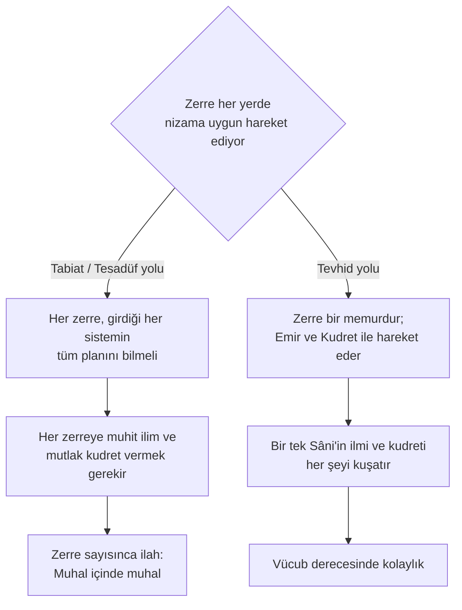

# 1. Tahavvülât-ı Zerrât: Hareketin Hikmetleri

> Kâinattaki zerreler hiç durmadan hareket eder; bir cisimden çıkar, diğerine girer; bir vazifeyi
> bitirir, öbürüne başlar. Bu hareket, bir **kalemin yazısı** gibidir.

---

## 1.1 Temel Soru

Bir zerre, bugün bir gülün yaprağında, yarın bir arının kanadında, öbür gün bir insanın gözünde
bulunabilir. Her yerde **o yerin bütün nizamına uygun** davranır. Bu nasıl mümkündür?

İki cevap vardır:

## 1.2 Kolaylık ve Zorluk Argümanı (Sühulet Delili)

Risale-i Nur'un pek çok yerinde (bilhassa *Lem'alar*, 23. Lem'a – Tabiat Risalesi) tekrar edilen bir
akıl yürütme:

> Eşya bir tek Zât'a verilse, bütün eşya bir tek şey kadar kolay olur. Eğer sebeplere ve tabiata
> verilse, bir tek şey bütün eşya kadar zor olur.

| | Tek Sâni'e İsnad | Sebeplere/Zerrelere İsnad |
|---|---|---|
| **Gereken ilim** | Bir tek muhit ilim | Her zerrede muhit ilim |
| **Gereken kudret** | Bir tek mutlak kudret | Sayısız müstakil kudret |
| **Koordinasyon** | Doğal (tek irade) | İmkânsız (sayısız irade çatışması) |
| **Netice** | Vücub derecesinde kolay | İmtina derecesinde zor |

## 1.3 Hareketin Hikmetleri

Zerrelerin durmadan hareketinin bazı hikmetleri (kavramsal özet):

1. **Esmânın Tecellisi İçin Teceddüd:** Her an yenilenen mevcudat, Hallâk, Musavvir, Muhyî gibi
   isimlerin daimî tecellisine ayna olur. Durgun bir kâinat, bu isimlerin cilvelerini göstermezdi.
2. **Hayatın Tazelenmesi:** Zerreler bir bedene girip çıkarak hayatı tazeler, israf olmadan bir
   "malzeme döngüsü" kurar.
3. **Kader Kaleminin Yazısı:** Zerrelerin hareketi, levh-i mahfuzdaki ilmin mürekkebi gibidir;
   kâinat sayfasında *kelimat-ı İlahiye* yazılır.
4. **Âlemlerin Bağlanması:** Aynı zerrenin farklı sistemlerde dolaşması, kâinatın parçalarını
   birbirine bağlar ve bir **vahdet** gösterir.

## 1.4 Modern Fizikle Diyalog

| Gözlem | Esbabperest Okuma | Harfî Okuma |
|--------|-------------------|-------------|
| Atomların sürekli titreşimi | "Termal enerjinin sonucu." | Kudretin her an yeniden icadı (teceddüd-ü emsal). |
| Madde döngüleri (karbon, su) | "Kapalı sistem dengesi." | Hikmetli bir idare ve israfsızlık. |
| Fizik yasalarının evrenselliği | "Doğanın kendi düzeni." | Bir tek iradenin her yerde aynı emri. |
| Kuantum belirsizliği | "Rastlantı temel seviyede." | Sebeplerin perde oluşu; fâil-i hakikînin görünmezliği. |

> [!NOTE]
> Bu tablo, bilimsel bulguları *reddetmek* için değil, aynı bulguların **iki farklı nazarla**
> okunabileceğini göstermek için hazırlanmıştır. Fizik "nasıl"ı açıklar; mana-yı harfî "kim adına"yı sorar.

## 1.5 Mini Model: Kaç İlah Gerekirdi?

Basit bir düşünce deneyi: Bir sistemde `n` zerre varsa ve her zerre diğer bütün zerrelerin konumunu
"bilmek" zorundaysa, gereken bilgi ilişki sayısı `n·(n−1)` olur.

| Sistem | Yaklaşık zerre sayısı | Gereken ilişki bilgisi |
|--------|----------------------|------------------------|
| Bir hücre | ~10¹⁴ atom | ~10²⁸ |
| Bir insan bedeni | ~10²⁷ atom | ~10⁵⁴ |
| Gözlemlenebilir evren | ~10⁸⁰ atom | ~10¹⁶⁰ |

Tevhid yolunda ise gereken: **bir** muhit ilim.

---

⬅️ [Zerre Dinamikleri](README.md) · ➡️ [2. Zerrenin İki Şahidi](02-zerrenin-iki-sahidi.md)
