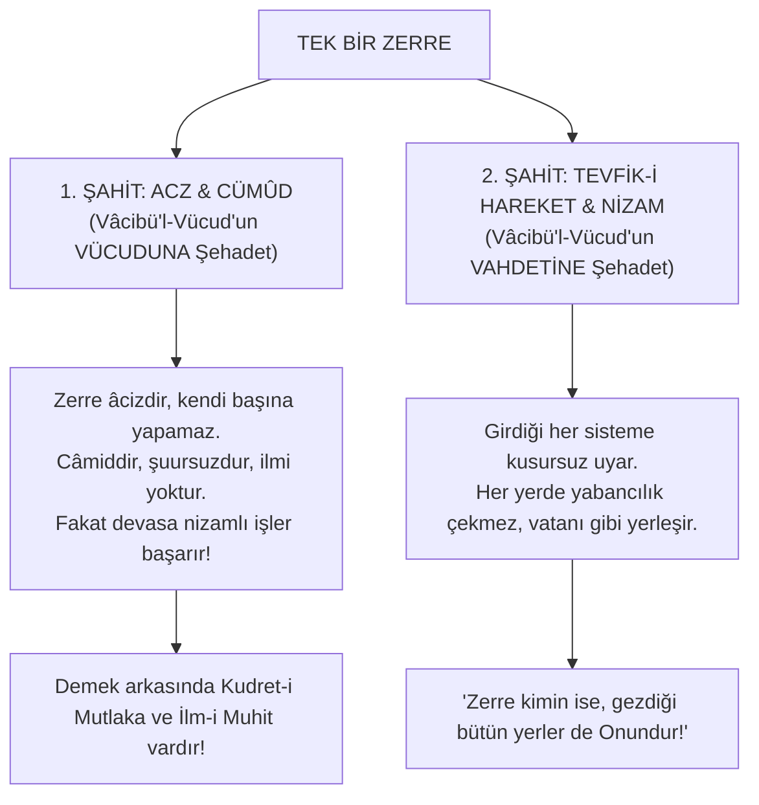

# ⚖️ 2. Zerrenin İki Şahidi: Acz ve Cümûd

> *"Herbir zerrede, Vâcibü’l-Vücudun vücuduna ve vahdetine iki şahid-i sadık vardır.*
> 
> *Evet, zerre, **acz ve cümuduyla beraber**, şuurkârâne büyük vazifeleri yapmakla, büyük yükleri kaldırmakla **Vâcibü’l-Vücudun vücuduna kat’î şehadet ettiği gibi**;*
> 
> *harekâtında nizamat-ı umumiyeye tevfik-i hareket edip, her girdiği yerde ona mahsus nizamatı müraat etmekle, her yerde kendi vatanı gibi yerleşmesiyle **Vâcibü’l-Vücudun vahdetine ve mülk ve melekûtun mâliki olan Zâtın ehadiyetine şehadet eder**.*
> 
> ***Yani, zerre kimin ise, gezdiği bütün yerler de onundur.***"*
> — **30. Söz, İkinci Maksad (İkinci Nokta)**

---

## 2.1 İki Şahid-i Sadık'ın Anatomisi

Otuzuncu Söz'ün İkinci Noktası, kâinatın en küçük parçası olan bir atomun veya zerrenin, Yaratıcısını nasıl iki sarsılmaz delille ispat ettiğini vazeder:

---

## 2.2 Birinci Şahit: Vücud-u İlâhîye Şehadet (Acz ve Cümûd)

* **Acz (Güçsüzlük):** Bir zerre kendi başına bir gram ağırlığı kaldıramaz. Fakat o zerre, bir araya geldiğinde tonlarca ağırlığındaki bir çam ağacının veya devasa bir organizmanın mimarisini omuzlar.
* **Cümûd (Cansızlık ve Şuursuzluk):** Bir zerre ne biyoloji bilir, ne tıp tahsil etmiştir, ne de kimya kanunlarından haberdardır. Gözü, beyni, hafızası, şuuru yoktur.

Âciz ve câmid bir şeyden, nihayetsiz derecede şuurlu, hikmetli ve sanatlı neticelerin çıkması aklen tek bir şeyi haykırır: 
**Bu işi yapan zerre değildir; zerre, mutlak ilim ve kudret sahibi bir Fâil-i Zülcelâl'in elinde itaatkâr bir memurdur.**

---

## 2.3 İkinci Şahit: Vahdet ve Ehadiyete Şehadet (Umumî Nizama Tevfik)

Bir zerrenin sadece bir ustası olduğunu bilmek yetmez; o Usta'nın **bütün kâinatın tek sahibi (Vâhid)** olduğunu nereden biliyoruz?

İkinci şahit tam bu noktada devreye girer:
> *"Her girdiği yerde ona mahsus nizamatı müraat etmekle, her yerde kendi vatanı gibi yerleşmesiyle Vâcibü’l-Vücudun vahdetine ve mülk ve melekûtun mâliki olan Zâtın ehadiyetine şehadet eder. **Yani, zerre kimin ise, gezdiği bütün yerler de onundur.**"*

Bir yabancı ülkeye gittiğinizde oranın dilini, gümrük kanunlarını, trafik kurallarını bilmezseniz derhal sistemin dışına itilirsiniz. 
Fakat bir oksijen zerresi veya bir karbon atomu:
* Toprağa girer, toprağın nizamına uyar.
* Suya girer, hidrojenle harika bir bağ kurar.
* Bitkiye girer, fotosentezin çarkı olur.
* İnsanın kanına girer, alyuvarların sırtında kalbe ve beyne gider; hiçbir hücre ona "sen yabancısın" demez.

Demek ki zerreyi tanzim eden Kudret ile, zerrenin seyahat ettiği toprağı, suyu, bitkiyi ve insan bedenini tanzim eden Kudret **aynı tek Zât'tır**. Parça kimin ise, bütün de Onundur!

---

## 2.4 Ene ve Zerre: İki Âlemin Simetrik Aynası

| Mukayese Noktası | Ene (Enfüsî Tılsım - İnsan İçi) | Zerre (Âfâkî Tılsım - Kâinat Dışı) |
|:---|:---|:---|
| **Zâtî Hüviyeti** | Hava gibi zayıf, farazî bir hat | Âciz ve câmid bir nokta |
| **Vazifesi** | İlahî sıfatları tartacak bir vâhid-i kıyasî | Kudret kaleminin yazdığı tekvînî âyet |
| **Sapkınlık Şekli** | Kendine mâlikiyet vehmetmek (Firavunluk) | Sebepleri ve tabiatı fâil zannetmek (Şirk) |
| **Hakiki Hâli** | Kulluk ve acz ile Kudret'e ayna olmak | Memuriyet ile umumî nizama itaat etmek |
| **Lisan-ı Hali** | *"Ben bir kulum, mülk O'nundur"* | Mebdede *"Bismillah"*, nihayette *"Elhamdülillah"* |

İnsanın içindeki "Ene" aczini anlayıp ubudiyete erdiğinde, kâinattaki "Zerre"nin aczini ve memuriyetini de keşfeder. Böylece iki tılsım birden açılır ve kâinat baştan başa bir tevhid kasidesine dönüşür.

---

⬅️ [1. Tahavvülât-ı Zerrât](01-tahavvulat-i-zerrat.md) · 🏠 [Ana Sayfa](../../README.md)
