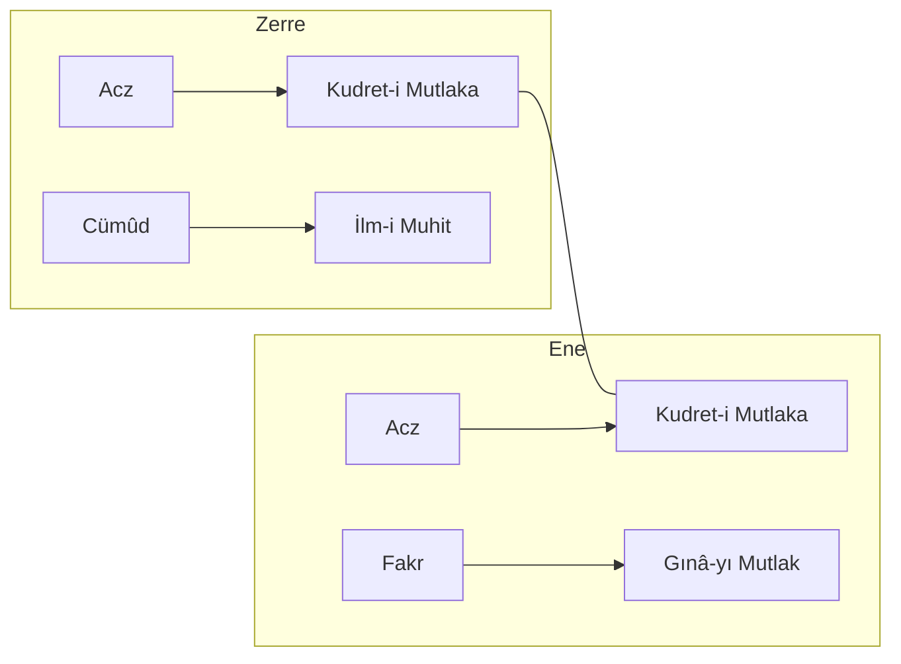

# 2. Zerrenin İki Şahidi: Acz ve Cümûd

> Her bir zerre, Sâni'inin vücuduna ve vahdetine **iki şahid-i sâdık** taşır.

---

## 2.1 İki Şahid

| Şahid | Anlamı | Delalet Ettiği |
|-------|--------|----------------|
| **Acz** (güçsüzlük) | Zerre kendi başına hiçbir şey yapamaz. | Ondan sâdır olan büyük işler, bir **Kudret-i Mutlaka**'ya aittir. |
| **Cümûd** (cansızlık, şuursuzluk) | Zerre bilmez, görmez, düşünmez. | Hareketlerindeki hikmet ve nizam, bir **İlm-i Muhit**'e aittir. |

Âciz ve câmid bir zerrenin, kâinatın umumî nizamına uygun, şuurlu ve hikmetli işler yapması;
*bir başkası adına* hareket ettiğinin en açık delilidir.

## 2.2 Ene ile Paralellik

Ene'nin de iki benzer şahidi vardır:

Zerre **şuursuz** şahittir; insan ise **şuurlu** bir şahit olabilir. Fark buradadır: Zerre şahitliğini
cebren yapar; insan ise ene'si ile ya bu şahitliği **ikrar** eder ya da **inkâr** eder.

## 2.3 Zerre ve Ene Arasındaki Hiyerarşi

| Seviye | Varlık | Şahitlik Türü |
|--------|--------|---------------|
| 1 | Zerre | Lisan-ı hâl (hâliyle), şuursuz |
| 2 | Bitki ve hayvan | Lisan-ı hâl + fıtrî ibadet (tesbih) |
| 3 | İnsan | Lisan-ı kāl (sözle) + şuurlu ikrar + **ene ile ölçme** |

İnsan, kâinattaki bütün tesbihleri **anlayan ve tercüme eden** bir varlık olarak, zerreden yıldıza
kadar her şeyin şahitliğini toplar ve şuurla takdim eder. Bu, emanet-i kübranın bir diğer vechidir.

## 2.4 Tefekkür Egzersizi

1. Elinizdeki bir bardak suya bakın. İçindeki her H₂O molekülü, daha önce nerelerde bulunmuş olabilir?
2. O molekül, bu yolculuklarının hiçbirini "bilmiyor". Peki her durakta doğru davranışı nasıl gösterdi?
3. Şimdi aynı soruyu kendi bedeninizdeki atomlar için sorun.

---

⬅️ [1. Tahavvülât-ı Zerrât](01-tahavvulat-i-zerrat.md) · 🏠 [Ana Sayfa](../../README.md)
